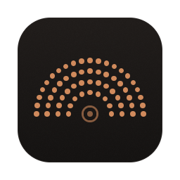
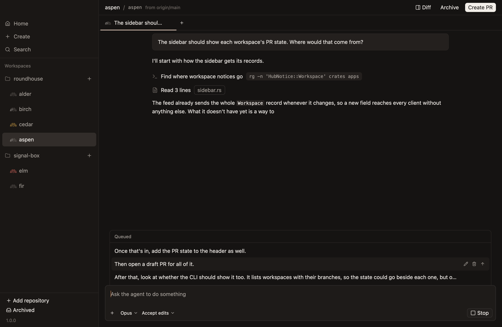
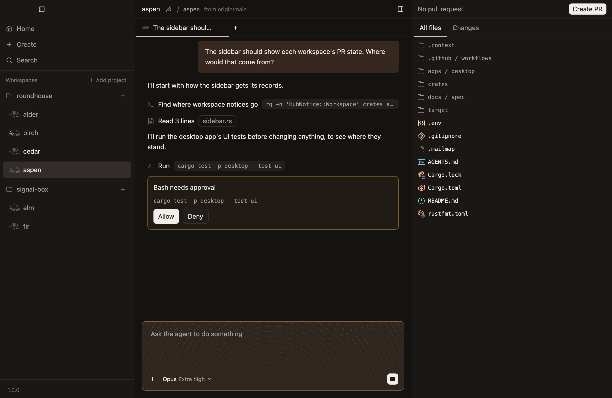

<p align="center">
  
</p>

<h1 align="center">Roundhouse</h1>

<p align="center">
  <b>Running many agents should feel calm.</b><br>
  A native Mac app that gives each coding agent a workspace of its own, so you can hand work over and know where it stands.
</p>

<p align="center">
  <a href="https://f001.backblazeb2.com/file/getroundhouse-releases/Roundhouse-osx-Portable.zip"><b>Download for Mac</b></a>
  &nbsp;·&nbsp; <a href="#where-it-stands">Windows and Linux previews</a>
  &nbsp;·&nbsp; <a href="https://getroundhouse.dev">Website</a>
  &nbsp;·&nbsp; <a href="#get-started">Get started</a>
  &nbsp;·&nbsp; <a href="docs/guide/README.md">Guide</a>
  &nbsp;·&nbsp; <a href="docs/spec/README.md">Spec</a>
  &nbsp;·&nbsp; <a href="docs/architecture.md">Architecture</a>
</p>


Give each task a workspace: a git worktree, a branch and chats of its own, with an agent at work in it. Roundhouse shows which agents are working, which have finished and which are waiting on you, and takes each one's work from the first prompt to a merged pull request. The workspace is the unit of delegation, and the branch and pull request are the unit of integration.

**It's early.** It runs on a Mac with Apple silicon, with first previews for Windows and Linux, and its agent is Claude, through the Claude CLI you already have. Other agents, a hub on your own server or in the cloud, and an iPhone app are designed for and not built. [Where it stands](#where-it-stands) has the rest.

Roundhouse is a working name, after the round building where a railway services its locomotives, each in its own stall around one turntable. Rail is the theme for naming, and the mark beside every workspace is a roundhouse seen from above.

## Why this exists

Running several agents at once works best when each one has its own workspace, and when the small day-to-day details are right. Conductor showed how good that can feel, and it's a big inspiration here. It no longer takes new users, and the alternatives tried don't fill the gap:

- None of the dozen options tried has quite the same mental model.
- None has all the small day-to-day features.
- Cloud and mobile are required, and existing options fall short there.

A web client isn't a target, since nothing depends on one, but nothing rules one out.

## What it does

- **One task, one workspace.** A worktree, a branch, ten ports and chats of its own, so agents never share files. You describe the task as you create the workspace, and the agent starts on it at once. A prompt sent while the workspace is setting up waits, then sends.
- **Quiet until it needs you.** Every workspace has a mark: a light while its agent works, red when it stopped short, and its pull request's colour. A name turns bright when there's a reply you haven't read, or an agent is waiting on you. Nothing else moves.
- **From the prompt to the merge.** Read the diff beside the chat, comment on a changed line, and send the comments to the agent. A bar above the changes says the first thing in the way of merging the pull request, and offers the one thing to do about it, such as Push, Fix checks, Resolve or Merge. Every row in the sidebar shows where its pull request stands.
- **Hand over the work.** Agents have full access, so one doesn't stall on a question while you're with another. When you'd rather see the route first, plan mode has an agent work out a plan, and ask before it changes anything. A question from an agent takes the composer's place until it's answered.
- **Steer or queue.** `Enter` while the agent works sends a prompt it reads at its next chance. `Cmd-Enter` queues one for when it finishes. Stopping the agent holds the queue until you say go.
- **Agents outlive the app.** A hub, in a process of its own, owns every workspace and chat and runs the agents. Quit the app and they keep working, and queued prompts still send. An update restarts the hub at once, and running agents carry on, on the version they started with. On Windows an update still waits for them, since agents there stop with the hub.
- **Your agent, your login.** It runs the Claude CLI on your Mac, with your login and settings. There's no Roundhouse account, and nothing is sent to us: the app's only request of its own is its check for updates.
- **See what's left.** A ring beside Send shows how full the agent's context is, and bars beside it show what's left of your plan's limits.
- **The small things.** Titles come from a small model, so they cost your agent no context. Archiving keeps the branch, and refuses to throw away uncommitted work. The Mac stays awake while agents work, and can sleep once they're only waiting on you.
- **Native.** Rust throughout: the app, the hub and the command line. The app is drawn on the GPU with [GPUI](https://www.gpui.rs), the toolkit Zed is built on, and has no web view.
- **At home in a repository set up for Conductor.** It reads `.conductor/settings.toml`, runs its setup and archive scripts, and sets the `CONDUCTOR_*` variables, so such a repository works unchanged.

<table>
  <tr>
    <td width="50%"></td>
    <td width="50%"></td>
  </tr>
  <tr>
    <td align="center">Prompts queued for when the agent finishes</td>
    <td align="center">An agent in plan mode, asking first</td>
  </tr>
</table>

How to use it is in the [guide](docs/guide/README.md), a page for each task. What the app does, and why, is written down rule by rule in [`docs/spec/`](docs/spec/README.md), beside a picture of every screen.

## Get started

You need:

- A Mac with Apple silicon.
- Git, and a repository to work in.
- The Claude CLI, `claude`, installed and logged in.
- GitHub's CLI, `gh`, logged in, for pull requests. Everything else works without it.

Then:

1. [Download Roundhouse](https://f001.backblazeb2.com/file/getroundhouse-releases/Roundhouse-osx-Portable.zip), unzip it, and move it to Applications. It's signed and notarized, and it updates itself as changes land on `main`.
2. Click `Add project` at the top of the sidebar, and choose a repository.
3. Click the `+` beside the project, or press `Cmd-N`, say what to work on, and press Return.
4. To review the changes, click a file in the sidebar on the right. To comment, hover a changed line and click its add button.
5. `Cmd-Shift-P` asks the agent for a pull request. From then on, the top of that sidebar says where it stands, and offers the next thing to do about it.

> [!WARNING]
> Every agent has full access. It runs commands and changes files as you, without asking, and a worktree is a directory, not a sandbox. In plan mode, which `Shift-Tab` turns on and off, it asks before changing anything.

Roundhouse keeps its data in `~/Library/Application Support/roundhouse`, and puts worktrees in `~/roundhouse/workspaces`. The model, and how hard it thinks, are below the composer.

| Key | Action |
|---|---|
| `Cmd-N` | New workspace |
| `Cmd-[`, `Cmd-]` | Move between workspaces |
| `Cmd-T` | New chat |
| `Cmd-W` | Close a chat, or the file tab |
| `Ctrl-Tab` | Move between chats |
| `Cmd-F` | Find in the chat |
| `Cmd-Shift-D` | Show or hide the diff |
| `Cmd-Shift-P` | Ask the agent for a PR |
| `Cmd-Enter` | Queue a prompt for when the agent finishes |
| `Cmd-Shift-A` | Archive the workspace |
| `Cmd-Shift-U` | Mark the workspace read, or unread again |
| `Cmd-.` | Stop the agent's turn |
| `Shift-Tab` | Turn plan mode on or off, in the composer and the new-workspace dialog |
| `Cmd-,` | Open Settings |

### From a terminal

The `roundhouse` command-line client is inside the app, and talks to the same hub, so a workspace made in one shows in the other.

```sh
alias roundhouse=/Applications/Roundhouse.app/Contents/MacOS/roundhouse
roundhouse --help
```

## Where it stands

| | |
|---|---|
| **Mac** | Built, for Apple silicon. |
| **Agents** | Claude, through the Claude CLI. Others are not built. |
| **Hub** | Runs on your Mac. One on your own server or in the cloud, with workspaces in VMs or sandboxes, is designed for and not built. |
| **iPhone** | Not built. `mobile-poc/` is a proof of concept. |
| **Windows** | A first preview. An installer is published from every merge, for [amd64](https://f001.backblazeb2.com/file/getroundhouse-releases/Roundhouse-win-amd64-Setup.exe) and [ARM64](https://f001.backblazeb2.com/file/getroundhouse-releases/Roundhouse-win-arm64-Setup.exe). It's unsigned, so Windows warns about it, and the only checks that run on Windows are a lint and a hub starting and stopping. |
| **Linux** | A first preview. An AppImage is published from every merge, for [amd64](https://f001.backblazeb2.com/file/getroundhouse-releases/Roundhouse-linux-amd64.AppImage) and [ARM64](https://f001.backblazeb2.com/file/getroundhouse-releases/Roundhouse-linux-arm64.AppImage). Make it executable and open it, and it updates itself. It needs glibc 2.35 or newer, as on Ubuntu 22.04 and later, Vulkan and FUSE. The only checks that run on Linux are the tests and a hub starting and stopping, and the keys and menus are the Mac's. |

What's left is on GitHub: [issues](https://github.com/getroundhouse/roundhouse/issues) for features, bugs, tasks, questions and risks, and [milestones](https://github.com/getroundhouse/roundhouse/milestones) for the build order.

## How it fits together

```
 Desktop app      CLI      iPhone app (not built)
      └────────────┼────────────┘
                   │
                  Hub       Owns workspaces, chats and their logs, in SQLite
                   │
                Workers     One per workspace: git, the worktree, scripts and diffs
                   │
                Agents      Your own Claude CLI
```

- **A hub owns the state.** Clients only talk to hubs, and only draw what a hub has recorded, so every client shows the same thing, and agents carry on with none open.
- **A worker does the work,** in a process of its own, one per workspace.
- **A provider gives a hub somewhere to run workers.** This Mac is one, and no provider is special, so a workspace in a VM or a cloud sandbox changes where its worker runs and nothing else.

[`docs/architecture.md`](docs/architecture.md) has the whole design, with what isn't built marked, and [`docs/ui.md`](docs/ui.md) says why the app is on GPUI.

## Working on Roundhouse

It needs Rust, through [rustup](https://rustup.rs), which installs the version `rust-toolchain.toml` pins, and [Zig](https://ziglang.org/download/) 0.17 on the PATH, which builds Ghostty's terminal core. On a Mac, `brew install zig` has it.

```sh
cargo run -p desktop --bin roundhouse-desktop -- --note "What to try"   # The app, with your changes
cargo test                 # The backend, with a fake agent. Runs on Linux too
cargo test --workspace     # Also the transcript and the desktop app's UI tests
```

A build from a checkout has a hub and data of its own, in `.context/dev`, and can't reach the installed app's. So Roundhouse can be worked on from inside Roundhouse, which is how it's built: most of its code is written by agents, each in a workspace here.

- [`AGENTS.md`](AGENTS.md) has every command, and the rules for working here, for people as much as for agents.
- [`docs/documentation.md`](docs/documentation.md) lists the docs, and says what goes in a doc and what goes on GitHub.
- [`docs/spec/`](docs/spec/README.md) is what the product does. The app draws every screen in it from made-up data, and a test fails when one no longer matches its picture.

### Installing a build of your own

`tools/install.sh` installs the current commit outside `target/`, as a version of its own, and says how to start it. `tools/install.sh --list` shows the versions, and `--use VERSION` goes back to one.

An older version can't open a database that a newer one has migrated, so before migrating, the hub saves a copy in `backups/` in its data directory, named for the schema version it holds. To go back past a migration:

1. Quit the app, which otherwise starts a new hub as soon as this one stops, then run `roundhouse hub stop`.
2. Run `tools/install.sh --use VERSION` with the version from before the update, or the next hub migrates the copy again.
3. In the data directory, delete `hub.db-wal` and `hub.db-shm`, then copy the newest backup over `hub.db`, keeping the backup.

Anything recorded since the copy is lost.

## Contributing

Issues are welcome: a bug, with the build shown at the bottom of the sidebar, or something that's missing. Before a pull request that's more than a small fix, open an issue, since what the product does and how it looks are settled there first, as [`docs/documentation.md`](docs/documentation.md) says. [`docs/pull-requests.md`](docs/pull-requests.md) says how a pull request is written.

## License

Apache-2.0, in [`LICENSE`](LICENSE), so anyone can use, change and build on it. It's the license GPUI uses, and it has each contributor grant the patents their contribution uses.
