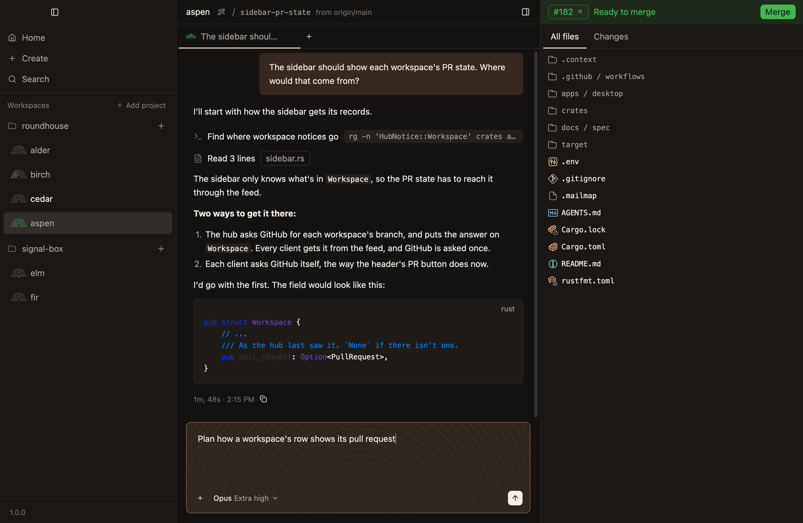

# Full access and plan mode

Every agent has full access, and never asks before using a tool, except in plan mode.

## Why full access

Agents run side by side. One that stopped to ask before each step would sit waiting until you came back to it, and with several at work, you'd spend the day approving commands. So an agent is left to work, and what you get to judge is the result: the diff, and the pull request.

> [!WARNING]
> Full access means what it says. An agent runs commands and changes files as you. A worktree keeps its files apart from other workspaces', and it isn't a sandbox: nothing stops an agent reaching outside it.

## Plan mode

When you'd rather see the route first, turn on plan mode. The agent works out a plan, and asks before it changes anything.

- **`Shift-Tab` turns it on and off,** in the composer and in the new-workspace dialog. So does `Plan mode` in the menu the composer's `+` opens.
- **The composer turns copper while it's on,** so it's plain which way a chat is working.
- **A command waits for you.** In plan mode, an agent that wants to run something asks, in a card with `Allow` and `Deny`.
- **Approving the plan goes back to full access,** and the agent carries it out.

Plan mode belongs to the task at hand. A new chat keeps the model and effort of the chat it was opened from, and starts with full access.

A chat that's planning when its agent stops is still planning when the agent comes back, so a restart never lets through a change nobody approved.

## Questions aren't approvals

An agent with full access can still ask you something, when it needs a decision only you can make. A question takes the composer's place until it's answered. [Answer its questions](../guides/answer-its-questions.md) says how.
