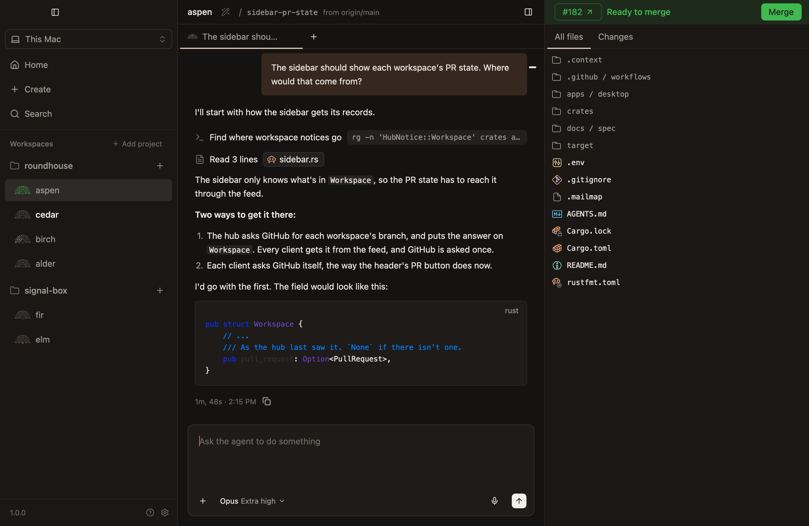

# The window

What each part of the app is called, here and in the rest of this guide.

## The sidebar

On the left. It lists your projects, each with its workspaces under it.

| Part | What it is |
|---|---|
| Hub switcher | The selected machine and its connection status; choose another saved hub or connect one |
| Home | Shows every workspace in one list, in place of the workspace |
| Create | Opens the new-workspace dialog, as `Cmd-N` does |
| Add project | Adds a repository |
| A project's row | Its name, with a `+` for a new workspace in it. Click it to put its workspaces away under it, and again to bring them back. Drag it to move the project, with its workspaces, among the others |
| A workspace's row | Its mark, its title, and how many lines it has added and removed, in green and red, as of when a turn last ended in it or its branches last moved, such as with a commit, and, while it's shown, within a moment of any file changing in it, once something has been sent to one of its chats since the hub last started. Click it to show the workspace |
| The build line | At the bottom: which build is running, a question mark whose menu has Check for Updates and Changelog, and a gear for Settings. An update's card shows over it when there's one |

A button at the window's top left, or `Cmd-B`, hides the sidebar and shows it again. On Windows and Linux, the button before it opens the menus. Drag the sidebar's inner edge to change its width.

## The workspace

In the middle, the workspace that's selected. The app opens on the one it was left on, or if that's been archived since, on the first in its project, or with none left there, the one at the top of the sidebar.

| Part | What it is |
|---|---|
| The header | The workspace's title, with its branch and its base |
| The tabs | A tab for each chat, after the file tab, the subagent tab and the proposal tab when they're open, then one for each terminal, and the `+` that opens a new chat or a new terminal |
| The chat | The conversation: your prompts, and what the agent said and did |
| The outline | Short ticks at the chat's right, one for each prompt |
| The composer | Where you type a prompt |

The composer's bottom row has a `+` that attaches files and turns on plan mode, the model picker, bars for your plan's limits, a ring for the context, and Send.

## The sidebar of changes

On the right. It's open from the start, so a workspace's changes and its pull request are always in view.

| Part | What it is |
|---|---|
| The pull request's bar | At the top: where the pull request stands, and the one thing to do next |
| All files | A tab that lists every file in the worktree |
| Changes | A tab that lists the files the workspace changes |

`Cmd-Shift-B` hides it and shows it again.

## The file tab

Clicking a file, in either tab of the sidebar of changes, shows it in the workspace's file tab: its diff from Changes, or the file itself from All files. A workspace has one file tab, always the leftmost, so reviewing doesn't leave a tab for every file.

## In place of the workspace

Home shows in place of the workspace, and goes away when you pick one. Settings shows in place of the sidebar and the workspace, and `Back`, Escape or `Cmd-W` goes back.
