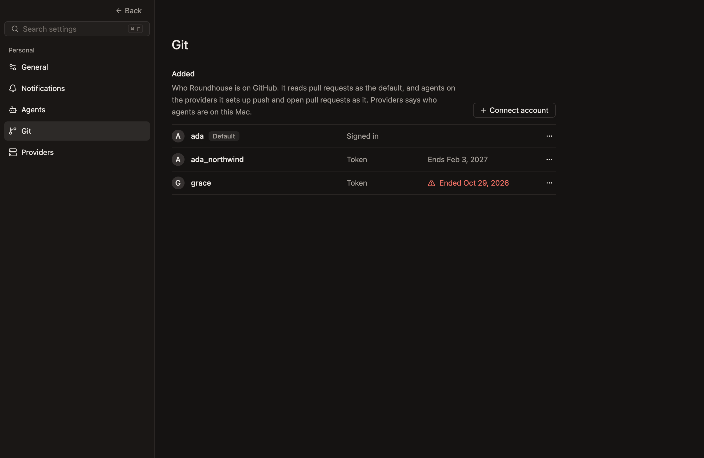
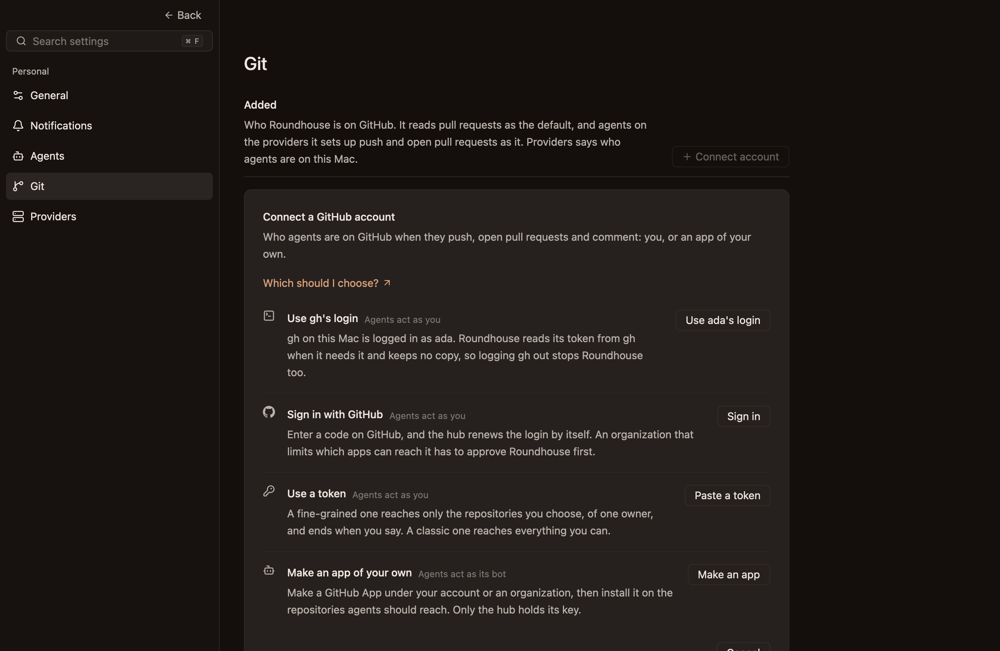
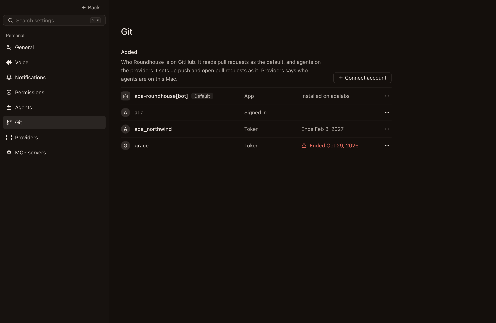
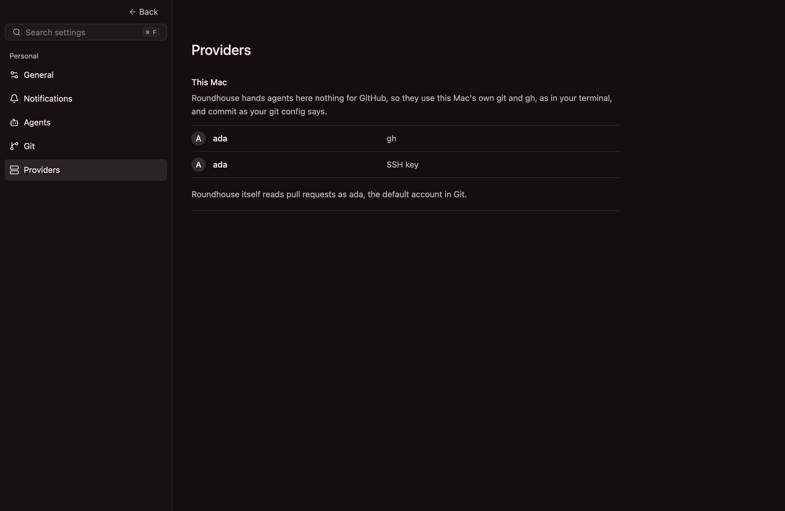
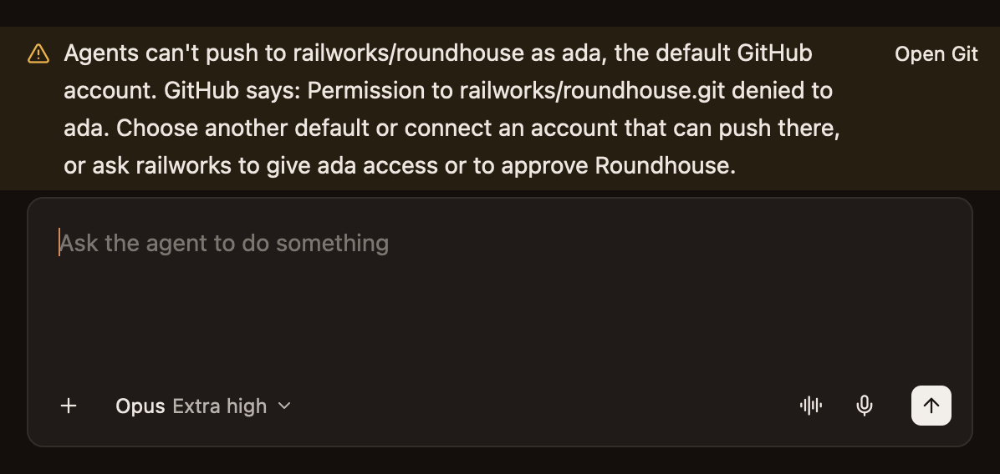
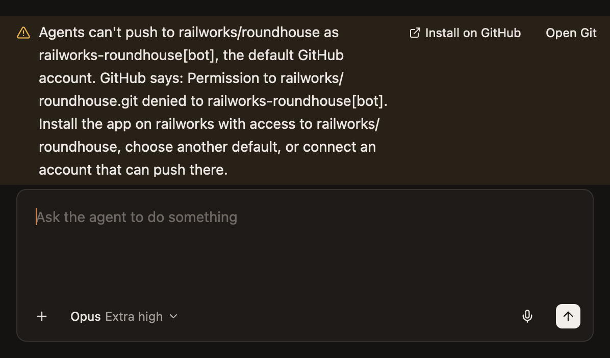

# Who agents are on GitHub

When an agent pushes, opens a pull request or comments, GitHub records someone as doing it. You choose who on the Git page in [Settings](../reference/settings.md#git): a GitHub account you've added, `gh`'s login on the Mac Roundhouse runs on, or the bot of an app of your own. The account you make the default is who Roundhouse reads GitHub as, such as for pull requests, and is used for every repository on GitHub, on every machine Roundhouse sets up GitHub on.

On your own machine, where the hub runs, Roundhouse sets up nothing of GitHub: agents use your `git` and `gh` as they are, as your own terminal does, SSH key and all. The Providers page in [Settings](../reference/settings.md#providers) says who they are there. On another provider's machines, which are made for workspaces and rarely have a login for GitHub of their own, Roundhouse sets up GitHub as the default, and sends a push to GitHub over SSH over HTTPS instead, unless that provider's settings say `"set_up_github": false`.

## An account you add

**Sign in with GitHub**, or paste a token, and agents act as you. On every machine Roundhouse sets up GitHub on, `git` and `gh` use the default for github.com, so agents push and open pull requests as it, and so does what you type in a workspace's terminal, and Roundhouse reads pull requests with it, wherever they run. Nothing else on the machine has to be logged in.

- Their pull requests are yours, so GitHub won't let you approve them, and nothing on GitHub tells their work from yours.
- What they ask of GitHub counts against your rate limit.

Signing in shows a code, which you type on GitHub and approve there. Agents can then do what `gh` logged in as you could: reach every repository you can, in every organization that lets Roundhouse in. An organization that limits which apps can reach it has to approve Roundhouse first. Until it does, a workspace of one of its private repositories says, in the card its name opens, that Roundhouse can't see it, with **Approve on GitHub**. The hub renews the login by itself, so it keeps working until you disconnect it, unless GitHub won't renew it, such as after about six months with the hub stopped. Then it needs signing in again.

A token does the same. Use one when an organization hasn't approved Roundhouse but allows tokens, or to keep agents to a few repositories: a fine-grained token reaches only the repositories you choose, of one owner. It ends when you said it would, and you renew it yourself, with a new one, from its row's `…` menu.

The hub keeps either in its own data, as [Where data is kept](../reference/where-data-is-kept.md) says, and hands the default's to every machine, where agents' `git` and `gh` use it. The app writes it nowhere.

## `gh`'s login on this Mac

If `gh` on the Mac Roundhouse runs on is logged in to github.com, **Connect account** offers that login first, by its username, and agents act as you, as they do once you sign in. Roundhouse uses it only once you choose it there, never by itself.

The hub keeps none of its token. It reads it from `gh` once a minute and hands it to every machine, so logging `gh` out, or switching it to another user with `gh auth switch`, stops agents pushing within a minute, until you log `gh` back in as the same user or make another account the default. `gh` renews its own login, so there's nothing to renew here.

- `gh`'s login usually can't push a change to a workflow file, in `.github/workflows`, since `gh auth login` doesn't ask GitHub for that unless told to. Run `gh auth refresh -s workflow` to add it, or sign in instead, which asks for it.
- It's the login on the hub's Mac only. Agents on other machines use it too, but `gh` there plays no part.

## An app of your own

Make a GitHub App of your own, and agents act as its bot, such as `ada-roundhouse[bot]`, rather than as you: they push, open pull requests, comment and commit as it.

- Their pull requests are the bot's, so you can review and approve them, and GitHub tells their work from yours.
- What they ask of GitHub counts against the app's own rate limit, not yours.
- They reach only the repositories you install it on, with what the app may do: push, open and merge pull requests, open issues and comment, change workflows, and read runs and checks. You can give it more on GitHub, on the app's page.

The app is private, so it's made under the account or organization whose repositories it's for, and only that one can install it. Make one under each organization agents work in. Only an organization's owners and app managers can make one under it.

Making one takes three steps in the panel, as [Settings](../reference/settings.md#make-an-app-of-your-own) says: choose where to make it and its name, make it on GitHub's page, which your browser opens, then install it on the repositories agents should reach. Only the hub holds the app's key, and it makes the installation a token from it an hour at a time, so there's nothing to renew. Each installation is a row on the Git page, which you make the default as you would an account.

Removing the app, from its row's `…` menu, has the hub forget its key, and deletes nothing on GitHub. Delete it there, in the developer settings of your account or the organization, to be rid of it.

## Your own machine's login

On your own machine, agents always use the login it already has: whoever `gh` is logged in as, or the owner of a `GH_TOKEN` your profile exports, which `gh` uses over its login, and the SSH key or other credential `git` pushes with. The Providers page in Settings says who `gh` is there and whose SSH key GitHub takes, which the hub reads each time you open it, beside who Roundhouse itself reads pull requests as, so you see when they differ.

## With no account

Until you add an account, there's no default, so Roundhouse reads nothing of GitHub: it can't say a workspace's pull request or wait on one. Agents on the machines Roundhouse sets up GitHub on can't push or use `gh`, and git there says to connect an account. Agents on your own machine work as they always do.

A repository that isn't on GitHub, such as one on GitLab or GitHub Enterprise, is always reached with the machine's own login, and its commits are by whoever its own Git config or the machine's says. On a machine whose Git is older than 2.36, so are the commits in every repository, though agents there still push to GitHub as the default.

## When the default can't be used

If the default's token ends, it needs signing in again, it's `gh`'s login and `gh` is logged out or logged in as someone else, or it's an app's installation that was uninstalled on GitHub, it stays the default, and agents can't push until you renew it, sign in again, or make another the default. They don't fall back on the machine's own login, so nothing is pushed as someone you didn't choose. On your own machine, agents push as they always do. The Git page says what's wrong, and what to do, at the top of **Added**.

If you disconnect the default, Roundhouse forgets it, and there's no default until you make another account the default, with the same effect. Git says so at the top of **Added**.

A signed-in account's token lasts 8 hours, and the hub renews it before it ends, so this happens only if the hub couldn't reach GitHub in time. Git says it's `Renewing` until the hub has. An app's installation's token lasts an hour, and the hub makes the next well before it ends, so the same goes for it: while GitHub doesn't make the next, a default installation says `Renewing` once the last has ended.

## When the default can't push to a repository

The hub asks GitHub whether the default can push to the repository on GitHub that each repository's `origin` names, as `git push` would ask, so it meets what a push would: your access, a fine-grained token's repositories, the repositories an app of your own is installed on, and an organization that hasn't approved Roundhouse. It asks as it starts, whenever the default or its login changes, and every half hour, since what an account can do changes on GitHub too.

If GitHub refuses, has no such repository the default can see, or doesn't take its token, every workspace of that repository on a machine Roundhouse sets up GitHub on says so in a line above the composer, with GitHub's words and what to do. **Open Settings** opens the Git page, where you can make another account the default or add one that can push there. It blocks nothing: agents push as they would anyway. The line goes once the hub finds a push would be taken.

A workspace on your own machine has no line, since its agents push as your own login, not the default.

When the default is an app of your own, the line names its bot. For a repository of the account or organization the app is installed on, it says to install the app there with access to the repository, and **Install on GitHub** opens the app's page on GitHub, where you give it more repositories. A repository of anyone else's the app can't reach, since it's installed only where it was made, so the line says to make another the default, such as an app made under that owner. If GitHub doesn't take the app's token, as after it was uninstalled, the line says to install it again and connect it again.

With no account, every workspace of a repository on GitHub, on a machine Roundhouse sets up GitHub on, says its agents can't push, and to connect an account.

## More than one

You can add more than one account, but only the default is used.

## Which to choose

- **Your own repositories:** sign in.
- **Repositories you don't own, such as open source:** sign in.
- **Whoever `gh` on this Mac is logged in as, with nothing new to approve:** `gh`'s login.
- **A few repositories, or an organization that hasn't approved Roundhouse:** a fine-grained token.
- **Agents' work told apart from yours, in pull requests you can approve:** an app of your own.
- **An organization's repositories, as a bot of the organization's own:** an app of your own, made under it.
- **Whatever your own machine is already logged in as:** nothing to choose, since agents there use it anyway.
