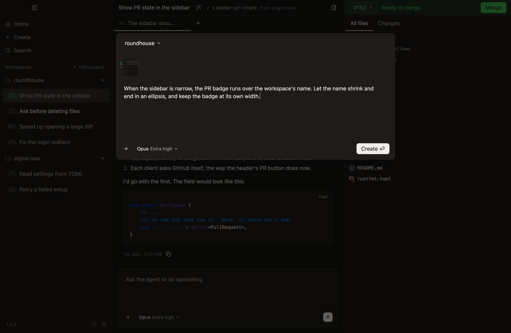
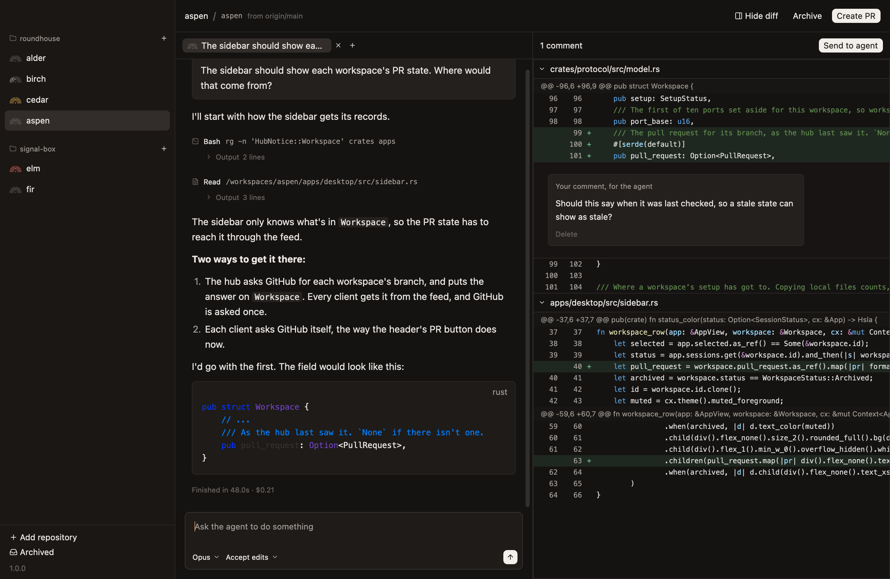

# Quickstart

From a download to a merged pull request, on a Mac.

## Before you start

You need:

- **A Mac with Apple silicon.** For the Windows and Linux previews, see [Install](install.md).
- **Git, and a repository to work in.**
- **Your agent's CLI, `claude` or `codex`, installed and signed in.** Run it once in a terminal to check. Claude can also use a login added in [Settings](../reference/settings.md#accounts). Codex uses its own sign-in on the machine running the workspace.
- **GitHub's CLI, `gh`, logged in,** for the pull request. Everything before that works without it.

> [!WARNING]
> Every agent has full access. It runs commands and changes files as you, without asking, and a worktree is a directory, not a sandbox. [Full access and plan mode](../concepts/full-access-and-plan-mode.md) says how to have an agent ask first.

## 1. Install

[Download Roundhouse](https://f001.backblazeb2.com/file/getroundhouse-releases/Roundhouse-osx-Portable.zip), unzip it, move it to Applications, and open it.

## 2. Add a project

Click `Add project` at the top of the sidebar, and choose your repository.

## 3. Hand over a task

Click the `+` beside the project, or press `Cmd-N`. Say what to work on, and press Return.

Roundhouse makes a workspace for the task: a worktree and a branch of its own, with an agent already at work on your prompt.

## 4. Let it work

A light sweeps the workspace's mark while the agent works. You don't have to watch. Hand over another task, or quit the app: the agent carries on either way.

When it finishes, the workspace's title turns bright in the sidebar until you've read the reply. To say more while it works, type and press `Enter`.

## 5. Review the changes

The sidebar on the right lists every file the workspace changes. Click one to see its diff.

To ask for a change, hover a line, click its add button, and write a comment. `Send to agent`, at the top of the sidebar, sends every comment at once.

## 6. Merge it

Press `Cmd-Shift-P`. That asks the agent to commit, push and open a pull request.

From then on, the bar at the top of the sidebar on the right says the first thing in the way of merging, and offers the one thing to do about it. When it's green and says `Ready to merge`, click `Merge`.

## 7. Archive the workspace

Once the pull request is merged, the bar offers `Archive`. That removes the worktree and keeps the branch.

## Where to go next

- [Set up your repository](set-up-your-repository.md), so each new worktree can build and run.
- [What Roundhouse does](what-it-does.md), for everything else the app does.
- [Know when an agent needs you](../guides/know-when-an-agent-needs-you.md), once you have several at work.
- [Keys](../reference/keys.md), for the shortcuts.
