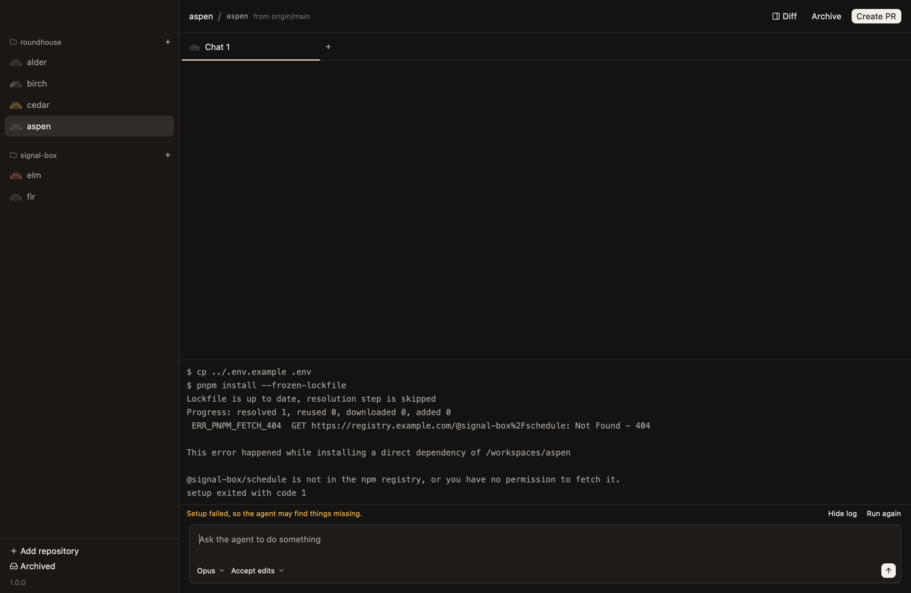

# Set up your repository

A new workspace is a fresh worktree, so it has no `node_modules`, no build output and no `.env`. Setup makes it runnable before the agent needs it.

## What setup does

Once a workspace's worktree exists, Roundhouse does two things in it:

1. **Copies the files git ignores that the worktree needs,** such as `.env`, from your repository.
2. **Runs the repository's setup script,** with `bash`, in the worktree.

Setup runs in the background. A prompt you send meanwhile is recorded at once, and reaches the agent when setup finishes. Bringing an archived workspace back runs setup again.

## Add a setup script

Commit a `.conductor/settings.toml` to the repository:

```toml
[scripts]
setup = "npm install"
```

A longer script can be several lines, or a call to a script in the repository:

```toml
[scripts]
setup = "./scripts/setup-workspace.sh"
archive = "docker compose down"
```

The `archive` script runs as a workspace is archived, to clean up what setup started.

Both scripts get variables that say which workspace they're in, such as `CONDUCTOR_WORKSPACE_NAME`, and `CONDUCTOR_PORT`, the first of ten ports that are the workspace's own. So two workspaces can each run a server without colliding:

```toml
[scripts]
setup = "echo \"PORT=$CONDUCTOR_PORT\" >> .env.local"
```

[Repository settings](../reference/repository-settings.md) lists every variable. The names are Conductor's, as [Coming from Conductor](coming-from-conductor.md) says.

## Choose which files are copied

With nothing set, Roundhouse copies the ignored files that match `.env*`. To copy others, list patterns in a `.worktreeinclude` at the repository's root. They mean what they do in `.gitignore`:

```
.env*
config/local.yml
```

Only files git ignores are copied, since the worktree already has everything git tracks.

## When setup fails

A failed setup warns, and never blocks. The workspace is still made, the agent still gets your prompt, and the chat shows the script's log.



## Settings of your own

To override a repository's settings without committing anything, put a `.conductor/settings.local.toml` in the repository. For defaults across every repository, use `~/.conductor/settings.toml`. [Repository settings](../reference/repository-settings.md) says which wins.
