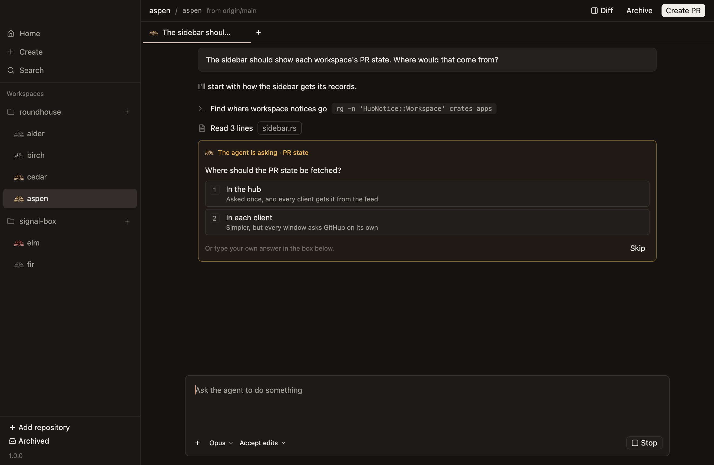
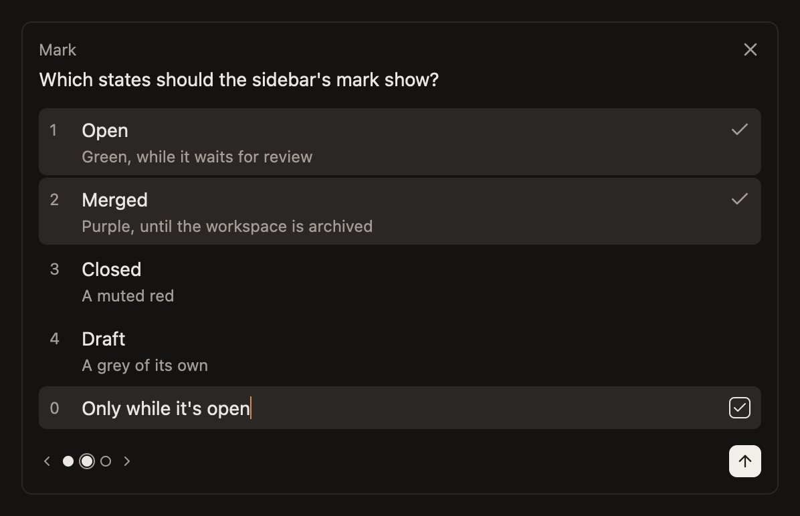
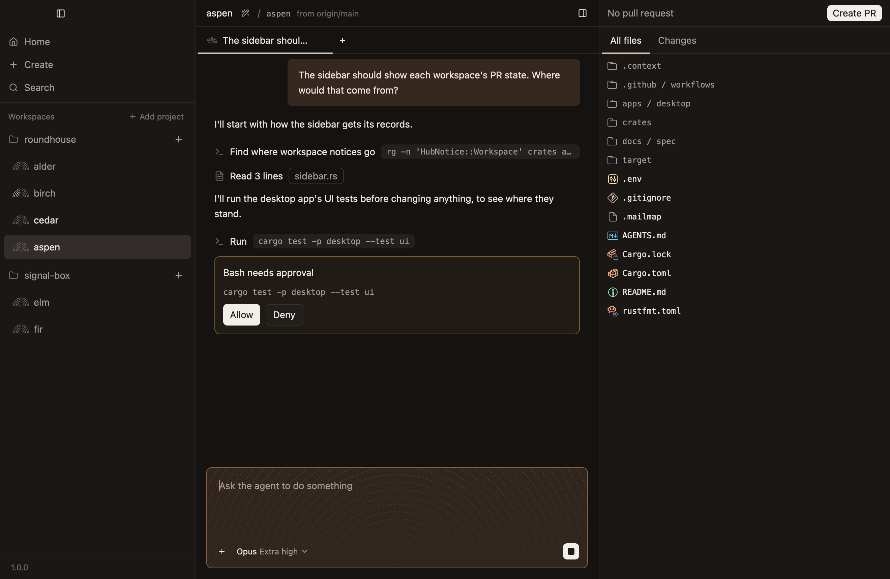

# Answer its questions

An agent asks you something in two cases: it needs a decision only you can make, or it's in plan mode and wants to do something. Either way, its workspace's title turns bright until you've answered.

## A question

A question takes the composer's place, so you answer where you'd have typed.

- **Press a number** to choose that option.
- **Press `0`** to type an answer of your own.
- **Press `Enter`** to go on to the next question without an answer, and to send once there's none.

When the agent asks several at once, a dot for each shows which have an answer, and the left and right arrow keys move between them. You don't have to answer them all: the send arrow works once any has an answer, and leaves the others out.

The `×` skips them all, and tells the agent to carry on if it can.

What you were typing in the composer isn't lost. It waits behind the question, and comes back when the question goes.

## An approval

In plan mode, an agent asks before it uses a tool, such as running a command. The request is a card in the chat, with `Allow` and `Deny`.

When the agent has worked out its plan, it asks you to approve it. Approving goes back to full access, and the agent carries the plan out.

Outside plan mode, agents don't ask before using tools. [Full access and plan mode](../concepts/full-access-and-plan-mode.md) says why.

## While it waits

An agent waiting on you holds still, and so does its mark. Nothing else is held up: other chats and workspaces carry on.

The answer you've started is kept by the hub, so it's there if you quit the app and come back.

## Afterwards

Once answered, a question is a line in the chat where the agent asked it, saying `Asked` and what you answered. Click it to see the whole question again.

[Questions and approvals](../reference/chats/questions-and-approvals.md) has every key.
