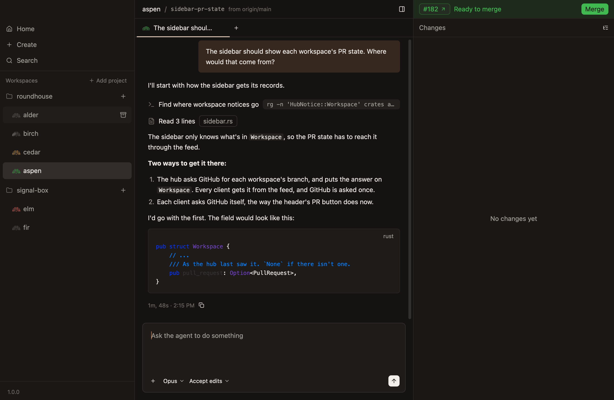
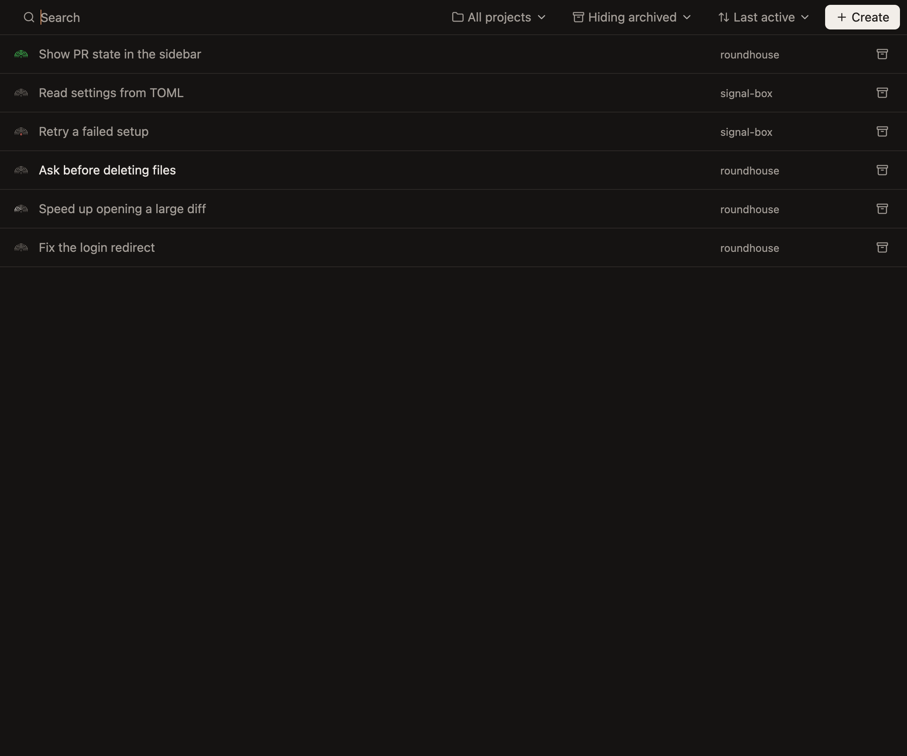

# Archive and restore

A finished workspace doesn't need its worktree any more. Archiving puts it away, and keeps what matters.

## Archive a workspace

Any of these archives a workspace:

- **Point at its row** in the sidebar, and click the button at its right end. It works on any row, without opening the workspace.
- **Right-click its row,** and choose Archive.
- **Press `Cmd-Shift-A`,** for the workspace showing.
- **Click `Archive` on its pull request's bar,** once the pull request is merged or closed.



The row says `Archiving…` until it has gone.

## What it keeps, and what goes

| | |
|---|---|
| **The branch** | Kept, wherever the agent left it |
| **The chats' history** | Kept, with the images in it |
| **The worktree** | Removed, with ignored files such as `.env` and `node_modules` |
| **Files attached to prompts, other than images** | Removed with the worktree |

The repository's `archive` script runs, if it has one, and then its agents stop.

## It won't lose your work

Archiving refuses if the worktree has uncommitted changes, or commits on no branch, and asks before it goes on. So committed work can't be lost, and uncommitted work can't be lost by accident.

## Find an archived workspace

Home, at the top of the sidebar, is the only place archived workspaces are listed. Its bar can hide archived workspaces, show them too, or show only them.



## Bring one back

Click an archived workspace's row on Home, or its button. Roundhouse makes the worktree again from its branch, and runs setup again. The row says `Restoring…` meanwhile.

Its chats are as you left them, and the next prompt in one resumes the agent's conversation.

## From a terminal

```sh
roundhouse workspace archive holly
roundhouse workspace list --all
roundhouse workspace restore holly
```
