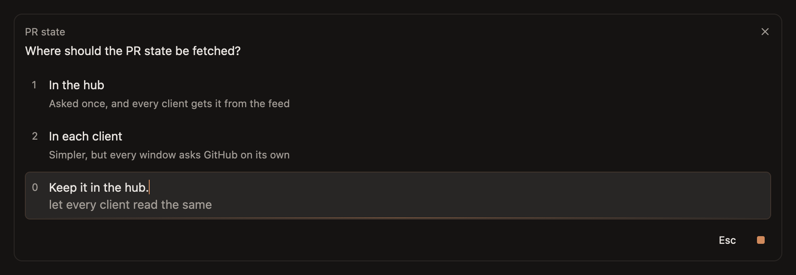
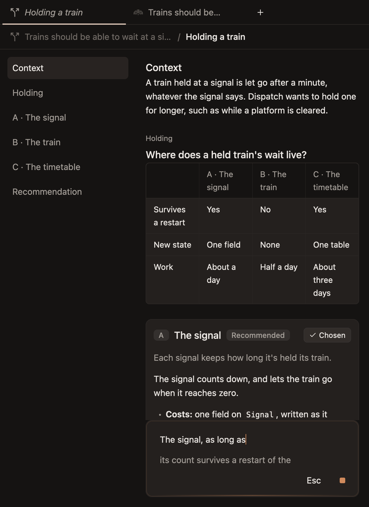

# Dictate a prompt

Say a chat prompt, a new workspace’s first prompt, an answer to an agent’s question, a note on your answer to a proposal or a comment on a diff. A model on your Mac hears what you say, so it never leaves it, and the text waits for you to send.

## Turn it on

Dictation is on a Mac with macOS 14 or later, and needs a model of 2.4 GB, downloaded once, so it asks first. On an older Mac, the composer has no microphone. Until you choose, the composer has a microphone beside Send, and the new-workspace dialog has one beside Create, and clicking it offers to turn dictation on. **Turn on** downloads the model, and **Hide the microphone** turns dictation off. You can choose either in Settings too, under General, where Dictation is Ask first, On or Off.

Once it's on, the model downloads, and then it's prepared, which can take a few minutes the first time. Until it's ready, the microphone is dimmed, and clicking it says how it's going, as Settings does under Dictation. If something goes wrong, it says what, with Retry, which goes on from what's already downloaded.

Turning dictation off stops a download, and keeps what's downloaded for next time. **Delete the model**, under Dictation in Settings, frees its room, and turns dictation off first if it's on.

## Dictate

| Key | What it does |
|---|---|
| Space, held | Dictates while it's held, and stops when you let go. A tap types a space, as always. Dictating starts at half a second, with what you've said from a moment after you pressed it, so you can start talking straight away |
| `Option-Space`, held | Dictates while it's held, from the moment you press it |
| Escape | Stops, and puts the text field back as it was when you started. `Option-Escape` while you still hold `Option-Space` |

Focus the text field before using these shortcuts. You can also click the microphone beside Send in the composer or beside Create in the new-workspace dialog to start. While speaking, click the square Finish dictation button to keep your words without sending.

A fine copper line responds quietly along the bottom of the field. It settles during pauses and stays still with Reduce Motion enabled. The normal controls give way to Cancel and Finish dictation until the last words settle. Only your live words appear under the text, with no listening or finishing label.

Finishing releases the microphone while the model works on the last words. Cancelling or leaving the field also releases it, even if the model is still loading or processing speech.

What's heard shows dimmed under what you've typed, as you say it. Each sentence goes in at the cursor, as if you'd typed it, once you've paused at its end and started the next one, and the last when you stop. Sentences said without a pause between them go in together, and pausing in the middle of a sentence leaves it showing until it ends. It can come out a little different from what showed, since the whole sentence is heard again, which gets more of it right. A short phrase said quickly is sometimes heard as nothing the second time, and then it goes in as it was first heard. It also favors names from your project, workspace, branch, changed files, recent chat, and question and proposal options, so project terms, package names and proper nouns come out right when spoken.

Dictation hears 25 European languages, and tells which you're speaking. If you speak one of them, choose it as **Dictation language** in Settings, under Dictation: it's heard better, and never comes out in another alphabet, as a short phrase said quickly can, such as English in Cyrillic.

Nothing is sent until you press `Enter`, so you can fix what came out wrong first. Pressing `Enter` while you're still dictating stops it, and sends once the last of what you said has gone in, so none of it is lost.

The first time, your Mac asks whether Roundhouse may use the microphone. Allow it, and press again. If you didn't, a message says where in System Settings to allow it.

Once holding Space has dictated something the first time, your Mac asks whether Roundhouse may monitor input, which it lists under Input Monitoring in System Settings. With it, dictating goes on while you hold Space even if something else comes in front for a moment. Dictating works without it.

## Dictate a new workspace, answer, note or comment

The new-workspace prompt uses the same shortcuts. `Enter` finishes the last words before creating the workspace. Create returns when dictation ends. Letting go only puts them into the prompt. Escape cancels dictation first, leaving the dialog open.

Questions have no microphone button. Focus **Other**, a written answer or the feedback field on a tool request, then hold Space or `Option-Space`. Final text selects your written answer and saves it just as typing does. With multiple choices, your selected options stay selected too. `Enter` finishes the live words and keeps its usual behavior of continuing to the next question or sending the answers. Secret inputs and questions that offer only choices do not support dictation.

Focus the note at the foot of the proposal tab and use the same shortcuts. `Enter` finishes the last words and sends your answer with them, once you've chosen an option for each question.

Focus a comment on a diff and use the same shortcuts. Finish dictation keeps the text in the box; `Enter` finishes the last words and saves the comment. Cancel dictation restores what you had before recording and leaves the comment open.

## Mute or pause what's playing

Turn on **Mute sound while dictating**, under Dictation in Settings, and the Mac's sound is muted while you dictate, so music or a video doesn't drown you out. It's unmuted once you stop, before the last of what you said goes in. Held Space mutes only once it starts dictating, at half a second, so a press you let go of sooner doesn't cut what's playing. Sound you'd muted already stays muted. Outputs whose volume the Mac can't set, such as many displays' speakers and some USB speakers and amps, play on. If Roundhouse crashes while you dictate, the sound stays muted, so unmute it with your keyboard's mute key.

Turn on **Pause media while dictating**, beside it, and the music or video playing is paused while you dictate, whatever speakers it plays from, and played again once you stop. It pauses only what the Mac shows as Now Playing, the app your keyboard's play key controls. If you've played it again yourself, or something else has started playing in its place, it's left as it is. It uses a part of macOS that Apple doesn't publish, so a macOS update could stop it working, and then nothing is paused.

## When it stops by itself

- **Going to another app** stops it as letting go does, so what you said goes in. While you're holding Space, and Roundhouse may monitor input, it goes on until you let go, even in the other app, so the Mac showing something in front for a moment, such as while it checks an app that's opening, doesn't cut you off.
- **The composer going,** such as for Settings, another chat, the file tab, a question from the agent, the workspace being archived or the app losing its hub, stops it, and drops what was still showing. A hub restarting, such as to finish an update, leaves the composer where it is, so you can go on dictating.
- **Leaving an answer or the proposal tab, hiding a comment or closing the new-workspace dialog** drops tentative words and keeps finalized text. Starting dictation in another field ends the old recording too.
- **Recognition falling too far behind** stops the microphone. Once the model responds, a message says it couldn't keep up; text already finalized stays in the field. Try dictating again.
