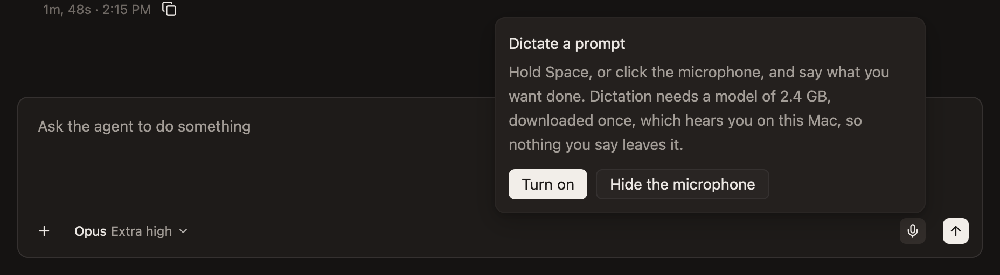
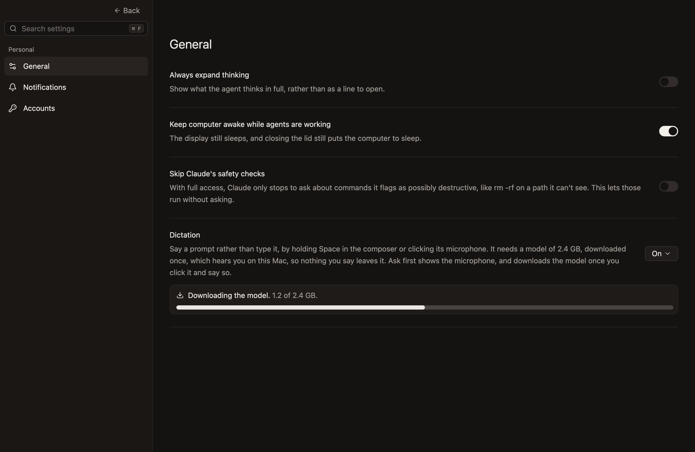

# Dictate a prompt

Say a prompt rather than type it. A model on your Mac hears what you say, so it never leaves it, and what it heard waits in the composer for you to send.

## Turn it on

Dictation is on a Mac with macOS 14 or later, and needs a model of 2.4 GB, downloaded once, so it asks first. On an older Mac, the composer has no microphone. Until you choose, the composer has a microphone beside Send, and clicking it offers to turn dictation on. **Turn on** downloads the model, and **Hide the microphone** turns dictation off. You can choose either in Settings too, under General, where Dictation is Ask first, On or Off.

Once it's on, the model downloads, and then it's prepared, which can take a few minutes the first time. Until it's ready, the microphone is dimmed, and clicking it says how it's going, as Settings does under Dictation. If something goes wrong, it says what, with Retry, which goes on from what's already downloaded.

Turning dictation off stops a download, and keeps what's downloaded for next time. **Delete the model**, under Dictation in Settings, frees its room, and turns dictation off first if it's on.

## Dictate

| Key | What it does |
|---|---|
| Space, held | Dictates while it's held, and stops when you let go. A tap types a space, as always. Dictating starts at half a second, with what you've said from a moment after you pressed it, so you can start talking straight away |
| `Option-Space`, held | Dictates while it's held, from the moment you press it |
| Escape | Stops, and puts the composer back as it was when you started. `Option-Escape` while you still hold `Option-Space` |

Or click the microphone beside Send at the bottom of the composer to start, and again to stop.

What's heard shows dimmed under what you've typed, as you say it. Each sentence goes in at the cursor, as if you'd typed it, once you've paused at its end and started the next one, and the last when you stop. Sentences said without a pause between them go in together, and pausing in the middle of a sentence leaves it showing until it ends. It can come out a little different from what showed, since the whole sentence is heard again, which gets more of it right.

Nothing is sent until you press `Enter`, so you can fix what came out wrong first. Pressing `Enter` while you're still dictating stops it, and sends once the last of what you said has gone in, so none of it is lost.

The first time, your Mac asks whether Roundhouse may use the microphone. Allow it, and press again. If you didn't, a message says where in System Settings to allow it.

## When it stops by itself

- **Going to another app** stops it as letting go does, so what you said goes in.
- **The composer going,** such as for Settings, another chat, the file tab, a question from the agent, the workspace being archived or the app losing its hub, stops it, and drops what was still showing. A hub restarting, such as to finish an update, leaves the composer where it is, so you can go on dictating.
