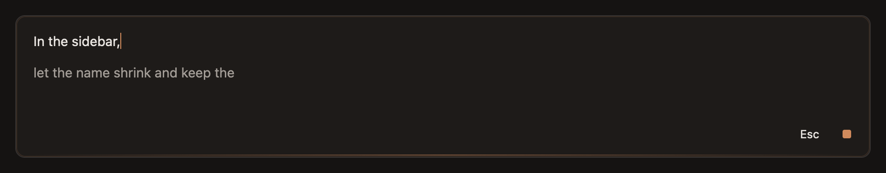

# Dictate a prompt

Say a chat prompt, a new workspace’s first prompt or an answer to an agent’s question. A model on your Mac hears what you say, so it never leaves it, and the text waits for you to send.

## Turn it on

Dictation is on a Mac with macOS 14 or later, and needs a model of 2.4 GB, downloaded once, so it asks first. On an older Mac, the composer has no microphone. Until you choose, the composer has a microphone beside Send, and the new-workspace dialog has one beside Create, and clicking it offers to turn dictation on. **Turn on** downloads the model, and **Hide the microphone** turns dictation off. You can choose either in Settings too, under General, where Dictation is Ask first, On or Off.

Once it's on, the model downloads, and then it's prepared, which can take a few minutes the first time. Until it's ready, the microphone is dimmed, and clicking it says how it's going, as Settings does under Dictation. If something goes wrong, it says what, with Retry, which goes on from what's already downloaded.

Turning dictation off stops a download, and keeps what's downloaded for next time. **Delete the model**, under Dictation in Settings, frees its room, and turns dictation off first if it's on.

## Dictate

| Key | What it does |
|---|---|
| Space, held | Dictates while it's held, and stops when you let go. A tap types a space, as always. Dictating starts at half a second, with what you've said from a moment after you pressed it, so you can start talking straight away |
| `Option-Space`, held | Dictates while it's held, from the moment you press it |
| Escape | Stops, and puts the text field back as it was when you started. `Option-Escape` while you still hold `Option-Space` |

Focus the text field before using these shortcuts. You can also click the microphone beside Send in the composer or beside Create in the new-workspace dialog to start, and again to stop.

Finishing releases the microphone while the model works on the last words. Cancelling or leaving the field also releases it, even if the model is still loading or processing speech.

What's heard shows dimmed under what you've typed, as you say it. Each sentence goes in at the cursor, as if you'd typed it, once you've paused at its end and started the next one, and the last when you stop. Sentences said without a pause between them go in together, and pausing in the middle of a sentence leaves it showing until it ends. It can come out a little different from what showed, since the whole sentence is heard again, which gets more of it right.

Nothing is sent until you press `Enter`, so you can fix what came out wrong first. Pressing `Enter` while you're still dictating stops it, and sends once the last of what you said has gone in, so none of it is lost.

The first time, your Mac asks whether Roundhouse may use the microphone. Allow it, and press again. If you didn't, a message says where in System Settings to allow it.

## Dictate a new workspace or an answer

The new-workspace prompt uses the same shortcuts. Create or `Enter` finishes the last words before creating the workspace. Letting go only puts them into the prompt. Escape cancels dictation first, leaving the dialog open.

Questions have no microphone button. Focus **Other**, a written answer or the feedback field on a tool request, then hold Space or `Option-Space`. Final text selects your written answer and saves it just as typing does. With multiple choices, your selected options stay selected too. Send finishes the live words before answering, and `Enter` keeps its usual behavior of continuing to the next question or sending the answers. Secret inputs and questions that offer only choices do not support dictation.

## When it stops by itself

- **Going to another app** stops it as letting go does, so what you said goes in.
- **The composer going,** such as for Settings, another chat, the file tab, a question from the agent, the workspace being archived or the app losing its hub, stops it, and drops what was still showing. A hub restarting, such as to finish an update, leaves the composer where it is, so you can go on dictating.

- **Leaving an answer or closing the new-workspace dialog** drops tentative words and keeps finalized text. Starting dictation in another field ends the old recording too.
- **Recognition falling too far behind** stops the microphone. Once the model responds, a message says it couldn't keep up; text already finalized stays in the field. Try dictating again.
