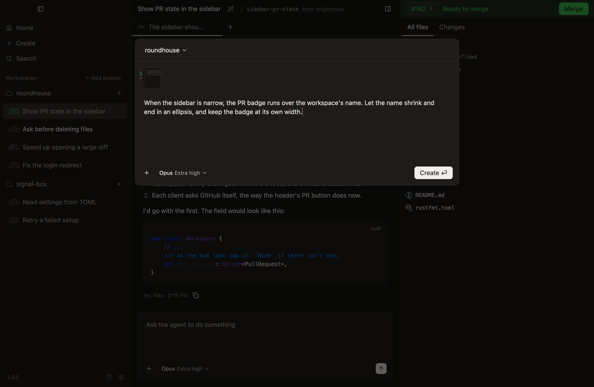
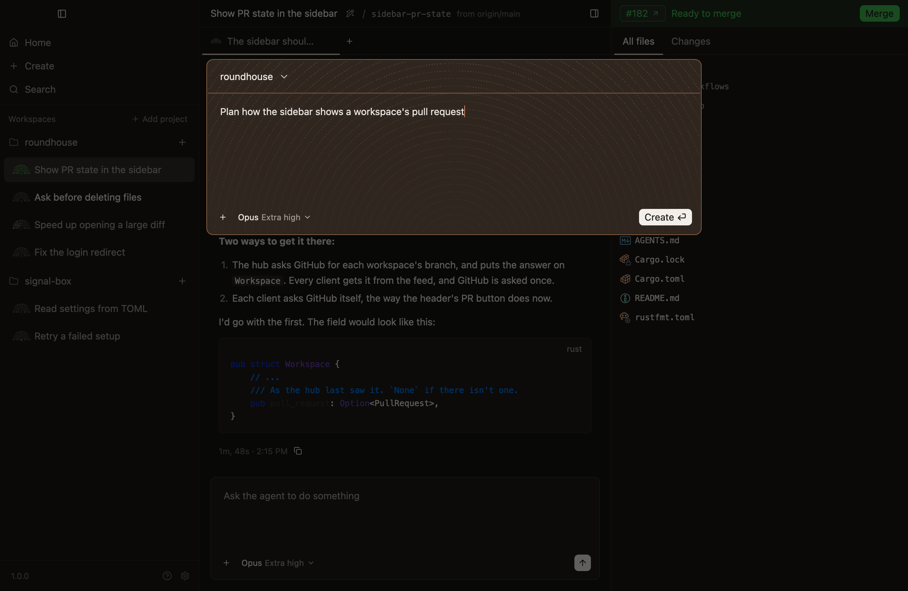

# Hand a task to an agent

Make a workspace, say what to work on, and the agent starts at once.

## Make the workspace

1. Press `Cmd-N`, or click the `+` beside a project in the sidebar. `Create`, at the top of the sidebar and on Home, does the same.
2. Say what to work on.
3. Press Return.



The dialog closes at once, and the sidebar shows the workspace on its way, since Roundhouse fetches first. Once it's made it's selected, unless you've gone somewhere else meanwhile.

`Shift-Return` starts a new line. Return with nothing typed makes the workspace and sends nothing.

## What you can set first

The dialog holds everything the first prompt needs:

- **The project.** Its name at the top opens a menu of the others.
- **Files.** Paste a screenshot, drop files on the dialog, or choose them from the `+` at its bottom left.
- **The model, and how hard it thinks.** They start at Opus and Extra high, and stay as you last chose.
- **Plan mode.** `Shift-Tab`, or the `+`'s menu, has the agent plan and ask before it changes anything. The dialog turns copper while it's on.



## You don't have to wait for setup

A new worktree runs the repository's [setup script](../get-started/set-up-your-repository.md) in the background. A prompt sent meanwhile is recorded at once, and reaches the agent when setup finishes.

## Nothing typed is lost

- Closing the dialog, with Escape or a click outside it, keeps what's in it for next time.
- If the workspace can't be made, what you typed goes back to the dialog, and it opens again.
- If the prompt can't be sent, it goes to the new chat's composer.

## Hand over more in the same workspace

`Cmd-T` starts another chat in the workspace showing, with an agent of its own in the same worktree. Use one for a side question, or for a second opinion on the first agent's work.

For work that should be its own pull request, make another workspace. You can open the dialog while one is still being made.

## From a terminal

The same thing, from [the command line](../reference/command-line.md):

```sh
roundhouse workspace create my-project   # Prints the new workspace's name, such as euston
roundhouse session new euston
roundhouse send euston "Fix the login redirect"
```
