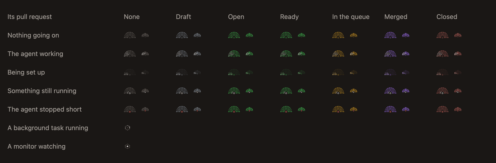
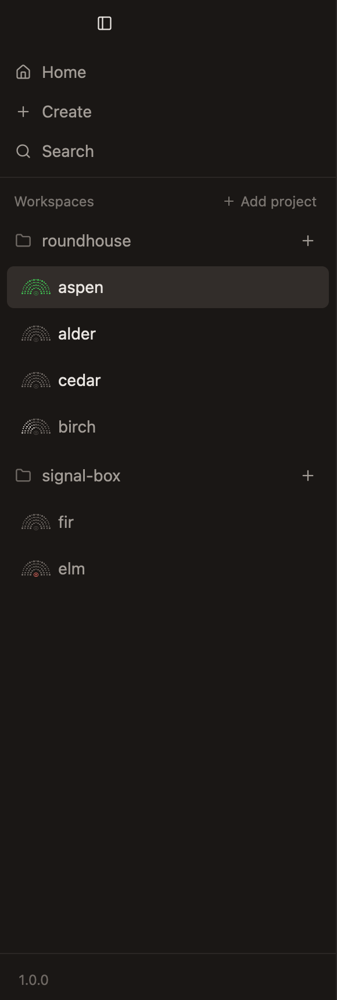
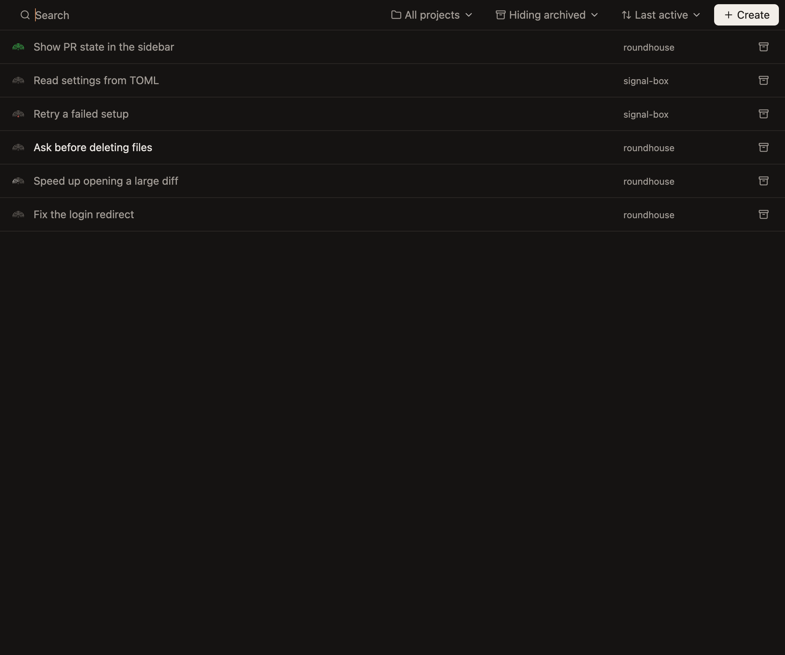

# Know when an agent needs you

With several agents at work, you shouldn't have to open each one to see how it's doing. The sidebar says, and stays quiet until one needs you.

## Read the mark

Every workspace has a mark before its title: a half circle of dots, like a roundhouse seen from above. Each part of it is about one thing.

| You see | It means |
|---|---|
| A light sweeping the whole fan | The agent is working |
| A slower light on the inner row | Its turn ended with something still running, such as a test run |
| The fan filling in | The workspace is being set up |
| A red centre | The agent stopped short: it went away mid-turn, or its turn failed |
| The fan's colour | Where the pull request stands: grey for none, green open, yellow in the merge queue, purple merged |

Only an agent with something running moves a mark. While an agent waits on you, its mark holds still.

## Look for a bright title

A workspace's title turns bright when it needs a look:

- **It has a reply you haven't read,** or
- **its agent is waiting on you,** for an answer or an approval.

Every other title is muted, so the ones that need you stand out. A chat's tab does the same.

A reply is read once its chat is showing in the window in front. One that comes while you're in another app waits until you're back.

To deal with one later, right-click its row and mark it unread, or press `Cmd-Shift-U` on the workspace showing. That's the key Mail uses.

## Let it tell you

When you're in another chat or another app, a notification says a chat has come to need you, and why: `Finished`, `Stopped short` or `Waiting on you`. Clicking it shows the chat. A sound plays at the same moment.

Both are on unless you turn them off, under Notifications in [Settings](../reference/settings.md), where you can also choose the sound.

Only what happens while the app is open is told of. When you open the app, the sidebar already shows what was waiting.

## Other signs on a row

- **A pencil** means something is typed there and not sent, so a half-written prompt isn't forgotten.
- **A clock** means one of its chats' prompt caches is about to expire. [Watch context and limits](watch-context-and-limits.md) says why that matters.

## See everything at once

Home, at the top of the sidebar, lists every workspace in one place, with a search, and choices of project and order. It's also the only place archived workspaces are listed.

## Walk away

Your Mac stays awake while there's work: a turn, something an agent left running, or a workspace being set up. It can sleep once agents are only waiting on you. Closing the lid still puts it to sleep.
