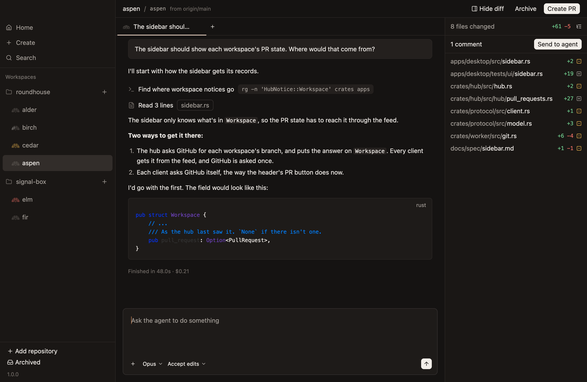
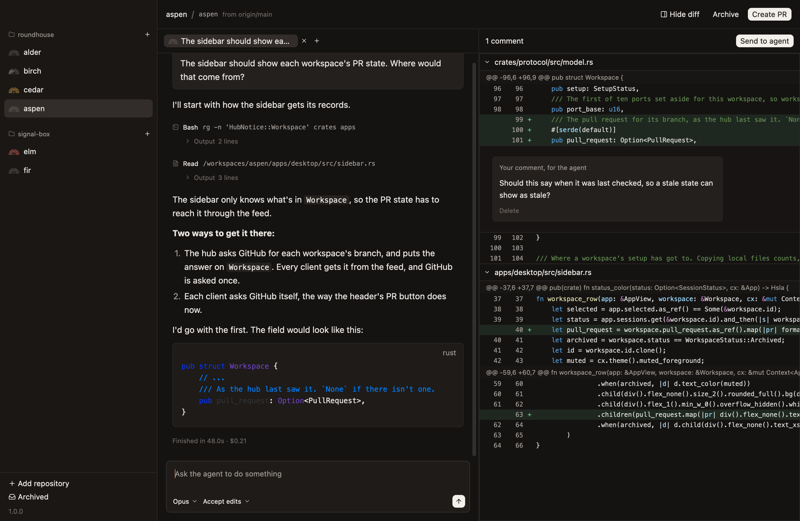
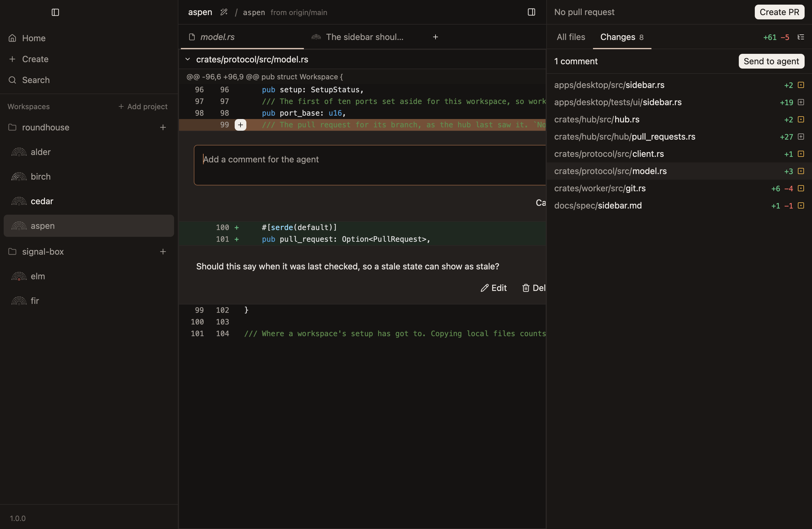
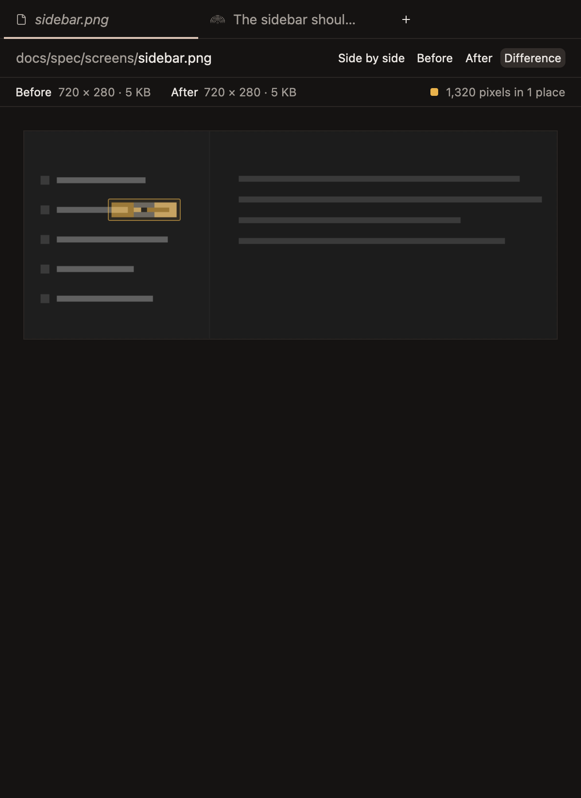

# Review its changes

Everything a workspace changes is listed beside its chat. Read the diff, comment on the lines you'd change, and send the comments back to the agent.

## See what changed

The sidebar on the right lists every file the workspace changes against its base, with the lines each adds and removes. It switches to its Changes tab by itself the first time there's something to review.

The button at the sidebar's top right shows the files as a list of paths, or in folders. `Cmd-Shift-D` hides the sidebar and shows it again.

## Read a diff

Click a file to see its diff in the workspace's file tab, the leftmost tab. Click another, and it takes the first one's place, so reviewing doesn't leave a tab for every file.

- **Lines far from a change are folded** into a row that says how many there are. Its arrows show 20 more at a time.
- **The words that changed are marked more strongly** than the rest of their line, so a small edit to a long line stands out.
- **A switch at the right end of the bar** shows the diff in one column, side by side, or as the whole file with its changes where they are.

`Cmd-W` closes the file tab, and clicking a chat's tab goes back to the chat with the file still open behind it.

## Comment on a line

1. Hover a changed line, and click its add button.
2. Write the comment, and press `Enter`.

A comment stays where you wrote it, with `Edit`, `Delete` and `Add to chat` beside it.

## Send the comments to the agent

- **`Send to agent`,** at the top of the sidebar, sends every comment at once, and shows the chat they went to. The number beside it says how many are waiting.
- **`Add to chat`,** on one comment, puts it in the composer after what's typed there, so you can say more with it.

## Compare a changed image

A changed image shows as Before and After, rather than as text. The bar above it chooses how:

- **Side by side.**
- **Before or After, one at a time.** Click the image or press Space to flip between them, and what changed jumps out.
- **Difference.** After, faded to grey, with every pixel that changed tinted yellow and each place outlined.

## Read the code around a change

The sidebar's other tab, All files, lists every file in the worktree, ignored ones too. Click one to read it in the file tab, highlighted for its language. An image opens as itself.

[The diff](../reference/the-diff.md) has every rule.
