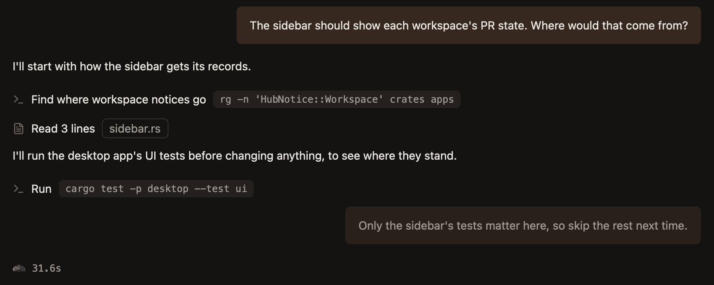
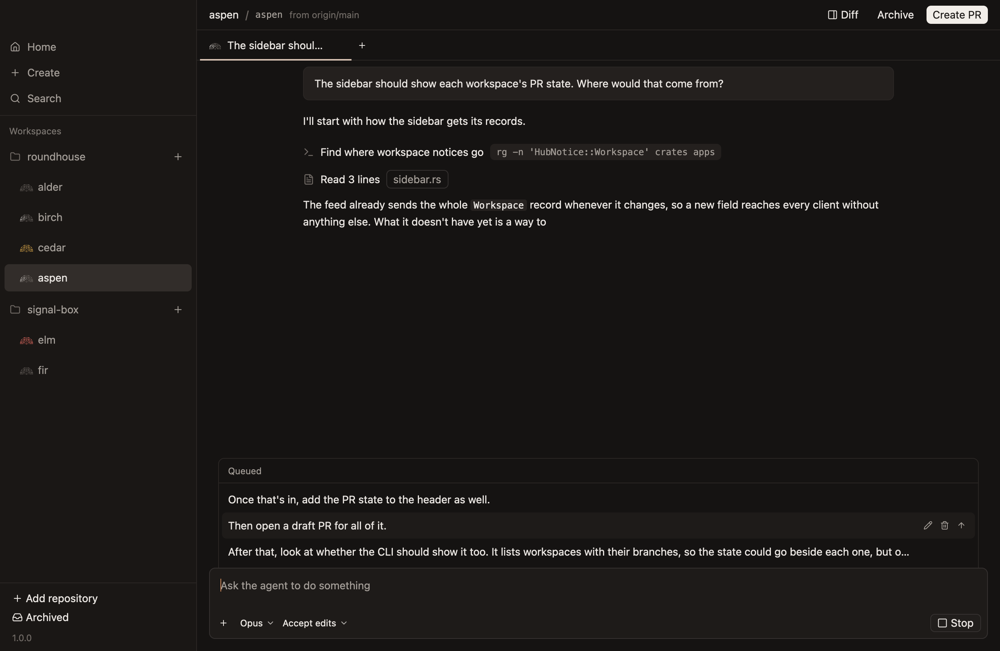
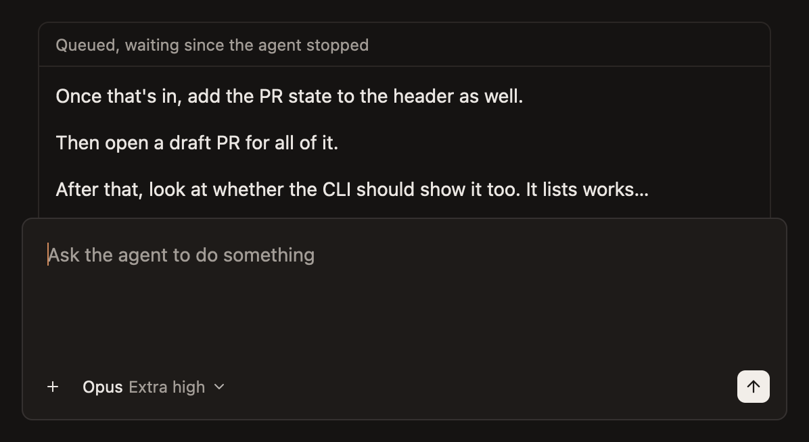

# Steer or queue while it works

You don't have to wait for an agent to finish before saying more. A prompt sent while it works either steers it now, or waits its turn.

| Key | What it does |
|---|---|
| `Enter` | Steers: the agent reads the prompt at its next chance |
| `Cmd-Enter` | Queues: the prompt is sent as a turn of its own once the agent finishes |
| `Cmd-.` | Stops the agent's turn |

With the agent idle, both keys just send.

## Steer

Type and press `Enter` while the agent works. It reads the prompt at its next chance, such as when a running tool finishes, and takes it into what it's doing.

Until then the prompt shows faint at the end of the chat, so it's plain the agent hasn't seen it.

Use it to correct course: "use the existing helper", or "skip the migration for now".

## Queue

Press `Cmd-Enter` to hold a prompt for when the agent finishes. Each queued prompt is a turn of its own, sent in order, so it can't fold into work it wasn't meant for.

The queue sits above the composer, a line for each prompt. Point at one for its buttons:

- **Change it,** in place. `Enter` keeps the change, and Escape leaves it as it was.
- **Take it out.**
- **Send it now,** with the arrow, which steers the agent with it.

The hub keeps the queue, so it's sent with the app closed. Queue the next three steps, quit, and come back to them done.

## Stop

`Cmd-.`, or the Stop button, stops the agent's turn. The chat stays usable.

Stopping means stopping:

- **A steered prompt the agent hasn't read is dropped,** and says so.
- **The queue holds,** rather than sending its next prompt. It says it's waiting.

To go on, send any prompt, or press the arrow on a queued one. The rest of the queue follows once that turn ends.

[Prompts and the queue](../reference/chats/prompts-and-the-queue.md) has every rule.
