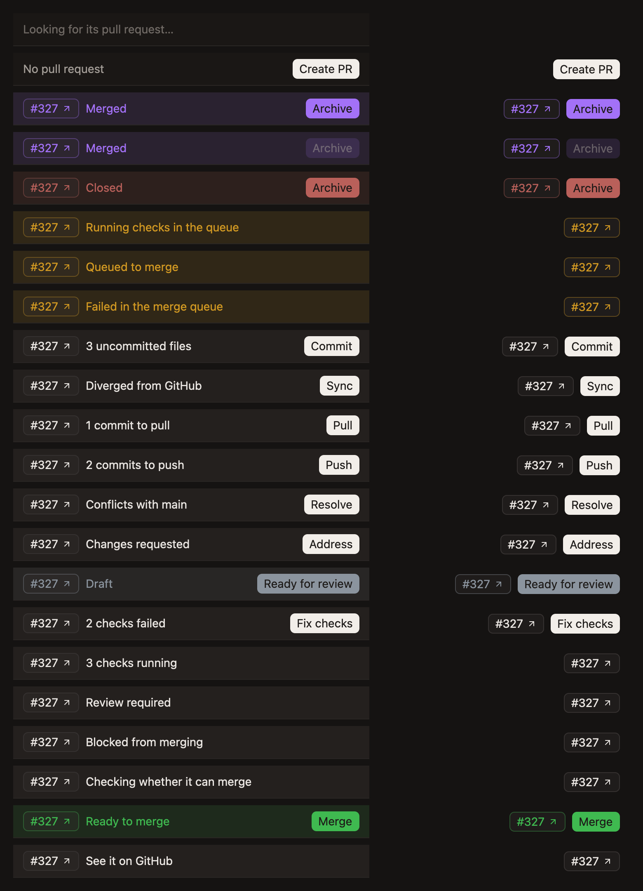
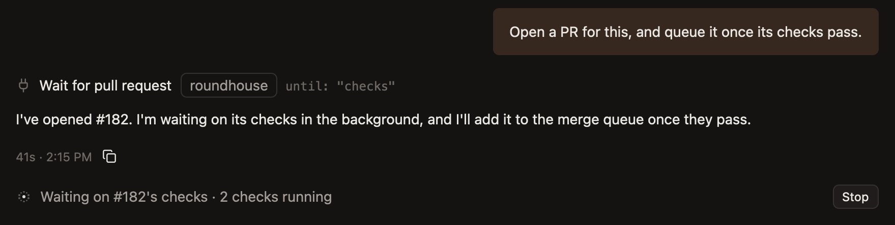

# Take a pull request to merge

A workspace's branch comes back as a pull request. Roundhouse says where it stands, and offers the one thing to do next, until it's merged.

It needs GitHub's CLI, `gh`, logged in, and a repository with a GitHub remote.

## Open it

Press `Cmd-Shift-P`, or click `Create PR` at the top of the sidebar on the right.

That asks the agent to commit, push and run `gh pr create`. The agent knows why the changes were made, so it writes the better description.

## Read the bar

From then on, the top of the sidebar of changes is the pull request's bar. It has three things:

- **The pull request's number,** which opens it on GitHub.
- **The first thing in the way of merging it.**
- **The one thing to do about it,** as a button.

The bar is green only once nothing is in the way, so green always means go. While there's something to do first, it's in the window's own colours. A place in the merge queue is yellow, a draft grey, merged purple and closed red.

## Do the one thing

Each button asks the agent, in the chat showing, since the agent knows how the repository works: how it merges, and whether through a queue.

| The bar says | Its button |
|---|---|
| Uncommitted files | `Commit`, which pushes too |
| Commits to push | `Push` |
| Commits to pull | `Pull` |
| `Diverged from GitHub` | `Sync` |
| `Conflicts with main` | `Resolve` |
| `Changes requested` | `Address` |
| `Draft` | `Ready for review` |
| Checks failed | `Fix checks` |
| `Ready to merge` | `Merge` |

While it's waiting on GitHub or on someone else, such as checks running or a review, the bar offers nothing, since there's nothing for you to do. [Pull request states](../reference/pull-request-states.md) has the full order.

## Let the agent wait for you

An agent can wait on its own pull request, such as for its checks to pass before it queues the merge. The wait shows as a line at the end of its chat, saying what it waits on, with `Stop` to call it off.

The hub keeps the wait, so it goes on with the app closed, and through an update.

## Watch them all

Every workspace's mark takes its pull request's colour, so the sidebar shows where each one stands without opening it: green for open, yellow in the merge queue, purple once merged.

Roundhouse reads each pull request again on its own, and stays within what GitHub's hourly limit can spare, since your agents' own `gh` shares it.

## Finish

Once the pull request is merged or closed, the bar offers `Archive`. [Archive and restore](archive-and-restore.md) says what that keeps.
