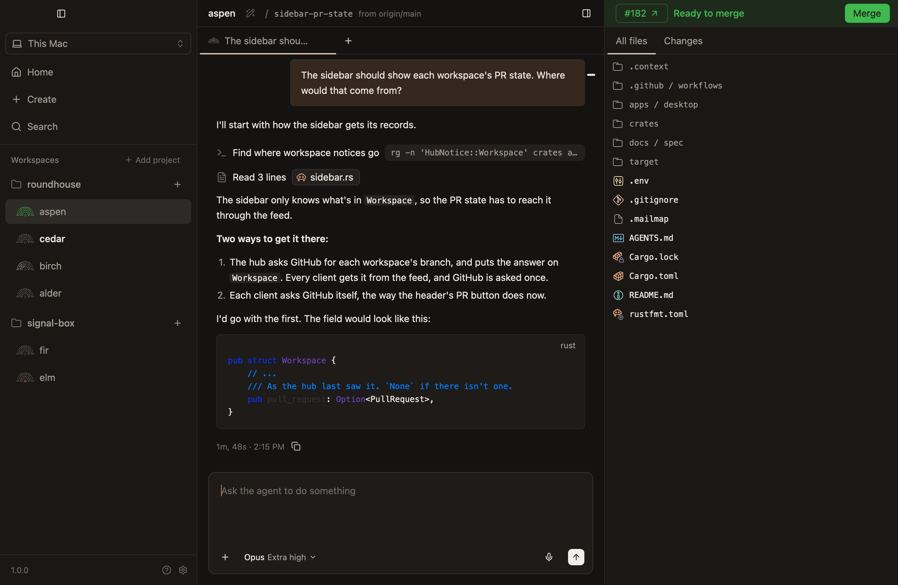
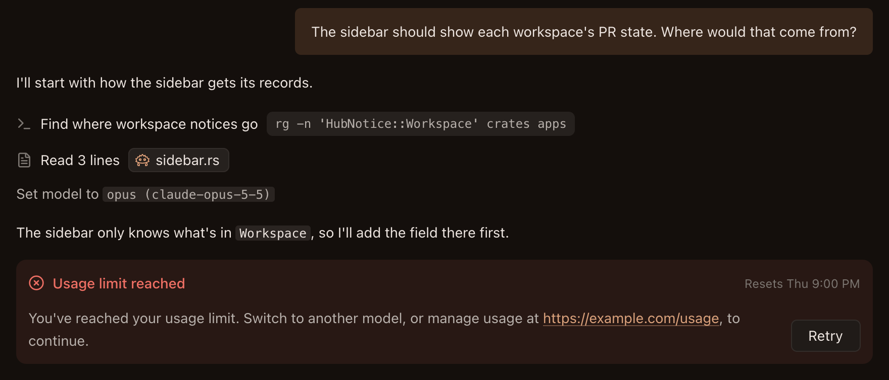
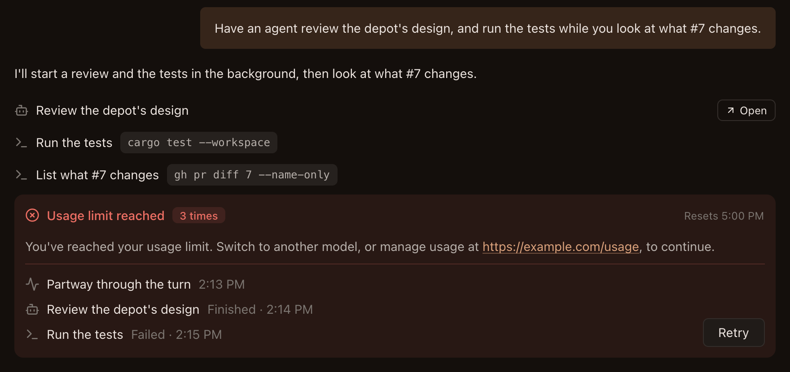
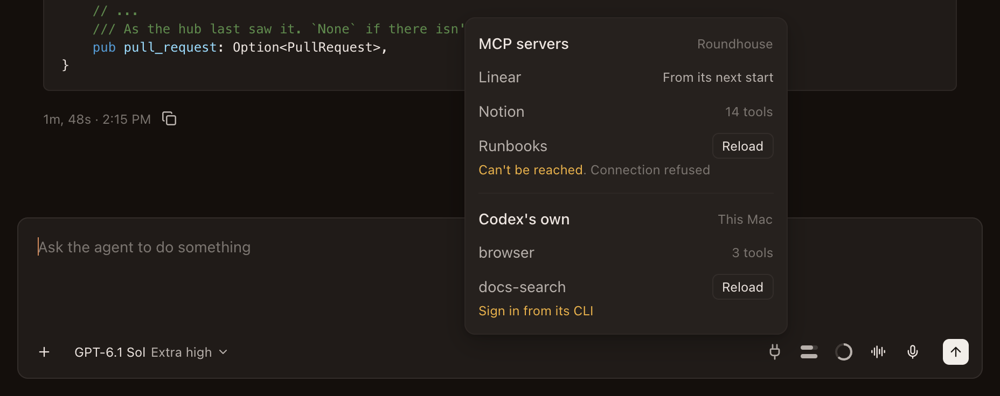

# Chats

A chat is one conversation with one agent, in a workspace's worktree. This page says what a chat is made of, and the pages under it have every rule.

## What a chat has

- **An agent,** Claude, Codex or Antigravity through its CLI, started when the chat's first prompt is sent. Closing the chat stops it.
- **A model and an effort,** which the chat names itself, so your own CLI settings don't decide them.
- **An approval mode:** full access, or plan mode.
- **A history,** which the hub keeps, so it's there after the agent has gone, in every client.
- **A queue** of prompts for when the agent finishes.
- **A title,** written from its first prompt. Until then it's Untitled.

A workspace can have several chats, each with its own agent, all in the same worktree.

## A turn

A turn runs from a prompt until the agent finishes responding. While it lasts, the chat ends with the working line: the mark with its light sweeping, and how long the turn has taken so far. While a Claude agent tries a failed request to its model again, the line says so after the time, such as `Trying the request again · 3 of 10 · 503`, until the agent writes again.

A finished turn ends with how long it took and when it ended, such as `1m, 48s · 2:15 PM`, and a button that copies the agent's final message. A stopped turn says `Stopped`, and one that failed says why, in red.

A Claude turn that failed because its request to the model did, as when you reach your usage limit, ends on a red card instead. It says what went wrong, when a limit resets, and the CLI's own words on what to do. `Retry` asks the agent to carry on, with whatever model the chat runs now, so choosing another model, then `Retry`, gets past one model's limit. It goes once you send anything.

When a request fails the same way again before anything else happens, as when the agent keeps picking up by itself after its background work while you're at your limit, the chat keeps one card for them. It says how many times, such as `3 times`, and has a line for what started each try: your prompt, the turn partway through, or the tasks the agent picked up after. Past four, the earlier ones fold under a line such as `2 earlier`, which opens them.

What the agent's CLI says itself, such as `Set model to opus (claude-opus-5-5)`, is a muted line of its own, so it isn't taken for the agent's words.

An agent that reports background work can end a turn with it still going, such as a test run the agent said it would come back to. When that finishes, the agent picks up again by itself, in a new turn, which starts with a line for each task that ended, saying how. If the new turn's request fails before it does anything, as on a usage limit, those lines are in the failure's card instead.

## The composer

Where you type. Its bottom row has:

| Part | What it does |
|---|---|
| `+` | Attaches files, and turns plan mode on and off |
| The model picker | Chooses the model and its effort |
| The plug | The chat's MCP servers, when it has any: the hub's, and the ones its agent's CLI has of its own |
| The limits' bars | What's left of your account's limits, when the agent reports them |
| The context's ring | How full the context is, when the agent reports it |
| Send | Sends what's typed. While the agent is on a turn, it offers to stop it |

What's typed and attached is kept by the hub until it's sent. It's there when the app opens again, and a prompt that can't be sent comes back to it. Closing the chat lets go of it.

### The chat's MCP servers

While the chat has an MCP server, a plug sits before the limits' bars. Rest the pointer on it for a card of them: the hub's, by the names you gave them, then the ones the agent's CLI has of its own, which it reads from its own settings.

| A server says | Which means |
|---|---|
| `14 tools`, or `Connected` | The agent has it |
| `Starting` | Its CLI is still connecting to it, as it does when you've just signed in to it |
| `Can't be reached` | Its CLI couldn't connect. Codex says why, on the line under it |
| **Sign in** | It's one of the hub's that needs you to sign in to it, and the plug is amber until you do. The button opens its page in your browser, and signs in for every chat |
| `Wants more access`, with **Sign in** | It's one of the hub's that works, and refused a call that needs more than you allowed. Signing in again asks to be allowed that too |
| `Signing in` | Its page waits in your browser for you to approve it, as [Settings](settings.md#sign-in) says |
| `Sign in from its CLI` | It's one of the CLI's own, which you sign in to there, such as with `codex mcp login` |
| `From its next start` | It was added to the hub after the agent started |
| `Removed` | It was removed from the hub after the agent started |
| `Turned off` | The CLI's own settings turn it off |
| Nothing | The agent hasn't said |

Once you've signed in, an agent that was started with the server connects to it, in the middle of a turn too. Antigravity does at your next prompt.

When a sign-in comes to nothing, why is on the line under the server, and **Sign in** starts it again. Settings › MCP servers shows the sign-in too, with a button that opens its page again and one that cancels it.

An agent says which servers it has as it starts on a turn, so until then the CLI's own say `Not known yet`. Antigravity never says, so only the hub's are listed there.

## The parts of a chat

- [Prompts and the queue](chats/prompts-and-the-queue.md): sending, attaching files, steering, queueing and stopping.
- [Questions and approvals](chats/questions-and-approvals.md): what an agent asks, and how to answer.
- [Models and plan mode](chats/models-and-plan-mode.md): which model, how hard it thinks, and whether it asks first.
- [Context, compacting and the cache](chats/context-compacting-and-the-cache.md): what fills up, and what it costs.
- [What a chat shows](chats/what-a-chat-shows.md): tool calls, thinking, subagents and work in the background.
- [Finding, tabs and closing](chats/finding-tabs-and-closing.md): the outline, Find, titles, tabs, and reopening a closed chat.
