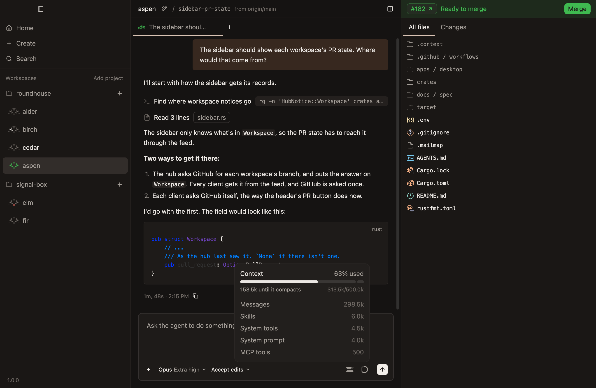
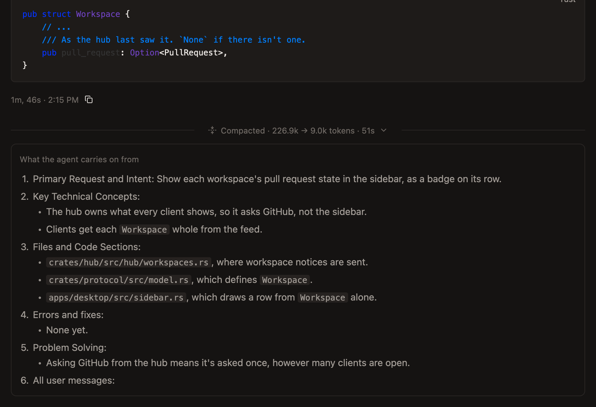
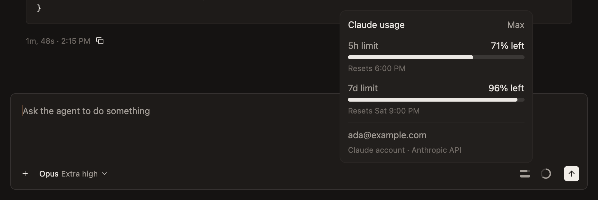
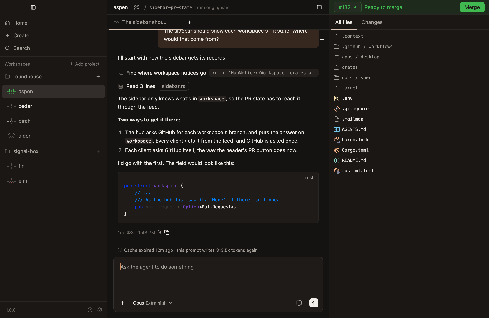

# Context, compacting and the cache

What fills up or runs out as a chat goes on, where each shows, and what each costs.

## The context's ring

A ring beside Send shows how full the agent's context is, filled clockwise from the top. It shows once the agent has said, so a new chat has none until its first turn starts.

Rest the pointer on it for its card:

- **How much is used,** as a share and a bar, such as `63% used`.
- **How much more it can take,** such as `153.5k until it compacts`, and what's used of how much, such as `313.5k/500.0k`.
- **What's in the context,** in the agent's own words, largest first, in tokens.
- **`Compact now`.**

When something has made the context smaller than its model holds, the card says so, such as `Capped at 500.0k of 1.0M by your settings`.

## Compacting

Compacting swaps what the agent holds for a summary, and the agent carries on from that.

- **The agent compacts by itself** as its context fills.
- **`Compact now`** on the ring's card compacts straight away.
- **`/compact`** typed in the composer does the same, with what follows it as what to keep.

A compaction is a rule across the chat: `Compacted`, or `Compacted automatically`, then how many tokens the context went from and to, such as `226.9k → 9.0k tokens`, and how long it took. Click it for the summary the agent carries on from.

While the agent compacts, the working line says `Compacting the conversation`.

It's refused while the agent is on a turn, and before it has had one, when there's nothing to compact. One that failed is a red line saying why.

## The account's limits

A bar for each of your account's limits sits left of the ring, shortest window first. Each empties as the limit is used. With more than five limits, the bars show the five with the least left, and the card lists them all.

Their card says how much of each is left, such as `96% left` of the `7d limit`, when it starts again, and your plan. Under the limits, it says whose account it is: the email, how it's logged in, and the model provider.

- **A model's own weekly limit has a line of its own on the card,** and a bar while there's room, such as the `7d Fable limit`. Using it up stops that model, unless your account has usage credits to spend on it, while the others go on, so choose another model to carry on meanwhile.
- **A limit is the account's, not the chat's,** so every chat under the same login shows the same.
- **The bars follow what working agents report,** and are never more than about five minutes behind.
- **Nothing shows for an account with no limits,** or until an agent under the account has heard of one. Then the ring's card says whose account it is instead.

## The prompt cache

The model provider keeps what an agent's requests read and write for a while, so the next request needn't send it again. A prompt sent once that cache has expired writes the whole conversation to it again, which in a long chat is the most a prompt can cost.

### When it expires

- **A cache expires one lifetime after the agent's newest request,** an hour on a Claude account, since each request starts its time again.
- **A compaction leaves nothing cached,** and so does choosing another model.
- **It's about to expire with a quarter of its lifetime left:** 15 minutes for an hour's cache.

### Where it shows

| When | Where | What it says |
|---|---|---|
| Any time | The newest turn's card | How long the cache has left, such as `42 min left` |
| About to expire | The chat's tab, and its workspace's row in the sidebar | A clock, which says `Cache expires in 9 min` when pointed at |
| About to expire | Its workspace's row on Home | `Cache expires in 9 min` |
| About to expire | The line under the newest reply | A small wedge for what's left |
| Expired | Above the composer | `Cache expired 12m ago · this prompt writes 313.5k tokens again` |
| After a prompt that wrote it again | A rule in the chat | `Cache expired · 1h 20m idle · 313.5k tokens written again` |

- **Nothing says so while the agent works,** since each request keeps the cache warm.
- **A chat under 50k tokens says nothing but in its newest turn's card,** since writing that again costs little.
- **Once expired, the tab and the row say nothing,** since every cache expires sooner or later. The chat itself still says so.

### Switching models

While the cache is warm, pointing at another model in the picker says what switching costs, such as `Switching writes this chat's 313.5k tokens to the cache again`. Once it has expired, switching costs no more than staying, so the picker says nothing.
