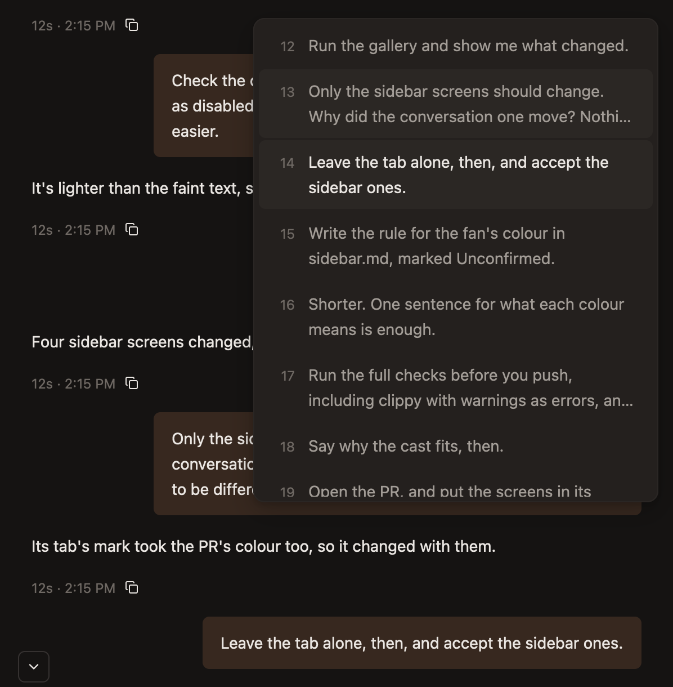
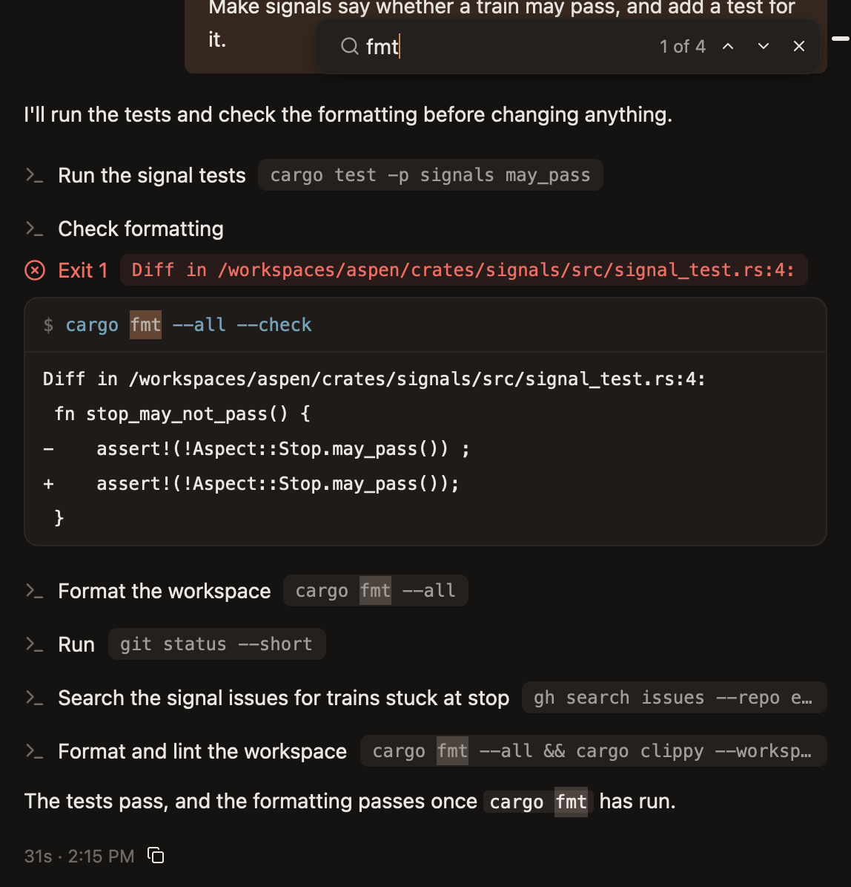
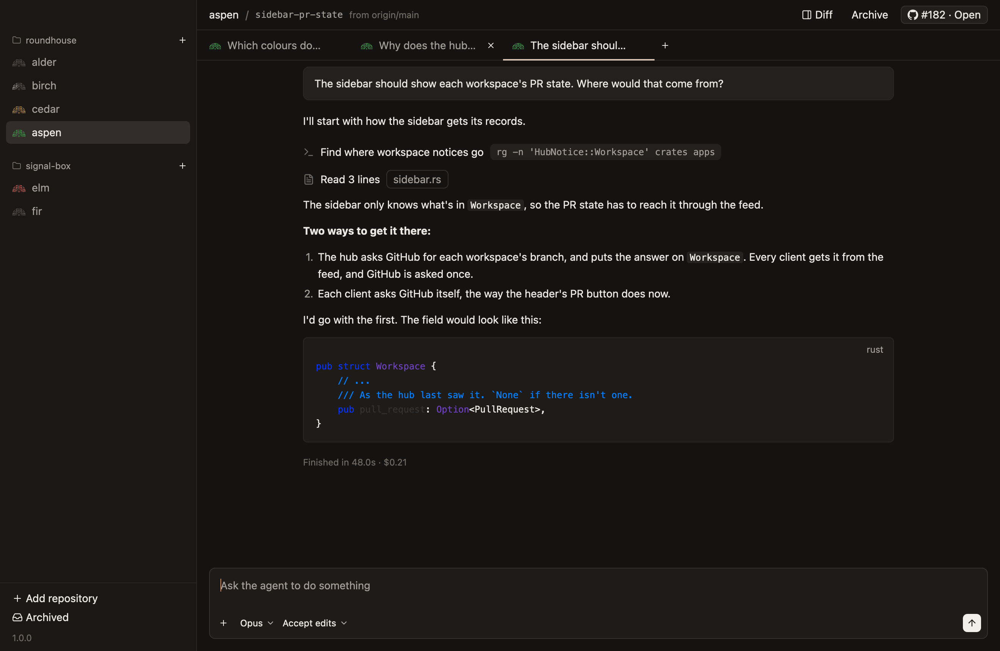
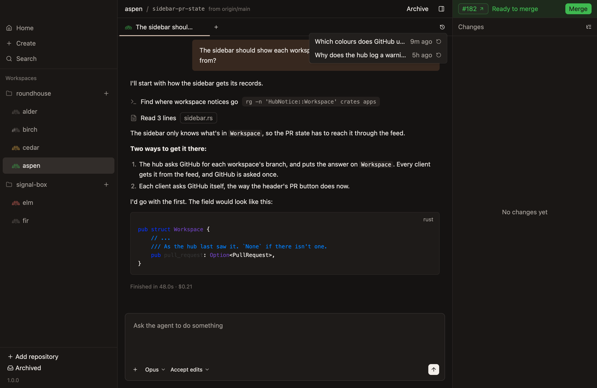

# Finding, tabs and closing

How to find your way around a long chat, and between chats.

## The outline

A chat has an outline at its right: a short tick for each prompt, top to bottom, with the one you're reading in white.

- **Rest the pointer on the ticks** for a numbered list of the prompts, with up to two lines of each.
- **Click a prompt** to put it at the bottom of the chat, with what came before it above.
- **A dot marks each compaction,** in its place among the ticks.
- **It has every prompt, however long the chat,** including those too far back for the app to have loaded.

A chat scrolled away from its end also shows a button at its bottom left, which scrolls back down to the end.

## Finding text

`Cmd-F` opens a bar at the top right of the chat.

| Key | What it does |
|---|---|
| `Cmd-F` | Opens Find, or goes back to its bar |
| `Enter`, `Cmd-G` | The next match |
| `Shift-Enter`, `Cmd-Shift-G` | The match before |
| Escape | Closes the bar |

- **What's typed is looked for as plain text, ignoring case.**
- **It finds what the chat shows:** your prompts, the agent's words and thinking, what calls were given and sent back, and what went wrong.
- **The count is of the whole chat, however long,** such as `2 of 41`. Until it's counted, the count ends in `…`.
- **Going to a match opens the call or the thought it's in,** and scrolls it into view.
- **It doesn't search** the file tab, the subagent tab, answered questions, or a compaction's summary.

## Titles

- **A chat is called Untitled until it has a title.**
- **Its title is written from its first prompt,** by a small model, not by the chat's agent.
- **A workspace's first chat gets the workspace's title.**
- **Right-click a tab and choose Rename…** to change it. A title typed by hand is never replaced by a generated one.

## Tabs

Every tab is the same width, with its mark and as much of its title as fits. The chat showing has a pale copper line under it.

| Key | What it does |
|---|---|
| `Cmd-T` | A new chat |
| `Cmd-W` | Closes the chat showing, or the file tab or subagent tab if that's showing |
| `Ctrl-Tab`, `Ctrl-Shift-Tab` | Move between tabs |

The file tab and the subagent tab sit at the far left, before the chats.

Right-clicking a tab also marks its chat read, or unread again.

## Closing and reopening

- **Closing a chat stops its agent and keeps its history.**
- **Closing the last chat starts a new one,** rather than leaving nothing.
- **Closing a chat nothing was sent in deletes it,** so unused chats don't pile up.
- **A closed chat is reopened from the history button,** at the far end of the tabs, which lists closed chats, the most recently closed first.

The next prompt in a reopened chat resumes the agent's conversation.
