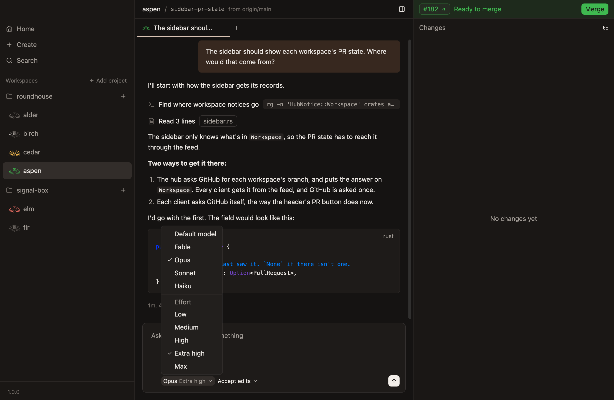
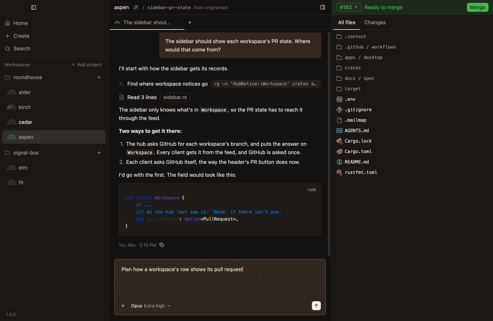
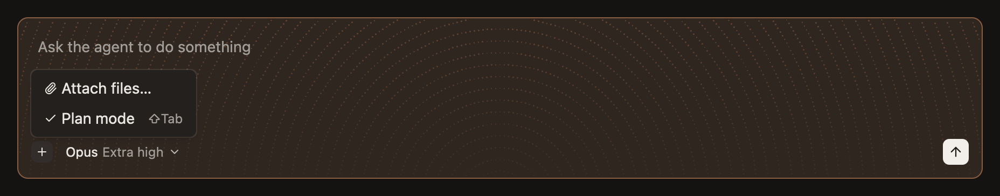

# Models and plan mode

Which model a chat runs, how hard it thinks, and whether it asks before changing anything.

## Choose the agent

The new-workspace dialog offers Claude and Codex. In an existing workspace, the `+` beside the chat tabs offers a new chat for each agent. A chat keeps its agent; choose another by opening another chat.

Codex offers the native model catalog captured in this Roundhouse build, including each model’s supported effort levels. Changing models keeps the current effort if supported, or selects the new model’s default. Codex starts with **GPT-6.1 Sol at Low effort**, using the Codex CLI’s sign-in on the worker’s machine.

## The model and its effort

One picker, in the composer's bottom row, chooses both, since how hard the agent thinks is part of choosing what thinks. It shows the model's name and then the effort, such as `Opus Extra high`.

| | Choices |
|---|---|
| **Claude models** | `fable`, `opus`, `sonnet` and `haiku` |
| **Codex models** | GPT-6.1 Sol and Terra; GPT-6 Astra, Sol and Luna; GPT-5.6 Sol, Terra and Luna |
| **Effort** | Low, Medium, High, Extra high and Max; Ultra on the Codex models that support it |

- **Claude’s models are aliases,** which the Claude CLI resolves to its newest of each, so a new model arrives without an update to Roundhouse.
- **A Claude chat nobody has chosen for runs Opus at Extra high; Codex runs GPT-6.1 Sol at Low.**
- **Every chat names its model and effort itself,** so your own CLI settings and your account don't decide them.
- **A new chat with the same agent keeps the model and effort of the chat it was opened from.** Switching agents uses that agent’s defaults.
- **A new effort reaches an agent that's already working without stopping it.** Codex accepts model, mode and effort changes for its next turn.
- **For Claude, choosing another model writes the conversation to the prompt cache again,** and the picker says how much before you switch. See [Context, compacting and the cache](context-compacting-and-the-cache.md).

## Approval modes

A chat is in one of two:

| Mode | What the agent does |
|---|---|
| **Full access** | Uses any tool without asking, but for the few things its own CLI asks about in any mode, which a setting can allow for you. A chat starts here, unless plan mode was on in the new-workspace dialog |
| **Plan mode** | Works out a plan, and asks before changing anything |

[Full access and plan mode](../../concepts/full-access-and-plan-mode.md) says why full access is where a chat starts.

## Plan mode

- **`Shift-Tab` in the composer turns it on and off,** and so does `Plan mode` in the menu the composer's `+` opens. The new-workspace dialog has both too.
- **The composer shows it in copper,** with a texture drawn from the status mark.
- **Approving the agent's plan goes back to full access.**
- **A new chat doesn't keep it,** since it belongs to the task at hand.
- **A chat that's planning when its agent stops is still planning when the agent comes back.**

Codex holds its finished plan for approval, including a plan returned as an ordinary final reply. Approve it to start implementation; asking for changes keeps it in plan mode.

## The `+`'s menu

Two items:

- **Attach files…,** which opens the file picker.
- **Plan mode,** with `Shift-Tab` beside it, and a check while it's on.

