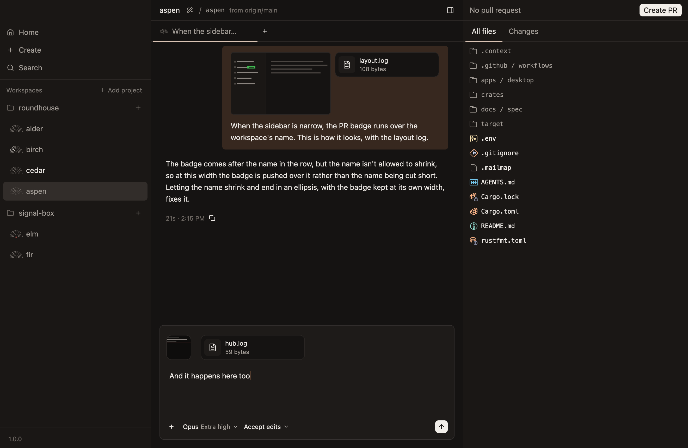

# Prompts and the queue

How a prompt is sent, what it can carry, and what happens to one sent while the agent works.

## Sending

| Key | With the agent idle | While the agent works |
|---|---|---|
| `Enter` | Sends | Steers: the agent reads it at its next chance |
| `Cmd-Enter` | Sends | Queues it for when the agent finishes |
| `Cmd-.` | | Stops the turn |

A chat's prompts reach the hub in the order you sent them, even when one is still adding a large file, so the agent never reads them out of order.

## Files

A prompt can carry files, and one with files needs no text.

- **Add them** by pasting an image, dropping files on the composer, or choosing `Attach files…` from the `+`'s menu. Each shows as a tile above what's typed.
- **Any kind of file can go,** up to 100 MB, and at most 10 with a prompt.
- **Each file is saved in the workspace's `.context/attachments/`,** and the agent is told where, so it can open it then or later. Git is told to ignore that folder.
- **Images go in the prompt itself too,** up to 32 MB between them, and so does a text file up to 32 KB, so the agent sees them without opening anything.

In the chat, a prompt's images show small above its text, and a click opens one. Other files show their name and size.

The hub keeps each image, so it's still there after the workspace is archived. Other files are only in the worktree, so archiving takes them with it.

## What's typed is kept

What's typed and attached in a composer is kept by the hub until it's sent:

- It's there when the app opens again, however it stopped.
- Typing is saved every half second.
- A prompt that can't be sent comes back to its composer, files and all.
- Closing the chat lets go of it.

## Steering

A prompt sent with `Enter` while the agent works is read at the agent's next chance, such as when a running tool finishes.

- **Until it's read, it shows faint,** at the end of the chat, above the working line.
- **Once it's read, it's where the agent read it,** after what the agent did before then.
- **One sent while the agent writes its last reply** starts a turn of its own straight after.

## The queue

`Cmd-Enter` queues what's typed for after the agent finishes.

- **Each queued prompt is a turn of its own,** sent in order once the agent has nothing left to do.
- **The queue sits above the composer,** a line for each prompt. A prompt with files says so after its text.
- **A prompt's buttons show while the pointer is over it:** change it, take it out, or send it now.
- **A change is made in place.** `Enter` keeps it, and Escape leaves it as it was. It changes only the text, and the files stay as they were queued.
- **The arrow steers the agent with the prompt,** as `Enter` would, rather than leaving it to wait.
- **The hub owns the queue,** so it's sent with the app closed, and every client shows the same one.

## Stopping

`Cmd-.` and the Stop button stop the agent's turn. The agent itself stays, and takes the next prompt.

- **A steered prompt the agent hasn't read is dropped,** and says so in the chat.
- **The queue holds,** and says it's waiting. It also holds when the agent goes away mid-turn.
- **Sending any prompt lets the queue go on,** once that turn ends. So does the arrow on a queued prompt, which sends it as a turn of its own.

The hold lasts through a restart of the hub.

Stopping a turn doesn't reach work the agent left in the background, such as a server it started.
