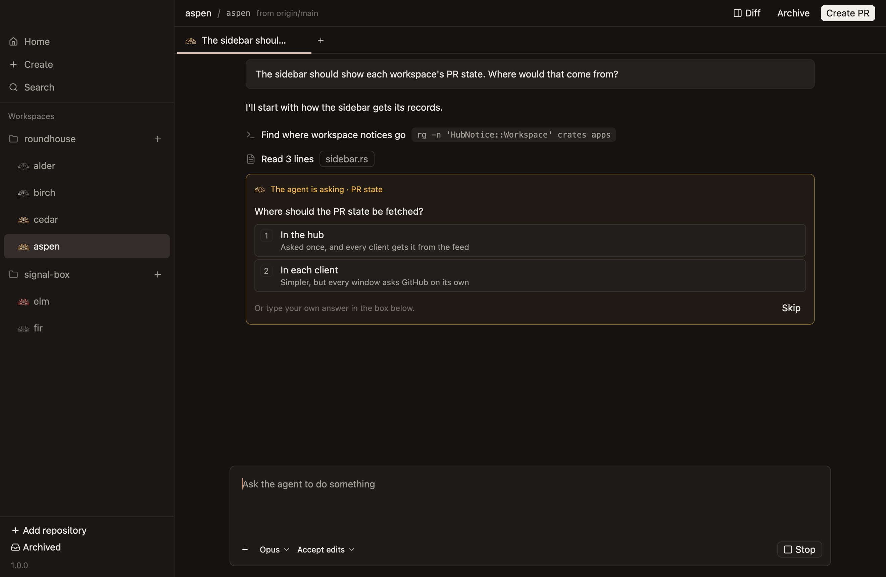
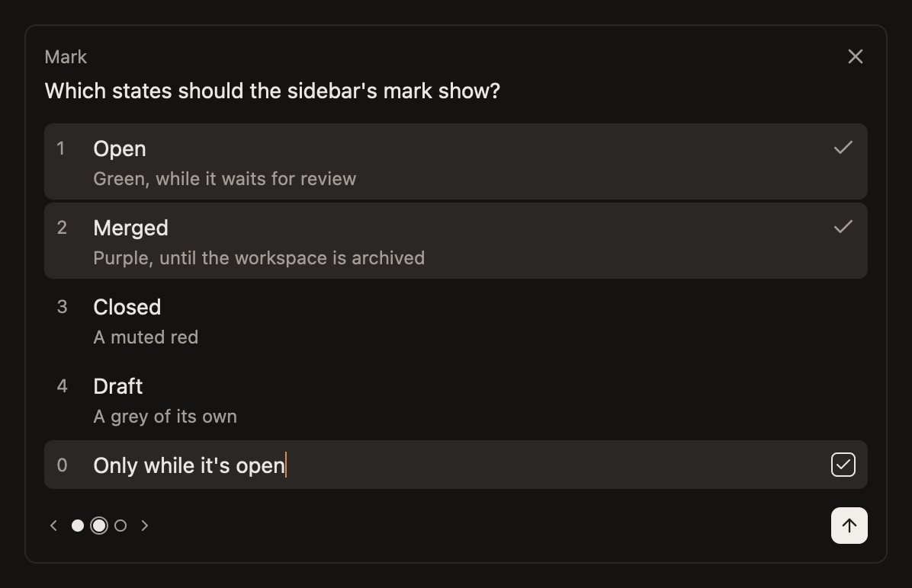
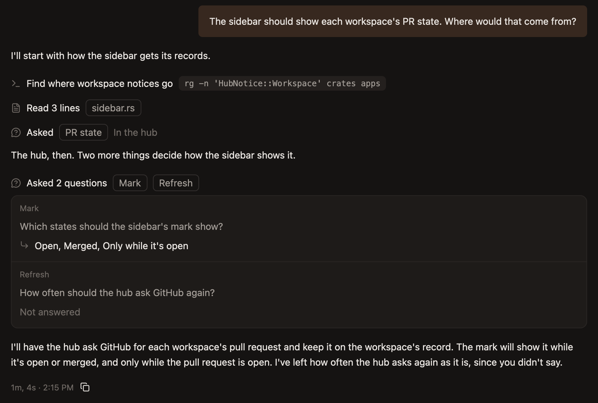
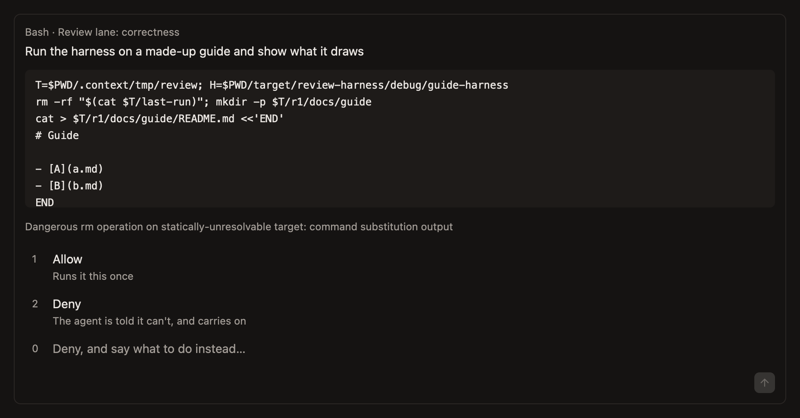
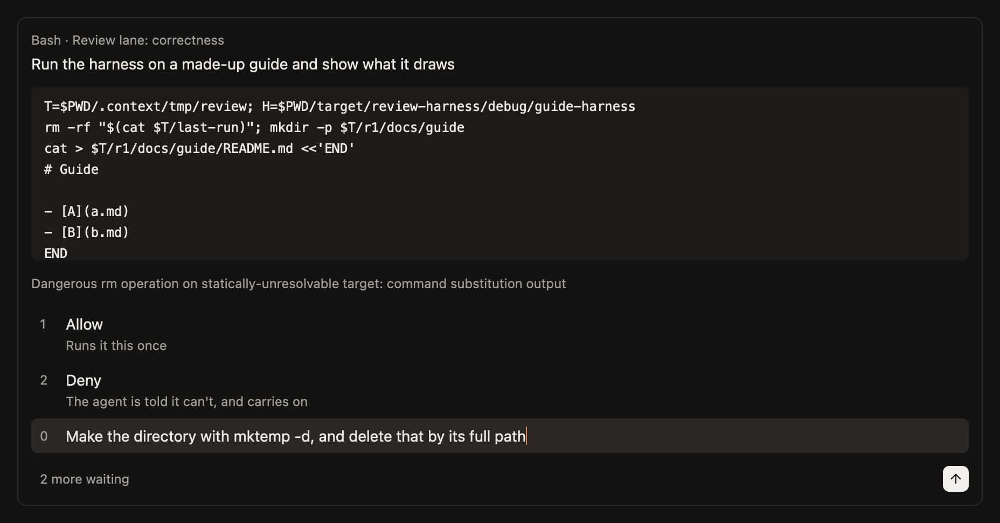

# Questions and approvals

What an agent can ask you, and how each is answered.

## Questions

A question from the agent takes the composer's place until it's answered. What's typed and attached in the composer waits behind it.

It shows one question at a time: its header and text, then each option on a numbered row with what it means under it, and a last row, `0`, to type another answer into.

### Keys

| Key | What it does |
|---|---|
| A number | Chooses that option |
| `0` | Goes to the row for typing an answer |
| Left and right arrows | Move between questions, when there are several |
| `Enter` | Goes to the next question without an answer, and sends once there's none |
| Escape | Leaves the typing row |

The question takes the keys when it comes. When it's just come, keys do nothing until half a second passes without one, so the end of something you were typing can't answer it by accident. Choosing with the pointer works at once.

### Several questions

With more than one, a dot for each sits at the bottom left, filled once it has an answer. Where a question takes several answers, a check marks each one chosen.

- **The arrow sends once any question has an answer,** and leaves out the ones without.
- **The `×` skips them all,** and tells the agent to carry on if it can.
- **Questions waiting are asked in turn,** oldest first.

### Once answered

An answered question is a line in the chat where the agent asked it: `Asked`, each question's header, and what was answered. Click it for the whole question. One nobody answered says `Not answered`.

## Approvals

An agent in plan mode asks before using a tool. An agent with full access asks only about what its own CLI won't do unasked in any mode, such as a command that removes something it can't check.

Either way, the request takes the composer's place, as a question does, and is answered by the same keys.

- **Its header is the tool,** then what the subagent that asks is for, when one does.
- **Under what the agent says it's for is the command, whole.** A long one scrolls. An edit, or a file to write, shows what it would change, under the file's path. Another tool shows its main input, such as a URL.
- **Under that is why the agent asks,** in its own words, when it says.
- **`1` allows it and `2` denies it,** and `Enter` or the arrow sends what's chosen.
- **`0` goes to the row for saying what to do instead.** What's typed there denies the request, and the agent is told in those words. `Enter` there sends only what's typed, so it never allows.
- **Typing anything else takes back what's chosen,** so a sentence meant for the composer can't allow a command.
- **With more requests waiting, the bottom left says how many,** and each is asked in turn.

Once answered, a request leaves the call's own line in the chat. One you denied says `Denied` under it, with what you said, if anything. A subagent's call is in its work, so the chat says what was denied and for whom, such as `Denied Bash for Check 1`.

When its plan is ready, the agent asks you to approve it, on a card in the chat. Approving goes back to full access.

## While an agent waits

- **Its title is bright,** in its chat's tab and on its workspace's row, until it's answered, whether or not it's showing.
- **Its mark holds still,** and the working line goes, since what it asks says it's your turn.
- **A notification says `Waiting on you`,** if you're elsewhere.
- **What you've chosen and typed in answer is kept by the hub,** so it's there when the app opens again, and wherever else the chat is open. A choice made there makes the panel here ignore keys for half a second, so an Enter you meant for your own choice can't send it.

## From the command line

`roundhouse approve` and `roundhouse answer` do the same from a terminal. See [The command line](../command-line.md).
