# What a chat shows

A chat shows your prompts, what the agent wrote, and everything it did on the way. Every tool call is one line that opens to its detail, so a long turn stays readable.

Rest the pointer on a prompt for a button at its left that copies what it says.

## While the agent works

- **The working line ends the chat:** the mark with its light sweeping, and how long the turn has taken so far.
- **A thought still being written** is a muted line above it.
- **A prompt you've sent that the agent hasn't read** shows faint, above the working line.

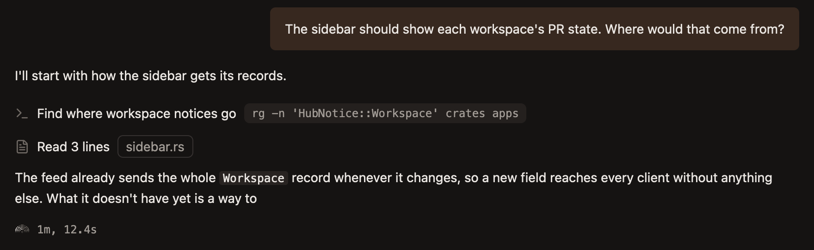

## A finished turn

A finished turn ends with how long it took and when, such as `1m, 48s · 2:15 PM`, and a button that copies the agent's final message.

Rest the pointer on that line for the turn's card: the details its agent reports, such as which model answered and how many tokens its requests took, read, written and cached, alongside when the turn started and ended. Codex does not report per-turn token counts through Roundhouse.

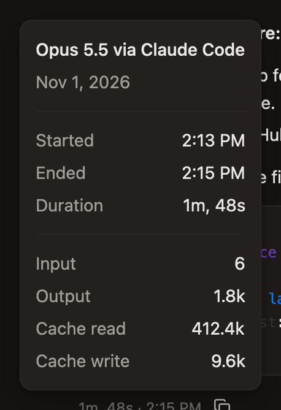

## Selecting text

- **Shift with an arrow key makes what's selected longer or shorter at the end you moved last,** a character at a time, or a line with up and down. With Option, or Ctrl on Windows and Linux, it goes a word at a time. The chat scrolls to bring that end into view, so held down, it goes on past the window's edge. The keys do the same in a proposal's page and in a Markdown file shown rendered.

## Tool calls

Each call is a line: what it is, and what it's about. Click it to open it.

| Call | Its line says | Opened, it shows |
|---|---|---|
| A command | What the agent said it's doing, and the command | The command, then what it printed |
| Reading a file | The file, and how much was read, such as `Read 10 lines` | The lines, numbered and highlighted |
| An edit | The file, and lines added and removed, such as `+5 −2` | Its diff |
| A patch of several files, as Codex makes | How many files, such as `Edit 2 files`, the lines added and removed, and the files' names | Each file's path, then its diff |
| A search | Its pattern, where it looked, and how much it found | The matching lines, under their files |
| A web search | What it looked for, and how many pages it found, where its agent says which | The pages, which open in the browser, then what was made of them |
| A fetch | The site | The address, what was asked of it, and the answer |
| Making an image, as Codex can | What it was asked for, once it's made | All of what it was asked for, then the image |
| Any other tool | Its name made readable, and the MCP server it's from | Its input, then what came back |

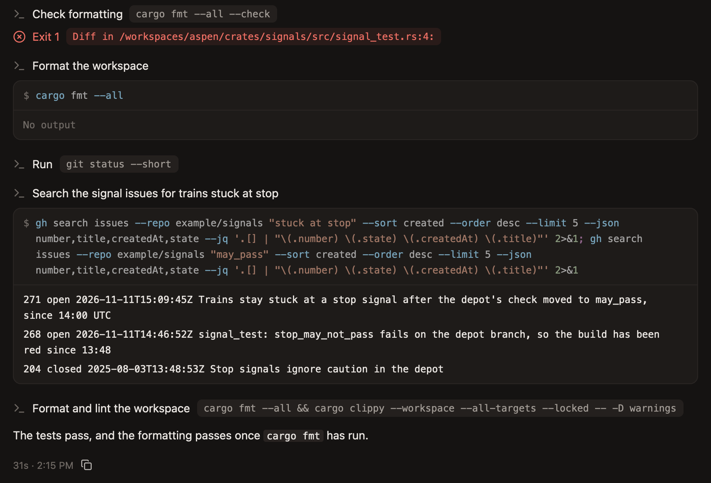

- **A call that failed says so on a red line under it,** such as `Exit 1`, or `Timed out` or `Stopped` for a command that didn't exit, where its agent says, with the first line of what went wrong. It shows while the call is closed, so a failure is never hidden.
- **A command that went on in the background says so when it's opened,** under what it printed by then, since what it prints from then on isn't the call's.
- **A command that only reads a file shows as reading it,** with the file's name, and opens to what it printed. That's a command that runs one program to print a file, such as `cat a.rs` or `sed -n '1,40p' a.rs`, so `cd src && cat a.rs` shows as a command. One that only searches shows as a search, and opens to its matching lines under their files, or to what it printed. A patch of one file shows as an edit or a write of it does, and a look at an image shows as reading it, opening to the image.
- **A web search whose agent says what it found only in words, as Antigravity's does, doesn't say how many pages it found,** and opens to the words.
- **Hovering an edit shows its diff,** without opening it.
- **An opened call's text is selected with the rest of the chat,** such as a command and what it printed, what went wrong, and a question and its answer. So a drag from one reply into the next takes in a call opened between them, and `Cmd-A` takes in every opened call. A tool's input, a file's numbered lines, a diff, a search's matching lines, a web search's pages, what a fetch asked, what you told the agent when you denied a call, and output over 16 KB aren't selected.
- **A command has a button that copies all of it,** to run elsewhere.
- **An image a call sent back, such as one it read, opens with a click,** as big as it is, up to what fits in the window. Escape or a click closes it.

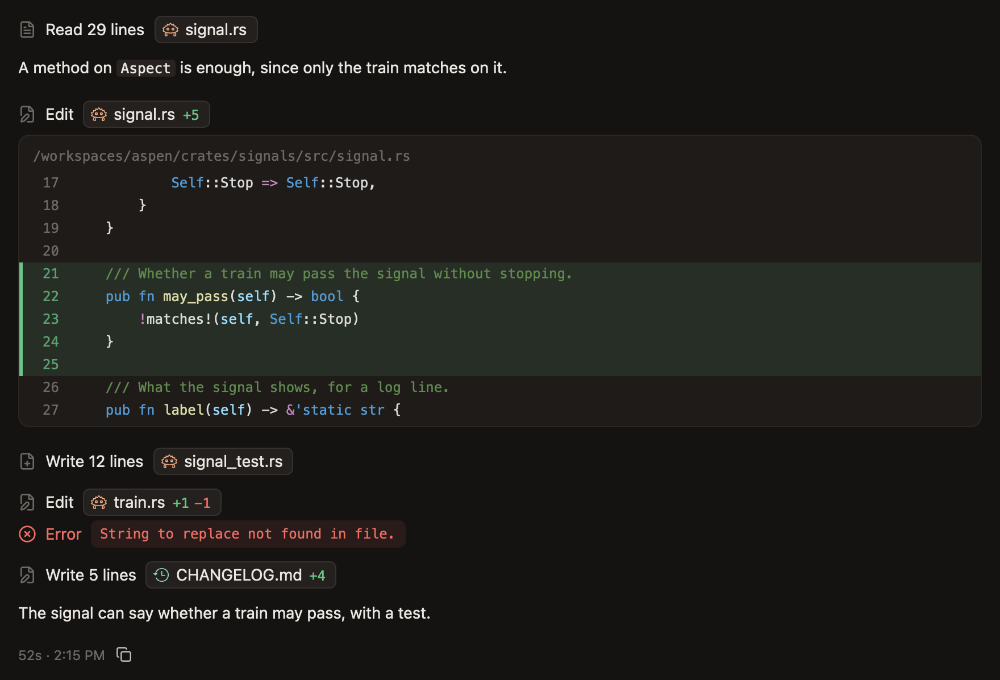

## Thinking

What the agent thought is a line like a call's, saying `Thinking`, with the start of the thought. Click it to read the whole thought.

`Always expand thinking`, in [Settings](../settings.md), shows every thought in full. Codex shows the reasoning summaries its model makes available; some thoughts have no summary.

## Subagents

An agent can hand part of its work to a subagent. Its call says what the subagent is for, its kind, the model it runs on, and how many calls it's made, such as `Haiku 5.5 · 3 calls`.

- **Opened, the call shows what the subagent was asked,** what it's done lately while it works, and its report once it's done.
- **`Open`, at the end of the line, opens the subagent tab,** with everything the subagent did, in order.
- **A call that sends a subagent a message, waits for it or stops it names it,** as `Message`, `Wait for` or `Stop` and what the subagent is for, and has `Open` too. Opened, a message shows what it asked.
- **The band at the top of the tab says where the subagent stands,** such as `Working · Opus 5.5 · 3 calls · 24k context`. Its context is how many tokens its conversation holds, not what it has used in all, so it can fall when the subagent compacts.
- **A workspace has one subagent tab.** Opening another subagent shows that one in the same tab. `Cmd-W` closes it.

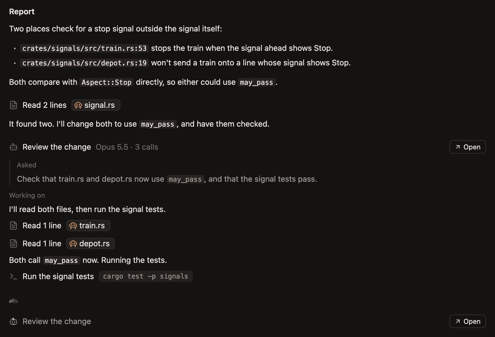

A subagent's work is kept out of the chat, so it doesn't bury the conversation it's part of. A subagent that starts working again after it finished, as Claude's does when the agent sends it a message, and Codex's does with follow-up work, says so in the same call, its time counts from when it started again, and its report is the one it gives next. Codex names its subagents by their task paths, and a message to one doesn't by itself start more of its work. What it was asked appears only when Codex supplies it. Antigravity doesn't say what its subagents do, so its subagent's call has no `Open` button, and opens to what it was asked and what came back, and its message to a subagent says only that, as `Message a subagent`.

## Proposals

When an agent needs you to decide something too large for a question, such as which of two or three designs to build on, it writes a proposal: the context, then each question with its options, each with what it costs, and the one it recommends. Its call in the chat says `Proposed`, the proposal's title, and how many options it has while it waits for you, or what you chose once you've answered.

- **The proposal opens in the proposal tab,** beside the chats, by itself the first time, without taking you from what you're doing, and from `Open` at the end of its line.
- **The tab has an outline of the proposal on the left.** Click a part to go to it.
- **Each option is a card,** with its letter, its title, and `Recommended` on the one the agent recommends.
- **The images the agent points to show on the page,** such as a diagram or a screenshot in the workspace, as they were when it proposed, and so do the diagrams it writes in Mermaid.
- **The agent can go on working, or stop, while you read it.** Ask it about the options in the chat meanwhile.
- **A workspace has one proposal tab.** Opening another proposal shows that one in the same tab. `Cmd-W` closes it.

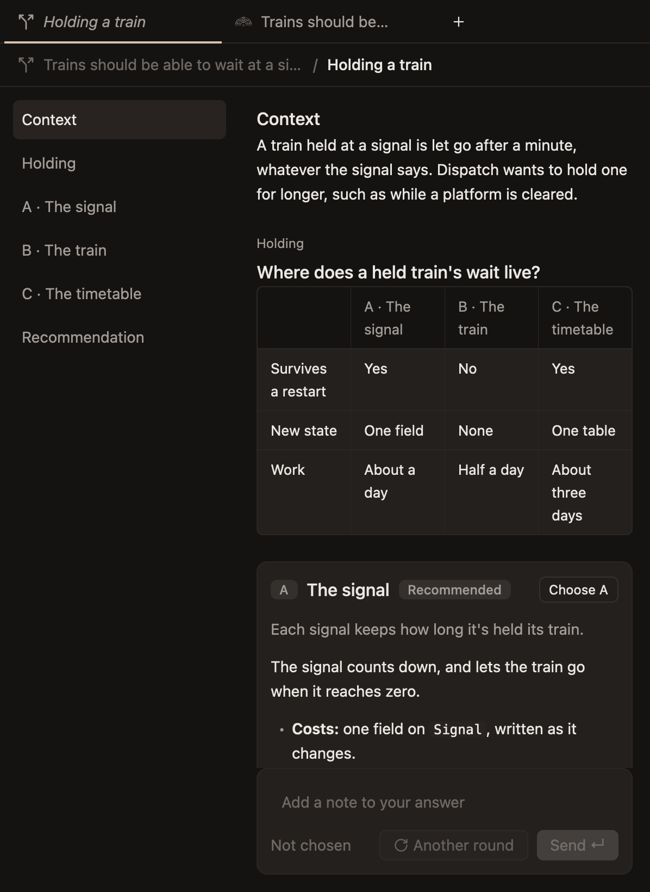

The agent can revise a proposal, such as when you ask for another round, or ask in the chat for something its options don't have, whether or not you've answered it.

- **The tab shows the newest revision,** with what changed since the one before at the top. Options the agent kept keep their letters, so dropping B leaves C as C.
- **The call that revised it has a line of its own,** `Revised`, and each line says which revision its call wrote and what became of it: what you chose, that you asked for another round, or that the next revision replaced it.
- **If it's revised while you're reading it, or part way through answering,** the tab stays as it is, with what you'd chosen and written, and a banner says the newer revision is there. Nothing can be sent until you click `Show revision 2`, or `Open` on one of its lines in the chat. Your note comes with you, and so does each choice whose option is still there under its letter.

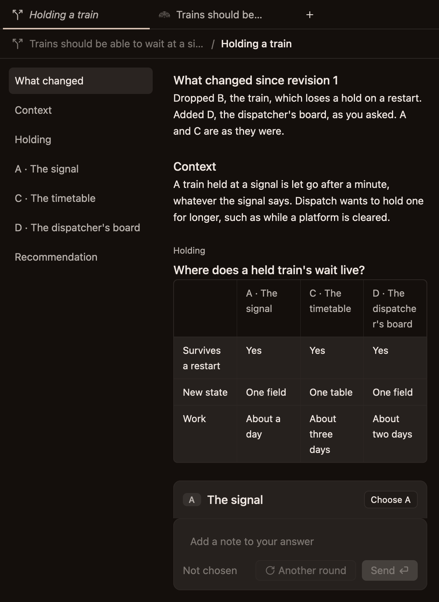

To answer, click `Choose` on the option you want for each question, add a note if you like, and click `Send`, or press `Enter` in the note. On a Mac, you can [dictate the note](../../guides/dictate-a-prompt.md) too.

- **The agent is told what you chose,** and reads your note with its tools, so what you write can be as long as it needs to be. If it's working, your answer goes into what it's doing, which it reads at its next chance, as a message you send while it works does. If you stop the agent before it reads your answer, it never gets it, and the answer's line says so. Your answer stays in the proposal, so ask the agent to read it.
- **Your answer is drawn in the chat as a line,** `Answered`, faint until the agent reads it, and then where the agent took it, rather than as a message of yours, and the outline marks it the same way. A chat's title is never made from it.
- **An answer can't be changed once it's sent.** To change your mind, tell the agent in the chat.
- **What you've chosen and written isn't kept until you send it,** so it's lost if you open another proposal in the tab, close the tab or quit the app. A new proposal from the agent waits rather than take its place.

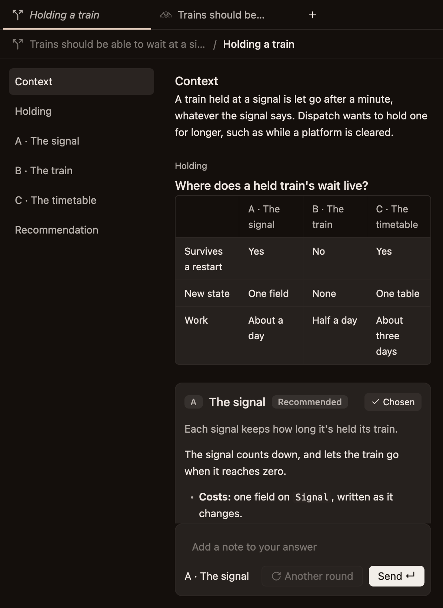

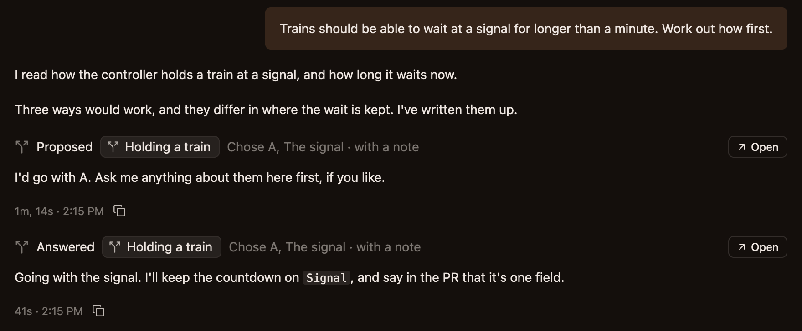

If none of the options will do, say in the note what to change, and click `Another round` instead of choosing.

- **The agent is told you asked for another round,** and reads your note with its tools, as it reads a note with an answer. It needs the note to know what to change, so `Another round` waits until you've written one.
- **The tab says the next revision comes there,** and shows it in place of this one once the agent writes it, waiting for you to choose.
- **Your request is drawn in the chat as a line,** `Replied`, as an answer's is.

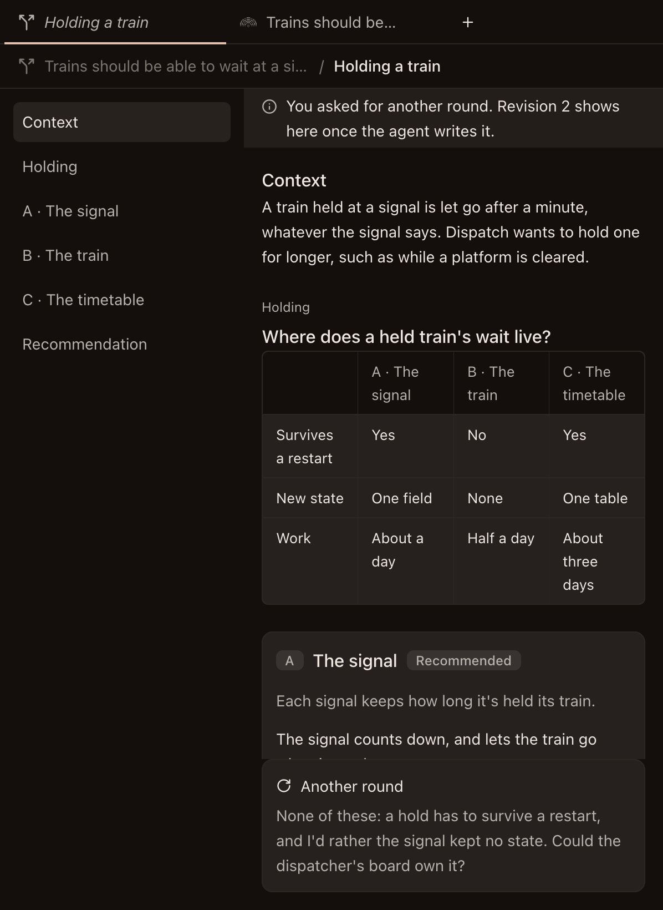

The agent withdraws a proposal it won't use, such as when you decide another way in the chat, and says why. The call has a line of its own, `Withdrew`, with why, the proposal's line says `withdrawn`, and its tab says why at the top, with nothing to choose.

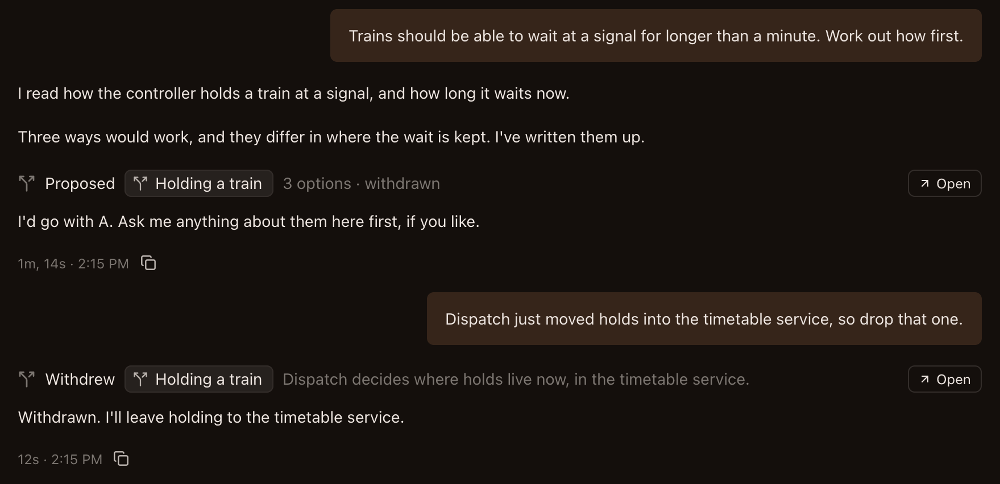

## Work in the background

A turn can end with work still going: a command, a subagent, or a monitor watching for something. Up to four tasks have a line each where the chat ends, saying what each is for.

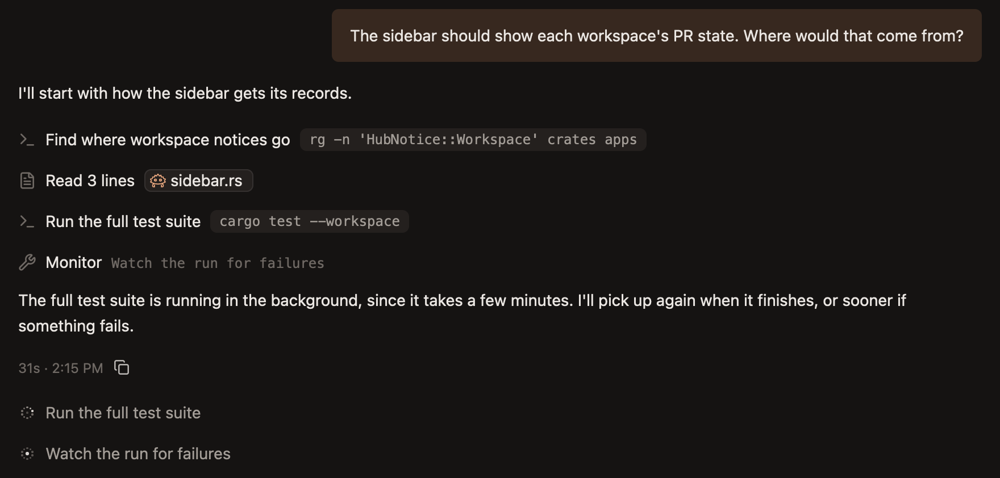

With more than four, each kind with several has one line, such as `6 subagents`, so the lines never take the conversation's place. Click a kind's line to open it to its tasks' own lines.

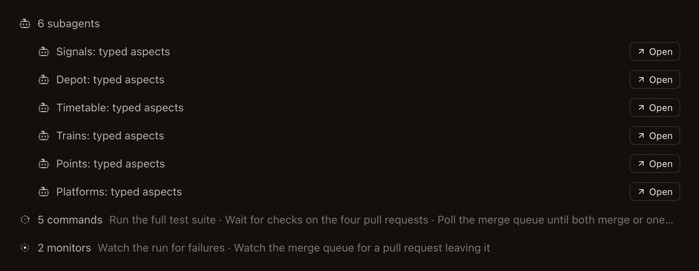

- **The mark shows something is running:** a slower light on its inner row, or the light still sweeping the whole fan while a subagent is going.
- **Each wait on pull requests has its own line,** listing the PRs, what it waits for and its progress. `Stop` calls off only that wait. A stack wait includes its lower PRs, and several waits can run together.
- **The agent picks up again by itself** when the work finishes, and the chat says what it picked up after: a line for each task that ended, with how it ended and when, before what the agent did about it. A wait's line says which pull requests it waited on and why it ended, such as `Waited on #7 for required checks`, then `Checks passed`. A turn started by what a monitor watches for happening has no line, since nothing says why until the turn is over.
- **Closing the chat asks first,** while something is running.

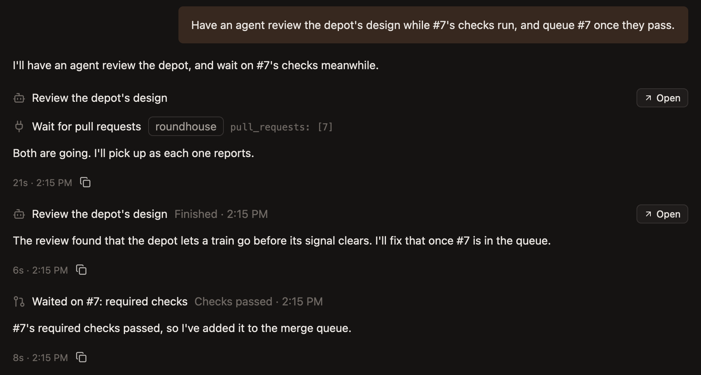

## Code blocks

Rest the pointer on a code block for a button at its top right that copies its code. Code blocks in your prompts and in the agent's thinking have one too.

## Images in a reply

An image the agent's reply points to shows in the reply, if it's in the workspace, and so does an SVG drawing. The hub keeps it as it was when the reply came, so it's still there after the agent changes the file, and after the workspace is archived.

An image anywhere else on the machine, or on the web, shows nothing.

A diagram the agent writes in Mermaid, in a code block whose language is `mermaid`, shows in the reply as a picture, once the reply has it all. One the app can't draw shows as its code.

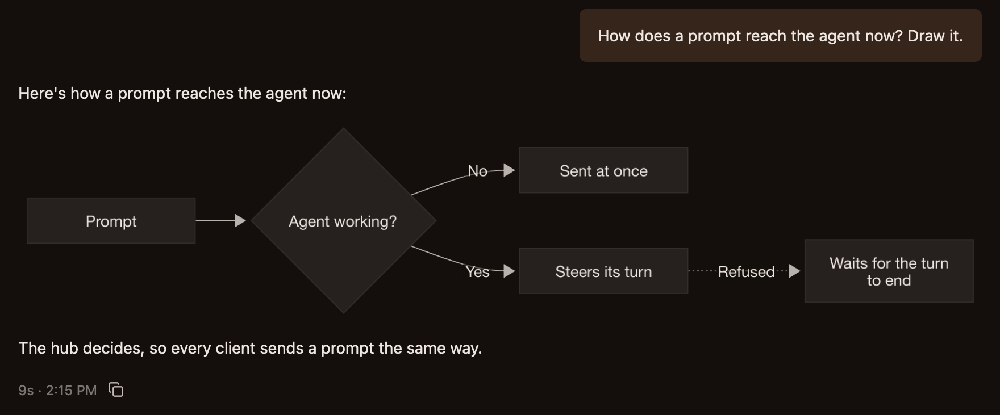

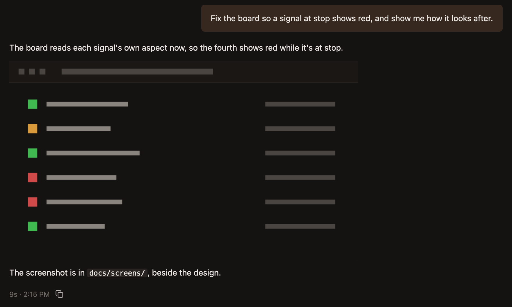

- **A click opens it,** as big as it is, up to what fits in the window, whether it's on a line of its own or among the reply's words. Escape or a click closes it.
- **An image in a link goes where the link does** instead, as a badge does.
- **Some images open nothing:** one in a heading, a table or a footnote, one written with its address given elsewhere in the reply, as `![The board][board]` is, several together in bold or italics with no words, one beside nothing but HTML, and one in what a subagent did, shown under its call.

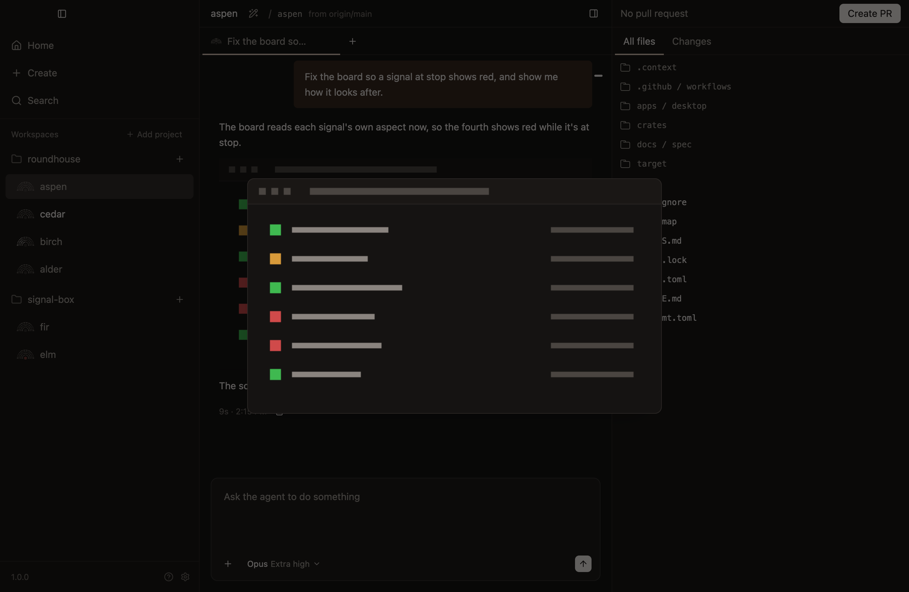

## Videos in a reply

A video the agent's reply points to plays in the reply, if it's a WebM in the workspace, such as a recording of a change at work. Roundhouse tells the agent how to make one the app plays. The hub keeps it as it was when the reply came, as it keeps an image.

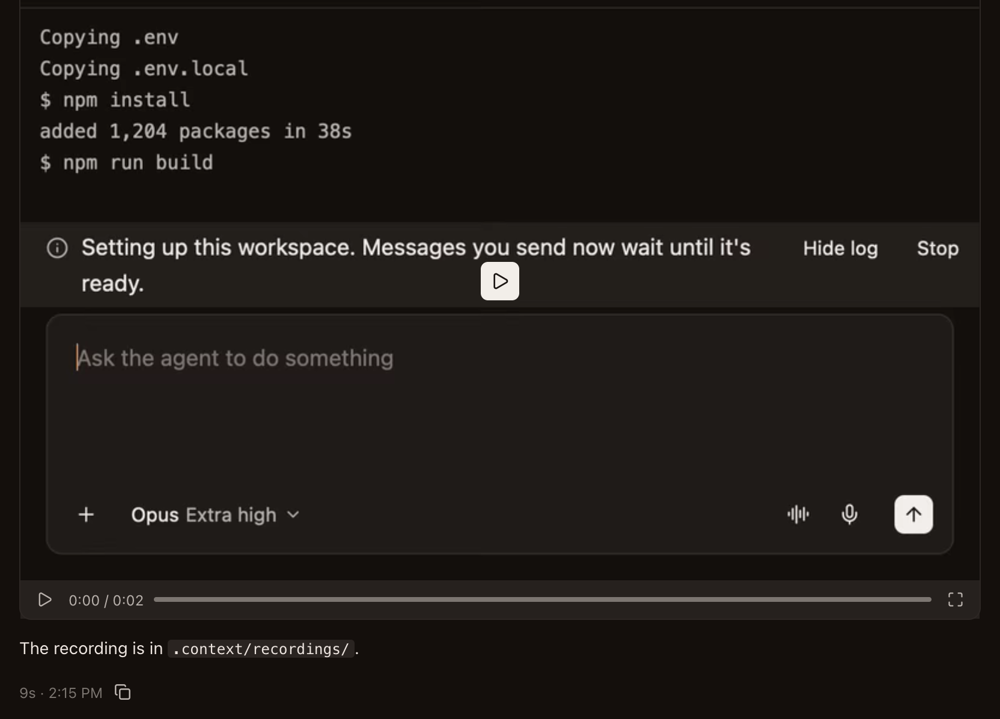

- **Play starts it where it is,** and the bar under it pauses it, says where it is of how long it is, and goes elsewhere in it with a click along its track.
- **Expand opens it over the window,** as big as fits, playing on from where it is. Escape closes it.
- **It stops when you scroll it out of sight.**
- **Another kind of video, such as an MP4, shows nothing** in a reply. Opened from All files, it opens in your system's player.

## Issues and pull requests in a reply

A link to an issue or a pull request on GitHub in a reply shows as a chip, whatever the link's words: its state's mark in its state's colour, its number, and, the first time the reply links to it, its title. Roundhouse tells the agent to link to each one it mentions, and which repository on GitHub its workspace's is, so its links go to the right place. A number written alone, such as `#1021`, stays as it's written, since it could be another repository's, or the number of something else. A subagent's report where its call shows it, a plan and a proposal show chips too. In a prompt and a thought, a link stays a link.

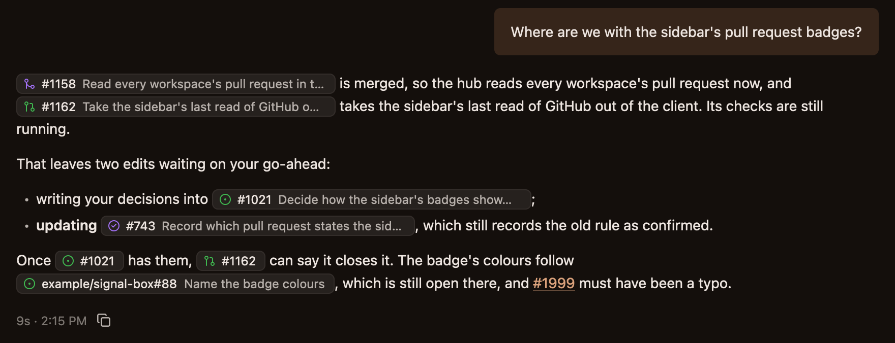

- **A click opens its link,** to where it goes on GitHub, such as a comment.
- **Resting the pointer on one shows its card:** where it stands, such as where a pull request is in the merge queue, in the bar's words, who opened it and when, its labels, a pull request's lines changed and checks, the workspace it's in, and the start of what it says.
- **A right-click, or the ⋯ on its card, opens its menu:** Open on GitHub, Copy link, and Go to the workspace it's in, unless that's archived.
- **Copying and Find use the link's words as they're written,** such as `#1021`, not the title.
- **One that can't be found stays the link it's written as,** such as a typo, or one in a repository the workspace's GitHub account can't read.

The hub looks each up on GitHub with the account the workspace's pull request is read as, for every client at once, and looks again about once a minute while one is on screen, so a pull request that merges says so. A chip of a pull request a workspace's bar shows says what the bar does.

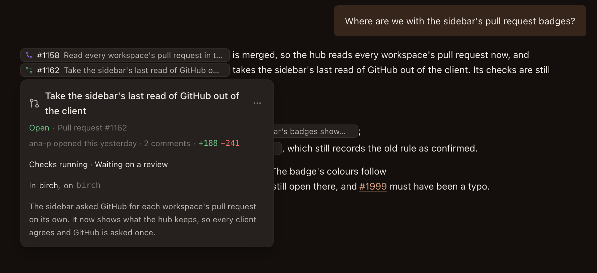
