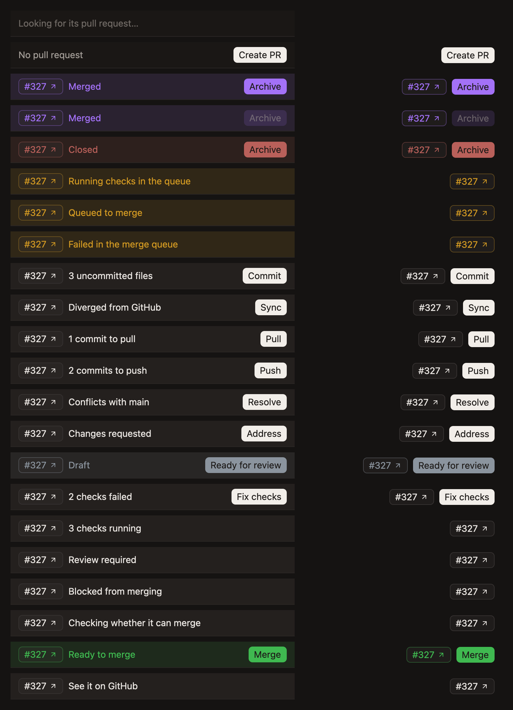

# Pull request states

What the pull request's bar says in each state, and what it offers. [Take a pull request to merge](../guides/take-a-pull-request-to-merge.md) is the walk-through.

## The first thing in the way

The bar says one thing: the first that's true, in this order.

| The bar says | What it means | Its button |
|---|---|---|
| `Merged` or `Closed` | Nothing else matters now | `Archive` |
| `Queued to merge`, `Running checks in the queue`, `Merge queue locked` | It's in the merge queue, which merges it whatever else is true | |
| `Failed in the merge queue` | It can't merge, and is leaving the queue | |
| `3 uncommitted files` | Work in the worktree that isn't committed | `Commit`, which pushes too |
| `Diverged from GitHub` | The branch and GitHub each have commits the other doesn't | `Sync` |
| `2 commits to pull` | GitHub has commits the worktree doesn't | `Pull` |
| `2 commits to push` | The worktree has commits GitHub doesn't | `Push` |
| `Conflicts with main` | It conflicts with its base | `Resolve` |
| `Changes requested` | A reviewer asked for changes | `Address` |
| `Draft` | It's still a draft | `Ready for review` |
| `2 checks failed` | Checks failed | `Fix checks` |
| `2 checks running` | Checks are still running | |
| `Review required` | It's waiting on a review | |
| `Blocked from merging` | One of the repository's other rules is in the way | |
| `Checking whether it can merge` | GitHub is still working it out | |
| `Ready to merge` | Nothing is in the way | `Merge` |

What's in the worktree comes before what GitHub says, because GitHub's answers are about an older commit until it's pushed.

A workspace with no pull request says `No pull request`, and offers `Create PR`.

Wherever GitHub says something this version doesn't know, the bar says `See it on GitHub`, in the window's own colours, and offers nothing, rather than guess.

## What a button does

Each button asks the agent, in the chat showing, and shows that chat. The agent knows why the changes were made and how the repository works, such as how it merges.

`Archive` is the one that doesn't: it archives the workspace.

Where the bar offers nothing, it's waiting on GitHub or on someone else.

## Colours

| Colour | Where it stands |
|---|---|
| The window's own | Open, with something to do first |
| Green | Open, and ready to merge |
| Yellow | In the merge queue |
| Purple | Merged |
| Muted red | Closed |
| Grey | A draft |

The workspace's mark in the sidebar takes the same colours, with every open pull request green, since the mark is too small to say what's in the way.

## While the sidebar is hidden

With the sidebar of changes hidden, the workspace's header shows the pull request's number and the button.

## When it's read

Roundhouse reads the pull request with `gh`:

- Each time its workspace is shown, and every 30 seconds while it shows.
- When a turn ends.
- When the worktree checks out another branch, or pushes.
- On its own, for every workspace, so each row in the sidebar is up to date.

- **Each check counts once, as its latest run,** so a rerun that passed reads as passed.
- **Reads nobody is waiting on stay within what GitHub can spare,** and leave the last fifth of its hourly limit to your agents.
- **What was found is kept across restarts,** and `gh` failing, such as while offline, never takes away a pull request already found.
- **A workspace's pull request is its branch's own:** one it pushed to, or one whose branch you checked out to work on. One from another computer's branch that only has the same name doesn't show. Once found, it stays the branch's, even after someone else pushes to it. Roundhouse keeps which it is as a setting of the branch in the repository's git config, `branch.<name>.roundhouse-pull-request`, which git renames and deletes with the branch.

Without `gh`, a login to it, or a GitHub remote, a pull request can't be read, and the bar offers to create one.
