# Settings

The app's own settings. A repository's are in [Repository settings](repository-settings.md).

`Cmd-,`, the gear at the bottom of the sidebar, or Settings… in the app menu, or in File on Windows and Linux, shows Settings in place of the sidebar and the workspace. `Back`, Escape or `Cmd-W` goes back to where you were.

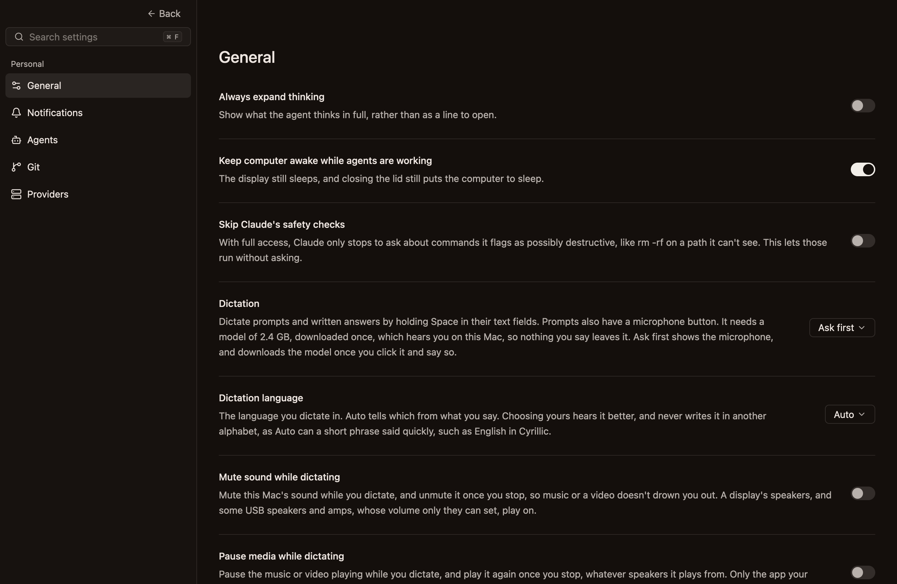

- **A setting takes effect at once, and lasts.** There's no Save button.
- **A search at the top finds a setting** by what it's called or what it does. `Cmd-F` puts the cursor in it.

## General

| Setting | What it does | Starts |
|---|---|---|
| Always expand thinking | Shows what the agent thinks in full, rather than as a line to open | Off |
| Keep computer awake while agents are working | Stops the Mac going to sleep by itself while there's work | On |
| Skip Claude's safety checks | Lets the few commands Claude still asks about with full access run without asking, such as a removal of a path it can't see. Plan mode and questions still ask | Off |
| Dictation | On a Mac with macOS 14 or later, lets you dictate prompts, written answers and diff comments, once it has downloaded the model, 2.4 GB, and prepared it. Ask first shows a microphone in the composer and new-workspace dialog, which offers to turn it on. Under it, Settings says how it stands, with Retry, and Delete the model. See [Dictate a prompt](../guides/dictate-a-prompt.md) | Ask first |
| Dictation language | The language you dictate in. Auto tells which from what you say. Choosing yours hears it better, and never writes it in another alphabet, as Auto can a short phrase said quickly, such as English in Cyrillic | Auto |
| Mute sound while dictating | On a Mac, mutes its sound while you dictate, and unmutes it once you stop. Speakers that set their own volume, such as a display's, play on | Off |
| Pause media while dictating | On a Mac, pauses the music or video the Mac shows as Now Playing while you dictate, and plays it again once you stop, whatever speakers it plays from | Off |

Work is a turn, something an agent left running in the background, or a workspace being set up. An agent that's only waiting on you isn't, since it could wait all night. The display still sleeps, and closing the lid or a low battery still puts the Mac to sleep.

## Notifications

| Setting | What it does | Starts |
|---|---|---|
| Notify when an agent needs you | Shows a notification as a chat comes to need you | On |
| Play a sound | Plays a sound at the same moments, whether or not a notification shows | On |
| Sound | Which sound: Chime, the app's own, or one of the computer's alert sounds | Chime |

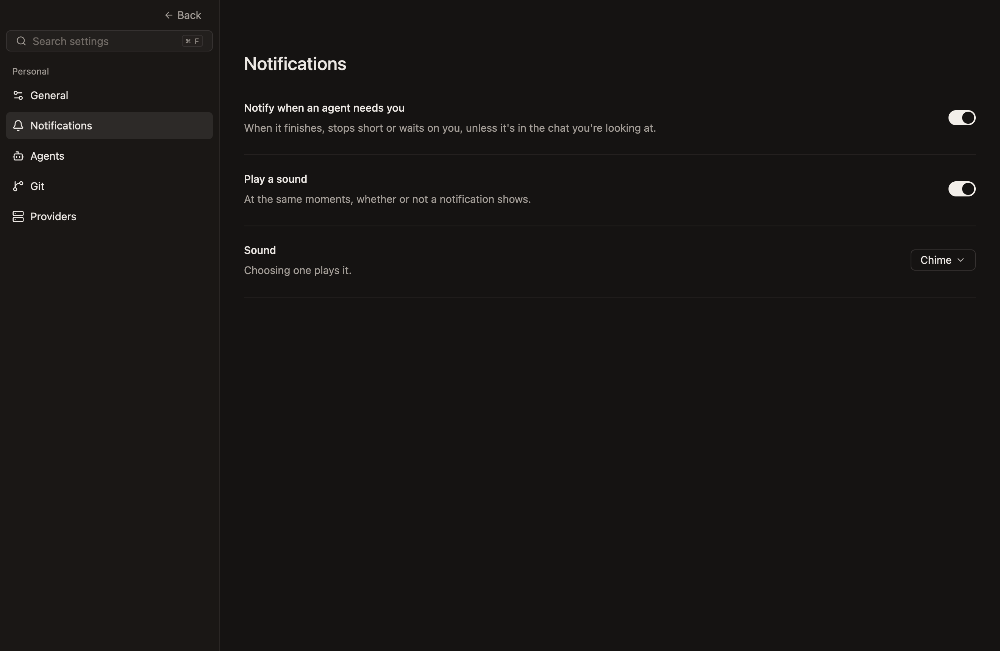

A chat needs you when it has a reply you haven't read, when it's waiting on you for an answer or an approval, or when its agent stopped short.

- **A notification says why:** `Finished`, `Stopped short` or `Waiting on you`, with the workspace and the chat. Clicking it shows the chat.
- **The chat you're looking at never notifies,** unless another app is in front.
- **A notification lasts as long as its chat needs you.**
- **The sound plays at most once in two seconds,** so several chats coming to need you together sound once.
- **The app plays the sound itself,** so a Mac's Focus doesn't silence it.
- **Only what happens while the app is open is told of.**

On Windows and Linux no sound plays.

## Agents

The accounts your agents run under: native logins found where agents ran, and Claude logins you've given the hub. Codex uses `codex login` and Antigravity uses `agy` on the worker's machine. Their credentials stay with their CLIs; this page doesn't add or move them.

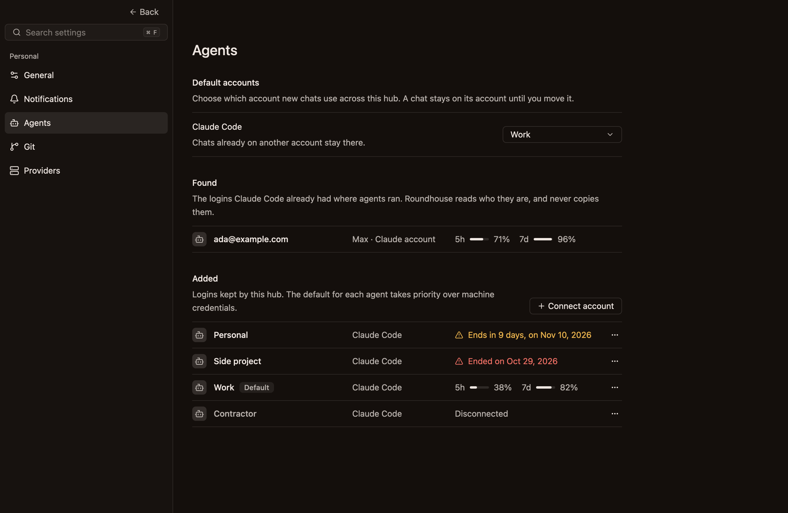

- **Found** has Claude Code's own login on a machine, such as this Mac's, once an agent has run under it. Roundhouse reads who it is, and never copies it, so there's nothing to do with it here.
- **Default accounts** chooses the account new chats of each supported agent use across this hub. Choose Work or Personal for Claude Code. A chat is put on the default when its agent first starts, and stays on that account when you choose another default, until you [move it](../guides/watch-context-and-limits.md#move-a-chat-to-another-account). For a chat that isn't on an account yet, an added default takes priority over machine credentials. With no added default, the agent uses its machine's own login, and its chat stays on it once you add one, until you move it. A chat that started with nobody signed in on the machine, or with an API key, goes on the default once you add one. So does a chat from before you updated that wasn't on an account, such as one that ran under the machine's own login, when its agent next starts.
- **Automatic,** first in the same menu, has the hub choose for each new chat instead, as [below](#put-chats-on-accounts-automatically).
- **Added** has the logins you've given the hub. The chosen account has the `Default` badge. Adding or renewing another account does not change your choice. Logins you've disconnected are listed last.
- **Each row** says how its login was made: for one found, its plan and how it's logged in, such as `Max · Claude account`, and for one you've added, its agent, such as `Claude Code`. Then it says only what else needs saying: that its login ends soon, has ended or was disconnected, or else what's left of each of its limits, as the chat's limits' card does.
- **Rest the pointer on a row,** or move to it with **Tab**, to see its card: which day you last used the account, when its login ends, and every limit with what's left and when it starts again, even while the row warns that the login ends soon. A screen reader reads the card out as it comes to the row.

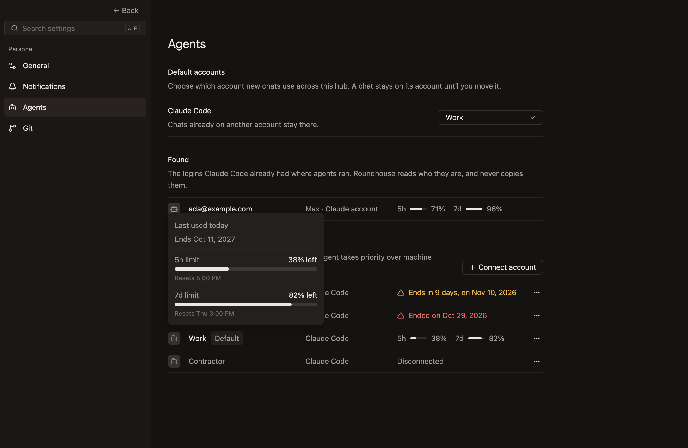

The first account you connect becomes its agent's default. When updating a hub that already has accounts, the most recently connected or renewed usable account is selected once. If all have expired, the most recent stays selected until you renew it or choose another.

### Connect an account

1. Click **Connect account**.
2. Copy the command it shows, `claude setup-token`, and run it in a terminal of your own. It signs you in through Claude's own page, and prints a token that lasts a year.
3. Paste the token, give the account a name, and click **Connect**.

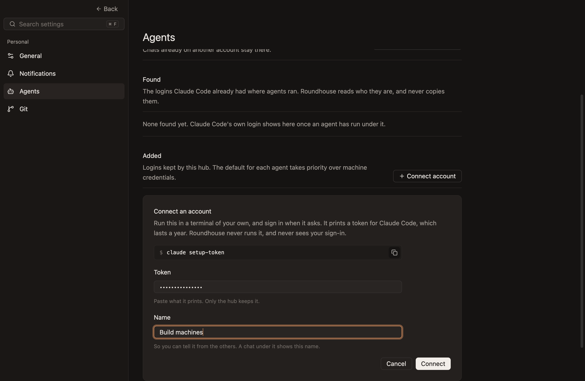

The app hands the token to the hub, which keeps it in its own data, as [Where data is kept](where-data-is-kept.md) says. The app writes it nowhere. Roundhouse never runs the command or sees you sign in.

A chat under the account names it by the name you gave it, where a login of the machine's own shows its email: on the card of its limits, beside Send, or on the context's card when there are no limits.

### Make an app of your own

Click **Connect account**, then **Make an app**. Agents act as the app's bot, as [Who agents are on GitHub](../concepts/who-agents-are-on-github.md#an-app-of-your-own) says. The panel takes you through three steps, and **Cancel** puts it away at any of them:

1. **Choose where to make it,** under your account or an organization, by its name as in its address on GitHub, and the app's name, which starts as the username of an account you've added, or that `gh` is logged in as, with `-roundhouse` after it. Click **Make on GitHub**.
2. **Make it on GitHub,** on the page your browser opens, where GitHub says if another app has the name, and you can change it. Once it's made, GitHub sends you back to Roundhouse, which waits for 30 minutes, and gives the hub the code GitHub sends, which the hub makes into the app's key. **Open GitHub again** opens the page again.
3. **Install it,** with **Install on GitHub**: choose the repositories agents should reach, and come back. Roundhouse looks for it as you do, and the hub every minute, or click **Check again**. Once it's installed, the panel says where, and **Done** puts it away.

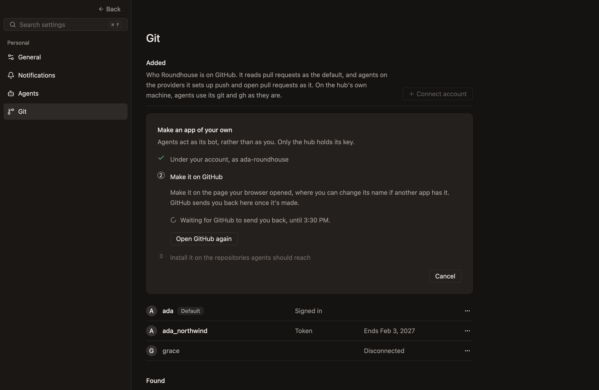

If the hub couldn't take the app's key, as when GitHub didn't answer, **Try again** gives it the same code, which GitHub takes for an hour. After that, the app GitHub made has no key here: delete it on GitHub, or choose another name, and **Start again**.

The installation is a row in **Added**, by its bot's name, which you make the default from its **…** menu, as you would an account. An app installed nowhere yet has a row of its own, saying `Not installed`, with **Install on GitHub** in its menu. **Remove app**, in either menu, has the hub forget the app's key and its installation's login, and asks first. It deletes nothing on GitHub, so delete the app there to be rid of it.

### Put chats on accounts automatically

Choose **Automatic** in **Default accounts** to spread new chats across the accounts you've added. As each new chat's agent starts, the hub puts it on the account with the most of its week to spare: what's left beyond what you [reserve](#reserve-part-of-an-accounts-week), for each hour until the week starts again, shared among the chats working on it. So an account whose week starts again tomorrow is used before one with more left that lasts days. An account that's used all of a limit, such as its five hours, isn't chosen, and neither is a login found on a machine. The menu says how much of each account's week is left beside it.

A chat stays on the account it's put on until you [move it](../guides/watch-context-and-limits.md#move-a-chat-to-another-account), and its limits' card says `Chosen automatically`. If no account has usage to spare, a new chat doesn't start, and your message isn't sent. A card at the chat's end lists the accounts, with **Start on** for those with usage left, which spends what they reserve. Choose one, then send your message again. With every account out of a limit, the card says which is back first, and when. Choose an account in the same menu to stop choosing automatically.

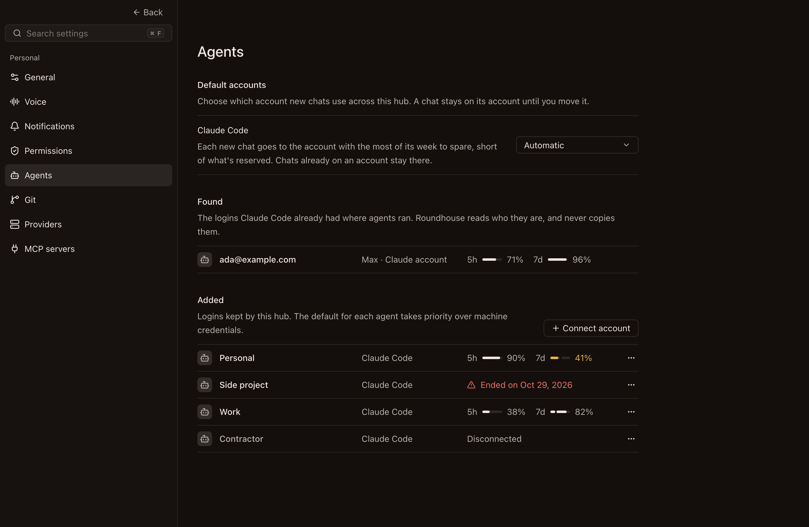

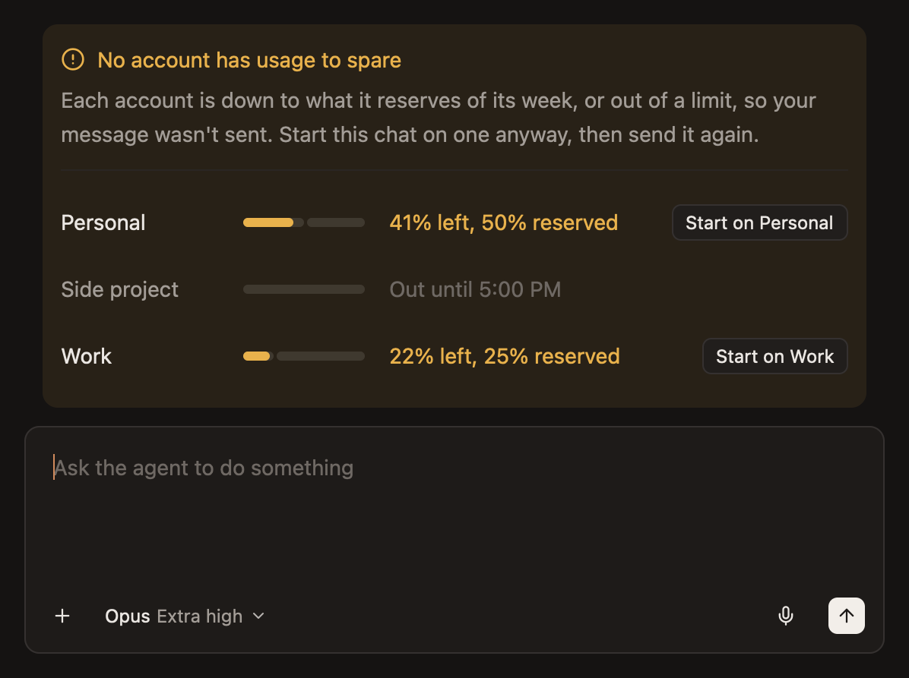

### Reserve part of an account's week

**Reserve usage…**, in an added account's **…** menu, sets how much of its week you keep for yourself: none, 10%, 25%, 50% or all of its 7d limit. Choose one in the panel that opens under the row, and **Save**. [Automatic](#put-chats-on-accounts-automatically) puts no new chat on an account that's down to what it reserves, and none at all on one that reserves all of it. What's reserved is split off the start of the week's bar, which turns amber once the account is down to it. It doesn't stop a chat already on the account, and use outside Roundhouse can spend it too, so a chat says when it's [using the reserve](../guides/watch-context-and-limits.md#when-an-account-uses-its-reserve).

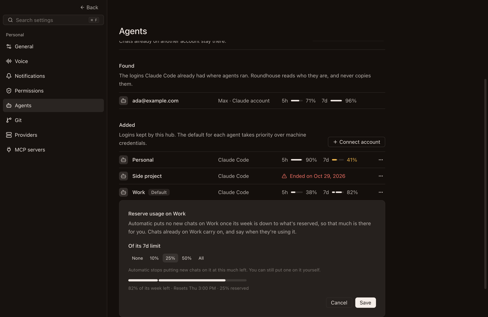

### Renew and disconnect

- **A login warns a month before it ends,** in amber, and in red once it has. Choose **Renew** in the row's **…** menu, run `claude setup-token` again for the same account, and paste the new token in the panel that opens under it. The account keeps its name, its limits and its chats.
- **Disconnect,** in the same menu, has the hub forget the token, and asks first. The account stays, with **Connect again** in its menu, which takes pasting a token again. It doesn't revoke the token, which still works wherever else you've kept it.

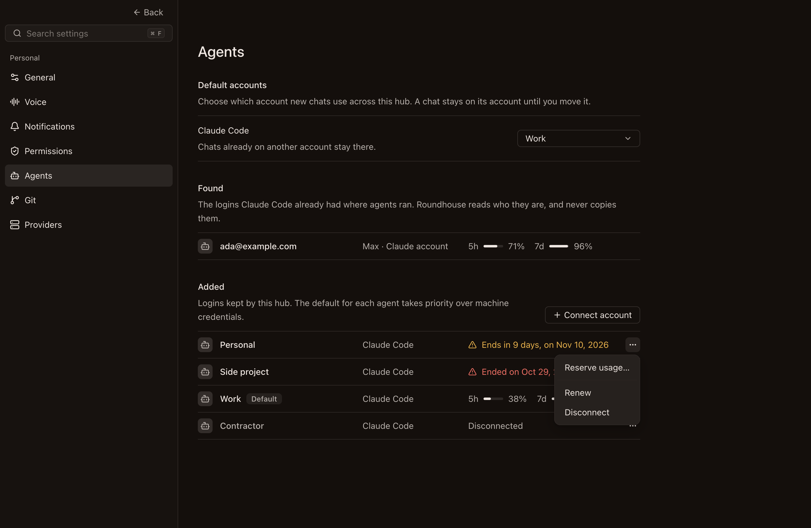

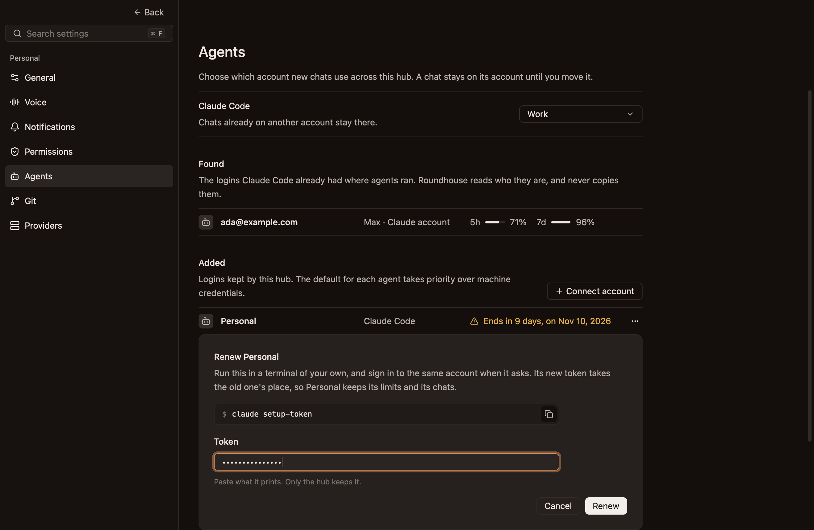

If an account expires or is disconnected, agents in the chats on it cannot start until you renew or reconnect it. If it's your default, new chats can't start either until you do, or choose another default, which the chats already on it don't follow, so [move them](../guides/watch-context-and-limits.md#move-a-chat-to-another-account) to another account. It stays selected and does not fall back to another account or machine credentials.

A hub from before account defaults cannot change them. Update the hub to choose one. An older worker that cannot enforce the selected account also refuses new launches until it is updated.

## Git

The GitHub accounts agents push and open pull requests as. [Who agents are on GitHub](../concepts/who-agents-are-on-github.md) says which to choose.

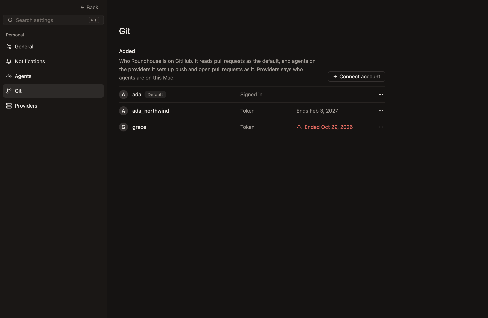

- **Added** has the accounts you've given the hub, the default first. On every machine Roundhouse sets up GitHub on, `git` and `gh` use the default for github.com, so agents push and open pull requests as it, and Roundhouse reads pull requests with it, wherever they run. On your own machine, agents use your `git` and `gh` as they are, as [Who agents are on GitHub](../concepts/who-agents-are-on-github.md) says.
- **Found** has who `gh` is logged in as on each machine where a workspace has run since the hub last started, and whether GitHub took its token then. Roundhouse asks GitHub with that token, and while it's the default reads pull requests with it, keeping it only in memory. While you've added no account, agents use each machine's own login, and Found has the Default badge. **Make default**, by Found's heading, goes back to each machine's own login once you have.
- **Each row** says how the account was connected, `Signed in`, `Token` or `App`, and only what else needs saying, such as when a token ends, or where an app is installed.

The first account you connect becomes the default. To use another, choose **Make default** in its row's **…** menu.

### Connect an account

Click **Connect account**, then:

- **Sign in:** the hub asks GitHub for a code, which the panel shows. Copy it, click **Open github.com/login/device**, type it there, and approve Roundhouse. The panel says when you're signed in, or why not, with **Sign in again**. The hub renews the login by itself, so there's no end to watch for.
- **Paste a token:** click **Make one on GitHub**, make a token for the repositories agents should reach, paste it, and click **Connect**. The hub asks GitHub whose it is and when it ends.
- **Make an app:** agents act as its bot, as the next section says.
- **Use gh's login:** first in the panel while `gh` on this Mac is logged in to github.com and no account holds its login. Click **Use ada's login**, by its username, and its row says `gh on this Mac`. The hub reads the token from `gh` once a minute and keeps no copy, as [Who agents are on GitHub](../concepts/who-agents-are-on-github.md#ghs-login-on-this-mac) says.

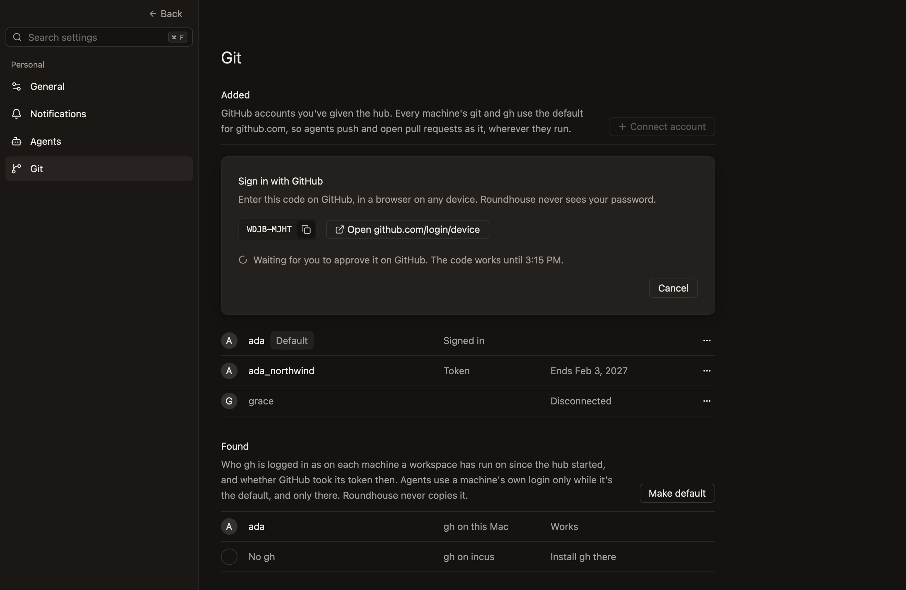

Whichever way but `gh`'s, the hub keeps the login in its own data, as [Where data is kept](where-data-is-kept.md) says, and the app writes it nowhere. A sign-in that waits shows on Git in every window until it's approved or cancelled, so you can finish one you started before the app quit.

### Renew and disconnect

- **A token says when it ends,** and in red once it has. Choose **Renew** in its row's **…** menu, and paste a new one in the panel that opens under it.
- **A sign-in says `Renewing`** while the hub renews a token that has ended, and `Needs signing in again` once GitHub won't renew it. Choose **Sign in again** in its menu, and approve it as the same GitHub user.
- **Disconnect,** in the same menu, has the hub forget the login, and asks first. The account stays, with **Connect again** and **Sign in again**. It doesn't revoke the token on GitHub.

If the default can't be used, because its token ended, it was disconnected, it needs signing in again, it's `gh`'s login and `gh` on this Mac is logged out or logged in as someone else, or it's an app's installation that was uninstalled on GitHub, or whose token ended before the hub could make the next, it stays the default, and agents can't push until you put it right or make another the default. They don't fall back on the machine's own login. On your own machine, agents push as they always do, as [Who agents are on GitHub](../concepts/who-agents-are-on-github.md) says. Git says so at the top of **Added**, with why and what to do, in the words a workspace's line says and git gives as it refuses a push.

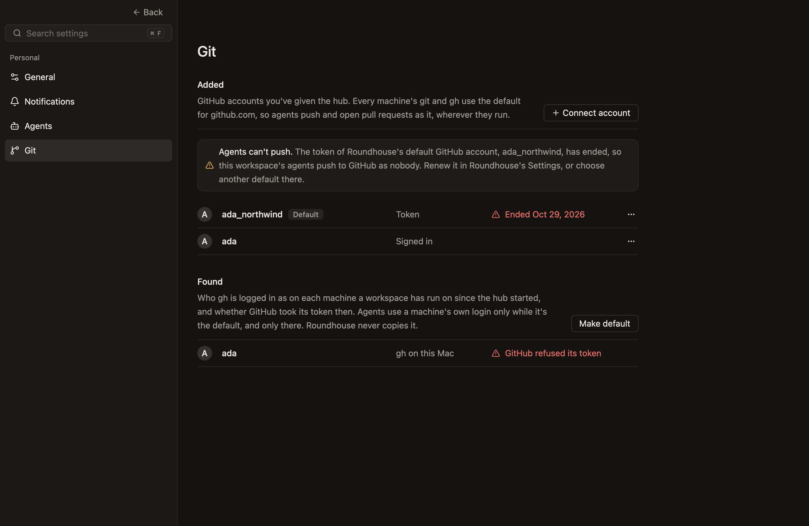

A hub from before hubs kept GitHub accounts can't connect one, and agents use each machine's own login. Update the hub to connect one.

## Whose setting it is

A setting belongs to whatever carries it out:

- **How the app looks and behaves is the app's,** kept on this machine.
- **What the hub does with the app closed is the hub's,** such as keeping the computer awake. The hub keeps it, and it can only be changed while the hub is there to ask.
