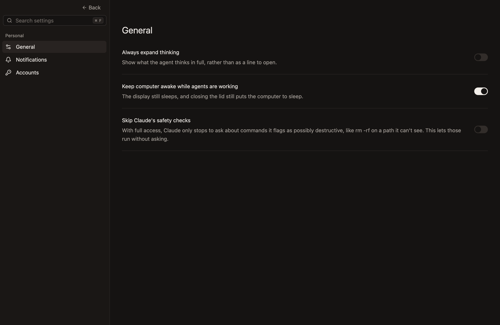
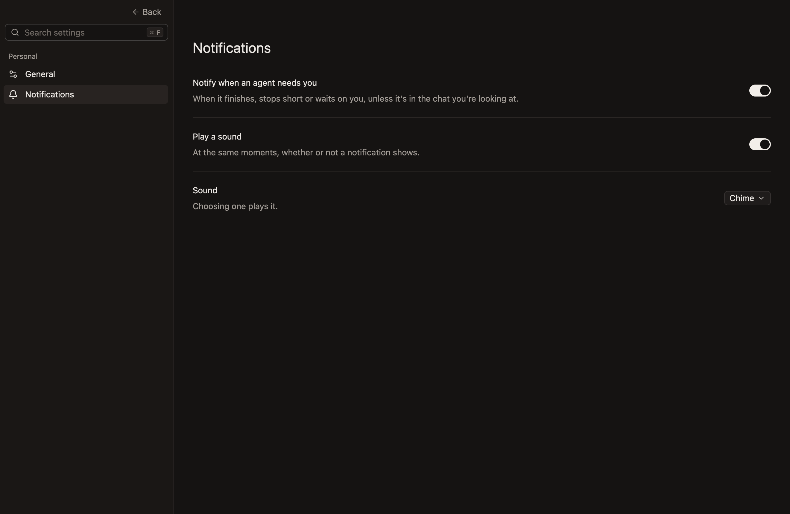
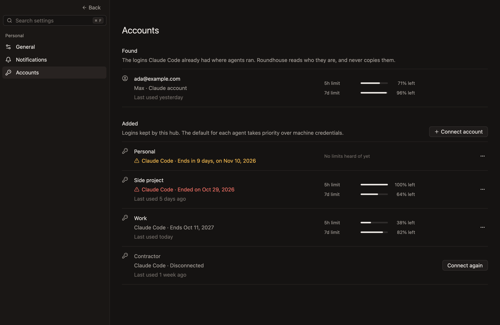
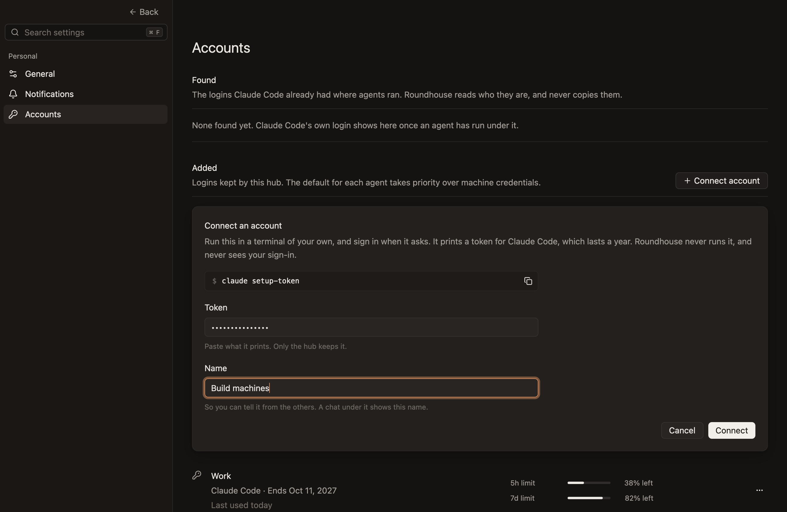
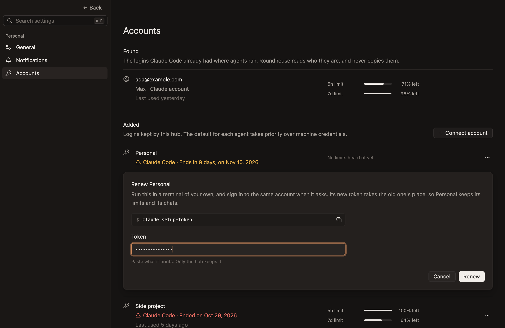

# Settings

The app's own settings. A repository's are in [Repository settings](repository-settings.md).

`Cmd-,`, the gear at the bottom of the sidebar, or Settings… in the app menu, or in File on Windows and Linux, shows Settings in place of the sidebar and the workspace. `Back`, Escape or `Cmd-W` goes back to where you were.

- **A setting takes effect at once, and lasts.** There's no Save button.
- **A search at the top finds a setting** by what it's called or what it does. `Cmd-F` puts the cursor in it.

## General

| Setting | What it does | Starts |
|---|---|---|
| Always expand thinking | Shows what the agent thinks in full, rather than as a line to open | Off |
| Keep computer awake while agents are working | Stops the Mac going to sleep by itself while there's work | On |
| Skip Claude's safety checks | Lets the few commands Claude still asks about with full access run without asking, such as a removal of a path it can't see. Plan mode and questions still ask | Off |

Work is a turn, something an agent left running in the background, or a workspace being set up. An agent that's only waiting on you isn't, since it could wait all night. The display still sleeps, and closing the lid or a low battery still puts the Mac to sleep.

## Notifications

| Setting | What it does | Starts |
|---|---|---|
| Notify when an agent needs you | Shows a notification as a chat comes to need you | On |
| Play a sound | Plays a sound at the same moments, whether or not a notification shows | On |
| Sound | Which sound: Chime, the app's own, or one of the computer's alert sounds | Chime |

A chat needs you when it has a reply you haven't read, when it's waiting on you for an answer or an approval, or when its agent stopped short.

- **A notification says why:** `Finished`, `Stopped short` or `Waiting on you`, with the workspace and the chat. Clicking it shows the chat.
- **The chat you're looking at never notifies,** unless another app is in front.
- **A notification lasts as long as its chat needs you.**
- **The sound plays at most once in two seconds,** so several chats coming to need you together sound once.
- **The app plays the sound itself,** so a Mac's Focus doesn't silence it.
- **Only what happens while the app is open is told of.**

On Windows and Linux no sound plays.

## Accounts

The logins your agents run under: native logins found where agents ran, and Claude logins you've given the hub. Codex uses `codex login` on the worker's machine. Its credentials stay with Codex; this page doesn't add or move them.

- **Found** has Claude Code's own login on a machine, such as this Mac's, once an agent has run under it. Roundhouse reads who it is, and never copies it, so there's nothing to do with it here.
- **Added** has the logins you've given the hub. The hub's default takes priority over machine credentials for new processes; running agents keep their login. With no added default, agents use their machine's login. Adding or renewing another account does not change the selection. Logins you've disconnected are listed last.
- **Each row** says the day you last sent something in a chat under the account, such as yesterday or 3 days ago, once you have, and what's left of its limits, as the chat's limits' card does.

The first account you connect becomes its agent's default. When updating a hub that already has accounts, the most recently connected or renewed usable account is selected once. If all have expired, the most recent stays selected until renewed or the selection changes.

### Connect an account

1. Click **Connect account**.
2. Copy the command it shows, `claude setup-token`, and run it in a terminal of your own. It signs you in through Claude's own page, and prints a token that lasts a year.
3. Paste the token, give the account a name, and click **Connect**.

The app hands the token to the hub, which keeps it in its own data, as [Where data is kept](where-data-is-kept.md) says. The app writes it nowhere. Roundhouse never runs the command or sees you sign in.

A chat under the account names it by the name you gave it, where a login of the machine's own shows its email: on the card of its limits, beside Send, or on the context's card when there are no limits.

### Renew and disconnect

- **A login warns a month before it ends,** in amber, and in red once it has. Choose **Renew** in the row's **…** menu, run `claude setup-token` again for the same account, and paste the new token in the panel that opens under it. The account keeps its name, its limits and its chats.
- **Disconnect,** in the same menu, has the hub forget the token, and asks first. The account stays, with **Connect again**, which takes pasting a token again. It doesn't revoke the token, which still works wherever else you've kept it.

If the default expires or is disconnected, new agents cannot start until you renew or reconnect it, or the default is changed. It stays selected and does not fall back to machine credentials.

An older hub may not support defaults. Update it to use added accounts before machine credentials.

## Whose setting it is

A setting belongs to whatever carries it out:

- **How the app looks and behaves is the app's,** kept on this machine.
- **What the hub does with the app closed is the hub's,** such as keeping the computer awake. The hub keeps it, and it can only be changed while the hub is there to ask.
