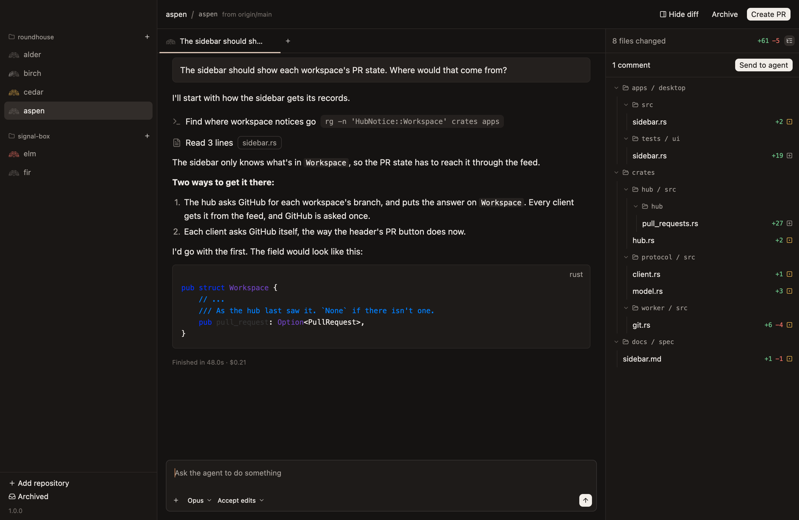
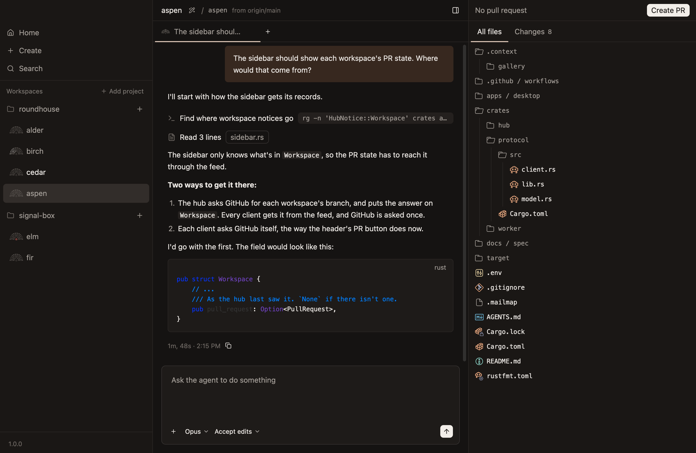
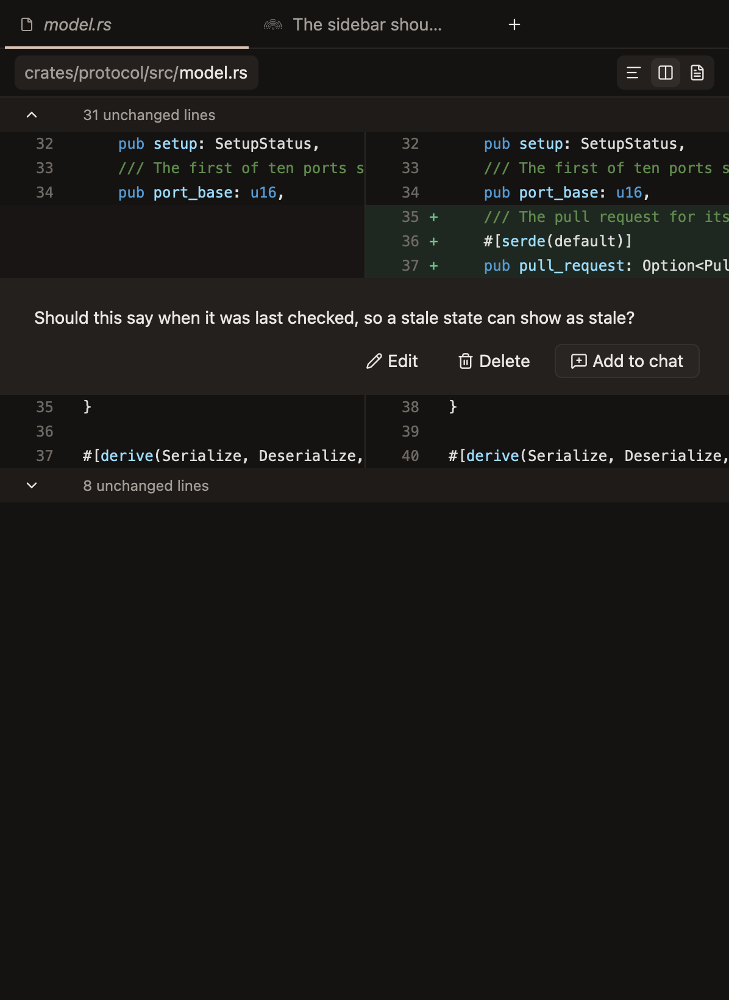
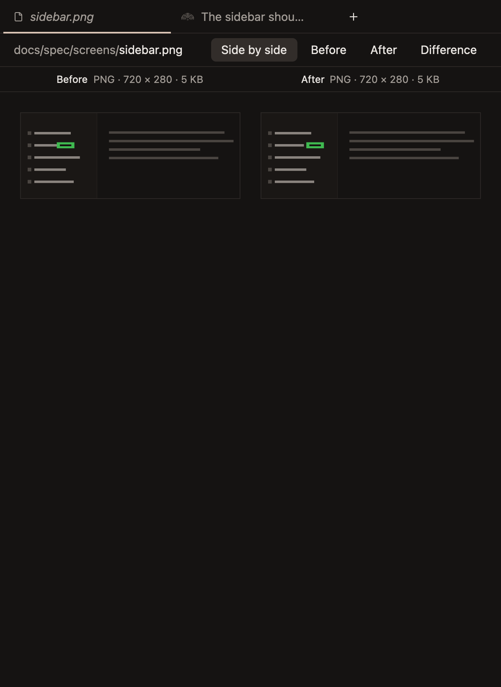

# The diff

The sidebar of changes, the file tab, and comments for the agent.

## The sidebar of changes

The sidebar on the right, under the pull request's bar. It's open from the start, and `Cmd-Shift-D`, or the button at the right end of the header, hides it and shows it again.

Two tabs switch what it lists:

| Tab | Lists |
|---|---|
| **All files** | Every file in the worktree, ignored ones too |
| **Changes** | Every file the workspace changes against its base, with the lines each adds and removes |

- **A workspace that changes nothing shows All files,** and switches to Changes when it first changes something. A tab you click stays.
- **Changes shows as a list of paths, or in folders,** switched by the button at the sidebar's top right.
- **Each changed file has an icon for how it changed:** added, modified, removed or renamed.
- **Dragging the sidebar's inner edge changes its width,** from 300px to 800px.

## All files

- **Files show in folders, which start closed.**
- **A folder git ignores whole,** such as `target` or `node_modules`, is read only when it's opened.
- **Each file has a coloured icon for its kind,** as editors show them.
- **The list is read again when a turn ends,** so what the agent makes shows up without asking.

## The file tab

Clicking a file shows it in the workspace's file tab: its diff from Changes, or the file as it is from All files.

- **A workspace has one file tab, always the leftmost.** Clicking another file shows that one in the same tab.
- **It covers the chat until a chat's tab is clicked,** and stays open behind the chats until it's closed.
- **`Cmd-W` closes it while it shows,** and `Ctrl-Tab` comes to it after the last chat.

## A file's diff

- **Changes show with three lines either side,** and the lines between fold into a row that says how many there are.
- **Arrows on that row show 20 more lines at a time,** or all of them when there are no more than 20.
- **Lines added and removed are tinted green and red,** and the words that changed more strongly.
- **A switch at the right end of the bar** shows the diff in one column, side by side, or as the whole file.
- **What you've opened stays open** when the diff is read again, such as at the end of a turn.

## Comments

- **Hover a line and click its add button** to comment on it. `Enter` saves the comment.
- **A saved comment shows where it was written,** with `Edit`, `Delete` and `Add to chat`.
- **`Send to agent`,** at the top of the sidebar, sends every comment at once, and shows the chat they went to.
- **`Add to chat` puts one comment in the composer,** after what's typed there.
- **A comment stays on the diff until it's deleted.**
- **A line with a comment always shows,** rather than folding away.
- **A comment being written is kept by the hub,** so it's there when the app opens again.

## Changed images

A changed image shows what it was and what it is. One bar above it chooses Side by side, Before, After or Difference.

- **Both sides are drawn at one scale,** so a pixel is in the same place in each.
- **Clicking the image, or Space, flips between Before and After.**
- **Difference shows After faded to grey, with each changed pixel tinted yellow,** and an outline around each place that changed. A strip says how much, such as `3,775 pixels in 7 places`.

Any other file that isn't text says so, and takes no comments.

## A file opened from All files

- **Its lines are numbered and highlighted for its language.** A file over 1 MB stays plain.
- **Text is shown up to 4 MB, and an image up to 64 MB.**
- **A file shown is read again when a turn ends,** keeping where it's scrolled to.
- **A file that can't be shown says why:** it isn't text or an image, it's too big, it's empty, or it's gone.
