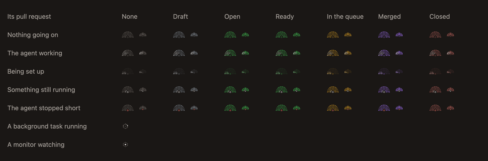

# The status mark

Every workspace and chat has a mark: a half circle of fine dots around a turntable, like a roundhouse seen from above. This page says what each part of it means.

## Three layers

Each layer is about one thing, so several facts show at once without competing.

| Layer | It's about | What it shows |
|---|---|---|
| The fan's colour | The work | Where the workspace's pull request stands |
| A white light over the fan | The agent | Whether it's working |
| The turntable | You | Red when the agent stopped short |

## The light

| The light | The agent |
|---|---|
| Sweeps the whole fan | Is working: on a turn, or with a subagent it left going |
| Keeps to the inner row, slower | Has ended its turn with something else still running, such as a command |
| The fan fills in | The workspace is being set up |
| None | Is idle, or waiting on you |

Only an agent with something running moves the mark. The system's Reduce Motion setting holds every mark still.

## The colour

| The fan | The pull request |
|---|---|
| Grey | None |
| Green | Open |
| Yellow | In the merge queue |
| Purple | Merged |
| Muted red | Closed |
| Lighter grey | A draft |

Only the pull request changes a workspace's colour, so the colour always means one thing, and matches the [pull request's bar](pull-request-states.md).

## The turntable

The centre turns red when the agent stopped short: it went away partway through a turn. It goes back once that's dealt with.

## What isn't on the mark

A reply you haven't read isn't on the mark, and neither is an agent waiting on you. Both mean the same to you, that the chat needs a look, so the title beside the mark says it: it turns bright. [Know when an agent needs you](../guides/know-when-an-agent-needs-you.md) has the rest.

## A workspace's mark and a chat's

- **A workspace's mark speaks for its open chat with the most going on:** one whose agent is working, then one that stopped short, then one that only left something running.
- **A chat's mark is always grey,** in its tab and on its working line, since a pull request belongs to the workspace. It says only what the chat's agent is doing.

## In the chat

Work in the background has a sign of its own, not a mark, where a chat ends:

- **A ring of dots** for a command or a monitor. Its light goes round while a command runs, and holds still for a monitor, which does nothing until what it's watching for happens.
- **A robot** for a subagent, with a light sweeping across it while it works.
