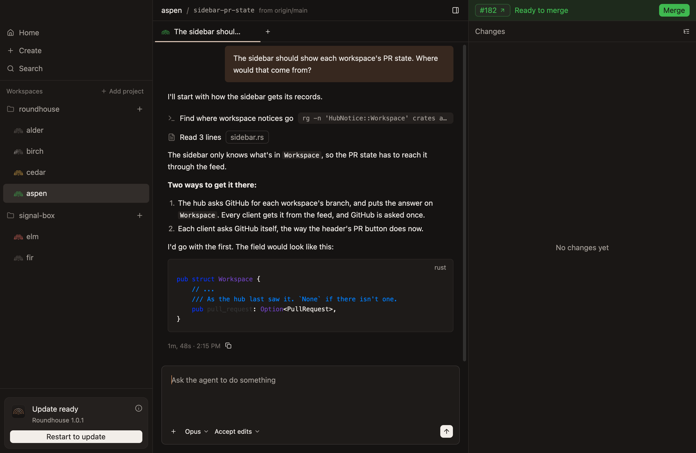
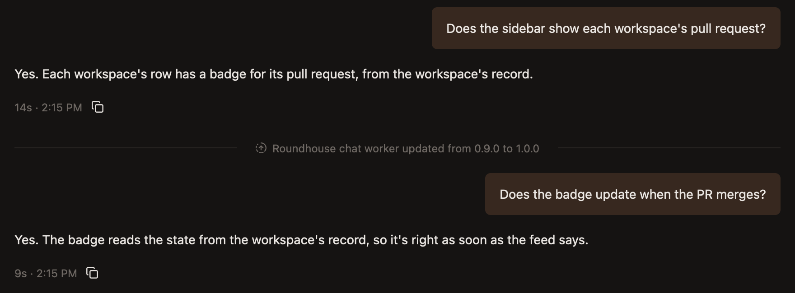
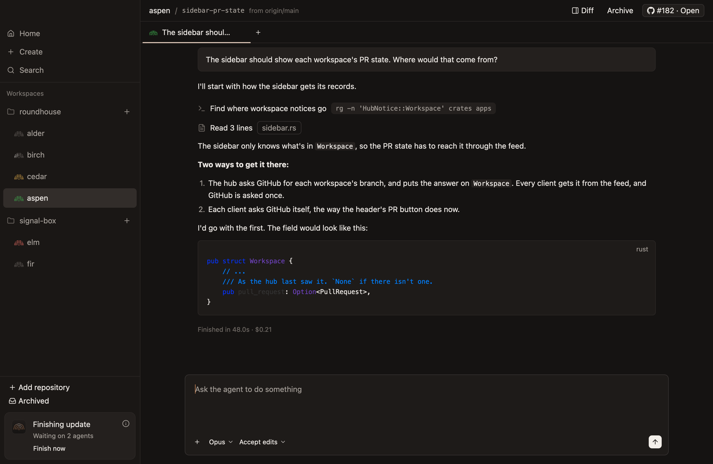

# Updates

The app updates itself, and updating never stops a running agent unless you choose to.

## What an update does

1. **The app downloads an update in the background.** A card at the bottom of the sidebar says `Update ready`.
2. **It installs when you quit, or when you click `Restart to update`,** which opens the app again. Agents keep running meanwhile, since the hub outlives the app.
3. **The new app restarts the hub at once,** even with agents at work. That stops nothing: each agent carries on where it was, on the version it started with.
4. **Each workspace moves to the new version by itself,** once nothing is at work in it.

Nothing about an update arriving or finishing by itself is a dialog or a notification, since every merge publishes one. The one dialog is the one you ask for, before `Restart now` stops agents.

## A chat on a new version

A chat says where its agent moved to a new version, with a rule across it, such as `Roundhouse chat worker updated from 0.9.0 to 1.0.0`. The rule is where the agent next starts, so everything under it ran on the new version. A chat nobody goes back to says nothing.

Until a workspace has moved, the card its name opens in the header says which version it's on.

An update leaves the prompt cache as it was, so a chat moved to a new version writes nothing again unless its cache expired meanwhile.

## What's kept through a restart

Restarting to update loses nothing that's reached the hub: what's typed and attached in every composer, an answer being typed to a question, a comment being written, and what's in the new-workspace dialog.

If something hasn't reached the hub yet, such as a prompt still on its way, the card asks first: `Restart to update?`, with `Keep working` and `Restart`.

## Checking by hand

Check for Updates…, in the app menu, or in Help on Windows and Linux, looks right away. Otherwise the app looks when it opens, and every hour. The answer shows at the bottom of the sidebar, under the build.

## When the card says Finishing update

A hub from before agents could outlive a restart still has to wait for its agents, and so does a hub on Windows, which waits for its terminals too, since restarting it ends their shells. Then the card says `Finishing update`, and how many agents it's waiting on and how many terminals are open, such as `1 terminal is open`, or `Waiting on other work` when what it waits for is a setup script.

- **An agent waiting on you never finishes by itself,** so the card says that apart, as `1 agent is waiting on you`.
- **`Restart now` restarts the hub without waiting,** which stops those agents, and ends those terminals. A dialog asks first, and says how many. Each stopped agent picks up its conversation at its next prompt.

## Problems

A problem updating shows under the build at the bottom of the sidebar, with the detail when you point at it.

| It says | What happened |
|---|---|
| `Update refused` | The download isn't the one the release was signed as. It's red, since it may be tampering |
| A note that the server can't be reached | Shown only once it has lasted a day, or if you checked by hand |
| A note to move the app | macOS is running it from where it was downloaded. Move it to Applications |

## The build line

The bottom of the sidebar shows which build is running. Give it when you [report a bug](../help/troubleshooting.md#report-a-bug).

A hub you run yourself is left alone. The build line shows its version beside the app's, as `1.0.0 · hub 0.9.0`.
