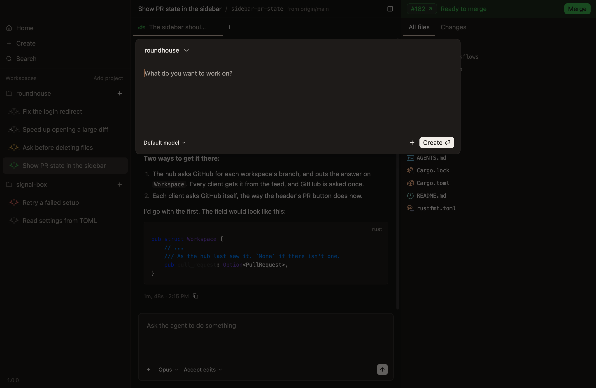
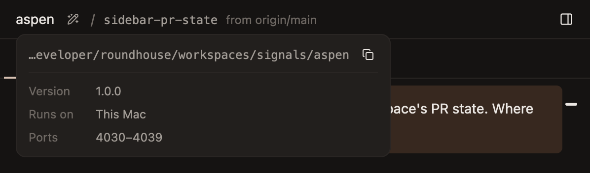
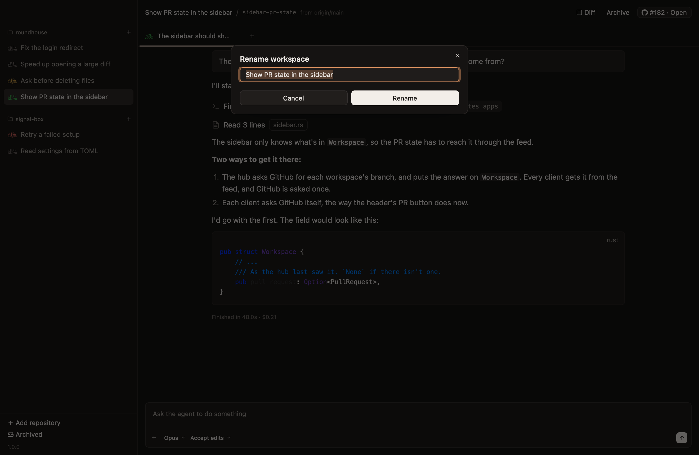
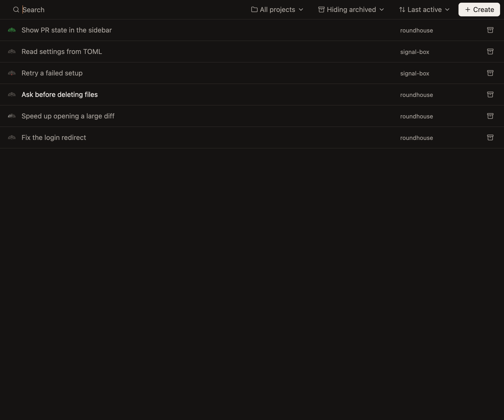

# Workspaces

Making a workspace, its setup, its name and title, and archiving it. [Workspaces, projects and chats](../concepts/workspaces.md) says what a workspace is.

## The new-workspace dialog

`Cmd-N`, New Workspace in the File menu, `Create` in the sidebar and on Home, and the `+` beside a project all open it.

- **It holds the project, the first prompt, the model and its effort, plan mode, and files to go with the prompt.**
- **Return presses Create,** and `Shift-Return` starts a new line.
- **Create with nothing typed makes the workspace and sends nothing.**
- **Create closes the dialog at once,** and the sidebar shows the workspace being made, since it fetches first.
- **The new workspace is selected once it's made,** unless you went somewhere else meanwhile.
- **The model and effort start at Opus and Extra high,** and stay as chosen for the next workspace. Plan mode doesn't.
- **Closing the dialog keeps what's in it.** The hub keeps it, files and all, until the workspace is made.
- **A workspace that can't be made puts what was typed back in the dialog,** and a prompt that can't be sent goes to the new chat's composer.

`Cmd-N` and `Create` make the workspace in the selected workspace's project, and a project's `+` in its own.

## What a workspace gets

| | |
|---|---|
| **A worktree** | In `~/roundhouse/workspaces`, on a new branch from the repository's default branch, fetched first |
| **A name** | Such as `euston`: its directory, and the folder its branches go in, so it starts on `euston/start`. One you don't choose is a railway station's, with a number, such as `euston-2`, when git or a workspace made at the same moment already has it |
| **Ten ports** | The first is `CONDUCTOR_PORT` |
| **A first chat** | Which takes the prompt from the dialog |

## Where a workspace is

Rest the pointer on a workspace's name in its header for a card that says where it is:

- **The path of its worktree,** with a button that copies it.
- **The version its agents run on,** and where they run.
- **Its ten ports.**

## Setup

Setup runs in the background once the worktree exists.

1. It copies the ignored files that match `.worktreeinclude`, or `file_include_globs`, or `.env*`.
2. It runs the repository's `setup` script.

- **A prompt sent meanwhile is recorded at once,** and delivered when setup finishes.
- **A failure warns, and never blocks.**
- **Restoring a workspace runs it again.**

[Repository settings](repository-settings.md) says where the script and the patterns go.

## Names and titles

A workspace's name never changes. Its title is what the sidebar and the header show.

- **A title is written from the first prompt,** and its images, by a small model in a call of its own. It costs the agent no context.
- **Until it arrives, the title is the prompt's first line,** cut at a word after 48 characters.
- **A generated title is a few words in sentence case,** such as "Fix login redirect".
- **Rename… is in the menu a right-click on a workspace's row opens.** A title typed by hand is never replaced by a generated one nobody asked for.
- **Regenerate title asks for a new one from everything asked in the workspace,** since the work can move on from its first prompt. It's in the same menu, and a button beside the title in the header.
- **A title is one line of at most 120 characters.**

## The sidebar's order

Each project's workspaces are listed last active first, or oldest first, chosen from a button at the sidebar's heading.

- **Last active goes by what you did, not what agents did:** making the workspace, making a chat in it, sending a prompt, or answering a question. So workspaces at work stay where they are until you turn to one.
- **The order holds still while the pointer moves over the list,** and for a second and a half after it stops, so a row doesn't move out from under a click.
- **`Cmd-[` and `Cmd-]` move between workspaces** in the order shown.

## Archiving

Archiving removes the worktree and keeps the branch, following it if the agent renamed it.

- **It refuses if there are uncommitted changes, or commits on no branch,** unless you say to go on.
- **Ignored files go with the worktree,** such as `.env` and `node_modules`.
- **The repository's `archive` script runs,** then its agents stop.
- **It's done as soon as the worktree is out of the way,** and the files are deleted after, so it doesn't wait for a build's output to be deleted.

Archive is on a workspace's row in the sidebar and on Home, in the row's right-click menu, on `Cmd-Shift-A`, and on the pull request's bar once the pull request is merged or closed.

## Restoring

Home lists archived workspaces. Clicking one brings it back: the worktree is made again from its branch, and setup runs again.

## Home

Home, at the top of the sidebar, shows every workspace in one list, in place of the workspace.

- **A row is a workspace:** its mark, its title, its project, and a button to archive it or bring it back.
- **The search matches a workspace's title or its branch.**
- **The list can show one project or all,** hide archived workspaces, show them too or show only them, and sort by last active, by when each was made, or by title, which the menu calls `Name`.

