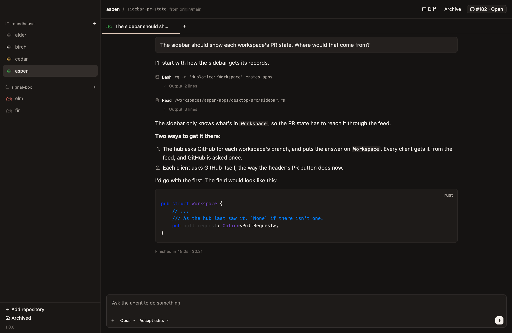
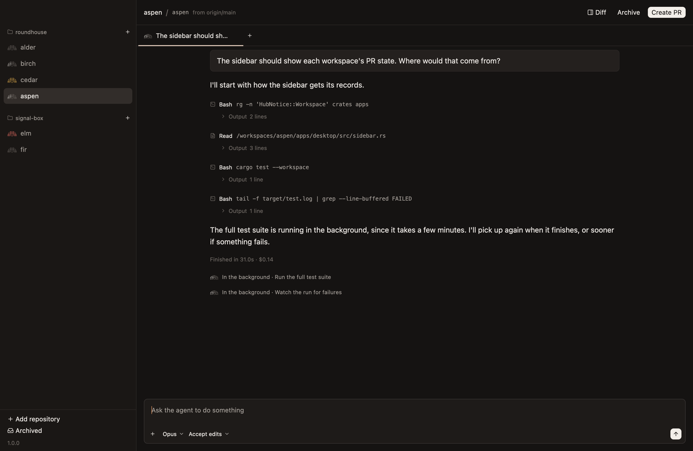
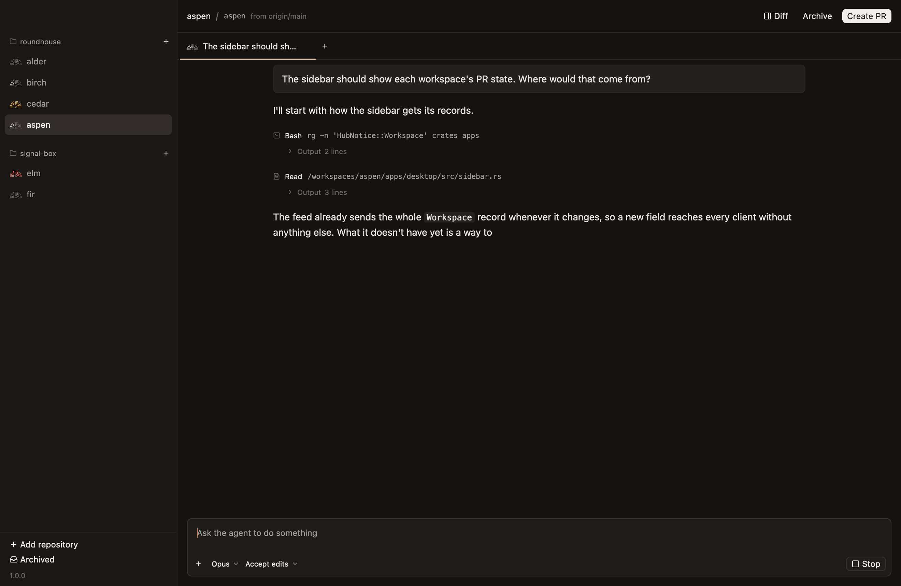
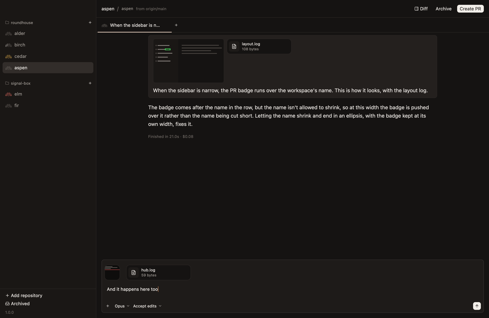
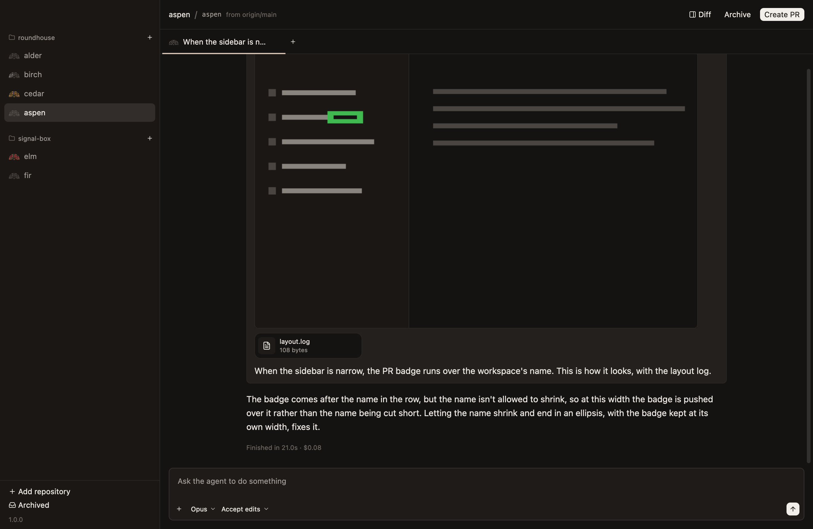
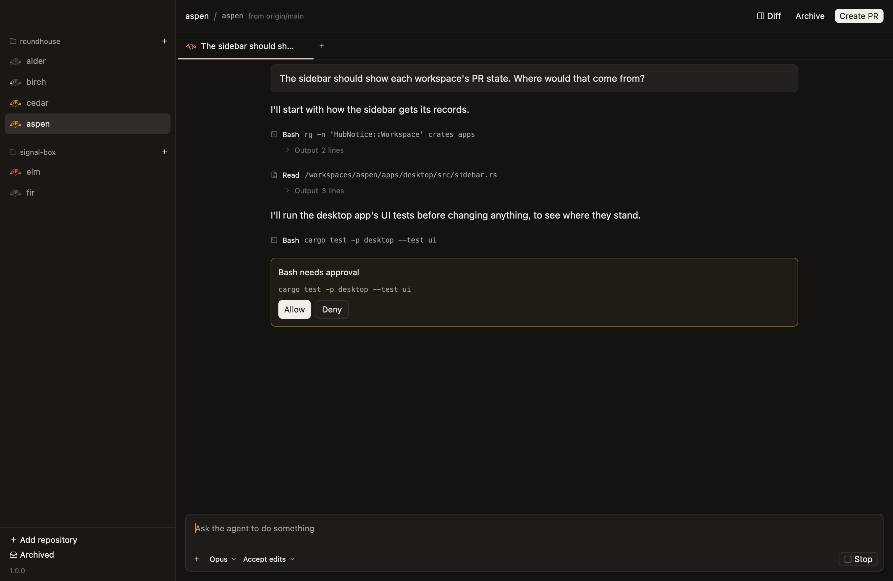
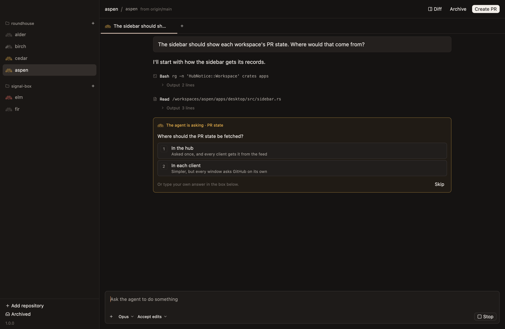
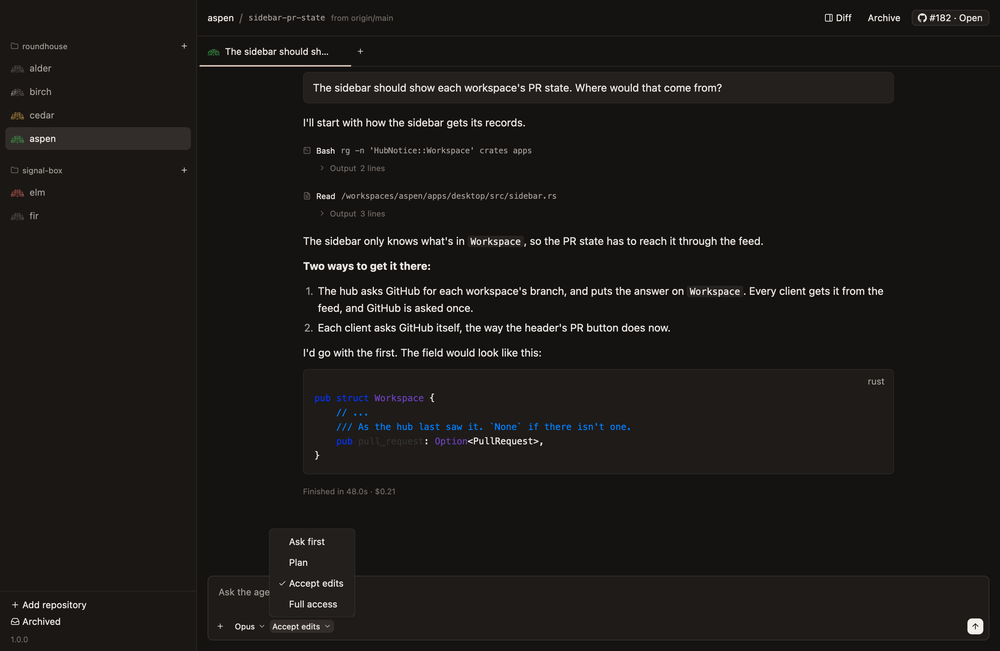
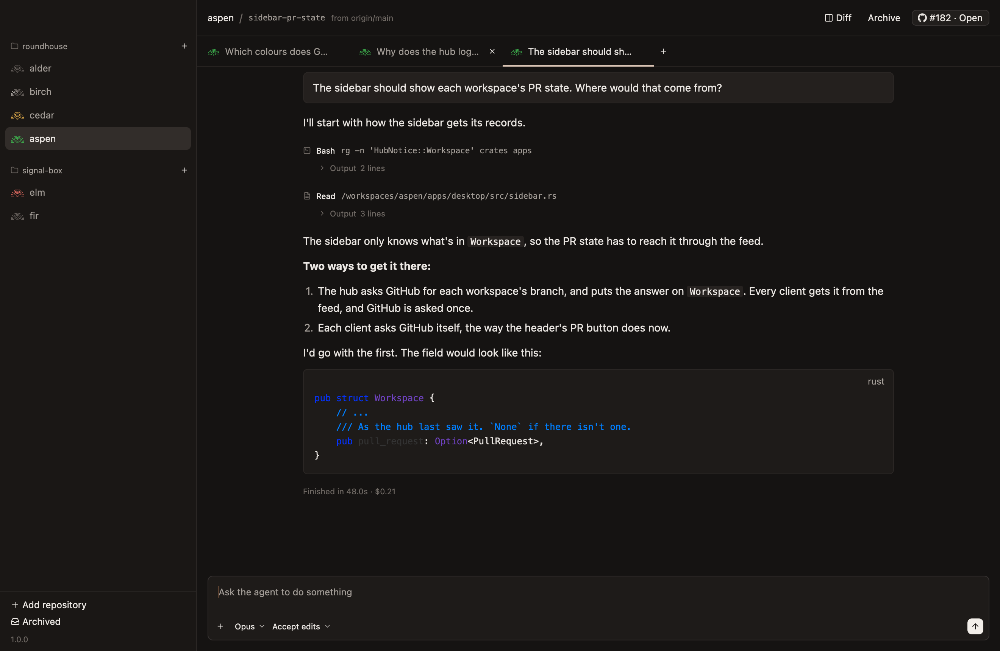

# Chats

## A turn

- **A turn can end with work still going in the background,** such as a test run the agent said it would come back to. Until that work finishes, the agent counts as working: its mark moves, an update waits for it, and closing its chat asks first. The composer still sends rather than offering to stop, since stopping a turn doesn't reach that work, and when it finishes the agent picks up again by itself. *Unconfirmed.*
- **What's running in the background shows where the conversation ends,** one working line for each task, with its mark moving and what the agent said it's for. A line goes when its task does. The hub keeps the list, so it shows however long ago the task started. *Unconfirmed.*

**A finished turn,** with tools, a list and code, and a pull request open for the branch. *Unconfirmed.*

**A turn that ended with the test suite running in the background, and a watch on it for failures.** *Unconfirmed.*

**The agent partway through writing a reply.** *Unconfirmed.*

## Titles

- **A chat's title can be changed by hand,** as a workspace's can, in `workspaces.md`.
- **A chat's title is generated from its first prompt,** by the same rules as a workspace's.
- **A workspace's first chat gets the same title as the workspace,** from the same call, since they come from the same prompt. *Unconfirmed.*

## Attachments

- **A prompt can carry files.** Paste an image, or drop images and files on the composer, or choose them with its `+`, and each shows as a tile above what's typed, with a way to take it off. A prompt with files needs no text, since a screenshot can be the whole question.
- **Any kind of file can go, up to 100 MB, and at most 10 with a prompt.** The size is what the hub takes in one go.
- **Each file goes in the workspace's `.context/attachments/`, and the agent is told where, so it can open it then or later.** Git is told to ignore the folder, so the files never show as changes. Images up to 32 MB between them, and a text file up to 32 KB, also go in the prompt itself, so the agent sees them without opening anything. A longer text file is opened from where it is, so the agent can search it rather than read all of it.
- **A file is known by its bytes rather than its name,** so the agent is never sent an image labelled as something it isn't, and a pasted TIFF, which some apps copy, goes as a PNG.
- **Files stay with their chat until they're sent,** the way what's typed does, and a prompt that can't be sent comes back to its chat's composer, files and all. While the agent waits on a question, what's typed answers it and the files wait for the next prompt, since an answer can't carry them.
- **In the transcript, a prompt's images show small above its text, and a click opens one to its own width, up to the column's.** Other files show their name and size. The hub keeps each image, so every client shows it, and it's still there after the workspace is archived. Other files are only in the workspace, so archiving takes them with it.

**A prompt that carried a screenshot and a log, and two more files waiting in the composer.**

**The screenshot, opened.**

## Questions and approvals

- **While the agent waits on a question, what's typed in the composer is the answer,** and the card says so. A plain Allow button would throw the question away. *Unconfirmed.*

**A command waiting to be allowed.** *Unconfirmed.*

**A question from the agent, with choices.** *Unconfirmed.*

## The model and approval mode

- **A new chat keeps the model and how edits are handled, but not Plan or Full access.** Plan belongs to the task at hand, and Full access should be chosen on purpose each time. *Unconfirmed.*
- **The model picker offers aliases:** `default`, `fable`, `opus`, `sonnet` and `haiku`. They follow the CLI's newest of each without a release here. *Unconfirmed.*

**The approval mode's menu, open.** *Unconfirmed.*

## Tabs

- **The chat showing is underlined, not filled.** A 2px pale copper line runs under its tab, over the bar's bottom edge, and its title is in the foreground colour while the others' are muted. A fill would make the tab one more raised thing on the pane.
- **A tab's close button shows only while the pointer is over the tab,** the one showing included, so the row reads as a row of titles. `Cmd-W` closes the chat showing without it.
- **Every tab is 200px wide,** with its mark and as much of its title as fits, so the row doesn't shift when a chat gets its title. *Unconfirmed.*

**Three chats, with the pointer over one that isn't showing.** *Unconfirmed.*

## Closing chats, and keys

- **Closing a chat stops its agent and keeps its history.** Closing the last one starts a new one rather than leaving nothing, and a workspace's first chat is found or made by the hub, so two clients opening a workspace at once share one chat. *Unconfirmed.*
- **Chat keys are the ones tabs use elsewhere:** `Cmd-T` for a new chat, `Cmd-W` to close one, and `Ctrl-Tab` and `Ctrl-Shift-Tab` to move between them. *Unconfirmed.*
