# Chats

## The transcript and the composer

- **Rows in sight stay drawn and interactive while history loads or new output arrives,** including in a long chat with many events that draw nothing. Once the rows needed for the window have loaded, keeping still asks for no more history.
- **The transcript is a centred column, at most 848px wide,** so lines stay short enough to read in a wide window. *Unconfirmed.*
- **Everything in the transcript but a prompt starts on the column's left edge:** what the agent wrote, a call's icon, and what a call or a thought opens to, so the eye always goes back to the same place. Something with an edge, such as a code block or the rule down a subagent's work, puts its edge there, and what's inside it sits in from it.
- **A code block has a button at its top right that copies its code, shown only while the block is hovered,** the same button a command has, before the block's language, if it has one, wherever the chat shows Markdown, such as a reply, a thought or a prompt. Every code block has the room above its code that one with a language has for the language, so the button never covers the code. *Unconfirmed.*
- **A prompt sits at the right of the column, on a bubble only as wide as what it says,** so what was asked stands apart from the agent's work, which starts at the left. The bubble has no edge, a control's 6px corners, 16px of room beside its text and 12px above and below. It's at most 80% of the column wide, so it never reaches across the column the way the agent's work does. *Unconfirmed.*
- **A prompt has a button that copies what it says, overlapping the bubble's lower right corner, shown only while the prompt's row or the button is hovered,** so a prompt can be sent again elsewhere, such as to another workspace's agent. Its centre sits on the bubble's right edge and 4px (`XSmall`) above its bottom, so the whole hit target clears the following row, including a reply that starts with a code block. It adds no space below the prompt and moves nothing on hover. It uses the shared Copy button's cutout, as `components.md` says, to separate the icon from the bubble without a visible badge edge. It stays at the same horizontal position for prompts of different lengths and stays shown as the pointer moves onto its outer half. A note below a prompt the agent dropped doesn't move it away from the bubble. One that only carried files has none.

  **Copy over the corner of a short prompt, then a longer one, with the conversation staying in place.**

  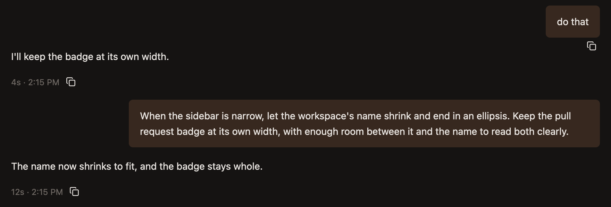
  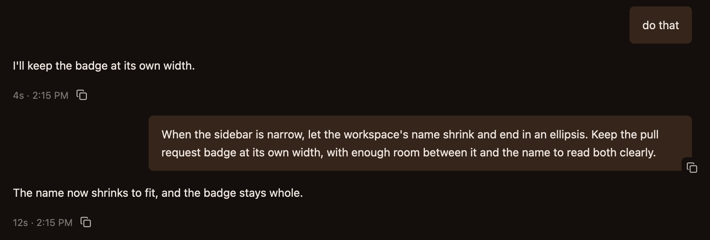

  **The copy button clears a reply that starts with a code block.**

  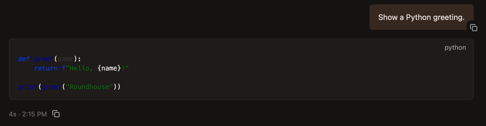

- **The composer is centred under the transcript, 24px wider than its column on each side, and at most 896px wide,** so the transcript's text sits inside the composer's edges. It has room for four lines before it grows, so a longer prompt doesn't start out cramped, and empty it's about 150px tall. *Unconfirmed.*
- **The bar along the composer's bottom has two ends.** The left one sets up the prompt: the `+`, whose menu attaches files and turns plan mode on and off, then the model picker. The right one has what the agent says of itself, such as how full its context is, then conversation mode's button and the microphone, unless dictation is off or this Mac can't run its model, as the dictation rule below says, and last the one main action, Send or Stop, so the microphone is beside what sends what was said. Each thing beside the main action sits in the middle of a 24px square, the main action's own size, so things of different sizes line up with it and are as easy to point at as each other. The squares are 8px apart, and the main action is 16px from them, so it stands apart. Something 16px wide there, as the context's ring is, is so 20px from the main action and 16px from another like it. *Unconfirmed.*
- **What a click opens, a second click closes without the pointer moving,** so the line that was clicked stays exactly where it is in the window while what it opened to comes and goes under it. At a chat's end, where the chat otherwise keeps its end at the window's bottom, opening something leaves the chat where it is, with its end out of sight as if it had been scrolled away from. Closing something there that would leave the chat ending above the window's bottom, with more of it above the window's top, brings the chat down until its end is at the bottom, since that room would show nothing, and the chat keeps to its end from there. That's the one place the line moves out from under the pointer. *Unconfirmed:* what the chat's end does.
- **What's in sight stays where it is when a row changes height by itself,** such as a long reply that's drawn a moment after someone scrolls to it, or an image once it's decoded. The first row that starts in the window stays put, and a row above it grows or shrinks upward, past the window's top. *Unconfirmed.*
- **A selection dragged past the chat's top or bottom scrolls the chat on,** so it can take in more than the window shows. A drag that starts in a block that scrolls its own text, such as a compaction's long summary, scrolls that block on the same way when it's held past the block's top or bottom. A copy has only what the chat shows, so it leaves out a thought that's been closed. *Unconfirmed.*
- **Shift with an arrow key moves whichever end of what's selected moved last, as in any text,** so a selection made with the mouse can be made a little longer or shorter without starting again. The other end stays where it is. Left and right move it a character, and with Option on a Mac, or Ctrl elsewhere, to the start of the word before or the end of the word after, as a Mac's and Windows' text boxes do. Up and down move it to the line above or below, at the place nearest to where it was across, which a run of them keeps to, so passing a short line doesn't pull it to the left, and in a table, to the cell above or below. It goes where a drag would go, and the chat scrolls as it does for a drag: into the next text, such as from a reply into the call after it, and into the lines of what a command printed that its block has scrolled out of sight, with the chat and the block scrolling it into view by as little as it takes. Held at the window's edge, it scrolls the chat on a line at a time, as a drag held just past the edge does. The one thing a drag never meets is an end out of sight, since a drag's end is under the pointer, so after the chat's been scrolled away from it, a key brings it back into view first. A click on text leaves a place to start from, and with neither that nor a selection, such as after a click beside the text, the keys do nothing. *Unconfirmed:* the keys for a word, keeping to where it was across, and bringing the end into view.
- **Once a chat has focus, the keys that scroll a page scroll it, and the keyboard has no place of its own in it,** so a chat is read from the keyboard as a page is. Up and down scroll it a line, and Page Up and Page Down a screen. Home goes up to the first row that's loaded, and End to the end, as the button back down does. Tab and Shift-Tab go through what opens, such as a call's line, a thought, an image or a link, and Return opens or closes it. Escape goes back to the composer, unless something open over the chat takes it first, such as Find's bar or an image. *Not built:* Tab, Shift-Tab and Return. *Unconfirmed:* where Home goes, Return, and Escape.
- **Page Up and Page Down scroll the chat from the composer too, and from a question in its place,** since neither has much use for them, so the chat can be read back while a prompt is being written. They do from Find's bar too, as Up and Down do, since it has no use for them either. *Unconfirmed:* from Find's bar.

## A turn

- **A turn can end with work still going in the background,** such as a test run the agent said it would come back to. Until that work finishes, an update leaves it running on the version it started with, closing its chat asks first, and its mark shows something is running, as `components.md` says. The composer still sends rather than offering to stop, since stopping a turn doesn't reach that work, and when it finishes the agent picks up again by itself. A wait on the pull request is work in the background like any other, with the same mark, but it's the hub's, which the next hub keeps, so an update doesn't wait for it, as `updates.md` says. *Unconfirmed.* Until the agent has picked up again, the chat is still at work, however that work ended, so nothing takes the moment in between for the agent being done, and one that hasn't within fifteen seconds is taken to be idle. *Unconfirmed:* fifteen seconds. *Not built:* an update waits for everything else in the background.
- **The Mac stays awake while there's work,** so it doesn't go to sleep by itself partway through. Work is a turn, what an agent left running in the background, and a workspace being set up. An agent that's only waiting on you isn't, since it could wait all night. The Mac is let go half a minute after the last of the work, so it stays awake between one turn and a queued prompt's. The display still sleeps, and closing the lid or a low battery still puts the Mac to sleep. `Keep computer awake while agents are working`, in Settings, turns it off. *Not built:* a worker on another machine keeping that machine awake.
- **What the agent's CLI writes only for the model isn't shown,** such as how much it shrank an image it read. The summary a compacted conversation carries on from is the one exception, as "Compacting" says. *Unconfirmed.*
- **What's running in the background shows where the conversation ends,** a line for each task while there are four or fewer: a ring, or a subagent's robot, as `components.md` says, and what the agent said it's for. The ring or the robot says it's in the background, so the line's words don't, and pointing at the line does. The fan stays the agent's, one to a chat, so a line under the working line isn't taken for another agent at work. A line goes when its task does. The hub keeps the list, so it shows however long ago the task started. *Unconfirmed.*

  **A turn that ended with the test suite running in the background, and a monitor watching it for failures.** *Unconfirmed.*

  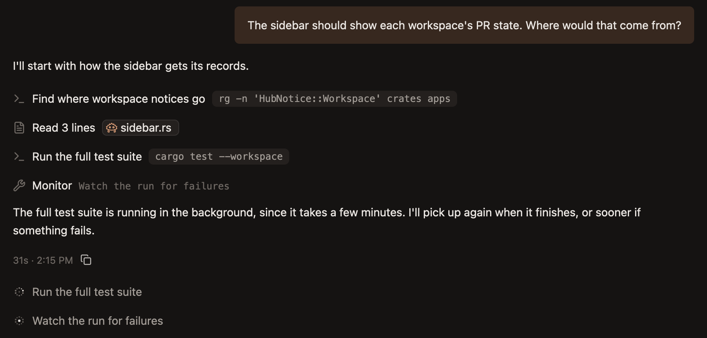

- **A ring's light goes round while its task runs, and a monitor's ring holds still with its hub lit,** since a monitor does nothing until what it's watching for happens. A command runs, and a light sweeps across a subagent's robot instead. *Unconfirmed.*
- **Up to four tasks have a line each, in the order the agent started them,** since what each is for is the reason to look. Each wait on pull requests has a line after theirs, in the order it started, drawn from the hub's waits. *Unconfirmed.*
- **With more than four tasks, each kind with several has one line,** such as "6 subagents", so the lines never take the conversation's place however many tasks there are. There's at most one for subagents, one for commands and one for monitors, in that order, and a kind with a single task keeps that task's own line. The line starts with the mark each of its tasks' lines would, so it says as much about whether anything is running. After how many there are, it says what each is for, fainter, as far as it has room. *Unconfirmed:* four.

  **Five tasks in the background: the three subagents in one line, and the command and the monitor with their own.** *Unconfirmed.*

  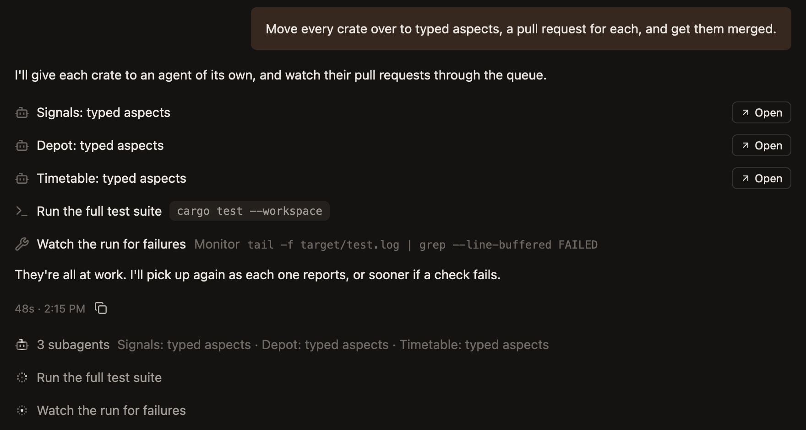

  **Thirteen tasks in the background, a line for each kind.** *Unconfirmed.*

  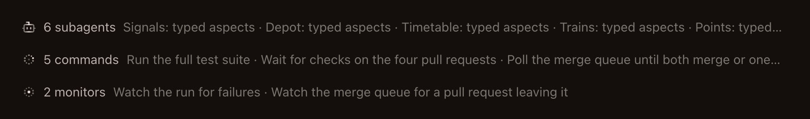

- **Clicking a kind's line opens it to its tasks' own lines, set in under it, and clicking it again closes it,** as a call's line does, with its mark turning into a chevron under the pointer. Which are open is the chat's own, on the device it's opened on. A line that goes and comes back, as when the next lot of subagents starts, starts closed, since it's another line. *Unconfirmed.*

  **The same, with the subagents' line opened to theirs.** *Unconfirmed.*

  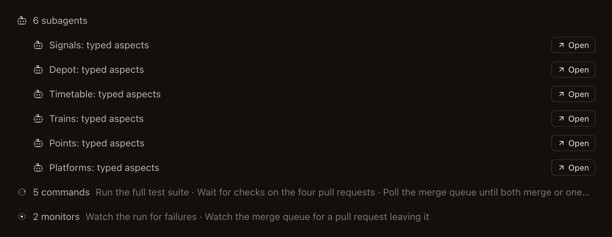

- **The lines change order once there are more than four, and a subagent's Open button is then a click further away,** since with that much going on nobody is reading each line.
- **A subagent's line starts with the robot its call's line has, and ends with the Open button it has,** so the line reads as that call, and the way to its tab is at the chat's end, however far up the chat its call is. Pointing at the rest of the line still says it's running in the background. The hub keeps which subagent each task is, or failing that which call started it, once the agent says, so the button opens the same subagent however the agent carried on with it. From a hub that keeps neither, the line has no button. *Unconfirmed.*
- **Each wait on pull requests has a line of its own, as the hub keeps it, with the ring a monitor has, held still with its hub lit, what it waits on and where its pull requests stand, then Stop,** as "Waiting on #182 · 2 required checks running". It comes from the hub's wait, since the agent's CLI lists a copy that can still be there for up to 5 s once the wait has ended, and calls it by the tool that started it, which says nothing of the pull request. Where they stand is the hub's last reading of them, which is the bar's reading too, since the hub reads a workspace's waits with its own pull request. The line lists the PRs in its scope, with how many of the checks it goes by are running, or a read error, and says what it waits until only once. A wait until checks says it in the count, as "Waiting on #6, #7 · 2 required checks running", naming them required when only those count, since the bar counts every check and would otherwise seem to disagree. A wait until a merge says it after the numbers, then where the pull request holding it stands, in the bar's words, as "Waiting on #9 to merge · Running checks in the queue", since what's in the way of merging is what holds that wait, and the bar reads it from the same reading, so the two never say one state two ways. A count would say "0 checks running" of a pull request in the merge queue, whose checks run on the queue's commit. For a stack, it's the lowest that hasn't merged, named, as "Waiting on #6, #7 to merge · #6: Review required". Nothing follows where the bar would only say to see it on GitHub. With a read error, it says what it waits until after the numbers, as "Waiting on #6, #7 for required checks · couldn't refresh GitHub". A wait the singular tool started, which only a hub from before that tool was dropped can still have open, has no reading, so its line says only what it waits on, as "Waiting on #182's checks". Pointing at it says what ends it. Several waits have separate lines and Stop buttons. Nothing runs for it here, as for a monitor: the hub reads the pull request. Stop calls that wait off, and the line goes as the hub records it. A running agent hears in a turn of its own once its CLI next asks after it, within 5 s, and one that isn't running hears once it next starts. *Unconfirmed.*

  **A turn that ended with the agent waiting in the background on its pull request's required checks, to queue it once they pass.** *Unconfirmed.*

  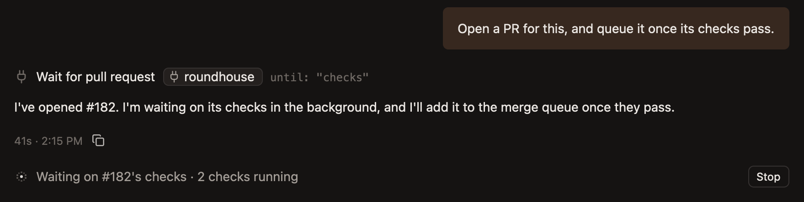

  **Independent waits, with the lower PRs included in a stack wait, and a wait until a merge on a pull request in the merge queue.** *Unconfirmed.*

  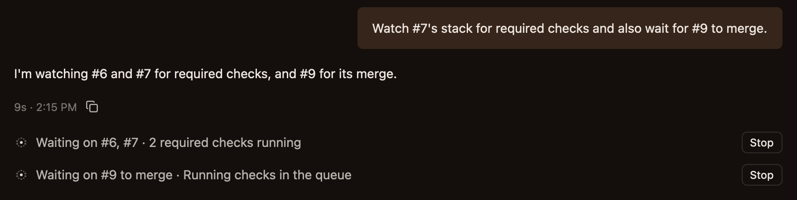

- **When the agent picks up by itself, the chat says what it picked up after:** a line for each of its tasks in the background it heard had ended, before what it did about them, so a turn nobody asked for doesn't start without a reason. Each has the icon the task's call has, what the agent said the task is for, how it ended and when the agent heard. A wait's line has a pull request's icon instead, since its call's plug says nothing of what it waited on, and says which pull requests it waited on, in the words its line had while it waited, as "Waited on #7 for required checks", and why it ended, from the hub's record of it, since the agent hears only that its tool answered. A subagent's line ends with the Open button its call's line has. A turn the agent starts by itself for another reason has no lines: one that what a monitor watches for happening starts, since nothing before it says why, and one a message from another chat starts, since that isn't told apart from a prompt yet. A turn refused before it did anything, as by a usage limit, has its lines in the failed request's card instead, as the rule on failures in a row says. *Unconfirmed.*

  **The agent picked up by itself twice: as the review it gave a subagent finished, and as its wait on #7's checks ended.** *Unconfirmed.*

  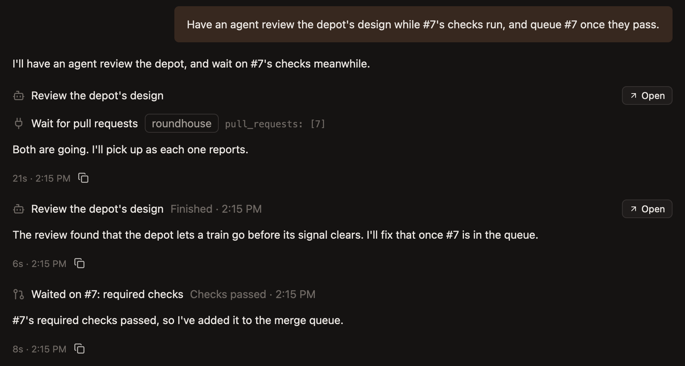

- **While the agent works, the chat ends with the working line:** its mark with the light sweeping, and how long the turn has taken so far, to a tenth of a second, so the count moving says it's still at it. The time is in the code font, so its digits stay put as they count. It counts from when the turn started, by the hub's clock, so every client counts the same. When the agent picks up again by itself after work in the background, or takes a prompt sent as its last turn ended, that's a new turn, and the count starts again.

  **The agent partway through writing a reply, and how long it's been working.** *Unconfirmed.*

  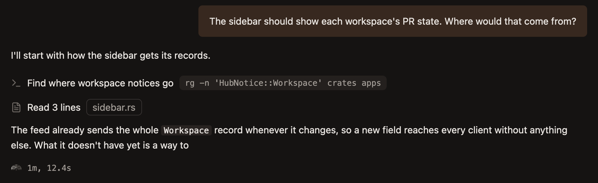

- **The working line is above the lines for work in the background,** so when the turn ends, its end takes the working line's place and they stay where they are.

  **The agent still working, with the test suite it started and a monitor watching it in the background.** *Unconfirmed.*

  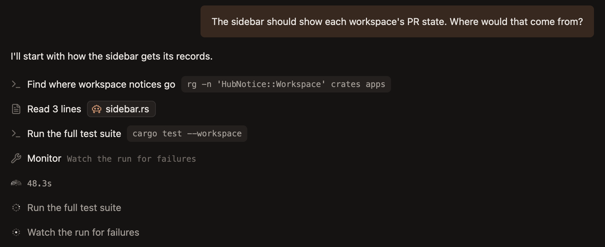

- **The working line goes while the agent waits on you,** since what it asks says so, in the composer's place or on a plan's card, and when it comes back its time counts the wait too.
- **A thought the agent is still writing is a muted line above the working line, with the icon its line will have once it's recorded and no mark of its own,** since the working line under it has one. A call it's still writing doesn't show until it's recorded, since it isn't running yet, and the working line says the agent is at work.

  **A thought still being written, above the working line.** *Unconfirmed.*

  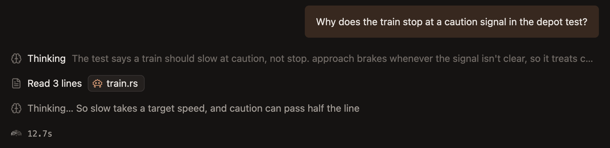

- **A finished turn ends with how long it took and when it ended,** such as "1m, 48s · 2:15 PM", and a button that copies the agent's final message. It says only as much of the day as it takes to tell when: none today, the day of the week within the last week, and the date before that. A stopped turn says "Stopped" instead, and one that failed says why, in red, but for one that ended on a failed request to the model, whose card says why.

  **A finished turn,** with tools, a list and code, and a pull request open for the branch. *Unconfirmed.*

  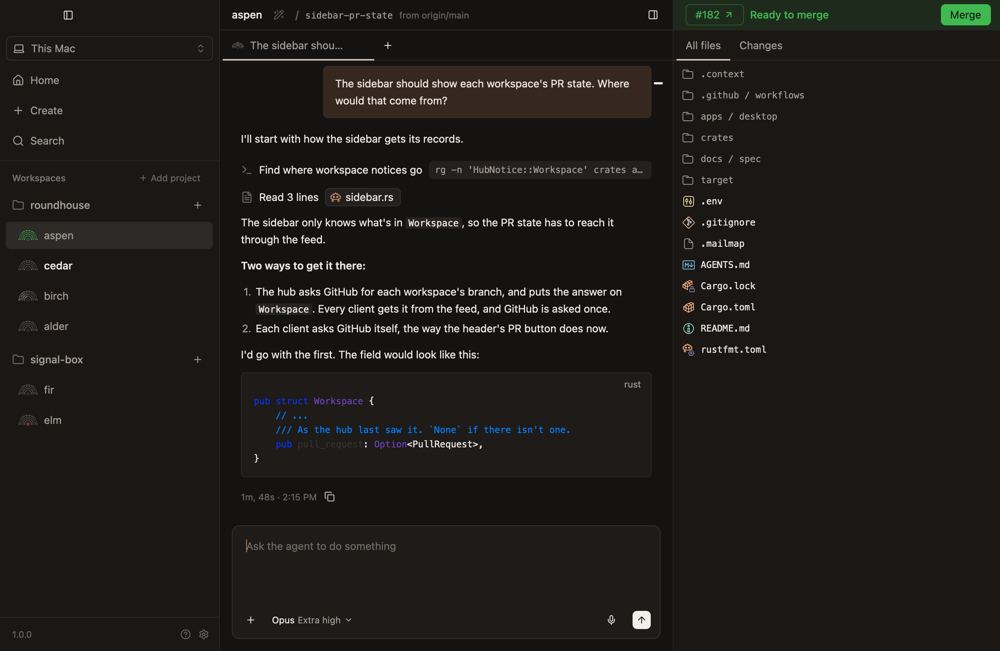

  **Three turns: one done, one stopped, and one that failed.** *Unconfirmed.*

  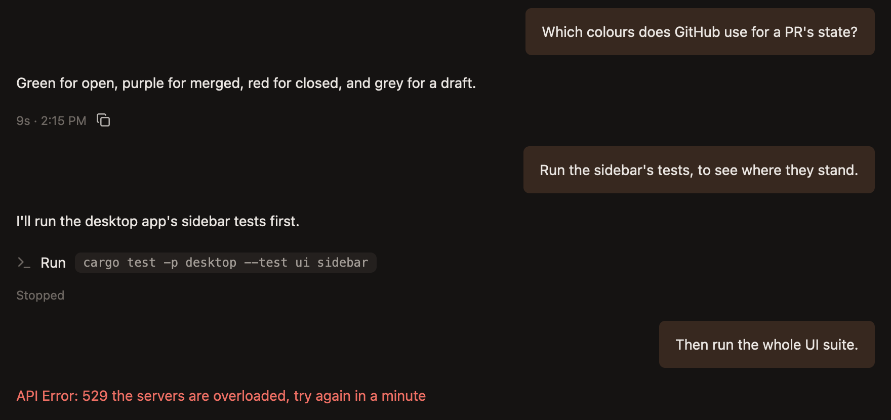

- **How long a turn took is counted the way the working line counts it,** by the hub's clock from the turn's start to its end, so the time doesn't jump when the turn ends, and doesn't change later. A turn from a hub too old to say when it started shows the agent's own count instead.
- **Resting the pointer on what a finished turn's line says, how long it took and when it ended, shows the turn's card, centred just above the line,** so it covers neither the line nor the composer, and it moves only as far as it must to stay in the window. It says what answered, such as "Opus 5.5 via Claude Code", with the day under it. Then rows say when the turn started and ended and how long it took, as its line does, and how many tokens the agent's own requests took: what they read fresh, what the models wrote, and what they read from the cache and wrote to it, each counted as the context's card counts, such as `412.4k`. The day is said once, under what answered, so the card is only as wide as its rows, and a turn that ran past midnight says each end's whole date in its row instead, such as "Oct 31, 2026, 11:57 PM". Its subagents' requests aren't counted. The hub records all of it with the turn's end, so every client shows the same, and a turn recorded before it did shows only its agent and its times. A stopped or failed turn has no card. *Unconfirmed.*

  **A finished turn's card, with the pointer resting on the turn's line.** *Unconfirmed.*

  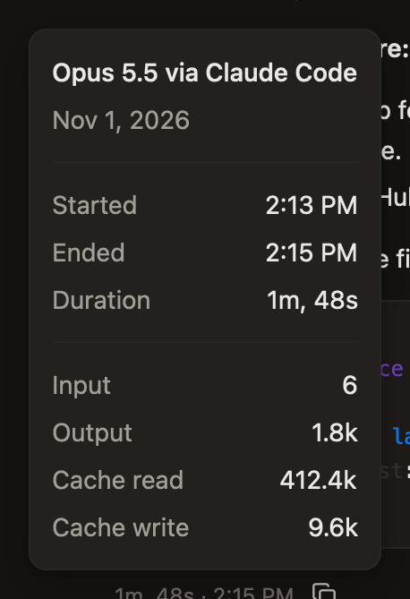

  **The card of a turn that ran past midnight.** *Unconfirmed.*

  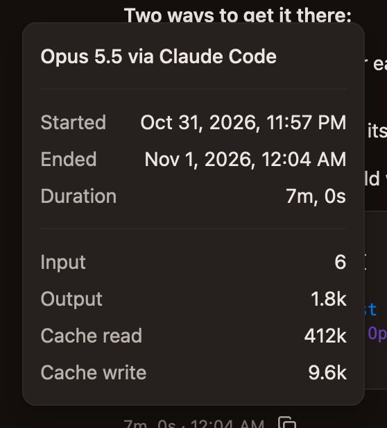

- **When one of the agent's requests to its model fails, a red card says so where it failed,** since that's where the agent stopped short, as a plan's card is amber since it waits on you. It's titled with what kind of failure it was, as the agent's CLI says apart from its words, which can change, such as `Usage limit reached`, `Couldn't sign in` or `The model's API is overloaded`. For a limit it says when the limit resets, as `Resets Thu 9:00 PM`, said as a turn's end says a time. Under that are the CLI's own words, which say what to do, with an address in them a link. A turn that ended on the card has no line of its own, since the card says why. A subagent's is in its tab, since the agent goes on without it. One that a later failure repeats is said in that one's card instead, as the next rule says.

  **A turn that failed on the account's usage limit, after the CLI said its model was changed.**

  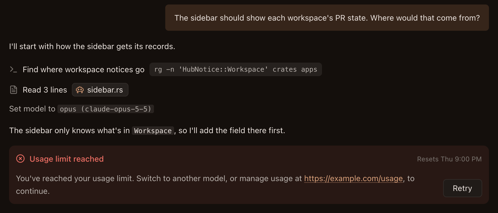

- **Failed requests in a row are one card, which says how many times and what started each try,** so an agent that keeps picking up by itself into a usage limit doesn't fill the chat with the same card. The hub says of each of the agent's own failed requests whether it's the same failure as its failed request before it, its words, kind and when its limit resets, with nothing between them that ended the row: anything the log records of the person, such as a prompt, Retry or a turn they stopped, anything the agent says or does, and the agent going or starting. A subagent's events don't end it, since its tab shows them, and neither does what the agent does by itself that comes to nothing else, such as a turn it starts as a task ends that ends with nothing said. The newest is the card, with how many times on a failure's badge beside its title, as the hub counted them, such as `Twice` or `6 times`, and under the CLI's words a line for each try, oldest first: `Your prompt`, `Partway through the turn`, a line for each task the agent picked up after, as the lines of a turn it started by itself say them, but with no Open button, since the task's call has one, or `Picked up by itself`, when nothing says why. Each says when its try started, or for one partway through a turn, when the agent was last at work. A try whose start the chat hasn't loaded has no line, rather than a guess, until it has. Past four tries, the earlier ones fold under a line such as `2 earlier`, which opens them in place, and stays open as more tries join. A turn the agent started by itself that was refused before it did anything has its lines in the card rather than above it, even when it's refused only once, and a turn between two failures that came to nothing else shows nothing. One failure after a prompt, or partway through a turn, has no lines, since what started it is just above.

  **The agent picked up by itself as a review finished, and the usage limit refused it before it did anything.**

  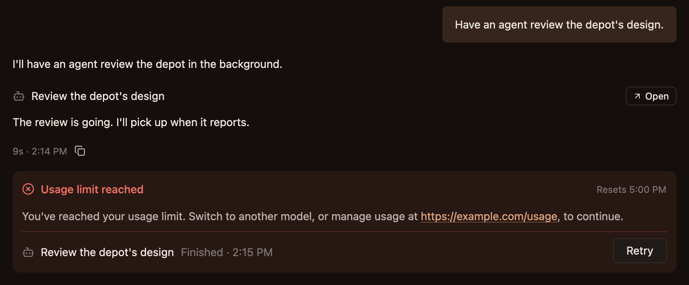

  **A turn refused partway through, then the agent picking up by itself as each of its two tasks in the background ended, refused the same way.**

  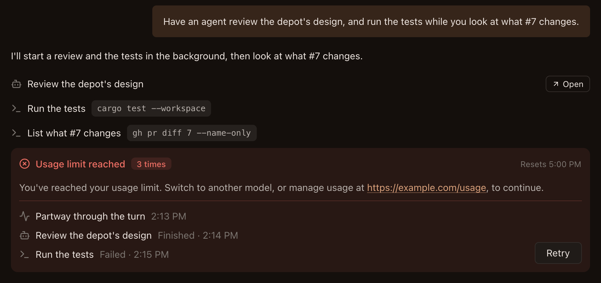

  **A prompt refused, then five turns the agent started by itself, with the first two tries folded.**

  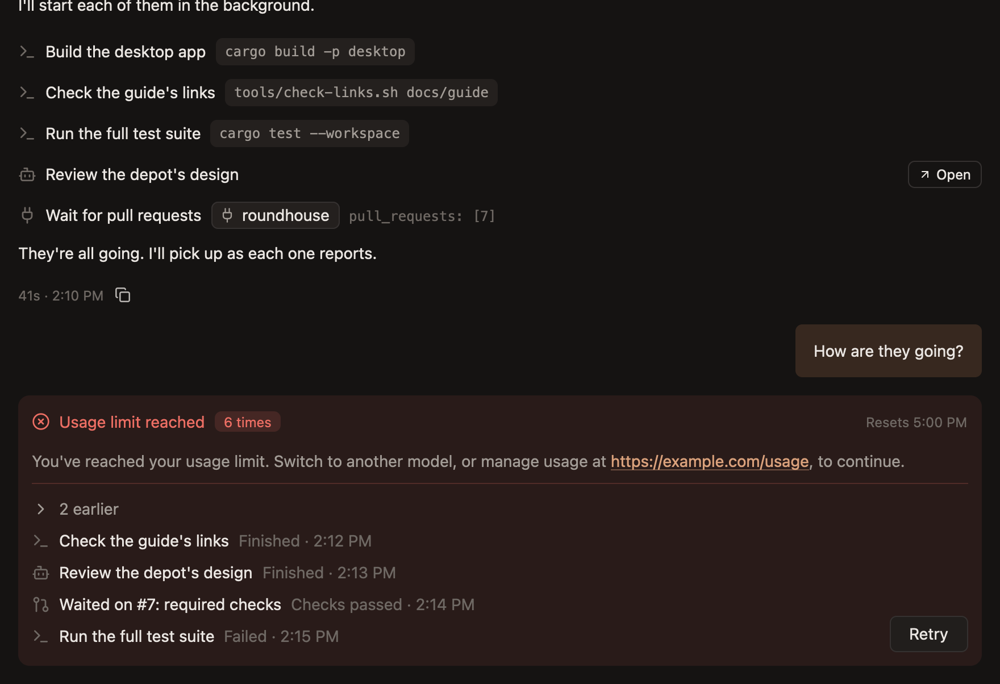

  **The same card, with its earlier tries open.**

  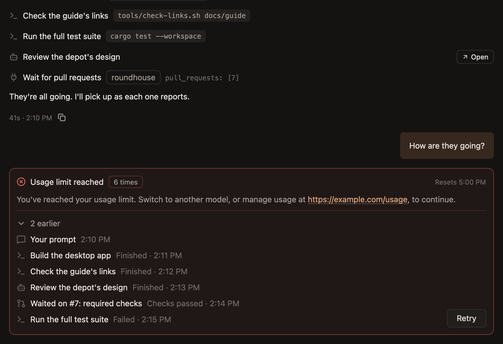

- **The card the newest turn ended on has Retry at its bottom right, while the agent is stopped short on it and until something is sent,** which asks the agent to carry on, as the prompt `Continue`, with the model the chat runs now, so choosing another model and pressing Retry gets past a model's limit. The agent already has what it was asked, and what it did before the failure, so the prompt isn't sent again, which would ask it twice. Every kind of failure has it, even one that Retry can't get past, such as a failed sign-in, since that's rare. Retry goes as soon as it's pressed, or anything else is sent, and an older card, or one the turn went on past, has none. If the hub refuses it, the chat says so, and the composer is left as it was, since nobody typed `Continue`.
- **What the agent's CLI says itself, rather than the agent, is a line of its own,** muted, or amber for what a command it ran printed as an error, such as `Set model to opus (claude-opus-5-5)` when the model is changed, or a note of the CLI's, so it isn't taken for the agent's words.
- **An image a reply points to shows in the reply, if it's in the workspace,** written as Markdown, such as ``, by its path in full or from the workspace. One written into the reply as a `data:` address shows too. An SVG drawing shows as an image does, at the size it says it is, as sharp as the screen allows. *Unconfirmed:* drawings. On a line of its own, it's as wide as it is, up to the column's, and among words it's the height of the text. Images with nothing but spaces or line breaks between them, such as a before and an after on lines one after another, are each on a line of their own, one under another, and so are images written that way in a prompt. It's the file as it was when the reply came, which the hub keeps, so when the agent changes the file and points to it again, each reply keeps what it showed, and every client shows the same, even after the workspace is archived. One that wasn't there when the reply came shows nothing, and so does one in a reply from before the hub kept them. One anywhere else on the machine or on the web shows nothing, since what the agent writes can't be trusted to point only where it should, and neither does anything in the workspace that isn't an image. *Unconfirmed.*

  **A reply that points to a screenshot in the workspace.** *Unconfirmed.*

  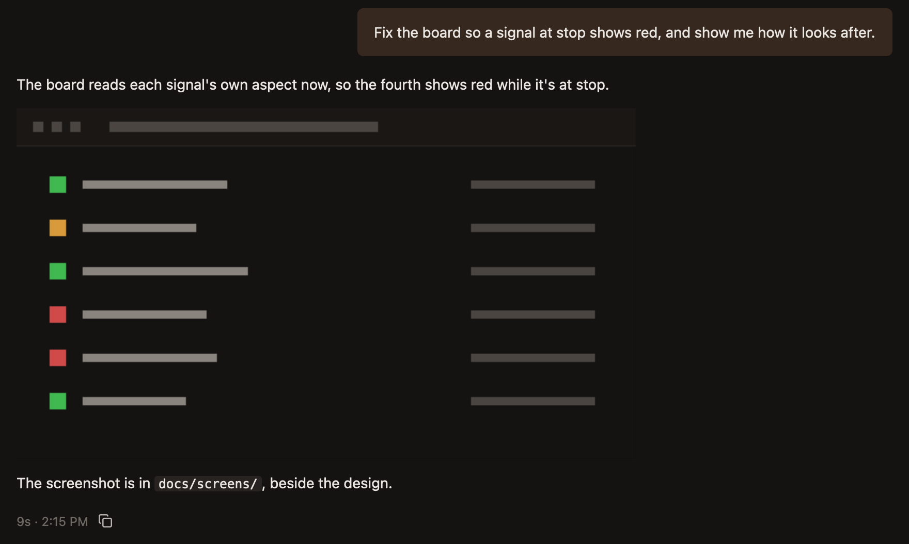

  **A reply that points to a screenshot among its words.** *Unconfirmed.*

  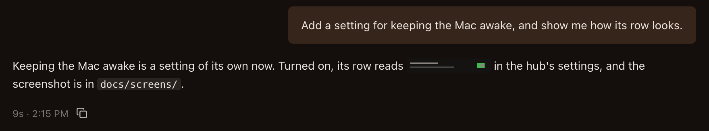

  **A reply that points to two screenshots, on lines one after another.** *Unconfirmed.*

  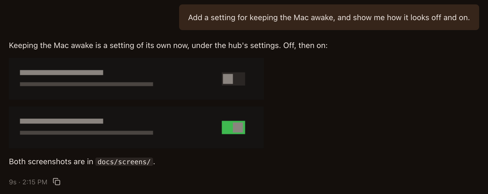

- **A diagram a reply writes in Mermaid shows in the reply as a picture,** from a code block whose language is `mermaid`, as GitHub draws one, as wide as it's drawn, up to the column's, and opens as an image does. It's drawn by each client from what the reply says, so nothing is kept but the reply's words, in the app's colours and with its words measured in the font they're drawn in, so each fits its box. While the reply is still being written, and until the block's fence is closed, it's the code block. One that can't be drawn, such as one with a mistake in it, a kind the app doesn't draw, or one that takes over 2 seconds, is the code block it was written as, with Copy. A selection copies its code, and find finds what it says. A plan to approve draws its diagrams too, and a prompt's is its code, as the person wrote it. *Unconfirmed:* the kinds drawn, which are flowcharts, sequence, class, state, entity-relationship and Gantt diagrams, pies, mind maps, timelines, git graphs and journeys, the colours, and the 2 seconds.

  **A reply that draws a diagram.** *Unconfirmed.*

  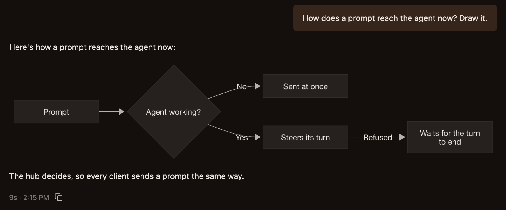

- **Every agent is told to show the person an image this way,** and to draw a diagram in Mermaid, and to save one it made in the workspace, rather than in the system's temporary directory, where the image wouldn't show. *Unconfirmed:* in the workspace's `.context/`, where it keeps whatever else it makes for its own use, in folders named for what they hold, such as `.context/screenshots/`.

- **A click on an image in a reply opens it over the window, as a prompt's image opens,** so a screenshot made smaller to fit the column, or the height of the text, can be seen as big as it is. An image in a link goes where its link does instead, as a badge does. One in a heading, a table or a footnote, and one written with its address given elsewhere in the text, as `![The board][board]` is, opens nothing. Nor do images in a paragraph that holds them with no words but isn't one image alone, such as two in one bold with nothing between them, nor one beside nothing but a tag of HTML, nor one in what a subagent did shown under its call. *Unconfirmed.*

  **The board's screenshot, opened.** *Unconfirmed.*

  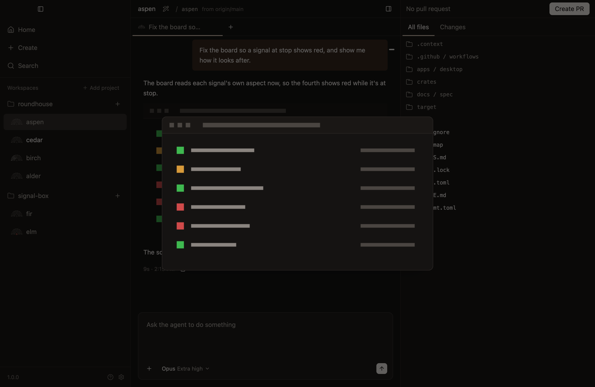

- **A link to an issue or a pull request on GitHub in a reply is a chip, whatever the link's words, with its state's mark in its state's colour, its number, and its title the first time the message links to it,** so a reply that lists several reads as what they are, and one linked to again doesn't repeat its title. Only a link is one, since only a link says which it is: a number alone, such as `#1021`, could be another repository's, or the number of something else, so it's never guessed at, and stays as it's written. Roundhouse tells every agent to link to each one it mentions, and the owner and name of its workspace's repository on GitHub, as the repository's address says, so it doesn't guess them, as from whoever commented on an issue. One whose repository isn't on GitHub is told to take an owner and name from the repository's address. Clicking a chip opens its link, to where it goes, such as a comment. What's selected and copied, and what the chat's search finds, is the link's words as the agent wrote them, such as `#1021`, since the title is the app's, not the agent's. *Unconfirmed:* a chip is a small one, with Detail text and a small mark, on its line's baseline, and names one in the workspace's own repository by its number alone, such as `#1021`, and one in another as `owner/name#41`. It's drawn in a reply, a subagent's report where its call shows it, a plan and a proposal, from a link of any words, such as a number, a phrase, code or an image, or an address written bare, but not yet from one written by reference to a definition elsewhere, such as `[#12][pr]`, which stays a link. It's drawn as it is anywhere else, whatever's around it, such as bold. Not in a prompt or a thought, whose links stay links. Nor in a reply still coming in, whose links stay links until it's recorded. One the hub hasn't found yet, or can't find, such as a typo or one in a repository its token can't read, stays the link it's written as.

  **A reply that links to two pull requests and three issues, one in another repository and one with words of its own, and to a number GitHub has nothing for.** *Unconfirmed.*

  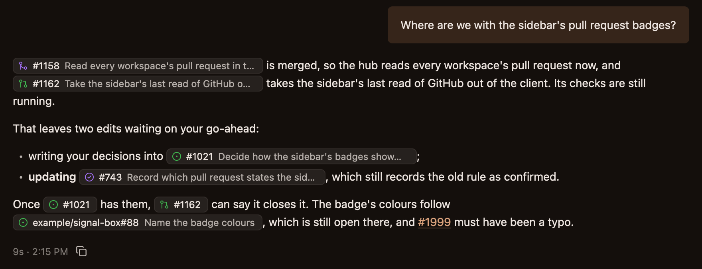

  **A proposal that links to an issue and a pull request.** *Unconfirmed.*

  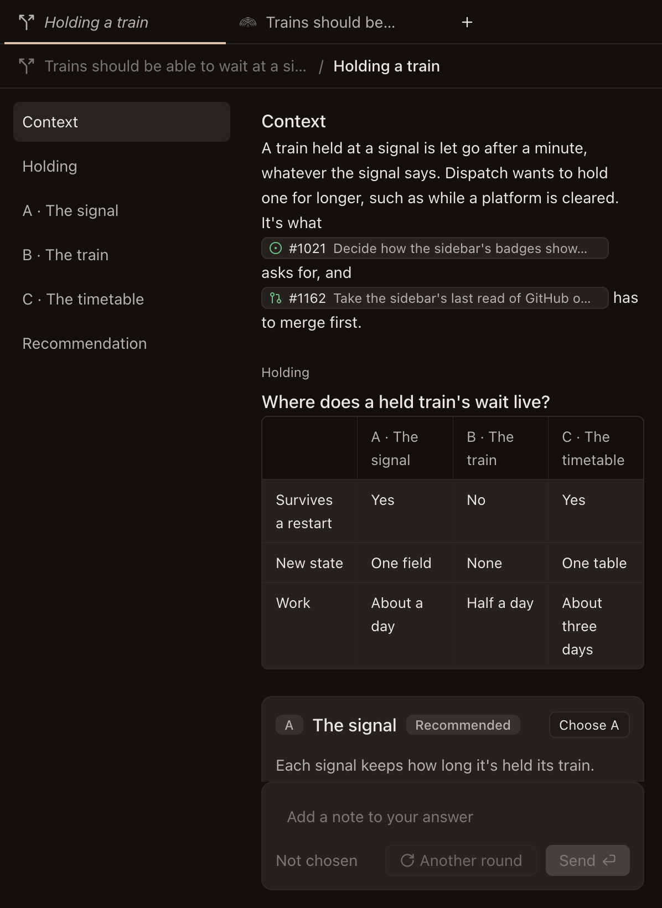
- **Resting the pointer on one shows its card, which tells, and whose one control is a faint ⋯ at its heading's end that opens the chip's menu:** its title, with a muted mark as a card's heading has, where it stands, in its state's colour, who opened it and when, and the lines a pull request changes, its labels, tinted with their colours on GitHub, where its checks stand, the workspace it's in, and the start of what it says. A button by its state, such as Start a workspace or Go to birch, offered a different kind of thing on each card, so the card offers only the ⋯, the same on every card, and the menu has what can be done. The ⋯ shows that the menu is there, since nothing says a right-click would open it.

  **An open issue's card, with its labels.** *Unconfirmed.*

  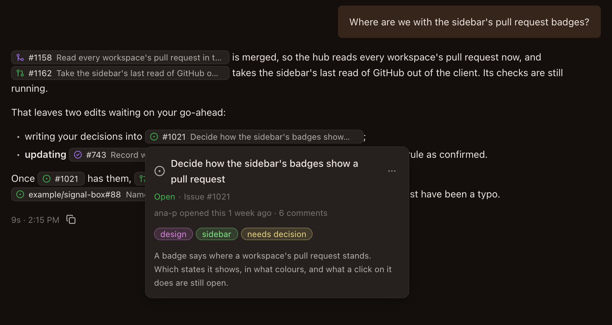

  **A pull request's card, open in birch.** *Unconfirmed.*

  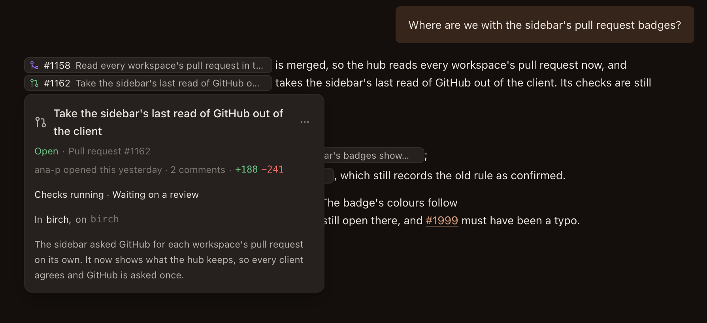
- **Right-clicking one opens the same menu on every chip, with what doesn't apply greyed out:** Open on GitHub, Copy link, Go to its workspace, and Start a workspace, which only an open issue in a project of Roundhouse's, with no workspace yet, can do. A workspace that's archived is named on the card and in the menu, and can't be gone to, since it's brought back from Home. *Not built:* Start a workspace, which the menu leaves out until it can.

  **The menu of a pull request open in birch.** *Unconfirmed.*

  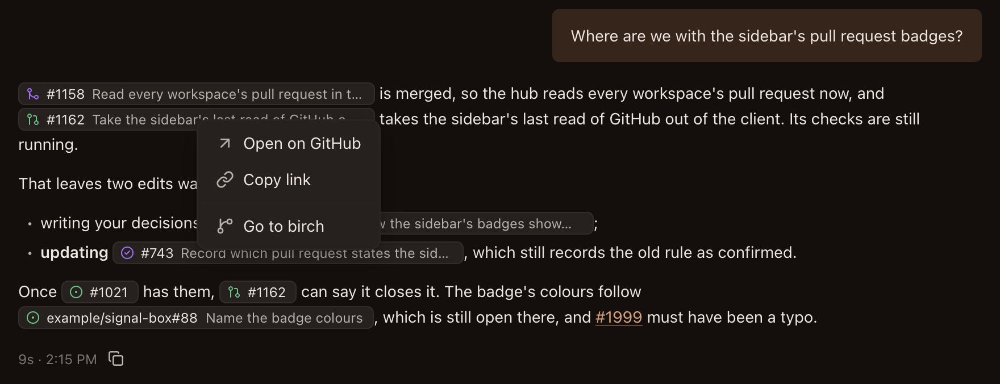

  **The same menu, from the ⋯ on its card.** *Unconfirmed.*

  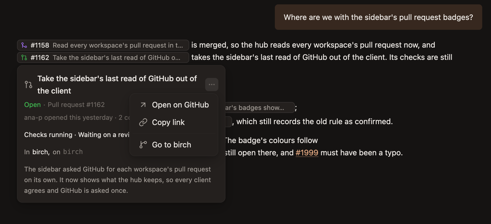
- **The hub looks each one up on GitHub and keeps what it found, for every client, and refreshes those on screen now and then,** so a pull request that merges while its chip is in view says so, and two clients looking at one chat ask GitHub once. *Unconfirmed:* the hub keeps what it found in its cache of what it reads from GitHub, which it keeps across a restart, and forgets one nobody has asked about for a week. It reads one again once what it found is a minute old, while a client shows it, and sends what it found to each client that shows it. A read that failed is tried again no sooner, and what was found before is kept meanwhile. A client tells the hub which it shows, as those its last frame drew in sight in the chat in front, so one out of view, or in a chat behind another's tab, is read no more. Past 200, those of the chats opened longest ago are left out. A hub too old to send them leaves each chip as its link was written. It reads as the account the workspace's own pull request is read as. A pull request the hub has read for a workspace's bar, or for an agent, is what that read found, so its chip and the bar agree.

## Finding a prompt

- **A chat scrolled away from its end shows a button that scrolls back down to the end,** in three tenths of a second, slowing as it arrives, so it's plain where the chat went. From more than two screens of chat up, it goes straight to a screen above the end and scrolls the rest, since rows passed any faster can't be followed. The button fades as soon as it's clicked, what arrives on the way is scrolled to as well, and the wheel or the scrollbar stops the scroll where it is. Reduce Motion skips it. *Unconfirmed.*
- **The button sits at the bottom left of the chat, with its left edge on the composer's,** so it's over the edge of the column, a few pixels into it, and clear of the prompts at the column's right. In a pane too narrow for the composer to reach its full 24px past the column, the button stays on the composer's edge, and so reaches further into the column. It's a 28px square with a control's 6px corners, on the pane's colour with the edge of something to use, and a small chevron pointing down in the text colour, so it reads as something to press over whatever is under it. It takes the pointer from what's under it, so a click on it doesn't also open a call there. It rests 8px above the composer, or above the bottom of a subagent's tab, which has no composer, and it rises 4px to there as it fades in.

  **The button back down to the end of a long chat, scrolled up to its fourteenth prompt, in a pane wide enough for the composer to reach its full 24px past the column.** *Unconfirmed.*

  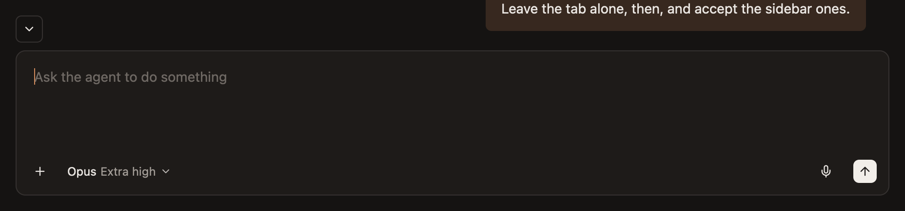

- **A chat has an outline at its right: a short tick for each prompt, top to bottom in the order they were sent, with the one being read in white,** so a long chat shows how far it goes and where you are in it. The one being read is the one whose part of the chat is at the bottom, which is where clicking it in the list puts it. One clicked in the list is the one being read until something else moves the chat, even where it can't reach the bottom. At the end of the chat, it's the last prompt, so in a chat that fits without scrolling, it's always the last. *Unconfirmed:* all but which prompt is the one being read.

  **A long chat, jumped to its fourteenth prompt from the list.** *Unconfirmed.*

  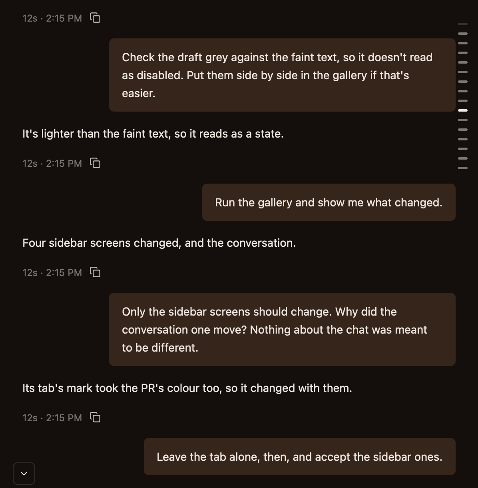

- **The outline shows from the first prompt,** since a long first turn takes its prompt far above the screen, and the list is the quick way back up to it. There's a tick for each prompt and no more, so each stands for one, but fewer than three still take up three ticks' room to the pointer, so a lone tick is as easy to rest on.
- **The outline shows sixteen ticks at most.** A longer chat shows those around the prompt being read, and a tick at an end with more past it is fainter. *Unconfirmed.*
- **The ticks sit at the top, in the margin between the scrollbar and the column,** narrow enough that in a narrow pane they stay clear of a prompt at the right of the column. They're a place to rest the pointer, not to click, so they can be that small. The wheel over them scrolls the chat, and doesn't open the list however long it turns, since a trackpad's wheel leaves the pointer resting there without asking for it. The list opens once the pointer moves over them. *Unconfirmed.*
- **Resting the pointer on the ticks lists the prompts over them, numbered, with up to two lines of each.** The one being read is washed, as a list's chosen row is, so it stands out among them. The list hides the ticks while it's open, and stays while the pointer is on it. It opens on the one being read, with the two before it above it, and it's as tall as its rows up to about eight prompts of two lines, past which it scrolls. The wheel over it scrolls only the list. A prompt that only carried files says how many. *Unconfirmed.*

  **The outline's list, open over its ticks.** *Unconfirmed.*

  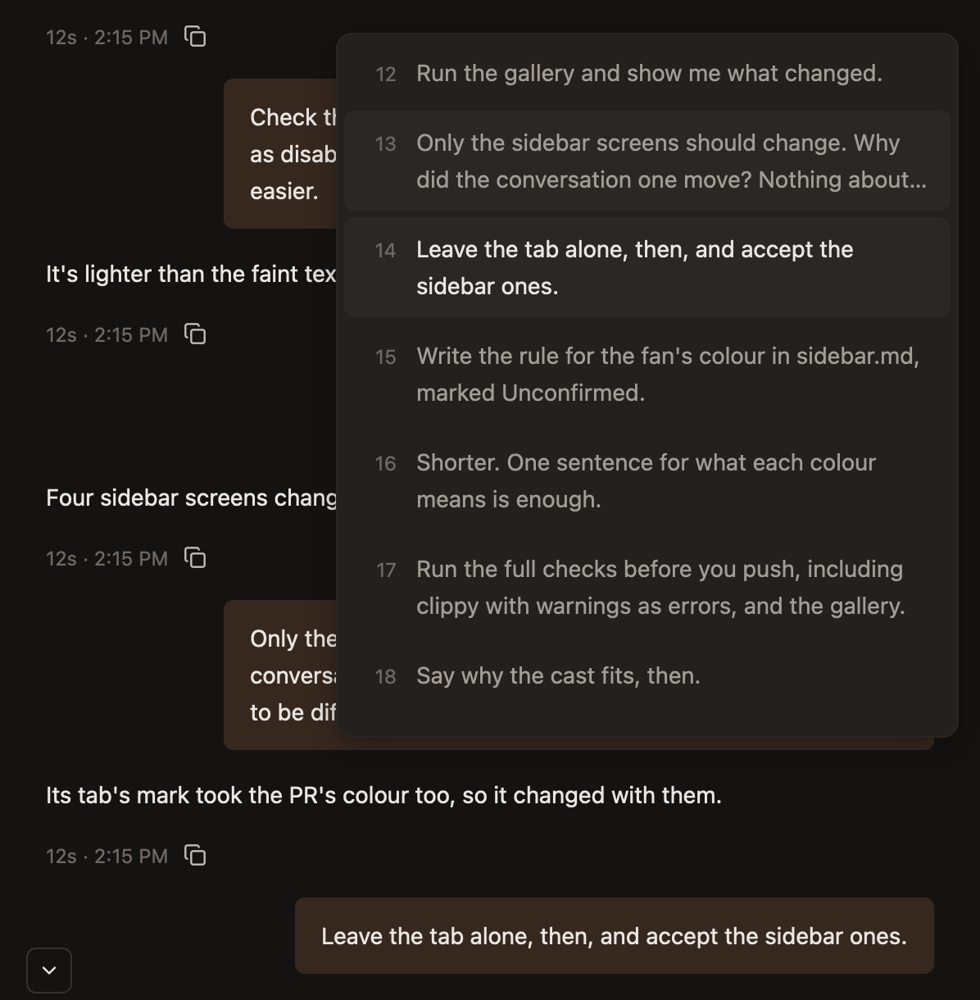

- **In a pane narrower than the list, the list keeps its width,** running past the pane over what's beside it rather than squeezing its rows.
- **Clicking a prompt in the list puts that prompt at the bottom of the chat, with what came before it above,** so the reply it answered is in sight without scrolling back up to it. The list closes, so it isn't over where it jumped to, and opens again once the pointer moves over the ticks, not because the click left it resting there. The prompt stays at the bottom as what's above it loads, until something else moves the chat, such as the wheel, the scrollbar, the button back down, opening or closing something in it, or sending a prompt. A prompt taller than the chat shows from its start instead, and one with less than a screen of chat above it can't reach the bottom, so the chat goes to its start, where that prompt shows. *Unconfirmed.*
- **`Option-Up` steps the chat back to the prompt before, and `Option-Down` on to the one after, from the composer, or a question in its place, as well as in the chat, whatever's typed,** so the conversation can be gone back over a turn at a time, as `Cmd-Option` with them goes between workspaces. Off the Mac, they're `Alt-Up` and `Alt-Down`. A step puts its prompt where clicking it in the list does, and the outline shows it as the one being read. A step back goes first to the prompt being read if it isn't already at the bottom, so from the end it goes to the last prompt, and a step on from the last prompt goes to the end. A step stops at whatever the list has a row for, a compaction and a proposal's answer too. *Unconfirmed:* where a step puts its prompt, where the first step back goes, stepping on to the end, and where a step stops.
- **With Shift, in the chat, they move the end of what's selected to the start of the prompt before or the one after,** as `Option-Shift` with left and right moves it a word, so a turn can be selected from its prompt with one key. Like the other keys that change what's selected, they go no further than the chat has loaded around what's selected. They pass over a prompt with no words, such as one that only carries an image, since it has no text to start at. *Unconfirmed:* no further than has loaded, and passing over a prompt with no words.
- **The outline has every prompt, however long the chat,** including those too far back for the app to have loaded, because the hub lists them. A hub too old to list them leaves only the prompts the app has loaded, and so does one that fails to, until the app reconnects to it, with the chat going on either way. A prompt shows in it once it's recorded. *Unconfirmed.*
- **Each compaction has a dot in the outline, in its place among the ticks,** so a chat shows whether the agent compacted, and in which turn, without scrolling through it. A dot is a different shape from a tick, so it reads as neither a prompt nor a gap. It's never white, since the one being read is always a prompt, and it takes one of the sixteen places. Only a compaction that compacted has one, since one that failed changed nothing. A hub lists them as it does prompts, so they're there however long the chat, and one too old to list them leaves only those the app has loaded. *Unconfirmed:* a dot at an end with more past it is fainter, as a tick is.

  **A long chat at its end, where the agent compacted by itself in the tenth turn, and someone asked it to after the sixteenth.** *Unconfirmed.*

  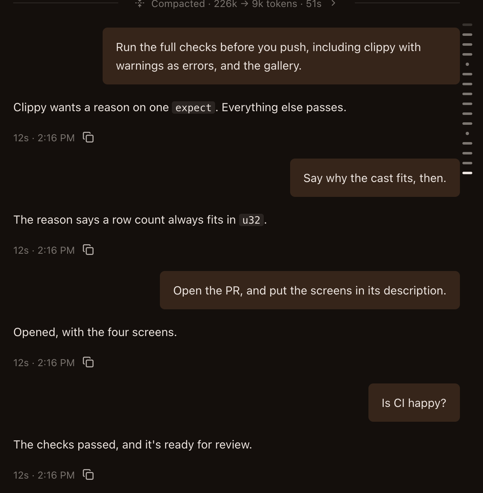

  **A chat of one turn, which the agent compacted partway through.** *Unconfirmed.*

  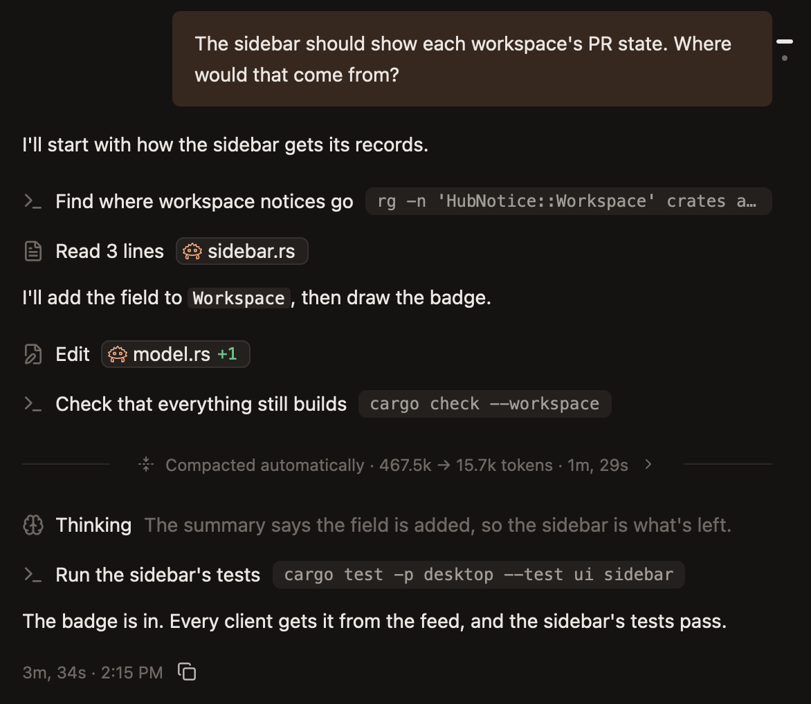

- **In the list, a compaction is a row between the prompts it came between,** with its icon where a number goes, then what its rule in the chat says, faint and on one line, such as `Compacted automatically · 467.5k → 15.7k tokens`. It has no number, so the prompts keep theirs. Clicking it puts the rule at the bottom of the chat, as clicking a prompt does, with what came before it above, and the prompt before it is the one being read.

  **Its list, with the compaction someone asked for between the prompts it came between.** *Unconfirmed.*

  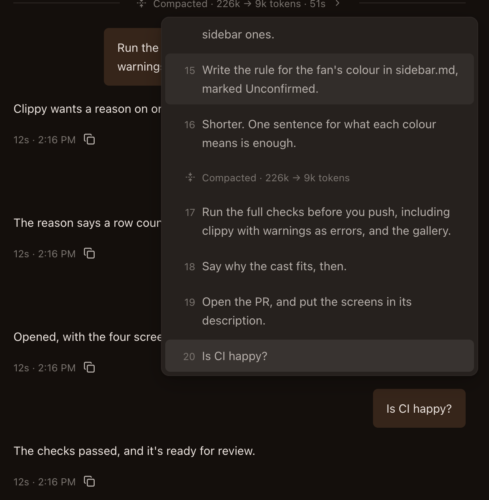

- **An answer to a proposal is in the outline as the proposal's, not as a prompt the person sent,** since the chat draws it as the proposal's line: a dot among the ticks, as a compaction has, and in the list a row with the proposal's mark where a number goes, then `Answered` and the proposal's title, faint and on one line, or `Answered a proposal` until its record has come. It isn't numbered among the prompts, and is never the one being read. *Unconfirmed.*

## Finding text

- **⌘F opens a bar at the top right of the chat, over it,** with what's looked for, which match is shown of how many, such as `2 of 41`, and buttons for the match before, the one after, and closing. It works wherever focus is while a chat shows, the message box too, and Find… in the Edit menu does the same. Pressed again, it puts focus back in the bar with what's in it selected. The file tab isn't searched.

  **Finding `fmt`: the first of four matches, in a call opened to show it, then one in each closed command below, whose line marks it, and one in the reply.** *Unconfirmed.*

  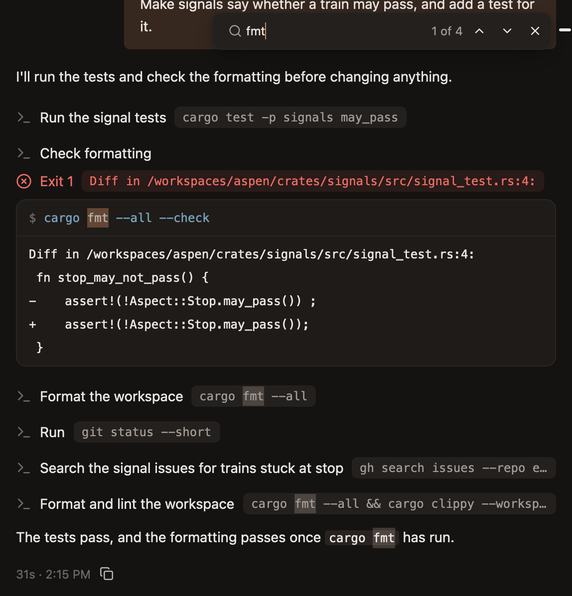

- **Nor is the subagent tab, or the proposal tab,** so Find isn't there while either shows. *Unconfirmed.*
- **What's typed is looked for as plain text, ignoring case,** once typing pauses, with no patterns or whole words. A phrase is found across a line break in a paragraph, since the paragraph shows it as a space.
- **It finds what the chat shows: the prompts, and the agent's words and thinking, as their Markdown renders,** so `**parser** is` holds `parser is` and a link's address holds nothing, **and what calls were given and sent back,** such as a command and what it printed, a file's path and lines, and a search's pattern, **and what went wrong,** such as a failed turn's error, a notice, and what the agent last printed before it stopped unexpectedly. What the app writes itself isn't found, such as `Read 10 lines`, `Exit 1` and line numbers. A closed call's command on its line is marked but not counted, since it's counted where the call shows it open. Cards that ask something aren't found, and nor is a reply until it's recorded.
- **Nor is a question the agent asked, once it's answered and drawn as a line,** what was asked or what was answered. *Unconfirmed.*
- **Nor is a compaction,** what its rule says or the summary it opens to. *Unconfirmed.*
- **Nor is a prompt the agent hasn't read yet, at the end of the chat,** until the agent reads it and it takes its place in the chat. *Unconfirmed.*
- **A subagent's call is found in as it shows it open:** what it was asked, and its report, but not what it's done lately, which changes as it works. *Unconfirmed.*
- **The count is of the whole chat, however long,** including what the app hasn't loaded, since the hub says which events hold the text, and the app reads those parts of the chat to count what each shows, then lets them go. Until it has, the count ends in `…`, and the first match waits until nothing above it can hold another. The hub looks past what Markdown marks text with, such as bold, and how much whitespace there is, but not past a link, so a phrase that runs across a link is found only where the chat is loaded.
- **One character is found only in what's loaded,** since it's in nearly every part of a chat, and so is anything when the hub is too old to say or fails to. Then the count ends in `+`, such as `3 of 12+`, or says `No matches loaded`, unless the whole chat is loaded.
- **The first match shown is the first at or below the top of the chat,** or the first of all with none below. Enter or ⌘G goes to the next, and ⇧Enter or ⇧⌘G to the one before, round from the last to the first. The one shown is marked more strongly than the rest.
- **Going to a match loads its part of the chat if it isn't, opens the call or thinking it's in, and scrolls it into view below the bar,** a block that scrolls in a call too. What it opened stays open.
- **A match in a line too long for its block scrolls the block sideways to it.** *Unconfirmed.*
- **Escape closes the bar,** the marks go, and focus goes back to the message box.

## Titles

- **A chat's title can be changed by hand,** as a workspace's can, in `workspaces.md`.
- **A chat's title is generated from its first prompt,** by the same rules as a workspace's.
- **A workspace's first chat gets the same title as the workspace,** from the same call, since they come from the same prompt. *Unconfirmed.*
- **A chat is called Untitled until it has a title,** since nothing else about a chat says what it's for.

  **A chat nothing has been asked in yet, beside the conversation.** *Unconfirmed.*

  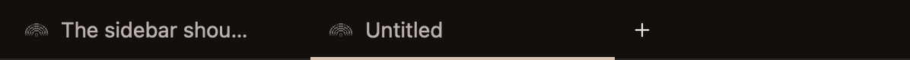

- **Renaming a chat that's still Untitled starts from an empty field,** so pressing Return can't make Untitled a title typed by hand, which a generated one would never replace.

  **Renaming that chat, from an empty field.** *Unconfirmed.*

  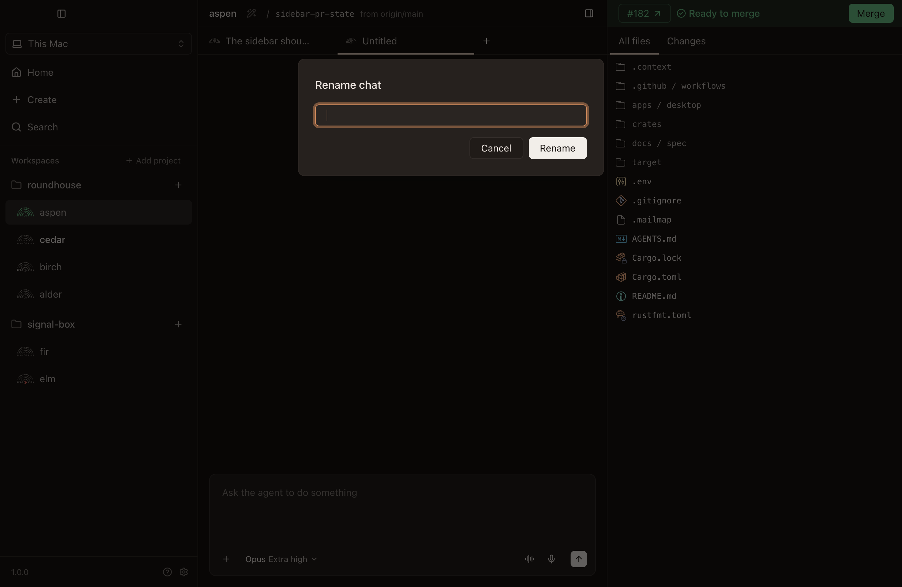

## Attachments

- **A prompt can carry files.** Paste an image, or drop images and files on the composer, or choose them from the menu its `+` opens, and each shows as a tile above what's typed, with a way to take it off. A prompt with files needs no text, since a screenshot can be the whole question.

  **A prompt that carried a screenshot and a log, and two more files waiting in the composer.** *Unconfirmed.*

  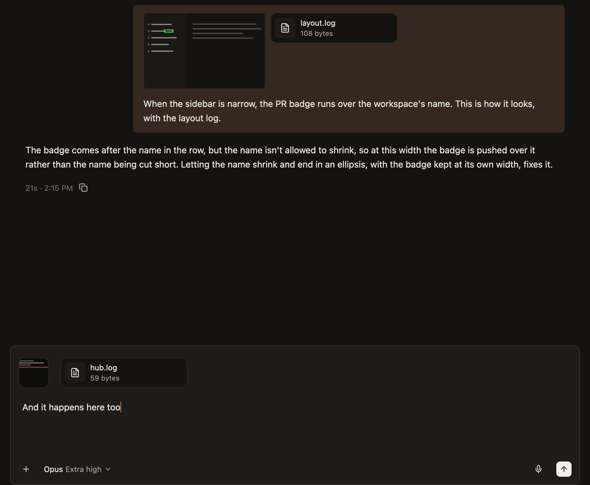

- **Any kind of file can go, up to 100 MB, and at most 10 with a prompt.** The size is what the hub takes in one go.
- **Each file goes in the workspace's `.context/attachments/`, and the agent is told where, so it can open it then or later.** Git is told to ignore the folder, so the files never show as changes. Images up to 32 MB between them, and a text file up to 32 KB, also go in the prompt itself, so the agent sees them without opening anything. An SVG drawing goes as the text it is, since a model reads it as text, and it's a file's tile in the prompt and the composer rather than a picture. *Unconfirmed:* drawings. A longer text file is opened from where it is, so the agent can search it rather than read all of it.
- **A file is known by its bytes rather than its name,** so the agent is never sent an image labelled as something it isn't, and a pasted TIFF, which some apps copy, goes as a PNG.
- **What's typed and attached in a chat's composer is kept until it's sent,** by the hub, so it's there when the app opens again, whether it quit, restarted to update or stopped without quitting, and in any other client, so something started on one device can be finished on another. A change made in another client shows in the composer as it reaches the hub, with its files, unless something typed or attached here hasn't reached the hub yet. Then what's here goes on and replaces it, so nothing is undone as it's typed, and the last change to reach the hub wins. Typing that goes on is kept every half second, so an app that stops without quitting loses at most that much. Closing the chat lets go of it, files and all, so the chat's composer is empty if it's opened again. *Unconfirmed:* the half second, that closing the chat lets go of what's in its composer, and that what's on its way from here replaces a change made elsewhere meanwhile.
- **Files stay with their chat until they're sent,** the way what's typed does, and a prompt that can't be sent comes back to its chat's composer, files and all. While the agent waits on a question, or on a request to use a tool, that takes the composer's place, and what's typed and attached waits for it to go.
- **In the transcript, a prompt's images show small above its text, and a click opens one over the window, as big as it is, up to what fits.** Opening one moves nothing in the chat, so it shows wherever its prompt is, even at the bottom of the window, where a prompt jumped to from the outline goes. Escape or a click closes it. Other files show their name and size. The hub keeps each image, so every client shows it, and it's still there after the workspace is archived. Other files are only in the workspace, so archiving takes them with it.

  **The screenshot, opened.** *Unconfirmed.*

  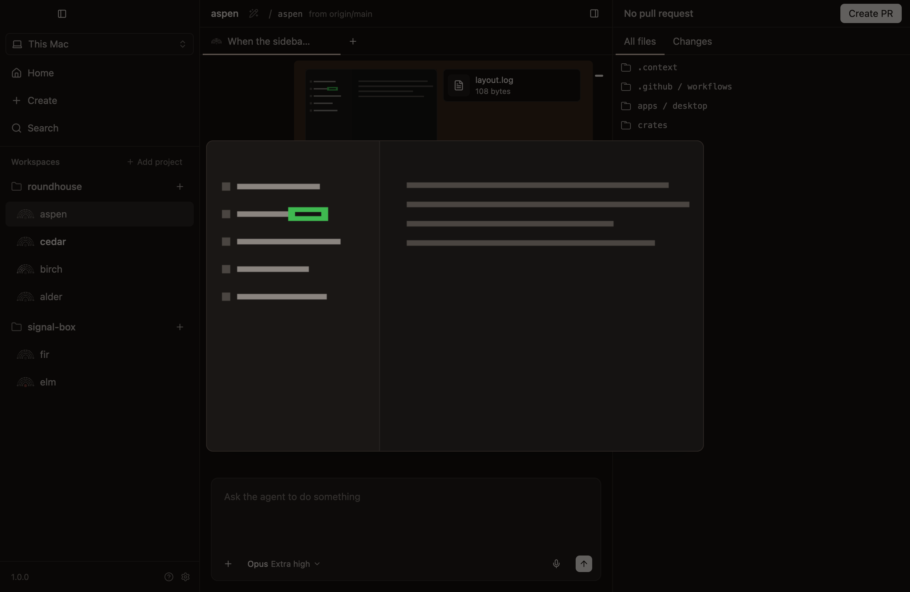

## Dictation

- **Dictation attaches to the field being edited.** The chat composer and the new-workspace prompt offer a microphone button and the same shortcuts. Diff comments, question answers and a proposal's note use the shortcuts alone, with no microphone button. Answers include Other, a written answer alongside several choices, a text-only question and feedback on a tool request. The text field must have focus; the choices themselves do not start dictation. Secret inputs and questions that do not allow a written answer have no dictation.
- **While dictating, the field listens with a fine copper line along its bottom edge.** A muted, one-pixel trace fades in, lifts only a few pixels with the microphone’s level and settles flat during pauses. Smaller answer and comment fields have a shallower ripple. The outline warms faintly, without a glow, a moving highlight or a change to the field’s geometry. When the last words settle, the trace fades away. Reduce Motion keeps a static trace; silence and a finished fade request no animation frames.
- **Recording replaces the field’s ordinary toolbar with Cancel and Finish dictation.** Attachment, model, effort, usage and submission controls return after completion or cancellation, in their usual places. The row keeps its height, with the recording controls at the right and no status label. Finalizing the last words disables Finish dictation; Cancel remains available and restores the starting text. Listening and finishing show no label or placeholder, so a short finalization does not flash a message. The buttons return focus to the input. Enter keeps its existing send, queue, create or answer behavior. The same treatment serves the composer, workspace prompt, answers, comments and a proposal's note, so each place uses the same recording state and actions.
- **Dictated answers behave as typed answers.** A finalized sentence selects the written answer and saves the draft through the same path as typing, preserving any chosen options where several answers are allowed. While words are still live, Enter can finish them before answering. Enter keeps its usual meaning, going on to the next unanswered question or submitting. Releasing the key only finishes dictation; it never answers a question. Escape restores the text from before recording and keeps the question and input open. Changing questions, answering or hiding the panel ends its recording, keeping finalized text and dropping tentative words.

  **Dictating an Other answer, using the keyboard.**

  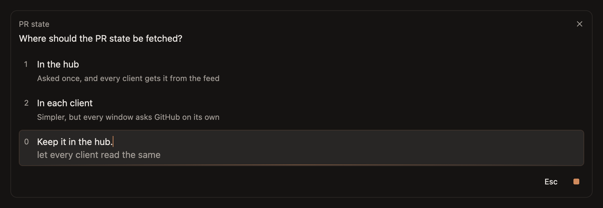

  **Dictating alongside selected choices.**

  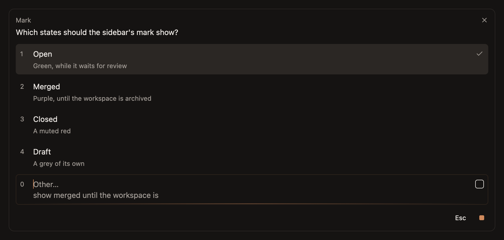

  **A question answered entirely in words.**

  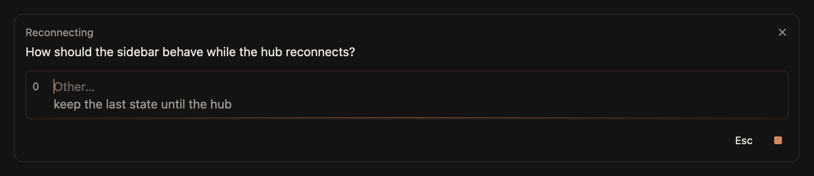

  **Dictating feedback on a tool request.**

  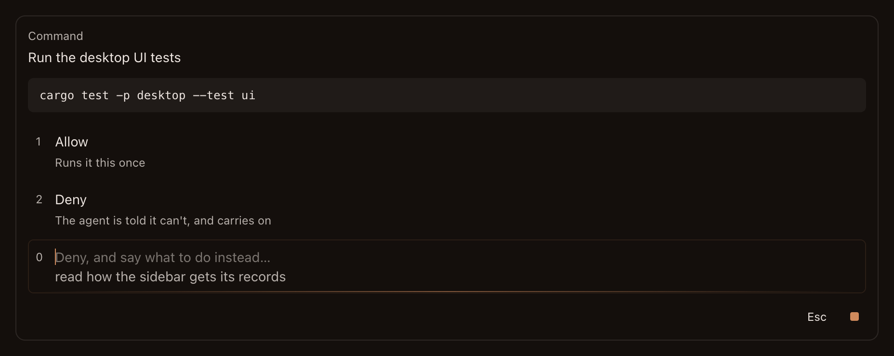

- **Holding Space in the composer dictates into it, and letting go stops,** so a prompt can be said rather than typed, with both hands still on the keyboard. Space types a space as it always has. Held 0.2 s, longer than a space being typed is, it begins to hear what's said without showing anything, and at 0.5 s it takes out the space it typed and starts dictating, as Claude Code's voice mode does, with what was said since 0.2 s, so the person can start talking as they press rather than wait to be told to. The space stays if what's typed has changed meanwhile, such as by a paste. Letting go, or another key, before then leaves the one space, and what was heard is dropped unseen. While it's held, its repeats type nothing, so it doesn't follow the key repeat, and works with key repeat off. Until the system has been asked whether the app may use the microphone, nothing is heard before 0.5 s, so the system's question comes only once Space dictates. Each time Space is held past 0.2 s, the system shows that the microphone is on, even if it's let go of before it dictates. `Option-Space` starts dictating at once. The microphone button beside Send starts dictating with a click; while recording, Finish dictation takes its place and keeps the words without sending. While something's already being dictated, Space types as it always has, and letting go of it stops only what holding it started. Space pressed or repeating while it's held to dictate types nothing, even once `Option` is let go of first. Where there's nothing to dictate to, Space repeats, and `Option-Space` types a non-breaking space, as they always have. *Unconfirmed.*
- **What's heard shows as it's said, dimmed on a line under what's typed, and goes in at the cursor a sentence at a time,** once there's been a pause of about 0.8 s at its end and the next has begun, and when dictating stops. Sentences said with no such pause between them go in together. A pause in the middle of a sentence leaves it under what's typed, since the model hears where a sentence ends only once it hears what follows, and a piece cut off at a pause is heard as a sentence of its own, with a capital and a full stop, and often with its edges' words wrong. What goes in can differ from what showed, since each sentence is heard again whole, which gets more of it right. A sentence heard again as nothing, as the model hears some short phrases said quickly, goes in as the line first heard it instead, so what was heard isn't lost. It ends with the full stop, question mark or exclamation mark the line had where it has none of its own. A sentence too long to hear whole, about 15 s, goes in in parts, cut at a pause or between words, which carry on as the line had them, with no full stop or capital between. It goes in with a space between it and what's on either side, unless there's one already. The line shows only live words; it is absent before speech is heard and once no tentative words remain. When nothing was heard, a message says so. *Unconfirmed.*

  **Dictating after typing, with the newest word still to show.** *Unconfirmed.*

  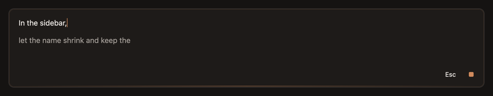

- **Dictating never sends.** What goes in waits in the composer for Enter, as typing does, and is kept with what's typed, in every client. What's still showing is this Mac's alone until it goes in. Sending or queueing while dictating stops it, and sends or queues once the last of what was said has gone in, a moment later, so none of it is lost, with the remaining live words visible until their final text goes in. If hearing it fails, nothing is sent, and what went in stays in the composer with the failure's message. An Enter with nothing typed or heard yet sends nothing and leaves dictating as it was. Conversation mode is the one exception: there, letting go of Space sends, as its rules below say. *Unconfirmed.*
- **`Escape` stops dictating and puts the field back as it was when it started,** for when what was said came out wrong, which is before the space that holding Space typed. With `Option-Space` still held, it's `Option-Escape`. *Unconfirmed.*
- **The composer going stops dictating, keeping what went in and dropping what was still showing,** such as for Settings, another chat, the file tab, a question from the agent, the workspace being archived, or the app losing its hub. A hub restarting, such as to finish an update, leaves the composer where it was, so dictating goes on, as typing does. Another app coming in front stops it as letting go does instead, so what was said goes in, and the microphone isn't left on with nobody looking. While Space is held to dictate, though, someone is there, so it goes on, or on towards dictating, until Space is let go of, wherever that is, and the system shows something in front for a moment, as it does checking an app that's opening, loses nothing. A Mac says whether Space is down while another app is in front only to an app it lets monitor input. Without that, another app coming in front stops dictating even with Space held, and Space goes on typing nothing until it's let go of, so its repeats don't type when the app comes back. The recording toolbar stays until the last words have gone in. *Unconfirmed.*
- **One field dictates at a time,** since there's one microphone. Starting in another ends the old recording, keeping finalized text and dropping tentative words; no late update can reach the new field. Turning dictation off or replacing its model ends the active recording too.
- **Stopping or cancelling releases the microphone without waiting for model loading or recognition.** Stop keeps already captured audio for the last words; Cancel drops it. Capture holds at most 30 seconds of audio awaiting recognition. Exceeding that limit releases the microphone and drops the backlog; once the model responds, the field reports that speech recognition couldn't keep up, keeping text already finalized. *Unconfirmed:* the 30-second limit.
- **The first time, the system asks whether Roundhouse may use the microphone,** and dictation starts with the next press once it may. If it may not, a message says where in System Settings to allow it. *Unconfirmed.*
- **Once holding Space has dictated something the first time, the system asks whether Roundhouse may monitor input,** so held Space goes on dictating while something else is in front for a moment, as the rule on the composer going says. It asks once the words have gone in, rather than as dictating starts, since its question comes in front and would stop that recording. Dictating works without it. *Unconfirmed.*
- **What's said is heard on the Mac, by a model that runs there, and never leaves it,** so dictating needs no account and works offline. Turning dictation on downloads the model once, as `settings.md` says. It favours the names around where it's dictated—the project, workspace and branch, the changed files, recent paths and code names in the chat, a question's options when answering one, and a proposal's when writing its note—only where the whole name is heard, so half a match doesn't put a name where nobody said it. *Unconfirmed.* *Not built:* Windows and Linux, which have neither the setting nor the microphone.
- **Until dictation is ready, the microphone opens a card rather than dictating, and Space and `Option-Space` type as they always have.** While dictation asks first, as it does until it's chosen, the card says what dictation does and what it downloads, with Turn on, which turns it on, and Hide the microphone, which turns it off. Once it's on, the microphone is dimmed until the model is ready, and the card says how it stands, as Settings does, with Retry after a failure. Turned off, the composer has no microphone, and neither has it on a Mac whose macOS is too old for the model, where Settings says so once dictation is on. However the card goes, the keys go back to where the prompt is typed. *Unconfirmed.*

  **The microphone offering dictation, before it's chosen.** *Unconfirmed.*

  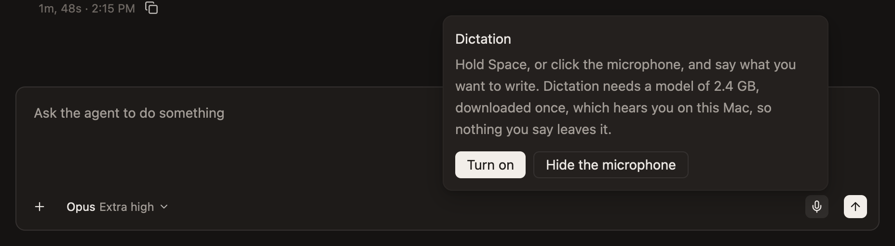

  **The microphone's card while the model downloads.** *Unconfirmed.*

  

## Conversation mode

- **Conversation mode lets someone talk with a chat's agent out loud and hear it answer, while it goes on working.** It's turned on and off in a chat, which carries on as before, so the agent doing the work is the one that heard what was said, and nothing smaller stands between them.
- **What's said is heard on the device, and the agent's replies are spoken there, by models that run on it,** so no sound leaves it, and only the words reach the hub and the agent, as with dictating.
- **The mode needs dictation, to hear the person, and speech, to read the agent's replies out, and works once both are ready.** Each is set up on its own, as a setting with Ask first, On and Off, as `settings.md` says, so speech can be used without the mode later, such as to play a reply. Dictation's model is 2.4 GB and speech's voice about 65 MB, each downloaded once it's turned on, and nothing before. How each stands, and what the card and the bar say of it, are in the same words on every client.
- **A button between the context's ring and the microphone turns it on, and so does `⇧⌘Space`,** and the bar takes the composer's place. The button's tooltip says `Conversation mode` and its key. It's there wherever dictation can run, unless dictation or speech is Off. *Unconfirmed:* no button while speech is Off. The composer shows only while the mode is off, so the button never needs to show that it's on.
- **Until dictation and speech are both ready, turning the mode on opens a card from the button, rather than turning it on,** as the owner chose on 2026-11-20. It says what the mode does and what it needs, then a row for each of dictation and speech, with its size and how it stands: `Not on`, how far its download has got, with a bar, `Preparing`, `Ready`, or why it couldn't be got ready. Under them, a button turns on what isn't on, `Turn on dictation`, `Turn on speech` or `Turn on both`, as Settings would, then Retry, once one failed, and Not now, which closes the card. While the card is open, the mode turns on by itself once both are ready, and closing it first leaves the mode off. `⇧⌘Space` opens the same card, and so do Take over and Take back, from the bar, so the mode never comes to a device that can't hear or speak, and a device that can't run dictation has no Take over or Take back. *Unconfirmed.*

  **Neither dictation nor speech on yet.** *Unconfirmed.*

  

  **Both turned on, with dictation's model half downloaded and speech ready.** *Unconfirmed.*

  
- **While the conversation is here and dictation and speech aren't both ready, the bar says what's missing, rather than to hold Space,** as when the app opens again with the conversation still here, or a setting changes while it's on: what couldn't be got ready, with why and Retry, then what isn't on, such as `Turn on dictation to talk`, with Turn on, then what's getting ready, such as `Getting speech ready, 40%`. Holding Space sends nothing meanwhile, and nothing is read out.

  **Neither on, with Turn on.** *Unconfirmed.*

  

  **Speech's voice being downloaded, as far as it's got.** *Unconfirmed.*

  

  **Speech's voice couldn't be downloaded, with why and Retry.** *Unconfirmed.*

  
- **Turning it on draws a rule across the chat, saying `Conversation mode` and when,** as a compaction's rule does. That's all the chat shows of what the agent is told while it's on. Turning it off draws nothing, since the next prompt, typed, has no microphone.
- **While it's on, the agent talks as a colleague does out loud.** It opens with a word or two, answers briefly and without Markdown, and hands anything that would take more than a few seconds to a subagent in the background, so it's free to talk meanwhile. When one finishes, it says what it found in a sentence or two, and never over the person. It's told so with every prompt said out loud. *Not built.*
- **A slim bar takes the composer's place, and says in one line where the conversation stands:** `Hold Space to talk`, the words as they're heard, what the agent is doing, or that it's speaking. At its right end are Type and ✕, which both turn the mode off, Type bringing the composer back to type in. While it listens they give way to `Let go to send` and Esc, and while the agent works, Stop takes ✕'s place, as Send's does in the composer. While the agent speaks, the bar says `Speaking` and that holding Space talks over it, with Stop and Esc to stop the voice.

  **Waiting for the person to talk.** *Unconfirmed.*

  

  **The agent at work, saying what it's doing, with Stop in ✕'s place.** *Unconfirmed.*

  
- **Nothing is read over the person while they talk.** Talking starts once dictating does, so a tap of Space talks over nothing. What's being read is talked over, a line said for the agent while they talk isn't said, and a reply that comes while they talk, or before what they said is taken, isn't read out, since they've moved on. Dropping what was said with Esc has the next reply read, as nothing new is coming for the agent to answer.
- **Holding Space talks, and letting go sends what was said,** unlike dictating elsewhere, which never sends. What's heard shows in the bar as it's said, with dictation's copper trace along the bar's bottom. Esc drops what was said and sends nothing. What was typed in the composer before the mode was turned on isn't part of what's said, and is still there once the composer comes back.
- **While the agent can't answer what was said, because it's busy or still thinking, it says what it's doing, in a sentence in its own voice,** such as "Hold on, I'm writing the brief for the parser agent, one sec." A small, fast model writes that sentence for it, as the agent: it says only what the agent is doing, never an answer, an opinion or anything the agent hasn't done. The bar shows it on every device showing the chat, and the device that has the conversation says it. The transcript doesn't show it, since it isn't a message, and what was said reaches the agent unchanged. It's said only if the agent hasn't started answering 1 s after the words were sent while it was busy, or 2.5 s while it was thinking, so it doesn't come just before the agent's own answer. The bar shows the newest line until the agent starts answering, or its turn ends without an answer, and the line goes as the mode is turned off. Each line is said once, however often the chat is sent again. *Unconfirmed:* the two waits.
- **Typing turns the mode off and brings the composer back, with what was typed in it,** from Type or any key, so every prompt sent in conversation mode is said out loud, and a typed prompt gets a written reply. Turning the mode back on is one press of its button, or `⇧⌘Space`. If the hub won't turn it off, the app says why, as it does when the hub won't turn it on, and the bar stays, since the mode is still on, with nothing read out, until Type, ✕ or typing asks again and the hub does.
- **A prompt typed and sent from any device turns the mode off as it's recorded, and only the device that has the conversation can send one said out loud, or queue it.** A typed prompt that waited in the queue leaves the mode as it is, since nobody sent it just then, and one said out loud that waited until the mode was off goes as typed, so it gets a written reply, since nobody's listening for one. So the log says, for everything in it, whether it came while the mode was on, and a device is the same one by its ID, whatever it's called now.
- **A prompt said out loud has a microphone at its start, inside its bubble.**
- **A reply is read out whole, with only Markdown's marks taken out,** such as a heading's, a list's, emphasis and a link's address, so code and a table's cells are read as they're written. A line with nothing in it to say, such as a table's rule or a code block's fence, says nothing. The agent is told to answer out loud without them, which is where to make what's read better.
- **A reply being spoken is bright as far as it's been said and dimmed after, and its line says `Speaking`.** If the voice is cut off, what wasn't heard stays dimmed, and the line says why: `Talked over` when the person talked over it, and `Stopped` when Stop or typing stopped it. Every client shows the same, since the hub records how far each reply was heard. A reply heard to its end has nothing more on its line. A reply in the mode that was never read out, as one after a reply the person talked over, is dimmed whole, and its line says `Not read out`. The device that has the conversation says how far it's got as it reads, and how each reply ended. When it can't, because it went while reading or the mode ended or moved, what it was reading says `Stopped` where it had got to, and each reply it hadn't reached says `Not read out`, unless the device says otherwise while it still has the conversation. A device that takes the conversation over partway through a reply reads none of it, and saying so doesn't undo how far the device before it was heard. While the device says it's reading a reply, the reply's line says `Speaking`, whatever was kept of it, so a device whose connection drops for a moment and goes on reading isn't shown as stopped. A reply's line is the line its turn ends with, which says how long the turn took and when it ended, so the reply the turn ended on says how it was heard before those. A reply its turn went on past, one being read before its turn has ended, and one whose turn was stopped or failed, whose line says only that, have no line of their own, so only their dimming says how they were heard, and the bar says `Speaking` while one is read. The person was there when it happened, so words on each would say what they already know. *Unconfirmed:* that a reply's line is its turn's, that a reply with no line of its own says nothing, and what's said of a reply when the device can't say.

  **A chat in conversation mode: the rule where it was turned on, prompts said out loud, a reply the person talked over, and the reply after it being spoken.** *Unconfirmed.*

  

  **A reply Stop stopped, the next never read out as the mode ended, and a prompt typed after them, with its written reply.** *Unconfirmed.*

  
- **The chat is everyone's, and the conversation is one device's.** Whether the mode is on, what was said and how far each reply was heard show on every device showing the chat, as the rest of it does. Only the device that started the conversation hears and speaks. On another device showing the chat, the bar says where the conversation is, by the device's name, as `The conversation is on Mac Studio`, and its only action is Take over, which moves the conversation there. It still shows the cover line and `Speaking`, with `On Mac Studio` beside them, but stays quiet. The device the conversation left stops listening and speaking, and its bar says `The conversation moved to` the other device, with Take back. A device is named as it named itself when it paired, which on a Mac is the computer's name.

  **On another device: where the conversation is, with Take over.** *Unconfirmed.*

  

  **On another device, while the agent works, its line, quietly, with where the conversation is beside it.** *Unconfirmed.*

  

  **On another device, while the one with the conversation reads a reply out.** *Unconfirmed.*

  
- **The conversation stays with its device until another takes it over,** with no timeout, even when that device has quit or lost track of having it. Taking it over, from any device, that one included, puts it right.
- **The conversation goes on while its chat isn't showing on its device,** such as while another chat, workspace or Settings is, as long as the chat's tab is open there, whichever workspace shows: the agent's replies and what's said while it can't answer are still read out, so the person can look at other work while they talk. Holding Space talks only where the chat's bar shows. Closing the tab on the device that has the conversation turns the mode off, as ✕ does, so nothing goes on being read that nobody can stop, and the hub hears how far the voice got first.

## Tool calls

Every call is drawn the same way, as the first rule below says, and each kind fills in what its line says and what it opens to. A tool that has no drawing of its own still gets a readable line, so a new tool, or one from an MCP server, never shows as raw JSON until it's opened.

- **A tool call is one line:** an icon for its kind, what it did in a few words, and the detail that matters, such as the command on a pill or an MCP server on a chip, as `components.md` draws each. Hovering the line turns its icon into a chevron, and clicking it opens what the call did in a block underneath, which scrolls once it's taller than a dozen lines or so. The wheel over a block that scrolls moves the block until it reaches the end the wheel is turning toward, and then the transcript, so a long block reads straight on into the rest of the chat. Over a block that fits, the wheel moves the transcript. A scroll stays with what it started on, as it does in a browser, so one that starts on the transcript carries on over the blocks it meets, and a trackpad's fling of a block stops at the block's end rather than speeding the transcript on. A scroll lasts from touching the trackpad to the end of the fling, or for a mouse wheel until it pauses. Calls in a row sit 36px apart, as one list. The rules below say how each kind of call reads. *Unconfirmed.*
- **What an opened call shows is text to select with the rest of the chat, in the order it's shown,** so a drag from one reply into the next runs through an opened call between them, `Cmd-A` takes in every opened call, and what's selected stays selected while its row is out of sight. That's what went wrong, a command and what it printed, the files a search found, a question and what was answered to it, the prose a call shows, such as a subagent's report, and anything else a call sent back as text. A copy has each text a blank line apart, as it has each reply, and the lines of one a line apart. A call's line isn't selected, since a press on it opens or closes the call, nor is the red line under one that failed, since opened, the call shows what went wrong whole. Neither are a block's faint labels, such as a file's path or a question's header, nor what says there's nothing there, such as `No output`, since they say what a block holds rather than what came back. *Unconfirmed.* *Not built:* selecting output over 16 KB, a file's numbered lines, a diff, a search's matching lines, a tool's input, a web search's pages, a fetch's prompt, and what the line under a denied call says the person told the agent.
- **A block's faint labels name its parts: a word, such as `Input`, `Output` or `Deleted`, is set as a detail, and a path or an address in the code font,** as the owner chose from pictures of three ways, since code is for what's typed or read as code, and a path is what you'd copy or type. *Unconfirmed.*
- **A command's title is what the agent said it's doing,** with the command beside it, cut off with an ellipsis when it doesn't fit. A command the agent didn't describe says `Run`. *Unconfirmed.*

  **Commands: one that failed, one opened that printed nothing, one the agent didn't describe, and two too long for their line, one of them opened to show it whole, its output wrapping.** *Unconfirmed.*

  

- **Opened, the command comes first, faded and whole, and what it printed comes under it in the foreground colour,** since the title has already said what the command does, and what it printed is what's read. The command is highlighted as shell, after a faint `$`, and wraps under itself rather than under the `$`. Opening the call is what shows it, so nothing in it opens further. A command taller than about five lines scrolls on its own, at half the height at which what it printed starts to scroll, so a long command leaves room for what it printed. A command that printed nothing says `No output` under it, faintly, so one that's done doesn't look as if it never answered, and one still running shows only itself. One that went on in the background says `Went on in the background` faintly under what it printed by then, or in place of `No output` if it printed nothing, since what it prints from then on isn't the call's. *Unconfirmed.*
- **The command is text to select, to copy and run elsewhere, and a button at its top right copies all of it,** the same button a finished turn has for its final message, shown only while the command is hovered. The button stays there while a long command scrolls under it, and the command leaves room for it, so its text never runs under the button. *Unconfirmed.*
- **What a command printed has a little space between its lines,** about a fifth of a line, so a line too long for the block reads as one where it wraps. It still selects and copies as one text, its lines one under another, as it was printed. Output of more than 200 lines is drawn without the space, so a long log stays as quick to draw as before. *Unconfirmed.*
- **A call that failed says so on a red line under it,** with how a command exited, such as `Exit 1`, or how it ended without exiting, `Timed out` or `Stopped`, where its agent says, or `Error` for anything else, and the first line of what went wrong. It shows while the call is closed, so a failure is never hidden. Opened, the call shows all of what went wrong, since the line only has room for its start, then what it tried, such as an edit's diff. What went wrong stays in muted text rather than red, so it's still easy to read, and what a command printed is in the foreground colour, as it is when the command works. *Unconfirmed.*

  **An edit and a search that failed, opened to all of what went wrong.** *Unconfirmed.*

  

  **Commands that ended without exiting: one that went on in the background, opened, one that ran past its time, and one that was stopped.** *Unconfirmed.*

  

- **A result whose call is too far back to find is drawn on a line of its own,** saying `Output` and how many lines or images came back, and opens to them, so nothing the agent was told is lost. *Unconfirmed.*

  **What a test run printed, come back after its call, opened.** *Unconfirmed.*

  

- **Any other tool's title is its name made readable,** such as `Create issue` for `create_issue`, then the MCP server it's from on a chip, and its most telling input in faint monospace. If the agent described the call, the description is the title and the tool's name follows it. Opened, its input as JSON, then what came back. Every agent's is drawn the same, and one that names no tool is titled `Unknown tool`. *Unconfirmed.*

  **Tools with no drawing of their own: one from an MCP server opened, one that failed, and a built-in one.** *Unconfirmed.*

  

  **The same tools of MCP servers, from Codex, one opened.** *Unconfirmed.*

  

- **A typed call of a kind with no drawing of its own is titled in words for what it does,** such as `Schedule a prompt`, `Run a workflow` or `Wait`, never by its kind's name, with its most telling input in faint monospace, such as the prompt, the workflow's name or `20 minutes`, and nothing more where it has none. Opened, its input, then what came back. The CLI prints it the same, and a request to use one is headed with its title. *Unconfirmed.*

  **A prompt set for later and a workflow left running, from Antigravity, the prompt opened.** *Unconfirmed.*

  

- **A file call names the file on a chip, and says how much it read or wrote,** such as `Read 10 lines` or `Write 12 lines`, with the lines a read asked for on the chip, where it named them, and what a change added and removed. Opened, the file's path, then its lines with their numbers in the file, highlighted for its language. The full path is only there, since the file's name is enough to tell calls apart. *Unconfirmed.*

  **Each kind of file call: a read, an edit opened to its diff, a new file, an edit that failed, and a write over a file that was there.** *Unconfirmed.*

  

- **A read of an image says `Read 1 image`, and opens to the image under the file's path, at its own width, up to the column's.** Any other tool's images, such as a screenshot from an MCP server, show the same way, after what else it sent back. A click on one opens it over the window, as a prompt's image opens, so one made smaller to fit the column can be seen as big as it is. The hub keeps them, as it does a prompt's, so every client shows them, and they're still there after the workspace is archived. *Unconfirmed.*

  **A read of a screenshot, opened.** *Unconfirmed.*

  

- **A look at an image, as Codex has, is drawn as a read of it,** `Read 1 image` with the file's name, opening to the image, since what the agent did is read it. *Unconfirmed.*
- **Making an image says `Make an image` and what it was asked for, as faint prose cut off where the line ends.** Opened, all of what it was asked for, then the image, as a read's is drawn. What it was asked for is what came back with the image, as the model rewrote it, or else what the call asked: Codex says it only once the image is made, so until then the line says only `Make an image`. One that failed says what's known of why, such as Codex's limit on making images. *Unconfirmed.*

  **Codex's look at a screenshot, and an image it made, opened to what it was asked for and the image.** *Unconfirmed.*

  

- **A command its agent says does nothing but read one file is drawn as reading it,** `Read` with the file on a chip, and opens to what it printed, since that's the file, or the part of it the command read. Its agent didn't number the lines, so they show as they came. One that reads several files stays a command, since what it printed can't be told apart by file. Each agent's adapter reads the command itself, Codex's rather than taking Codex's own reading of it, which can leave out what else it does. It says a command only reads where it's one program that does nothing but print one file it names, such as `cat a.rs` or `sed -n '1,40p' a.rs`, alone or piped into `sed -n` printing a range of lines. So `cd src && cat a.rs`, `cat a.rs | head` and `cat *.rs` draw as commands. What's asked of it is still whether to run the command, so a request to run it shows the command. One that went on in the background draws as a command too, since only a command's row says so. *Unconfirmed.*
- **A patch of several files says `Edit 2 files`, how many lines it added and removed, and the files' names.** Opened, each file's path, then its change as a diff, a file it added all added, and one it deleted saying `Deleted`. A patch of one file draws as an edit or a write of it does, or says `Delete` or `Move`. The diff's line numbers are the file's own, from what came back. Before then, it's the patch's own lines, without numbers. A patch that failed says only `Error` under it, since what came back is the files it would have changed, not what went wrong. *Unconfirmed.*

  **A command that only reads, drawn as reading, a read, a patch of two files opened to each file's diff, and a notebook's cell changed.** *Unconfirmed.*

  

  **Patches of one file each: a file added, one changed, one moved, and one deleted.** *Unconfirmed.*

  

- **Changing a notebook's cell says `Edit a cell`, `Add a cell` or `Delete a cell`, with the notebook on a chip,** and opens to what the cell holds afterwards, all of it added, since the call doesn't say what it held before. *Unconfirmed.* *Not built:* an agent recording one. Claude's adapter records a notebook edit as any other tool's call, and it draws as one.

- **An edit shows how many lines it added and removed,** as `+5 −2` in green and red, leaving out whichever is none, as `components.md` says of every count of lines, and so does a write over a file that was already there. A write that made a new file shows no counts, since all of it is new, and opens to the whole file marked as added. *Unconfirmed.*
- **An edit's diff uses the file's own line numbers,** from the patch the agent sent back, with a gap mark between parts of the file that aren't next to each other. Added and removed lines are tinted, with a bar down their left, and the words that changed are picked out, as `diff.md` says the file tab's diff picks them out. Before the patch comes back, the diff is worked out from the edit itself, without numbers. *Unconfirmed.*
- **Hovering an edit shows its diff,** so a change can be checked without opening it. The preview is a dozen lines tall at most, and stays while the pointer is on it, so a longer diff can be scrolled there. The wheel over it scrolls only the diff, so the transcript doesn't carry the edit away from it.

  **An edit's diff, shown while it's hovered.** *Unconfirmed.*

  

- **A search shows its pattern, where it looked, and how much it found,** such as `4 matches in 3 files`, or `Nothing found`. Opened, matching lines under their file's path, with their numbers, or the files it found. Anything else it sends back, such as matches with lines of context around them, shows as it came, so nothing is lost. Finding files by name says `Find files`. *Unconfirmed.*

  **Searches: one opened to its matching lines, one listing files, and one by name.** *Unconfirmed.*

  

- **A command its agent says does nothing but search what's in files, for one pattern, is drawn as searching,** `Search` with its pattern and where it looked, and opens to what it printed, as a search's matching lines under their files when it printed them as ripgrep does, and otherwise as it came. One that also searches for another pattern or in another place, or for something its agent couldn't say, or does anything else, stays a command. It's still asked about as a command, and one that went on in the background draws as one, as a command that only reads does. One that found nothing exits with `1`, as ripgrep and grep do, and where its agent records that as failing, its line says `Exit 1` under it, as a command's does. *Unconfirmed.*
- **A search that only counted says how many matches it found in how many files,** such as `12 matches in 4 files`, and doesn't open, since that's all it sent back. *Unconfirmed.* *Not built:* an agent recording one. Claude's adapter records a count as the words its search sent back, which show as they came.

- **A block of a file's lines is twelve and a half lines tall at most,** so a dozen fit whole and anything longer shows half a line as a sign that it scrolls. *Unconfirmed.*

  **A read of part of a file and a new file, both opened to their lines, one of which is too long to show whole.** *Unconfirmed.*

  

- **A line too long for its block scrolls sideways, rather than being cut off or wrapped,** so it can be read to its end and each row stays one line of the file, as in the file tab. The numbers move with the lines, as they do there. A swipe scrolls the way it started, so reading down a block doesn't drift it sideways. An edit's preview and a search's matching lines scroll the same way. *Unconfirmed.*

- **A call that hands work to a subagent is titled with what the subagent is for,** with its kind of agent on a chip, such as `Explore`, then the model it runs on and how many calls it's made so far, such as `Haiku 5.5 · 3 calls`. Claude's default kind, `general-purpose`, gets no chip, since it can do anything the agent can, so naming it says nothing. The model is named even when it's the chat's own, since neither the kind nor the call says which a subagent runs on, and the same kind can run on different ones. It's named as the turn's card names one, from the model its newest reply came from, so there's none until it replies. One that failed, or was stopped, says so first, such as `Stopped · Haiku 5.5 · 3 calls`. One still working when its agent goes was stopped with it, and says so too. *Unconfirmed.*
- **Opened, a subagent's call shows what its tab starts and ends with:** what the subagent was asked, and once it's done, its report, in full, since the report is what the agent read and acted on. The report is the outcome, so it carries more weight: it's the subagent's answer, in the agent's prose, under a rule and the heading Report. What it was asked is a quote, quieter, with a rule at its left and fainter text, under the word Asked, since a prompt is what a person sends. While it works, what it's done lately sits between them, under the words `Working on`: its three newest calls, each after what it wrote just before it, then what it's written since, so a glance says what it's doing and why. Each call opens as any call does. The hub keeps only the start of a long text or result, since every change to a subagent's record goes to every client, so a call whose result was too long to keep whole is drawn without it, as one still waiting, rather than counting too few lines. The rest of its work is in the subagent tab.

  **Subagents: one finished, opened to its report, and one at work, opened to what it's done lately, with its line in the background at the chat's end.** *Unconfirmed.*

  

- **An outlined Open button at the far end of a subagent's line opens the subagent tab on it.** It always shows, for an agent that records its subagents' work, so the way to the tab is seen before the pointer finds it, and it's outlined, as a button that opens something is, apart from the line, whose click opens the call where it is. It shows whether or not the subagent's record has come, since the tab reads its work by the subagent's ID, which the record says, and one whose record hasn't come is taken as named by its call, as one from a hub that keeps no records is. A tab opened in the moment before the record comes, on a subagent its agent names otherwise, shows its work all the same, since the hub finds a subagent by its call too, even before the agent says it started, and once the record comes, the tab names the subagent as the record does, and shows what it says. *Unconfirmed.* Until the record comes, the tab is named for what the call says the subagent is for, and its band says no more.
- **A subagent's work shows in the subagent tab, not in the chat.** The agent goes on working while a subagent does, several subagents can work at once, and one can make hundreds of calls, so their events arrive mixed with the agent's own. Kept out of the chat, they don't bury the conversation they're part of, and the chat costs the same to draw however much its subagents do. A hub from before subagents were kept apart can't send the chat only the agent's own events, so there the call opens to everything the subagent did, in order, under a rule down its left, with no button, and work that arrives too long after its call to be gathered, such as more than 2,000 events later, shows where it arrives instead, so it isn't lost.
- **A subagent that starts working again after it ended, as Claude's does when the agent messages it, and Codex's does with each turn after its first, works again in the same call's line and the same tab,** since it's the same subagent, carrying on with what it knows. Its line says it's working again, and still says what it was first asked, and its report is the one it gives next, so what's shown as its outcome is never one it has gone on from. How long it's been at it, and once it ends again, how long it took, are from when it started again, so the time it sat finished doesn't read as work. *Unconfirmed.*
- **A subagent's call is drawn the same whichever agent made it,** with what the agent said it's for, its persona as its kind, what it was asked when the agent says, and its record. Its count and what it's done lately are of its calls as its agent records them. The Open button and the tab are for an agent that records each subagent's work as its own, as Claude's and Codex's do. Antigravity's doesn't, since `agy` sends nothing of what its subagents do, so its subagent's call has no button, and opens to what it was asked and what came back. *Unconfirmed.*

  **A subagent's call from Codex, finished, and opened to its report.** *Unconfirmed.*

  

  **The same subagent at work, opened to what it's done lately: a command that came back, and a read still under way.** *Unconfirmed.*

  

- **A Codex subagent's call is named for its task path,** since Codex says nothing else of what it's for. A message to a subagent doesn't by itself start more of its work. The call shows a prompt only when Codex supplies one. *Unconfirmed.*
- **A call to a subagent at work names it as its record does,** so a message to one, a wait for some, or stopping one says which, the same whichever agent made it. Its line has the subagent's robot, then what it does, `Message`, `Wait for` or `Stop`, then what each subagent it names is for, or else its kind, on a chip, and how many more it names that no record says anything of, such as `and 1 other`. A message goes on to its start, faint. Where it names one subagent whose work the tab shows, it ends with the Open button the subagent's call has, so the way to the subagent is wherever the agent dealt with it. One whose subagents no record names, as Antigravity's, which records none, says what it does in words instead, such as `Message a subagent` or `Wait for subagents`, and has no button. Opened, a message shows what it said under the word Asked, as the subagent's call shows what it was first asked, then what came back, as it came. *Unconfirmed.*

  **A Codex agent stopping one of its two subagents and telling the other to look at another file, with the message opened, before Codex has answered either.** *Unconfirmed.*

  

- **The subagent tab works as the file tab does.** A workspace has at most one, and opening another subagent shows that one in the same tab, so following subagents doesn't leave a trail of tabs. It covers the chat and its composer until a chat's tab is clicked, and `Cmd-W` closes it while it shows, when the File menu's Close Chat says Close Subagent Tab. It sits at the far left, as tabs that are replaced rather than added to do, just after the file tab when that's open too, so neither moves however many chats are open, and `Ctrl-Tab` comes to it there. It closes when the chat whose subagent it shows does, since the chat's agent and its subagents stop then. The tab has the call's icon and what the subagent is for, in italics, as the file tab has a file's icon and its name.
- **The subagent tab is a page about one subagent.** A band at its top, like the diff's file header, says which chat it's from, then what the subagent is for, its kind as its call's line does, and where it stands, with the model it runs on as its call's line names it and how many tokens its conversation holds, such as `Finished · Haiku 5.5 · 3 calls · 18.2k context · 12s`, so that's in view however far its work scrolls. The band calls them its context, since beside its calls, which are a total, a count of tokens would read as what it has used. They're the agent's own count for the subagent, said as the context's card says one: about what the conversation holds, not what the subagent's requests took in all, so it grows as the subagent works and can fall, as it would when the subagent compacts. There's none until the agent says, and none for a subagent that ended before the hub kept the count, unless the hub had recorded its end with one. Only the band says it, so its call's line stays short. Where the tab sits doesn't say which chat it's from, so the band does, faint, before a slash, and clicking the chat's name shows that chat. *Unconfirmed:* how the band names the chat, its model, what its tokens count, and that only the band says them. Under the band come what it was asked, everything it did, in order, as the chat shows the agent's, and its report once it's done, drawn as its call draws them. Its last words aren't drawn above the report when the report says the same. While it works, it ends with the working line, with how long the subagent has been at it, and it follows the subagent's work as a chat follows the agent's. A subagent another started opens in the same tab, from its call's button. *Unconfirmed:* the working line's time. *Not built:* the band saying which subagent started it, as a link back (#451).

  **The subagent tab on the subagent that finished, with its band at the top.** *Unconfirmed.*

  

  **The subagent tab on the subagent at work.** *Unconfirmed.*

  

- **A web search shows what it looked for and how many pages it found.** Opened, the pages, each its title and then its site, faint, which open in the browser when clicked, then what was made of them. *Unconfirmed.*

  **The web: a search and a fetch opened, and a fetch the site refused.** *Unconfirmed.*

  

- **A web search whose agent says what it found only in words, as Antigravity's does, says no count,** since nothing says how many pages it found, and opens to the words. *Unconfirmed.*

  **A command that only searches, drawn as searching and opened to its matches, a search that only counted, a find of files by name, a web search its agent said in words, opened, and a fetch.** *Unconfirmed.*

  

- **A fetch shows the site on a chip.** Opened, the page's address, what the agent asked of it, then the answer. *Unconfirmed.*

- **Asking the advisor says `Ask the advisor`.** The advisor is a stronger model that reads the whole conversation and advises the agent. Opened, what it said, whose start shows closed too, faint, as a thought's does. A reply can come encrypted, for the model alone, and then the call opens to a line saying only the agent can read it, and nothing claims to say what the advice was. When asking failed, the red line under the call says why, such as `overloaded`, or `refusal` when the advisor refused. *Unconfirmed.*

  **The advisor: opened to a reply only the agent can read, then a call the agent went on without, the call it made again, closed on a reply that can be read, and a call that failed.** *Unconfirmed.*

  

- **An open call to the advisor always shows something.** With no reply so far, it opens to a line saying the advisor hasn't replied, whether one is on its way or the turn ended first, since a reply can take minutes. A reply with nothing in it opens to a line saying it was empty. *Unconfirmed.*

  **A call to the advisor, opened while the agent waits for its reply.** *Unconfirmed.*

  

- **A call to the advisor that the agent went on without says `No reply`.** The log says when the agent's next message began without a call's result. Its line says `No reply`, faint, so closed it reads apart from the call the agent then makes again, and it opens to a line saying the advisor didn't reply and the agent went on without it. It stays in the chat, since the agent did make it. This has been seen for a call made after a call to one of the agent's own tools, in the same message. *Unconfirmed.*

- **What the agent thought is a line like a call's,** saying `Thinking`, with the start of the thought, faint, cut off where the line ends. Opened, the whole thought is at body size in muted text, under its line and on the column's left edge, and the line drops the start, so it isn't shown twice. While it streams, its line says `Thinking…` at the same size. *Unconfirmed.*

- **Bold emphasis in thinking keeps the surrounding text's regular weight,** for every agent, while streaming and once recorded, so progress notes stay quieter than the answer. Links, lists, code and other Markdown formatting keep their styles. This is how thoughts are drawn; the agent's original text is kept unchanged.

- **Codex thinking shows the reasoning summaries the model makes available.** Roundhouse requests automatic summaries, since a model's default can leave them off. A model can still return no summary for a thought. *Unconfirmed.*

  **Thinking among calls: a long thought opened, and a short one closed.** *Unconfirmed.*

  

## Sending while the agent works

- **Enter sends what's typed to the agent while it works, and the agent reads it at its next chance,** such as when a running tool finishes. Until then the prompt is faint, so it's clear the agent hasn't seen it. One sent while the agent writes its last reply starts a turn of its own straight after. *Unconfirmed.*

  **A prompt sent while a tool runs, waiting for the agent.** *Unconfirmed.*

  

- **A prompt sent while the agent works is at the end of the chat until the agent reads it, under what the agent is still writing and above the working line,** so it's where you're looking, even under a long thought. Once the agent reads it, it's where the agent read it, after what the agent did before then, so it doesn't go back up above the thought it was sent during. In a chat from before the hub recorded which prompts the agent read, each stays where it was sent. *Unconfirmed.*

  **A prompt sent while the agent thinks, waiting under the thought.** *Unconfirmed.*

  

- **An agent that can't read a prompt during its turn, as Codex can't during a review, reads it once the turn ends,** with any sent after it, in order. It's faint until then, as any prompt the agent hasn't read is. *Unconfirmed.*
- **Stopping the agent drops a prompt it hasn't read yet, and the prompt says so,** since stopping means stopping. So does a prompt the agent never read because it went away. *Unconfirmed.*

  **A prompt sent while a command ran, which the agent never read, since it was stopped first.** *Unconfirmed.*

  

- **A chat's prompts reach the hub in the order they were sent, sent or queued,** even while one is still adding a large file and the next carries none, so the agent never reads them out of order. *Unconfirmed.*
- **Cmd-Enter queues what's typed instead, for after the agent finishes.** Each queued prompt is a turn of its own, sent in order once the agent has nothing left to do, so it can't fold into a turn it wasn't meant for. With the agent idle, Cmd-Enter sends. What's attached goes with it, as it would with Enter, and until the hub has the prompt, it shows faint at the end of the queue, so a prompt whose files take a while to add doesn't seem lost. *Unconfirmed.*
- **The queue sits above the composer, one line to a prompt, with buttons to change one, take it out, or send it now.** A change is made in place, where Enter keeps it and Escape leaves it as it was. It changes only the text, so the files stay as they were queued, and with any, the text can be cleared. Once the agent has a prompt, or it's been taken out, it can't change, and a change that comes too late says so rather than queueing it again. *Unconfirmed.*

  **Three prompts queued while the agent writes, the first with a file, and the pointer over another.** *Unconfirmed.*

  

  **The first queued prompt being changed in place, with its file still beside it.** *Unconfirmed.*

  

- **A queued prompt with files says so after its text, muted, with a file's name or how many there are,** and beside it while it's changed. The text gives way first, so a long line doesn't hide that something's attached. *Unconfirmed.*
- **A queued prompt's buttons show only while the pointer is over it,** which lights its row, so it's clear which prompt they're for.
- **An answer to a proposal waiting in the queue, which it does only while the queue is held, since otherwise it's sent at once, is the proposal's line, `Answered`, its title in a chip, and what was chosen, rather than the prompt's words,** as `proposals.md` says the chat draws it once it's sent. It has no Edit, since only a prompt the person wrote has one, and the hub refuses a change to it from any client, so the person's words are never sent as the answer. It can be sent now like any other, and taken out, which takes the answer back, as `proposals.md` says. *Unconfirmed.*
- **The arrow on a queued prompt steers the agent with it,** as Enter does, rather than leaving it to wait its turn.
- **The queue belongs to the hub, not the app,** so it's still sent with the app closed, and every client shows the same queue. *Unconfirmed.*
- **Stopping the agent holds the queue, and so does the agent going away mid-turn or failing its turn, or the hub failing to give it the prompt, or the compaction asked for, that would start one,** since then it's for the person to say whether to go on, and a prompt sent after a failure, such as a usage limit, could fail as the turn did. When the agent is running, such a turn never started, so the chat is back between turns, with the error, rather than at work on a prompt the agent doesn't have. When it isn't, the agent couldn't be started, and the chat is interrupted. The queue says it's waiting, and the arrow on a prompt sends it as a turn of its own, after which the rest follow. Sending any prompt lets the queue go on, once that turn ends. The hold is on the session's record, so it lasts through a hub restart. *Unconfirmed.*

  **The queue held after a stop, the last prompt with two files.** *Unconfirmed.*

  

## Questions and approvals

- **A question from the agent takes the composer's place until it's answered,** so it's answered where a reply would be typed, and the transcript keeps what was asked and what was answered. What's typed and attached in the composer waits for it to go, and so does any other question or request to use a tool waiting, since they're asked in turn, oldest first. A plain Allow button would throw the question away. *Unconfirmed.*

  **A question from the agent, with choices.** *Unconfirmed.*

  

- **What's chosen and typed in answer is kept until the question is answered,** by the hub, as what's in the composer is, so it's there when the app opens again, and in any other client, where a change made to it shows as it reaches the hub, unless something chosen or typed here hasn't reached the hub yet. A choice that changes that way makes the panel ignore keys for the half second it does when it's just come, so an Enter meant for what was chosen here can't send what was chosen elsewhere. The hub lets go of it as the question is answered, so it's still there if the answer can't be sent. Which question shows, and where the focus is, stay this app's. *Unconfirmed.*
- **It asks one question at a time:** its header and text, then each option on a numbered row, with what it means under it, and a last row, `0`, to type another answer into. A chosen row is washed, as a list's chosen row is, and where several can be chosen, a check marks each, and the typing row's checkbox takes back what's typed there. *Unconfirmed.*
- **On the right under the options is the arrow that sends, and with more than one question, on the left, a dot for each, filled once it has an answer and ringed while it shows,** between arrows to the one before and after. Choosing the one answer a question takes goes on to the next without one. *Unconfirmed.*

  **Three questions, with the first answered, two choices and a typed answer on the second, and the third still to answer.** *Unconfirmed.*

  

- **The arrow sends once any question has an answer, and leaves out a question without one,** so only what matters needs an answer. Enter goes on to the next question without an answer, and sends once there's none. The `×` skips them all, and tells the agent to carry on if it can. *Unconfirmed.*
- **While it has focus, a number chooses that option, `0` goes to the typing row, and the left and right arrows move between questions.** It takes focus from the composer when it comes, and gives it back when it goes. When it's just come, keys do nothing until half a second passes without one, so the end of something being typed in the composer can't answer it. Choosing with the pointer ends that early. Escape leaves the typing row. *Unconfirmed.*
- **It's drawn on the pane's own surface inside the thin edge colour, with the composer's corners, rather than in a card's amber,** since taking the composer's place already says it's your turn. Its header, numbers and what each option means are small details, at 12px, and the question and its options are at body size. Each option is a list's row that wraps, as `components.md` says, and Send is the composer's. *Unconfirmed.*
- **Once it's no longer waiting, a question is a call's line in the transcript, where the agent asked it.** It says `Asked`, or `Asked 2 questions` for several, then each question's header on a badge, then what was answered, faint, cut off where the line ends, with a dot between the answers to several. A typed answer of several lines shows its first there, as a command does. The agent usually says what it's asking just before it asks, so what was answered is what the line has room for. Opened, it's a block with each question under its header, in muted text, and what was answered under it after an arrow, in the foreground colour, so what was decided stands out. The line doesn't say the answers again while it's open.

  **Questions once answered: one, then two, of which only the first was answered.** *Unconfirmed.*

  

  **The two opened to what was answered to each.** *Unconfirmed.*

  

- **A question nobody answered says `Not answered` in the block,** whether it was skipped, left out when others were answered, or the turn stopped before anyone could. The line leaves out a question nobody answered, and says `Not answered` only when none of them was. *Unconfirmed.*
- **What was answered is on the hub's record,** kept as the answers are passed to the agent, so every client shows the same, after a restart too. One answered before the hub kept answers shows only what was asked. *Unconfirmed.*
- **A request to use a tool is asked in the composer's place too, as a question with two answers,** `Allow` and `Deny`, on numbered rows, so it's answered where the person is already looking, by the same keys, rather than on a card that has scrolled away. Its header says what the call is, in words, such as `Command` or `Edit`, or names the tool where it has no kind of its own, then what the subagent that asks is for, when one does, or its kind, or `Subagent` where its record says neither or hasn't come. Its text is what the request says the use is for, which for a command is the agent's own line about it, and `Run this command?`, `Make this edit?`, `Make these edits?` for a patch of several files, or `Write this file?` where it says nothing, or `Use this tool?` for any other tool with nothing to say it by. It has no `×`, since denying it is one of its answers. *Unconfirmed.*

  **A command waiting to be allowed, in a chat that's planning, with Allow chosen.** *Unconfirmed.*

  

- **Under its text is the command, whole,** in the code font on the composer's surface, scrolling once it's taller than seven lines or so, since what's allowed is the command and not what the agent says it's for. An edit or a file to write shows what it would change, as a diff under the file's path, scrolling both ways as an edit's diff does in the chat, since what's allowed is the change. A patch of several files, as Codex makes, says how many over its diff, and each file's path over its own lines, with `Deleted` for one it deletes. Any other tool shows what its call's line says of it, such as a URL, and where nothing says what the use is for, that is its text. Then why the agent asks, in its own words, as a small detail, when it says: an agent with full access asks only about what it won't do unasked in any mode, so the reason is what there is to judge. *Unconfirmed.*

  **A removal one of the agent's subagents wants to run, which the agent asks about even with full access, and says why.** *Unconfirmed.*

  

  **An edit to a file waiting to be allowed, which says nothing of what it's for: its file, and what it would change.** *Unconfirmed.*

  

  **A patch of two files waiting to be allowed, as Codex asks for one: how many files, then each file's path over what it would change.** *Unconfirmed.*

  

- **Its `0` row takes what the agent should do instead,** which denies the request and tells the agent in those words, so a no can say what would be a yes. It's there where the run that asks takes a denial in words, as its claims say, and Claude's does, and where its claims aren't known. Enter in that row sends only what's typed there: with nothing typed it leaves the row, as Escape does, so a row that says it denies never allows. *Unconfirmed.*

  **The removal again, with what to do instead typed, which denies it in those words, and two more requests waiting behind it.** *Unconfirmed.*

  

- **A chosen row waits for the arrow or Enter, as a question's does, and typing anything but a row's number takes it back,** so neither one key pressed by mistake nor the end of a sentence meant for the composer allows anything. The panel then ignores keys again for the half second it does when it's just come. *Unconfirmed.*
- **The hub keeps which row is chosen and what's typed there,** as it does for a question, so both are there when the app opens again, and in any other client, and a row chosen in another client makes the panel ignore keys for half a second, as a question's does, so an Enter meant for `Deny` can't allow. *Unconfirmed.*
- **When what's asked is one question, as a tool's use always is, and more requests wait behind it, the bottom left says how many,** such as `2 more waiting`, where the dots would be, since several subagents can ask at once, and each is asked in turn. *Unconfirmed.*
- **Once it's no longer waiting, a request to use a tool leaves no row of its own.** The call's line is what the transcript keeps of it, where the agent made it, wherever that's drawn, in the chat or in a subagent's work. A call that was denied says `Denied` under it, quietly, with what the person told the agent, cut off where the line ends, rather than in a failure's red, since a no is the person's choice and not something going wrong. Its adapter says which results those are, from what the agent says beside them. Its words are found, as what the person said, and an opened call that was denied shows nothing it printed, since it never ran. A subagent's call isn't in the chat, so the chat says what was denied and for whom, such as `Denied Bash for Check 1`. A request that was cancelled says `Approval cancelled`, and one whose call's result doesn't say, as one recorded before adapters said doesn't, or that's too far back from what closed it to be read, says `Denied` alone. *Unconfirmed.*

  **A command that was denied with what to do instead, in the chat: its call's line, then `Denied` and what the person said.** *Unconfirmed.*

  

- **A plan waiting to be approved is a card in the transcript,** in amber, with the plan and its two buttons, since the plan is what's read, and it's too long for the composer's place. Its heading, `Plan`, says `Waiting for you` at its end until it's answered, and then the card is filled as the chat's other cards are, with no buttons, as `components.md` says. *Unconfirmed.*

## The model and plan mode

- **A workspace can have Claude, Codex and Antigravity chats.** Choose the agent in the new-workspace dialog or from the chat tabs' `+`; a chat keeps the kind it was created with. When only one kind is offered, the tabs' `+` offers New chat, which starts its chat, rather than a chat with each. The keyboard shortcut starts another of the current chat's kind. *Unconfirmed.*
- **A new chat is Claude's until another agent is chosen,** since Claude is the first agent the hub offers. The new-workspace dialog starts on it, and a chat made without naming an agent, as from the command line, is one.
- **Codex starts with the model and effort its CLI offers as defaults, with the worker machine's native Codex sign-in.** Roundhouse leaves those credentials with Codex. Its model, mode and effort changes apply on the next turn. Its completed plan waits for approval even when Codex returns it as ordinary final text, so implementation cannot follow an unapproved plan. *Unconfirmed.*
  

- **The Codex picker reads the available models and each model’s efforts from the CLI under the launch login and project, even when choosing the first workspace’s first prompt.** Every client shows the same list, which the hub asks the CLI for once for a project, provider and login, again on Retry, and in the background once it's an hour old, keeping the list it has meanwhile. A model the list doesn't have is refused, from any client, the command line included. It keeps the current effort when the new model offers it, otherwise choosing that model’s default. A model with no effort control shows only its name. A failed lookup offers retry, and a chat whose lookup failed still shows the model it runs. An unavailable saved choice keeps the draft until another choice is made.

  

- **Antigravity starts on Gemini 4 Neon at High effort, with the worker machine's native Antigravity sign-in.** Roundhouse leaves those credentials with Antigravity. Its model, mode and effort changes apply on the next turn (switching between full access and plan mode restarts `agy` once idle, stopping any running `agy` background tasks or subagents), and a completed plan waits for approval before switching to full access. *Unconfirmed.*

- **The Antigravity model picker offers the compiled native catalog, Gemini 4 Neon, Carbon, Hydrogen and Argon, Gemini 3.8 Flash, and Claude Opus 5.5 and Sonnet 5.5, with each model’s supported efforts, including Extra high on Gemini 4 Neon and Hydrogen.** Switching to a model that cannot use the current effort selects that model’s default, which is Medium on both Claude models. Antigravity offers the Claude models only when it’s signed in with a Google account, so a chat on one under a Gemini API key is refused with that reason rather than started. *Unconfirmed.*

  

- **A tool approval offers a written denial only when its run claims that it can take one.** Otherwise the choices are Allow and Deny. *Unconfirmed.*
- **A secret answer is masked and never kept in shared drafts or the chat log.** It goes to the agent only when submitted. A question that forbids typed answers offers only its choices. *Unconfirmed.*

- **Every agent has full access, and never asks before using a tool, except in plan mode.** Agents run side by side, and one that stopped to ask before each step would hold up its work until someone came back to it. An agent still asks about what its own CLI won't do unasked in any mode, such as Claude's check for a removal it can't rule out as dangerous, and says why, unless Skip Claude's safety checks, in `settings.md`, has the hub allow it for you. *Unconfirmed:* what it still asks about, and the setting.
- **`Shift-Tab` in the composer turns plan mode on and off, and so does Plan mode in the menu the composer's `+` opens,** with no menu of modes. In plan mode the agent works out a plan and asks before changing anything, and approving its plan goes back to full access.

  **A plan waiting to be approved.** *Unconfirmed.*

  

- **The `+`'s menu has two items, each with an icon: Attach files…, which opens the file picker, and Plan mode, with `Shift-Tab` beside it, and a check after that while it's on.** However it closes, focus goes where the prompt is typed. The new-workspace dialog has the same `+` and menu, as `workspaces.md` says. *Unconfirmed.*

  **The `+`'s menu, open, in a chat with full access.** *Unconfirmed.*

  

  **The same menu in a chat that's planning.** *Unconfirmed.*

  

- **The composer shows plan mode in copper, with a texture made from the mark:** a muted copper edge, a faint copper wash, and the fan's rows as dotted half circles of fine copper dots around a point just under the composer's bottom edge, each with a dot over the composer's middle, as if the composer lay over a roundhouse far bigger than itself. The texture is strongest at the top and fades toward the buttons, so the colour marks the whole composer and the texture doesn't crowd what's typed or pressed. `look.md` has the colour. *Unconfirmed.*

  **The composer in plan mode, with a prompt typed.** *Unconfirmed.*

  

- **A chat that's planning when its agent stops is still planning when the agent comes back.** Otherwise an agent that restarted would make changes nobody had approved. *Unconfirmed.*
- **A new chat of the same agent keeps the model and its effort, but not plan mode,** which belongs to the task at hand. *Unconfirmed.*
- **Every chat names its model and, on a model that offers a choice, its effort,** so the chat decides which model and level the agent runs, rather than the user's own Claude settings or the account. An alias such as `opus` is still the CLI's to resolve to a model. There's no default model to choose.
- **For Claude, the model picker offers aliases:** `fable`, `opus`, `sonnet` and `haiku`. They follow the CLI's newest of each without a release here. *Unconfirmed.*
- **The model and its effort are one picker,** since how hard the agent thinks is part of choosing what thinks. It shows the model's name, then the effort in muted text, such as `Opus Extra high`, and its menu lists the models, then the levels: Low, Medium, High, Extra high and Max, which are the CLI's own. *Unconfirmed.*

  **The model picker's menu, open, in a chat at Extra high.** *Unconfirmed.*

  

- **A Claude chat nobody has chosen for runs Opus at Extra high,** the owner's usual choice. *Unconfirmed.*
- **A new level reaches an agent that's already working without stopping it,** and shows once the agent has said it's using it, so the picker is never ahead of the agent. *Unconfirmed.*

## The context and the account

- **An agent reports only what its adapter can establish.** Codex supplies context window usage and account limits without cache, token or cost reports, and Antigravity supplies context window usage and per-turn token counts without prompt-cache, cost or account-limit reports; indicators an agent does not supply stay absent. *Unconfirmed.*

- **A ring beside Send shows how full the agent's context is,** filled clockwise from the top. It shows once the agent has said, so a new chat has none until its first turn starts. It follows the agent as it works: the agent says when a turn starts, a few times a minute during one, and when it ends. It's in muted text's colour however full it is, since amber and red already mean something, and it doesn't move by itself, since only a working agent moves anything. *Unconfirmed.*
- **Resting the pointer on the ring shows a card above it,** with its right edge on the edge of the ring's place in the bar, so it covers neither the ring nor Send. It goes a third of a second after the pointer leaves, so the pointer can cross to its button. *Unconfirmed.*
- **The card says how much room is left.** First how much is used, as a share such as `63% used` and as a bar. Under the bar, how much more the context can take, such as `153.5k until it compacts`, and what's used of how much, such as `313.5k/500.0k`. An agent that keeps room back for shrinking the conversation has that room split off the bar's end by a gap, so the gap is where it compacts. For one that keeps none back, the bar is whole and the line says how much is left, such as `186.5k left`. When something has made the context smaller than its model holds, a quieter line under that says so, and what did if the agent said, such as `Capped at 500.0k of 1.0M by your settings`, or `by an environment variable`, since otherwise the most it holds reads as the model's own. The agent says what its model holds only as a turn ends, so a new chat has no such line until its first turn ends, and one whose agent has launched again loses it from the new agent's first report until that turn ends. *Unconfirmed.*

  **The ring's card, over a chat whose context is nearly two thirds full.** *Unconfirmed.*

  

  **The ring's card, over a chat nearly full, whose agent's settings make its context half of what its model holds.** *Unconfirmed.*

  

- **Then what's in the context, in the agent's own words, largest first, in tokens.** Room that's free or kept back isn't listed, since the bar shows it. Neither are the tools an agent loads only when it needs them, since they aren't in the context. A part whose kind the agent didn't say is listed, since it may be in it. *Unconfirmed.*
- **Last, `Compact now` compacts the conversation straight away,** beside `Summarize to make room`, rather than when the room runs out. It asks the hub, as typing `/compact` does, and the chat shows the compaction as one that was asked for. It's off while the agent is on a turn, since the agent would only compact once the turn is done, and while there's no hub. It's off too while the chat's record says the agent has yet to take a prompt it was sent, or hasn't had a turn. The hub refuses one then, and also while the agent has yet to take a prompt it was sent, or before it has had a turn, when there's nothing to compact, and the chat says why.

  **The ring's card while the agent is on a turn, with Compact now off.** *Unconfirmed.*

  

- **A bar for each of the account's limits, up to five, sits left of the ring,** lying flat, one above the next and as wide as the ring, shortest window first. They come closer together for four or five, and with more limits than that, the five with the least left show, since they run out first. Each empties from the right as the limit is used, as its bar in the card does. They lie flat because two upright bars beside Send would read as a pause button. They're bars so they can't be taken for the ring, and in its colour for the same reason it is. They have a card of their own because a limit is the account's and the context is the chat's. They follow the account's record, which the hub changes as soon as any agent under the account hears of its limits, in whichever workspace, so they move with nothing asked for, while the app is in the background too. An agent says what's left only as it starts, so while one works it's asked again at most every five minutes, and the bars are never more than about five minutes behind what working agents have used. *Unconfirmed.*
- **Their card says how much of each limit is left,** such as `96% left` of the `7d limit`, as a bar that empties, and when the limit starts again, with the plan beside its heading. A model's own weekly limit, such as Fable's, comes after the week's and says the model as its provider labels it, as `7d Fable limit`, since running out of it stops that model, or spends usage credits on it where the account has them, while the others go on. The label is the provider's, so a model's limit shows with no new release, and a label too long for the card is cut off with an ellipsis. A limit is the account's and not the chat's, so the hub keeps what any agent under the account last heard, and every chat under that account says the same, in whichever workspace, and still says it after the hub restarts. A chat under another account has that account's own, even with the same model provider. Nothing shows for a limit that has started again since it was heard, for a model's own limit that the provider no longer lists, as when it labels the model anew, for an account with no limits, or until an agent under the account has heard of one. *Unconfirmed.*

  **The limits' card, on an account with two limits.** *Unconfirmed.*

  

  **The limits' card, on an account that also has a weekly limit of Fable's own.** *Unconfirmed.*

  

- **Under the limits, whose account it is:** the email, or for a login the person gave the hub, the name they gave the account, as Agents in Settings calls it, since a token doesn't say whose it is, then more quietly how it's logged in and the model provider, where the record says, and `Chosen automatically` when Automatic put the chat on the account, as `settings.md` says under Agents, until it's moved. The hub reads it from the agent's CLI on the workspace's machine each time an agent launches, or for a login the hub holds, from its own record of that login, and the chat names the account its agent's newest launch runs under, or once it's moved to another, that one, so it's there once the agent has gone, and before the agent launches under the account it was moved to. A line too long for the card, such as a long email, is cut off with an ellipsis. *Unconfirmed.*

  **The limits' card, on a chat Automatic put on Work.** *Unconfirmed.*

  

- **With no limits to show there are no bars, so the ring's card says whose account it is,** under what the context holds: the email, or the name the person gave a login they gave the hub, then more quietly the plan, how it's logged in and the model provider. Until the chat's agent has launched, when nobody was logged in, and when the hub can't tell whose account it is, nothing says, and the ring's card is only the context. *Unconfirmed.*

  **The ring's card on an account no agent has heard a limit for, so it says whose account it is.** *Unconfirmed.*

  

  **The same, on a login the hub holds, which says the name the person gave it.** *Unconfirmed.*

  

- **Beside whose account it is, `Move` moves the chat to another account the hub holds a login for,** on whichever card says whose it is. It's a chat's, not a workspace's, and a new chat is put on its kind's default, whichever chat it's opened from. Its menu opens above it, and holds the card open while it's open, wherever the pointer goes. A card with `Move` goes a third of a second after the pointer leaves, as the ring's does, so the pointer can cross to the button. The menu lists the logins added for the chat's kind of agent that still work, by the names the person gave them, each with how much of its week is left, as `82% of 7d`, so the move can go by it, and a check on the one the chat is on. One whose login has ended or been disconnected isn't listed, but for the one the chat is on, which is listed off. A chat has `Move` only when a login that works isn't the one it's on, since otherwise there's nowhere else for it to go, so a chat on the only one has none, and one that ran under the machine's own login has it once a login is added. From a hub from before account defaults, it has none. One that keeps defaults but is from before moves has it, and refuses the move, and the app says so in the strip along the window's top, as `couldn't move the chat: the hub is older than this app`. `Move` is off while there's no hub. *Unconfirmed:* where the button is, what its menu lists, when `Move` shows or is off, and a hub from before moves having it.

  **The limits' card, on a chat that could move to another account.** *Unconfirmed.*

  

  **The menu Move opens, with the chat on Work.** *Unconfirmed.*

  

- **A chat that's moved runs under the account it was moved to from its next launch, and stays on it, whatever the default becomes, until it's moved again,** and that launch resumes the conversation there, so its next prompt writes the conversation to the new account's cache again. Its agent, if one is running under another account, is stopped. One that's working asks first, `Move this chat to Personal?`, saying that moving stops it, with `Keep working` and `Move anyway`, and moving anyway stops it short, as `Stop` does. The hub decides whether to ask, since it knows whether the agent is working. A chat whose agent only waits on a pull request isn't asked about, and its agent starts again under the new account and goes on waiting. Once moved, the card names the account it was moved to. A chat on an account whose login ends, or is disconnected, can't start its agent, and its chat says which account needs a login, until it's moved to another or the login is renewed. *Unconfirmed:* the question's words, a chat whose agent only waits on a pull request not being asked about, and its agent starting again at once.

- **While the chat's account is using what it reserves of its week, a warning's banner above the composer says so, as `components.md` says, with `Move`,** since the chat is spending what the person kept for themselves: `Personal is using its reserve: 41% of its week is left, and 50% is reserved.`, then that new chats go to other accounts and this one stays on Personal until it's moved, as one paragraph, as the banner about pushing is written. `Move` opens the same menu as the card's, above it, and is there only when the card's would be. The week's bar beside Send, and in the card, is amber too, with what's reserved split off its start, as `settings.md` says under Agents. It blocks nothing, since a reserve is the hub's rule of where it puts new chats, not a limit, and goes once the week resets or the chat is moved. *Unconfirmed:* the line, and its words.

  **A chat on Personal, which is down to the half of its week it reserves, with its limits' card.** *Unconfirmed.*

  

  **The same, with the menu the line's Move opens.** *Unconfirmed.*

  

- **A new chat that Automatic finds no account with usage to spare for doesn't start, and says so in an amber card at its end, above the composer,** since it waits on the person: `No account has usage to spare`, that each account is down to what it reserves of its week or out of a limit, so the message wasn't sent, and to start the chat on one anyway, then send it again. The hub drops what was sent, and says why the agent couldn't start, as for any launch that fails, and its record of the chat says it needs an account, so every client draws the card, in place of the line that the agent stopped before it finished. The card lists the logins added for the chat's kind that work, by name, each with its week's bar, with what's reserved split off its start, how much of its week is left and what it reserves, in amber once it's down to that, and `Start on Work`, which puts the chat on the account as `Move` does, spending what it reserves, as the person chose to. One out of a limit says `Out until` when the last of its used-up limits starts again, and has no button. With every account out, the card says `Every account is out of usage`, and which account is back first, and when, to send it again then. The card goes once the chat is on an account, by `Start on`, `Move`, or a launch that's given one, as when the person sends it again once an account has usage to spare. *Unconfirmed:* the card, its words, and dropping what was sent rather than keeping it to send once the chat is on an account. *Not built:* the chat starting by itself once an account has usage to spare again.

  **A new chat that couldn't start, with Work and Personal down to what they reserve and Side project out of its five hours.** *Unconfirmed.*

  

  **The same, with every account out of a limit.** *Unconfirmed.*

  

- **How full a context is belongs to its chat's record,** so every client shows the same ring, and it's still there once the agent has gone or the hub has restarted, since the conversation the agent resumes is as full. It isn't in the chat's history: only the newest matters, and it answers the app's own question rather than being something the agent said. *Unconfirmed.*

## Compacting

- **A compaction is a rule across the chat,** where the agent swapped what it held for a summary. In its middle, faint: `Compacted`, or `Compacted automatically` when the agent did it by itself as its context filled, then how many tokens the context went from and to, such as `226.9k → 9.0k tokens`, and how long it took.

  **A compaction someone asked for, and the turn after it.**

  

  **A compaction the agent did by itself, partway through a turn.**

  

- **The rule opens to the summary the agent carries on from,** under a heading saying so, in a box about fifteen of its lines tall that scrolls inside past that, since a summary can run to thousands of words. The wheel scrolls the box to its end and then the chat. What the CLI writes around the summary for the model is left out.

  **A compaction opened to its summary, which scrolls past fifteen lines or so.**

  

- **Typing `/compact` asks the hub to compact, as `Compact now` does, rather than sending a prompt,** with what follows it as what to keep. So a compaction asked for either way is drawn as its rule alone, with no prompt, and so is the end of the turn that was only it, since the rule says how long it took. What it was told to keep is quoted under the rule, as it was typed. An agent that doesn't read what to keep, as Codex doesn't, is asked without it, and nothing is quoted. Typed while the agent is on a turn, it's refused, and stays typed, with what the hub said. *Unconfirmed:* asking an agent that doesn't read what to keep without it.

  **A compaction asked for with what to keep.**

  

- **While the agent compacts, the working line says so after the time,** `Compacting the conversation`, and how much of the summary it has written when the agent says, such as `16.5k characters written`, since that's the only sign a compaction is getting on. It says so from when the compaction is asked for, since an agent that has to start first can take most of a minute to say anything. The hub's tail holds it, so every client says the same, and one that opens the chat partway says it too.

  **The agent compacting, three minutes into a turn.**

  

- **While the agent tries a failed request to its model again, the working line says so after the time,** `Trying the request again`, which try it is of how many when the agent says, and the status the last try failed with, such as `3 of 10 · 503`, since otherwise nothing says why nothing comes. It says so in place of a compaction's words, and stops as soon as the agent writes again, its request fails for good, or its turn ends. The hub's tail holds it, so every client says the same, and nothing of it is kept in the chat. Only Claude says it. *Unconfirmed.*

  **The agent trying a request again a third time, forty seconds into a turn.**

  

- **A compaction that failed is a red line saying why,** such as `Couldn't compact the conversation. Not enough messages to compact.`, or only that it couldn't when the agent didn't say.

  **A compaction asked for with too little to compact.**

  

## The prompt cache

The API keeps what an agent's requests read and write for a while, so the next request needn't send it again. A prompt sent once that cache has expired writes the whole conversation to it again, which in a long chat is the most a prompt can cost: writing at 1h costs 2× the input price, and reading costs 0.05× on Opus 5.5, so coming back to a 300k-token chat just after its cache has expired costs about what 40 prompts would while it's warm. So the chat says when that's coming, and when it has happened.

- **A cache expires one TTL after the agent's newest request was sent,** an hour for the agent's own on a Claude account, since each request that reads it or writes it starts its time again. A subagent caches a conversation of its own, so only the agent's own requests count. The hub keeps when that was, and the TTL, on the chat's record, from what the agent's adapter says of each request, so every client says the same, and still says it after the hub restarts. A compaction leaves the chat with nothing cached, since what the cache held is no longer the conversation, and so does choosing another model, whose cache doesn't hold it, and running under another account than before, by moving the chat, or a chat on none being put on the default, such as one from before or one under an API key, since another account's cache may not hold it, as one in another organization doesn't. *Unconfirmed:* the compaction, choosing another model, and another account.
- **A cache is about to expire with a quarter of its TTL left, or 2 minutes, whichever is longer:** 15 minutes for a 1h cache, and 2 minutes rather than 75 seconds for a 5m one, so there's time to act.
- **A chat under 50k tokens of context says nothing of its cache but in the newest turn's card,** since writing that again costs little: about 15k tokens, which every chat shares, stay cached anyway.
- **Nothing says the cache is about to expire while the agent works,** since each request keeps it warm and there's nothing to do about it mid-turn. A chat waiting on the person for an answer or an approval does say so, on its tab, its workspace's row and Home, and above its composer, since answering is something to do about it. Its transcript doesn't, since the newest turn hasn't ended, and the line and card before it are an earlier turn's. *Unconfirmed:* while it waits.
- **The words are "expires" while that's ahead and "expired" once it's past,** in the transcript too, as a compaction's rule says `Compacted`.
- **The newest turn's card says how long the cache has left,** under its cache read and write: `Cache`, then a small wedge for what's left beside the time, such as `42 min left`, and under it when it expires and how long the cache lasts, such as `Expires at 3:15 PM` and `1h cache`. Once it has expired, the wedge is a clock, the time is `Expired`, and under it is `Expired at 3:15 PM`. The wedge isn't a bar or a ring, so it can't be taken for the context's. It says so whatever the chat's size, and goes while the agent works. An older turn's card says nothing of the cache, since only the newest turn's can still be warm.

  **The newest turn's card while its cache is warm.** *Unconfirmed.*

  

  **The newest turn's card once its cache has expired.** *Unconfirmed.*

  

- **The line under the newest reply has the same mark after its time, but only once the cache is getting cold:** nothing until it's about to expire, then the wedge, then the clock once it has expired. Pointing at the mark opens the turn's card, as pointing at the time does, since the card says what the mark means. The context's ring and its card say nothing of the cache, since the cache isn't the context.

  **A chat whose cache is about to expire: a wedge on the newest reply's line, and a clock on its tab and its workspace's row.** *Unconfirmed.*

  

- **Once it has expired, a line above the composer says so,** with a clock, how long ago in the app's words for that, and what the next prompt writes again, which is what the context holds: `Cache expired 12m ago · this prompt writes 313.5k tokens again`. *Unconfirmed:* the clock, and `12m` for `12 min`, as the app says how long ago elsewhere.

  **A chat whose cache has expired: a clock on the newest reply's line, and a line above the composer.** *Unconfirmed.*

  

- **While the cache is warm, pointing at another model in the picker says switching writes the chat's tokens to the cache again,** such as `Switching writes this chat's 313.5k tokens to the cache again`, since a cache belongs to one model. Once it has expired, switching costs no more than staying, so the picker says nothing.
- **A prompt that wrote the conversation to the cache again has a rule after it,** drawn as a compaction's is, with a clock, such as `Cache expired · 1h 20m idle · 313.5k tokens written again`. It's after the prompt, before what the agent wrote, since that's where it happened in the chat's history, and each row draws only its own event. The hub records it when the first request for a prompt reads less than half of what the request before it left in the cache, since a warm cache is read at least that far however much the prompt adds, so it's right even when the cache expired sooner than expected. A request to another model writes the conversation again too, which the person chose after the picker said so, so that has no rule, and nor does the first request under another account, which left the chat with nothing cached. *Unconfirmed:* after the prompt rather than before it, and no rule for another model or another account.

  **A prompt sent after the chat had been idle for over an hour, which found the cache expired.** *Unconfirmed.*

  

- **An update leaves the cache as it was,** since an agent that picks up its conversation on the new version sends what it sent before, so a chat moved to a new version, as `updates.md` says, writes nothing again unless the cache expired meanwhile. *Unconfirmed.*
- **Once it's about to expire, a chat says so where it's listed:** a clock on its tab and at the right end of its workspace's row in the sidebar, as `sidebar.md` says, which say `Cache expires in 9 min` when pointed at, and those words on the workspace's row on Home, before its repository, for the soonest of its chats. Once it has expired, they say nothing, since every chat's cache expires sooner or later and a clock that stayed would be on almost every row, and the chat itself still says so. *Unconfirmed:* where on Home.
- **What's said moves on by itself,** as each minute goes while the cache is about to expire, and as the line above the composer's time moves on, with nothing drawn between.

## Tabs

- **The chat showing is underlined, not filled.** A 2px pale copper line runs under its tab, over the bar's bottom edge, and its title looks as it does when it isn't showing, as `look.md` says for lists. A fill would make the tab one more raised thing on the pane.
- **A tab's close button shows only while the pointer is over the tab,** the one showing included, so the row reads as a row of titles. `Cmd-W` closes the chat showing without it. The pointer over a tab that isn't showing also draws its line, faint, as `components.md` says of every tab.

  **Three chats, with the pointer over one that isn't showing.** *Unconfirmed.*

  

- **Every tab is 200px wide,** with its mark and as much of its title as fits, so the row doesn't shift when a chat gets its title. *Unconfirmed.*

- **The `+` after the tabs opens a menu of a new chat and a new terminal,** since a workspace's tabs hold both. Each item is New Chat's and New Terminal's own, so it shows their key, and does what the key does. When more than one kind of agent is offered, a chat with each takes New chat's place, without a key, since the key starts another of the current chat's kind. *Unconfirmed:* the menu.

  **The menu the `+` opens.** *Unconfirmed.*

  

- **`Cmd-Shift-T` opens a new terminal,** as `Cmd-T` opens a new chat.
- **A terminal is a shell in the workspace's worktree, in a tab after the chats',** named Terminal, and Terminal 2 and on by their place among those open, so closing one renumbers the ones after it, with a terminal's icon in place of a chat's mark. Its tab is built as a chat's is, with the same width, underline and close button, so the row reads as one row of tabs. It shows at once when it's opened, and takes the keys while it shows. Its lines are 1.3 times its font's size apart, about as a terminal app spaces them. *Unconfirmed.*

  **A terminal in front, after a test run.** *Unconfirmed.*

  

- **A terminal's shell is the person's own, started as a login shell,** as a terminal app starts it, so it reads their profile. On Windows it's `cmd.exe`, or whatever `ComSpec` names, which reads no profile. The shell has the environment the workspace's agents have, such as the workspace's ports, as `workspaces.md` lists the variables. *Unconfirmed.*
- **Closing a terminal's tab ends its shell,** and a shell that ends, such as with `exit`, takes its tab with it. Quitting the app doesn't end it, so it's there again when the app opens, and neither does restarting the hub, but archiving the workspace does. `Cmd-W` closes the terminal showing, and `Ctrl-Tab` comes to the terminals after the chats. *Unconfirmed:* a shell's end taking its tab, and `Cmd-W` and `Ctrl-Tab` for a terminal.
- **On Windows, restarting the hub ends its terminals,** since a worker there stops with its hub.
- **Ending a terminal hangs up on its shell and the shell's foreground job,** as closing a terminal app's window does, and kills whichever hasn't ended two seconds later. Closing its tab ends it this way. A shell passes the hangup on to its background jobs, so those end too. A job started to outlive its terminal, such as with `nohup`, carries on, as it would after a terminal app's window closed. *Unconfirmed.*
- **A terminal shows the same on every client, at one size.** A client that opens one already running, as the app does when it starts, is shown what the terminal shows, with its colours and its cursor, and its history as it scrolls there. The terminal's size is the last a client gave it, and every client showing it draws what the program draws for that size, whoever resized it. A client gives a terminal the size its view has room for when the view is laid out, and each time it begins to watch it, as on connecting again. It keeps a size another client gave the terminal until its own view's room changes, so two clients showing one terminal don't keep taking it from each other. A new size from another device takes this one's view to the bottom, with nothing selected. *Unconfirmed.*
- **A terminal has at most 600 columns and 200 rows,** so what a device is sent of one stays small. A view with room for more gives the terminal that size, and shows it with the rest of its room empty. *Unconfirmed.*
- **What a terminal shows is selected with the pointer, as in terminal apps:** a drag selects from cell to cell, a double click selects a word and a triple click a line, and a drag after either goes on by words or by lines. A cell at either end of a drag is taken in only once the drag covers the point six tenths of the way across it, as in Ghostty, and a click with no drag clears the selection. A double or a triple click's word or line comes from the workspace's worker, a moment after the click, by Ghostty's rules, so what's highlighted is what's copied. `Cmd-C` copies it as text, with a line the terminal wrapped joined again and the spaces at the ends of lines left out, and `Cmd-A` selects everything, the history too, as Edit's Copy and Select All do. Copying needs the hub, which sends the text, so nothing is copied while the app can't reach it. Typing or pasting clears it, as in Ghostty, and it stays on its text as the terminal scrolls. It's this device's, and it stays when the app reconnects, as below. *Unconfirmed.*

  **Lines of the test run selected.** *Unconfirmed.*

  

- **In a terminal, every key goes to its program but the app's keys on `Cmd` on a Mac,** as in terminal apps there, and off the Mac the app's keys on `Ctrl-Shift`, as `menus.md` says, and `Ctrl-Tab` and `Ctrl-Shift-Tab` on both, which Ghostty keeps too. `Cmd-Left`, `Cmd-Right` and `Cmd-Backspace` are the program's too, as Ghostty has them, sent as `Ctrl-A`, `Ctrl-E` and `Ctrl-U`, which a shell reads as going to the start of the line and to its end, and as deleting back to its start in bash and fish, or the whole line in zsh. `Option-Left` and `Option-Right` go back a word and on one, sent as Escape with `b` or `f`. With a key that types, `Option` types a character, such as `ß` with `S`, as in other Mac apps and in Ghostty by default. A key that acts on a chat acts only while one shows, so Find and stopping the agent, `Cmd-.`, do nothing while a terminal, a file tab or a subagent tab is in front, rather than act on a chat out of sight, and off the Mac their keys are the program's in a terminal. *Unconfirmed:* the rule, `Ctrl-Tab` on a Mac, and stopping the agent doing nothing from a file tab or a subagent tab.
- **The wheel scrolls through a terminal's history,** and in a full-screen program, such as a pager, it's sent as arrow keys, as terminal apps do. A program that asked for the mouse is sent nothing, and a press in it selects. *Unconfirmed.*
- **A terminal keeps 10,000 lines of history,** as most terminal apps do by default, and fewer when they'd take more than 32 MiB, as they can in a terminal far wider than most. One 600 columns wide, the widest a terminal can be, keeps about 6,000. Only the workspace's worker keeps them, and the app is sent the rows near where its view is scrolled to.
- **Where a terminal's history is scrolled to, and what's selected in it, stay when the app reconnects,** so neither loses the person's place. The app keeps them by the numbers of their rows, which the worker gives, so they stay where lines repeat too. Otherwise the terminal shows from the bottom again, with nothing selected: when its rows were numbered again meanwhile, as a new size from any device, a clear of its history, or a flood too large to count does. A drag under way stops, and keeps what it had selected.
- **A paste into a terminal has its control characters swapped for spaces,** as xterm does: Escape, Backspace, Delete and those a terminal acts on, such as `Ctrl-C`. A program that asks is sent the paste between marks that say it's pasted, so a paste can't end its marks early, or stop the program. For a program that doesn't ask, each line ends as Return does, so a shell runs it. *Unconfirmed.*
- **What's typed in a terminal while the app can't reach its hub is dropped,** as a terminal over SSH drops it. It's sent once, since typing it twice isn't typing it once. The wheel still scrolls meanwhile, through the rows the app holds. *Unconfirmed.*

## Closing chats, and keys

- **Closing a chat stops its agent and keeps its history.** Closing the last one starts a new one rather than leaving nothing, and a workspace's first chat is found or made by the hub, so two clients opening a workspace at once share one chat. One made from the new-workspace dialog runs the agent chosen there, even when a client opens the workspace before the hub has given it its chat. *Unconfirmed.*
- **Closing a chat nothing has been sent in deletes it,** since it has nothing to go back to, so new chats opened and closed unused don't pile up among the closed ones. A prompt queued counts as sent, and a title typed by hand doesn't. A file added for a prompt that never arrived goes with the chat, since nothing shows it.
- **A closed chat is reopened from the history button at the far end of the tabs,** which shows once a chat is closed and stays put as chats open and close. It's a muted icon with no fill, which brightens while the pointer is over it or its menu is open. The menu lists the closed chats, the most recently closed first, each with its title, cut short where it's long, and how long ago it was closed, such as `9m ago`, faint at its end. A row has no icon, as the owner decided, since every row reopens its chat, as the button says, so the same icon on each would tell none apart. A row has no mark, because a mark says what a chat's agent is doing, and closing a chat stops its agent. *Unconfirmed.*

  **Two closed chats, in the history button's menu.** *Unconfirmed.*

  

- **Chat keys are the ones tabs use elsewhere:** `Cmd-T` for a new chat, `Cmd-W` to close one, and `Ctrl-Tab` and `Ctrl-Shift-Tab`, or `Cmd-Shift-]` and `Cmd-Shift-[`, to move between them. *Unconfirmed.*
- **Each `Cmd-T`, `+` or New Chat from a menu makes a chat, even one asked for while another is still being made,** as `Cmd-T` opens a tab each time elsewhere. They're made one after another, so they open in the order they were asked for, and the last shows. A workspace given its first chat by itself joins the one on its way, rather than making a second. A key held down makes one chat, rather than one for each time it repeats. *Not built:* a held key.
