# Chats

## A turn

- **A turn can end with work still going in the background,** such as a test run the agent said it would come back to. Until that work finishes, an update waits for it and closing its chat asks first, and its mark shows something is running, as `look.md` says. The composer still sends rather than offering to stop, since stopping a turn doesn't reach that work, and when it finishes the agent picks up again by itself. *Unconfirmed.*
- **The Mac stays awake while there's work,** so it doesn't go to sleep by itself partway through. Work is a turn, what an agent left running in the background, and a workspace being set up. An agent that's only waiting on you isn't, since it could wait all night. The Mac is let go half a minute after the last of the work, so it stays awake between one turn and a queued prompt's. The display still sleeps, and closing the lid or a low battery still puts the Mac to sleep. `Keep computer awake while agents are working`, in Settings, turns it off.
- **What the agent's CLI writes only for the model isn't shown,** such as how much it shrank an image it read. The summary a compacted conversation carries on from is the one exception, as "Compacting" says. *Unconfirmed.*
- **What's running in the background shows where the conversation ends,** a line for each task: a ring, or a subagent's robot, as `look.md` says, and what the agent said it's for. The ring or the robot says it's in the background, so the line's words don't, and pointing at the line does. The fan stays the agent's, one to a chat, so a line under the working line isn't taken for another agent at work. A line goes when its task does. The hub keeps the list, so it shows however long ago the task started. *Unconfirmed.*
- **A ring's light goes round while its task runs, and a monitor's ring holds still with its hub lit,** since a monitor does nothing until what it's watching for happens. A command runs, and a subagent's robot has its eyes glow and dim instead. *Unconfirmed.*
- **Every task has a line, however many there are,** in the order the agent started them, since what each is for is the reason to look. *Unconfirmed.*
- **A subagent's line starts with the robot its call's line has, and ends with the Open button it has,** so the line reads as that call, and the way to its tab is at the chat's end, however far up the chat its call is. Pointing at the rest of the line still says it's running in the background. The hub keeps which call started each task, once the agent says, and from a hub that doesn't, the line has no button. *Unconfirmed.*
- **While the agent works, the chat ends with the working line:** its mark with the light sweeping, and how long the turn has taken so far, to a tenth of a second, so the count moving says it's still at it. The time is in the code font, so its digits stay put as they count. It counts from when the turn started, by the hub's clock, so every client counts the same. When the agent picks up again by itself after work in the background, or takes a prompt sent as its last turn ended, that's a new turn, and the count starts again.
- **The working line is above the lines for work in the background,** so when the turn ends, its end takes the working line's place and they stay where they are.
- **The working line goes while the agent waits on you,** since the card says so, and when it comes back its time counts the wait too.
- **A thought the agent is still writing is a muted line above the working line, with the icon its line will have once it's recorded and no mark of its own,** since the working line under it has one. A call it's still writing doesn't show until it's recorded, since it isn't running yet, and the working line says the agent is at work.
- **A finished turn ends with how long it took and when it ended,** such as "1m, 48s · 2:15 PM", and a button that copies the agent's final message. It says only as much of the day as it takes to tell when: none today, the day of the week within the last week, and the date before that. A stopped turn says "Stopped" instead, and one that failed says why, in red.
- **How long a turn took is counted the way the working line counts it,** by the hub's clock from the turn's start to its end, so the time doesn't jump when the turn ends, and doesn't change later. A turn from a hub too old to say when it started shows the agent's own count instead.
- **Resting the pointer on what a finished turn's line says, how long it took and when it ended, shows the turn's card, centred just above the line,** so it covers neither the line nor the composer, and it moves only as far as it must to stay in the window. It says what answered, such as "Opus 5.5 via Claude Code", with the day under it. Then rows say when the turn started and ended and how long it took, as its line does, and how many tokens the agent's own requests took: what they read fresh, what the models wrote, and what they read from the cache and wrote to it, each counted as the context's card counts, such as `412.4k`. The day is said once, so the card is only as wide as its rows, and a turn that ran past midnight says each end's whole date in its row instead, such as "Oct 31, 2026, 11:57 PM". Its subagents' requests aren't counted. The hub records all of it with the turn's end, so every client shows the same, and a turn recorded before it did shows only its agent and its times. A stopped or failed turn has no card. *Unconfirmed.*

**A finished turn,** with tools, a list and code, and a pull request open for the branch. *Unconfirmed.*

**A finished turn's card, with the pointer resting on the turn's line.** *Unconfirmed.*

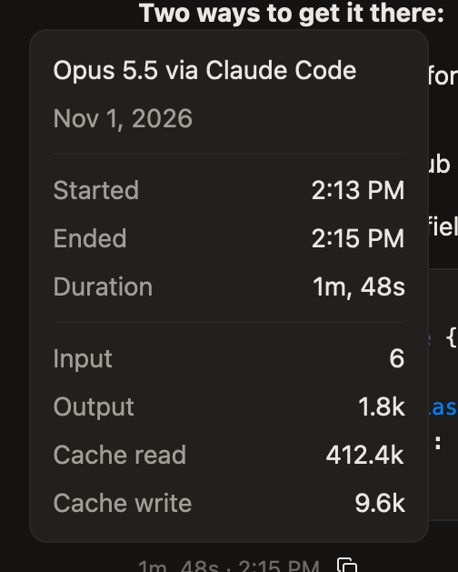

**The card of a turn that ran past midnight.** *Unconfirmed.*

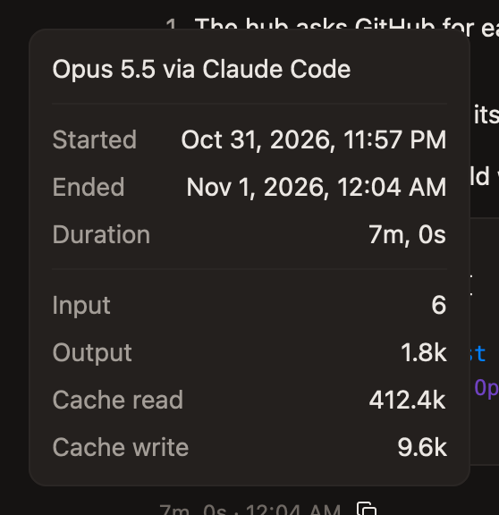

**A turn that ended with the test suite running in the background, and a monitor watching it for failures.** *Unconfirmed.*

**The agent still working, with the test suite it started and a monitor watching it in the background.** *Unconfirmed.*

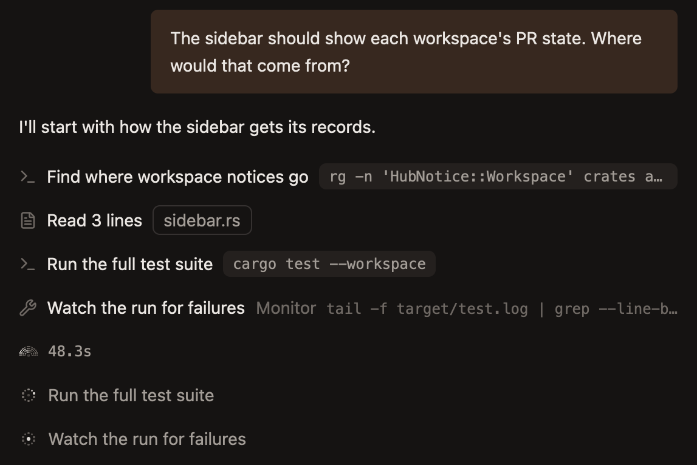

**The agent partway through writing a reply, and how long it's been working.** *Unconfirmed.*

- **An image a reply points to shows in the reply, if it's in the workspace,** written as Markdown, such as ``, by its path in full or from the workspace. One written into the reply as a `data:` address shows too. On a line of its own, it's as wide as it is, up to the column's, and among words it's the height of the text. Images with nothing but spaces or line breaks between them, such as a before and an after on lines one after another, are each on a line of their own, one under another, and so are images written that way in a prompt. It's the file as it was when the reply came, which the hub keeps, so when the agent changes the file and points to it again, each reply keeps what it showed, and every client shows the same, even after the workspace is archived. One that wasn't there when the reply came shows nothing, and so does one in a reply from before the hub kept them. One anywhere else on the machine or on the web shows nothing, since what the agent writes can't be trusted to point only where it should, and neither does anything in the workspace that isn't an image. *Unconfirmed.*

**A reply that points to a screenshot in the workspace.** *Unconfirmed.*

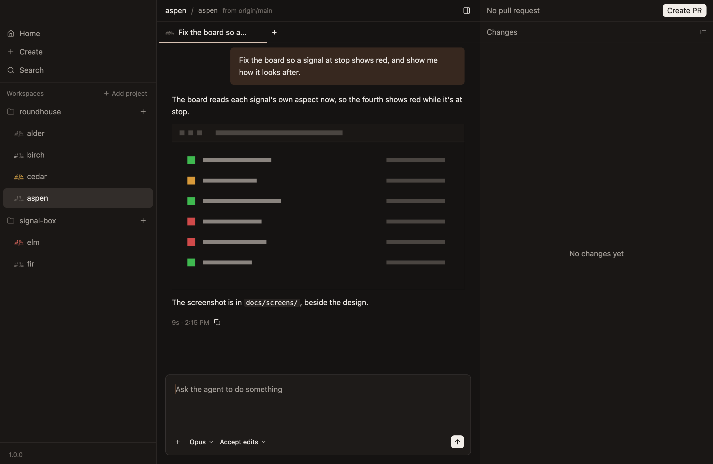

## Finding a prompt

- **A chat scrolled away from its end shows a button that scrolls back down to the end,** in three tenths of a second, slowing as it arrives, so it's plain where the chat went. From more than two screens of chat up, it goes straight to a screen above the end and scrolls the rest, since rows passed any faster can't be followed. The button fades as soon as it's clicked, what arrives on the way is scrolled to as well, and the wheel or the scrollbar stops the scroll where it is. Reduce Motion skips it. *Unconfirmed.*
- **The button sits at the bottom left of the chat, with its left edge on the composer's,** so it's over the edge of the column, a few pixels into it, and clear of the prompts at the column's right. In a pane too narrow for the composer to reach its full 24px past the column, the button stays on the composer's edge, and so reaches further into the column. It's a 28px square with a control's 6px corners, on the pane's colour with the lighter edge a field has, and a small chevron pointing down in the text colour, so it reads as something to press over whatever is under it. It takes the pointer from what's under it, so a click on it doesn't also open a call there. It rests 8px above the composer, or above the bottom of a subagent's tab, which has no composer, and it rises 4px to there as it fades in.
- **A chat has an outline at its right: a short tick for each prompt, top to bottom in the order they were sent, with the one being read in white,** so a long chat shows how far it goes and where you are in it. The one being read is the one whose part of the chat is at the bottom, which is where clicking it in the list puts it. One clicked in the list is the one being read until something else moves the chat, even where it can't reach the bottom. At the end of the chat, it's the last prompt, so in a chat that fits without scrolling, it's always the last. *Unconfirmed:* all but which prompt is the one being read.
- **The outline shows from the first prompt,** since a long first turn takes its prompt far above the screen, and the list is the quick way back up to it. There's a tick for each prompt and no more, so each stands for one, but fewer than three still take up three ticks' room to the pointer, so a lone tick is as easy to rest on.
- **The outline shows sixteen ticks at most.** A longer chat shows those around the prompt being read, and a tick at an end with more past it is fainter. *Unconfirmed.*
- **The ticks sit at the top, in the margin between the scrollbar and the column,** narrow enough that in a narrow pane they stay clear of a prompt at the right of the column. They're a place to rest the pointer, not to click, so they can be that small. The wheel over them scrolls the chat, and doesn't open the list however long it turns, since a trackpad's wheel leaves the pointer resting there without asking for it. The list opens once the pointer moves over them. *Unconfirmed.*
- **Resting the pointer on the ticks lists the prompts over them, numbered, with up to two lines of each.** The one being read is lit and the rest are quieter, so it stands out among them. The list hides the ticks while it's open, and stays while the pointer is on it. It opens on the one being read, with the two before it above it, and it's as tall as its rows up to about eight prompts of two lines, past which it scrolls. The wheel over it scrolls only the list. A prompt that only carried files says how many. *Unconfirmed.*
- **In a pane narrower than the list, the list keeps its width,** running past the pane over what's beside it rather than squeezing its rows.
- **Clicking a prompt in the list puts that prompt at the bottom of the chat, with what came before it above,** so the reply it answered is in sight without scrolling back up to it. The list closes, so it isn't over where it jumped to, and opens again once the pointer moves over the ticks, not because the click left it resting there. The prompt stays at the bottom as what's above it loads, until something else moves the chat, such as the wheel, the scrollbar, the button back down, opening or closing something in it, or sending a prompt. A prompt taller than the chat shows from its start instead, and one with less than a screen of chat above it can't reach the bottom, so the chat goes to its start, where that prompt shows. *Unconfirmed.*
- **The outline has every prompt, however long the chat,** including those too far back for the app to have loaded, because the hub lists them. A hub too old to list them leaves only the prompts the app has loaded, and so does one that fails to, until the app reconnects to it, with the chat going on either way. A prompt shows in it once it's recorded. *Unconfirmed.*

**A long chat, jumped to its fourteenth prompt from the list.** *Unconfirmed.*

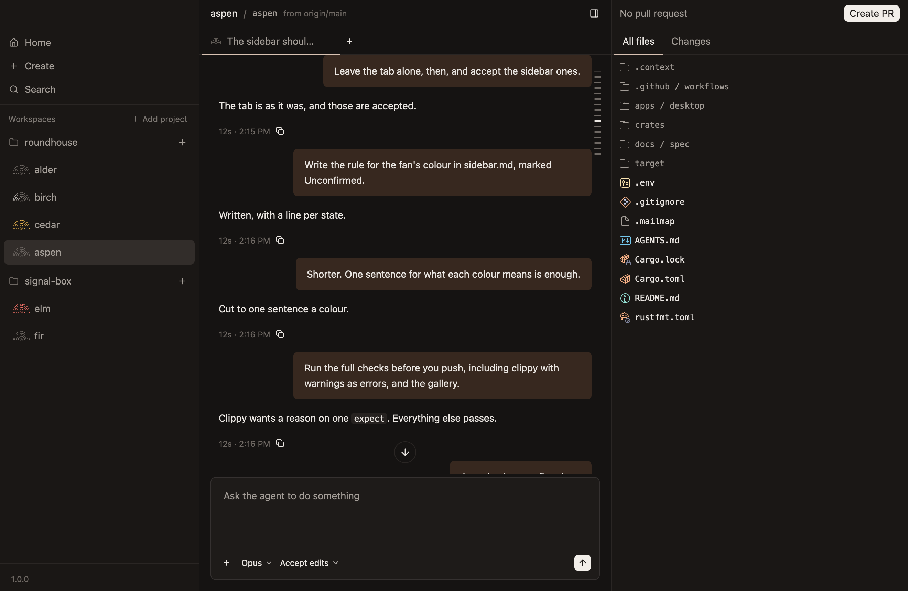

**The outline's list, open over its ticks.** *Unconfirmed.*

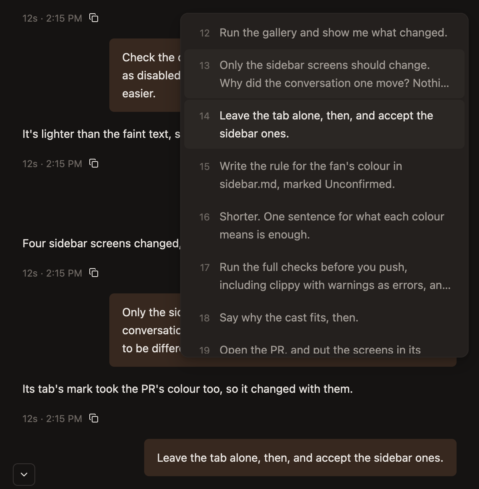

**The button back down to the end of a long chat, scrolled up to its fourteenth prompt, in a pane wide enough for the composer to reach its full 24px past the column.** *Unconfirmed.*

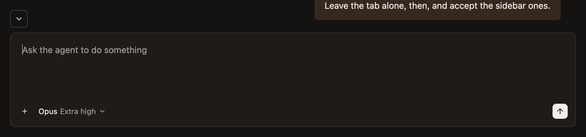

## Finding text

- **⌘F opens a bar at the top right of the chat, over it,** with what's looked for, which match is shown of how many, such as `2 of 41`, and buttons for the match before, the one after, and closing. It works wherever focus is while a chat shows, the message box too, and Find… in the Edit menu does the same. Pressed again, it puts focus back in the bar with what's in it selected. The file tab isn't searched.
- **Nor is the subagent tab,** so Find isn't there while it shows. *Unconfirmed.*
- **What's typed is looked for as plain text, ignoring case,** once typing pauses, with no patterns or whole words. A phrase is found across a line break in a paragraph, since the paragraph shows it as a space.
- **It finds what the chat shows: the prompts, and the agent's words and thinking, as their Markdown renders,** so `**parser** is` holds `parser is` and a link's address holds nothing, **and what calls were given and sent back,** such as a command and what it printed, a file's path and lines, and a search's pattern, **and what went wrong,** such as a failed turn's error, a notice, and what the agent last printed before it stopped unexpectedly. What the app writes itself isn't found, such as `Read 10 lines`, `Exit 1` and line numbers. A closed call's command on its line is marked but not counted, since it's counted where the call shows it open. Cards that ask something aren't found, and nor is a reply until it's recorded.
- **Nor is a question the agent asked, once it's answered and drawn as a line,** what was asked or what was answered. *Unconfirmed.*
- **Nor is a compaction,** what its rule says or the summary it opens to. *Unconfirmed.*
- **A subagent's call is found in as it shows it open:** what it was asked, and its report, but not what it's done lately, which changes as it works. *Unconfirmed.*
- **The count is of the whole chat, however long,** including what the app hasn't loaded, since the hub says which events hold the text, and the app reads those parts of the chat to count what each shows, then lets them go. Until it has, the count ends in `…`, and the first match waits until nothing above it can hold another. The hub looks past what Markdown marks text with, such as bold, and how much whitespace there is, but not past a link, so a phrase that runs across a link is found only where the chat is loaded.
- **One character is found only in what's loaded,** since it's in nearly every part of a chat, and so is anything when the hub is too old to say or fails to. Then the count ends in `+`, such as `3 of 12+`, or says `No matches loaded`, unless the whole chat is loaded.
- **The first match shown is the first at or below the top of the chat,** or the first of all with none below. Enter or ⌘G goes to the next, and ⇧Enter or ⇧⌘G to the one before, round from the last to the first. The one shown is marked more strongly than the rest.
- **Going to a match loads its part of the chat if it isn't, opens the call or thinking it's in, and scrolls it into view below the bar,** a block that scrolls in a call too. What it opened stays open.
- **A match in a command shows the command whole, and one in a line too long for its block scrolls the block sideways to it.** *Unconfirmed.*
- **Escape closes the bar,** the marks go, and focus goes back to the message box.

**Finding `fmt`: the first of four matches, in a command opened to show it, then one in each closed command below, whose line marks it, and one in the reply.** *Unconfirmed.*

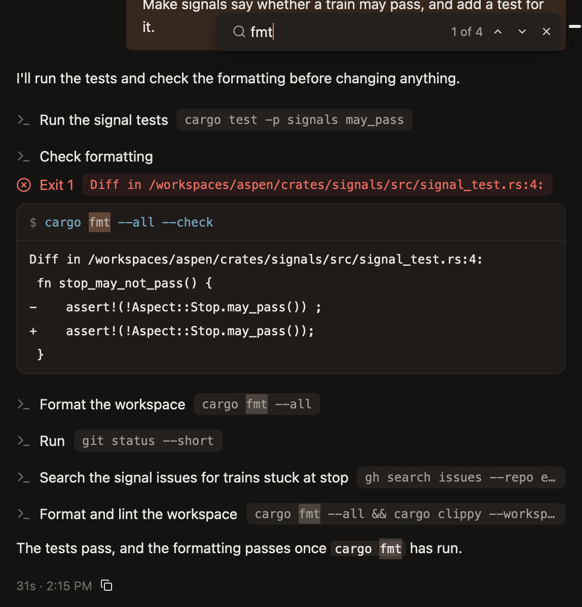

## Titles

- **A chat's title can be changed by hand,** as a workspace's can, in `workspaces.md`.
- **A chat's title is generated from its first prompt,** by the same rules as a workspace's.
- **A workspace's first chat gets the same title as the workspace,** from the same call, since they come from the same prompt. *Unconfirmed.*
- **A chat is called Untitled until it has a title,** since nothing else about a chat says what it's for.
- **Renaming a chat that's still Untitled starts from an empty field,** so pressing Return can't make Untitled a title typed by hand, which a generated one would never replace.

## Attachments

- **A prompt can carry files.** Paste an image, or drop images and files on the composer, or choose them from the menu its `+` opens, and each shows as a tile above what's typed, with a way to take it off. A prompt with files needs no text, since a screenshot can be the whole question.
- **Any kind of file can go, up to 100 MB, and at most 10 with a prompt.** The size is what the hub takes in one go.
- **Each file goes in the workspace's `.context/attachments/`, and the agent is told where, so it can open it then or later.** Git is told to ignore the folder, so the files never show as changes. Images up to 32 MB between them, and a text file up to 32 KB, also go in the prompt itself, so the agent sees them without opening anything. A longer text file is opened from where it is, so the agent can search it rather than read all of it.
- **A file is known by its bytes rather than its name,** so the agent is never sent an image labelled as something it isn't, and a pasted TIFF, which some apps copy, goes as a PNG.
- **What's typed and attached in a chat's composer is kept until it's sent,** by the hub, so it's there when the app opens again, whether it quit, restarted to update or stopped without quitting, and in any other client. Typing that goes on is kept every half second, so an app that stops without quitting loses at most that much. Closing the chat lets go of it, files and all, so the chat's composer is empty if it's opened again. *Unconfirmed:* the half second, and that closing the chat lets go of what's in its composer. *Not built:* an answer being typed to a question stays in the app, so it goes when it quits. A client takes what's in a chat's composer from the hub as it first opens the chat's workspace, so a change another client makes meanwhile shows the next time it opens, and the last change wins.
- **Files stay with their chat until they're sent,** the way what's typed does, and a prompt that can't be sent comes back to its chat's composer, files and all. While the agent waits on a question, the question takes the composer's place, and what's typed and attached waits for it to go.
- **In the transcript, a prompt's images show small above its text, and a click opens one over the window, as big as it is, up to what fits.** Opening one moves nothing in the chat, so it shows wherever its prompt is, even at the bottom of the window, where a prompt jumped to from the outline goes. Escape or a click closes it. Other files show their name and size. The hub keeps each image, so every client shows it, and it's still there after the workspace is archived. Other files are only in the workspace, so archiving takes them with it.

**A prompt that carried a screenshot and a log, and two more files waiting in the composer.** *Unconfirmed.*

**The screenshot, opened.** *Unconfirmed.*

## Tool calls

Every call is drawn the same way, as `look.md` says, and each kind fills in what its line says and what it opens to. A tool that has no drawing of its own still gets a readable line, so a new tool, or one from an MCP server, never shows as raw JSON until it's opened.

- **A command's title is what the agent said it's doing,** with the command beside it, cut off with an ellipsis when it doesn't fit. A command the agent didn't describe says `Run`. *Unconfirmed.*
- **Opened, the command comes first, faded, on one line, and what it printed comes under it in the foreground colour,** since the title has already said what the command does, and what it printed is what's read. The command is highlighted as shell, after a faint `$`. A command too long for the line is cut off with an ellipsis, and one of several lines shows its first, as the call's line does. Clicking it shows it whole, wrapping under itself rather than under the `$`, and clicking again cuts it off. The pointer is a hand over it only when a click would change it. A command that printed nothing says `No output` under it, faintly, so one that's done doesn't look as if it never answered, and one still running shows only itself. *Unconfirmed.*
- **What a command printed has a little space between its lines,** about a fifth of a line, so a line too long for the block reads as one where it wraps. It still selects and copies as one text, its lines one under another, as it was printed. Output of more than 200 lines is drawn without the space, so a long log stays as quick to draw as before. *Unconfirmed.*
- **A call that failed says so on a red line under it,** with how a command exited, such as `Exit 1`, or `Error` for anything else, and the first line of what went wrong. It shows while the call is closed, so a failure is never hidden. Opened, the call shows all of what went wrong, since the line only has room for its start, then what it tried, such as an edit's diff. What went wrong stays in muted text rather than red, so it's still easy to read, and what a command printed is in the foreground colour, as it is when the command works. *Unconfirmed.*
- **A result whose call is too far back to find is drawn on a line of its own,** saying `Output` and how many lines or images came back, and opens to them, so nothing the agent was told is lost. *Unconfirmed.*
- **Any other tool's title is its name made readable,** such as `Create issue` for `create_issue`, then the MCP server it's from in an outlined chip, and its most telling input in faint monospace. If the agent described the call, the description is the title and the tool's name follows it. Opened, its input as JSON, then what came back. *Unconfirmed.*

**Commands: one that failed, one opened that printed nothing, one the agent didn't describe, and two too long for their line, one of them opened, its output wrapping.** *Unconfirmed.*

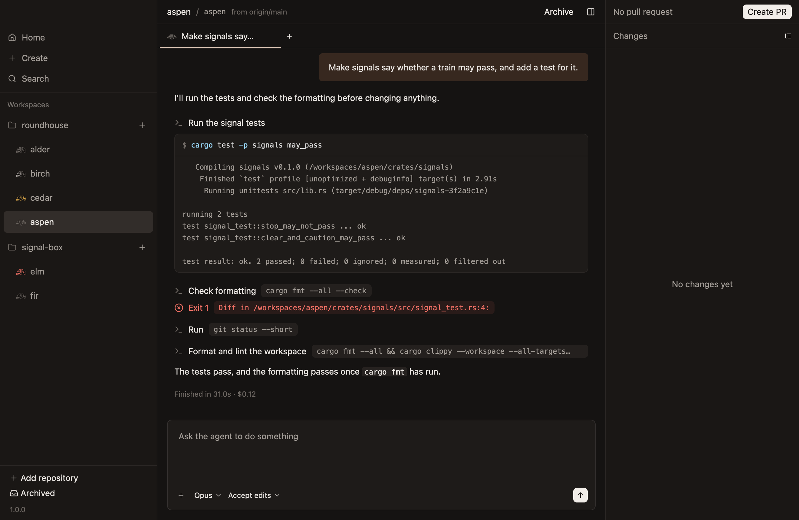

**The opened command, clicked to show it whole.** *Unconfirmed.*

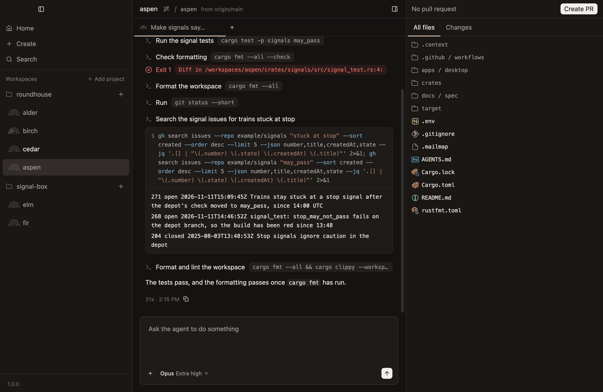

**Tools with no drawing of their own: one from an MCP server opened, one that failed, and a built-in one.** *Unconfirmed.*

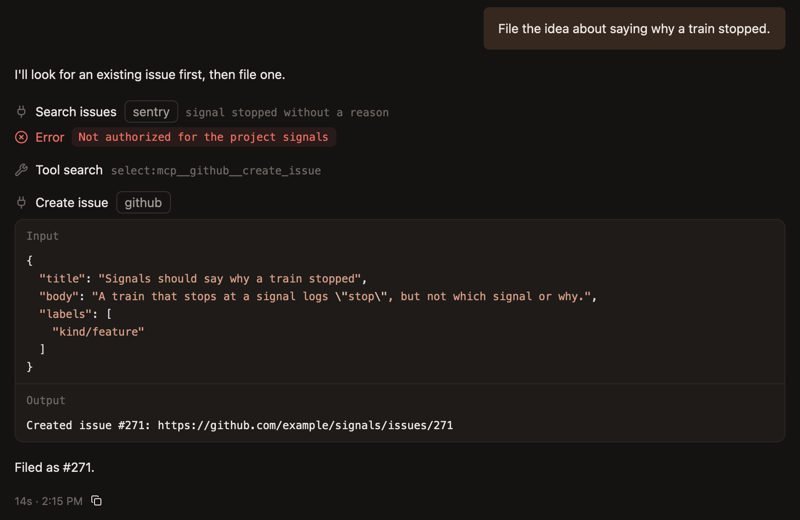

- **A file call names the file in an outlined chip, and says how much it read or wrote,** such as `Read 10 lines` or `Write 12 lines`. Opened, the file's path, then its lines with their numbers in the file, highlighted for its language. The full path is only there, since the file's name is enough to tell calls apart. *Unconfirmed.*
- **A read of an image says `Read 1 image`, and opens to the image under the file's path, at its own width, up to the column's.** Any other tool's images, such as a screenshot from an MCP server, show the same way, after what else it sent back. The hub keeps them, as it does a prompt's, so every client shows them, and they're still there after the workspace is archived. *Unconfirmed.*
- **An edit shows how many lines it added and removed,** as `+5 −0` in green and red, and so does a write over a file that was already there. A write that made a new file shows no counts, since all of it is new, and opens to the whole file marked as added. *Unconfirmed.*
- **An edit's diff uses the file's own line numbers,** from the patch the agent sent back, with a gap mark between parts of the file that aren't next to each other. Added and removed lines are tinted, with a bar down their left, and where a line changed in place, the part that changed is picked out. Before the patch comes back, the diff is worked out from the edit itself, without numbers. *Unconfirmed.*
- **Hovering an edit shows its diff,** so a change can be checked without opening it. The preview is a dozen lines tall at most, and stays while the pointer is on it, so a longer diff can be scrolled there. The wheel over it scrolls only the diff, so the transcript doesn't carry the edit away from it.
- **A search shows its pattern, where it looked, and how much it found,** such as `4 matches in 3 files`, or `Nothing found`. Opened, matching lines under their file's path, with their numbers, or the files it found. Anything else it sends back, such as matches with lines of context around them, shows as it came, so nothing is lost. Finding files by name says `Find files`. *Unconfirmed.*
- **A block of a file's lines is twelve and a half lines tall at most,** so a dozen fit whole and anything longer shows half a line as a sign that it scrolls. *Unconfirmed.*
- **A line too long for its block scrolls sideways, rather than being cut off or wrapped,** so it can be read to its end and each row stays one line of the file, as in the file tab. The numbers move with the lines, as they do there. A swipe scrolls the way it started, so reading down a block doesn't drift it sideways. An edit's preview and a search's matching lines scroll the same way. *Unconfirmed.*

**Each kind of file call: a read, an edit opened to its diff, a new file, an edit that failed, and a write over a file that was there.** *Unconfirmed.*

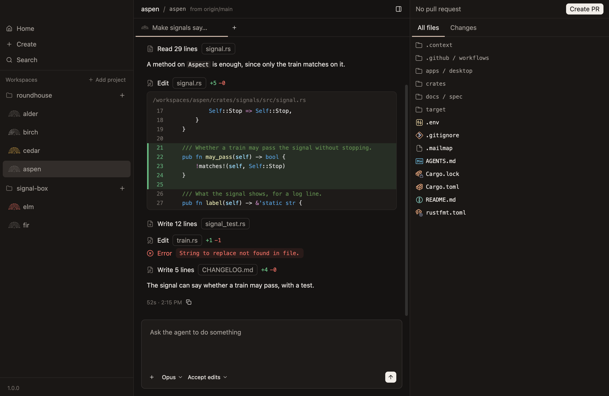

**An edit's diff, shown while it's hovered.** *Unconfirmed.*

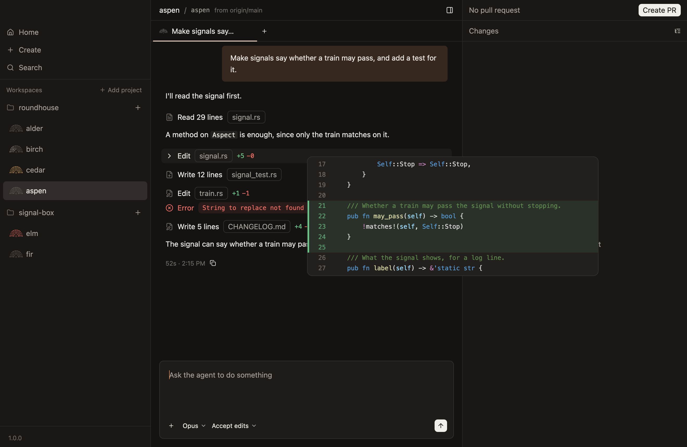

**A read of part of a file and a new file, both opened to their lines, one of which is too long to show whole.** *Unconfirmed.*

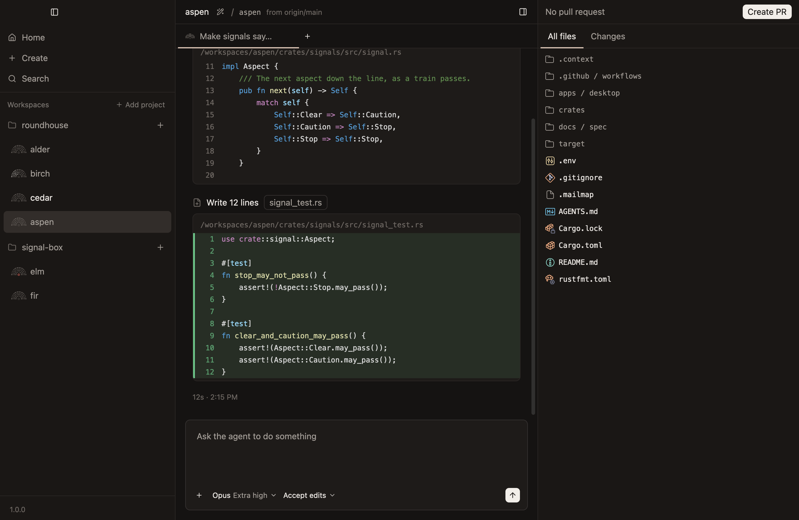

**A read of a screenshot, opened.** *Unconfirmed.*

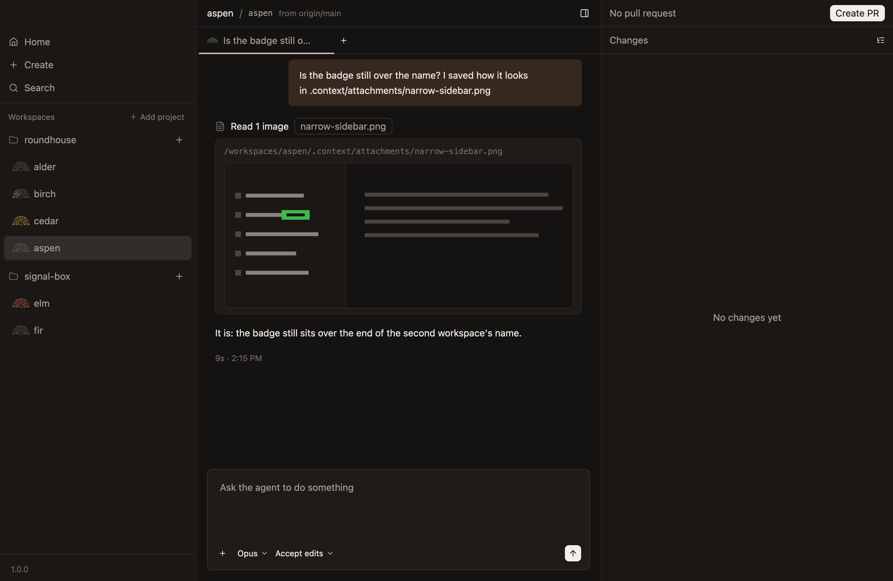

**Searches: one opened to its matching lines, one listing files, and one by name.** *Unconfirmed.*

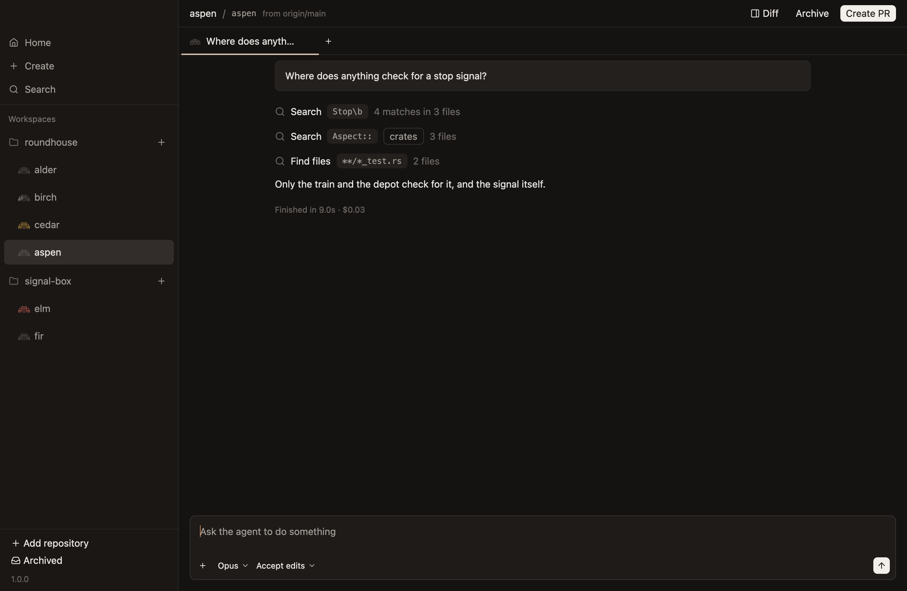

**An edit and a search that failed, opened to all of what went wrong.** *Unconfirmed.*

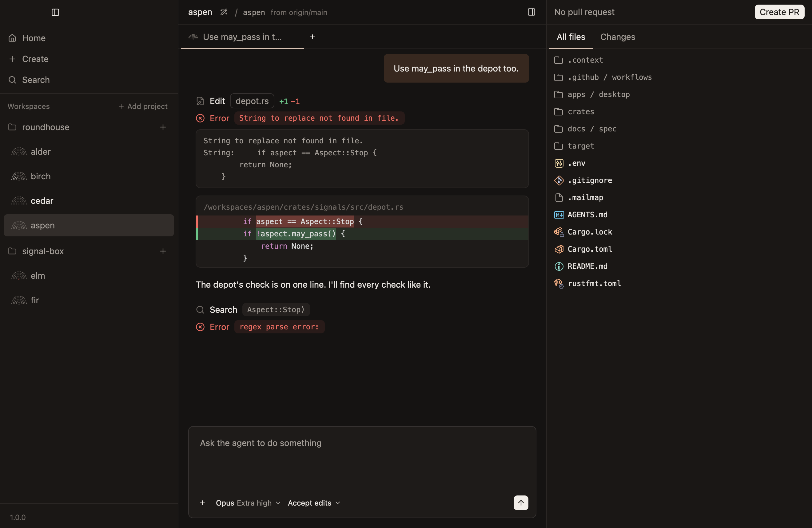

- **A call that hands work to a subagent is titled with what the subagent is for,** with its kind of agent in an outlined chip, such as `Explore`, and how many calls it's made so far. Claude's default kind, `general-purpose`, gets no chip, since it can do anything the agent can, so naming it says nothing. One that failed, or was stopped, says so first, such as `Stopped · 3 calls`. *Unconfirmed.*
- **Opened, a subagent's call shows what its tab starts and ends with:** what the subagent was asked, and once it's done, its report, in full, since the report is what the agent read and acted on. The report is the outcome, so it carries more weight: it's the subagent's answer, in the agent's prose, under a rule and the heading Report. What it was asked is a quote, quieter, with a rule at its left and fainter text, under the word Asked, since a prompt is what a person sends. While it works, what it's done lately sits between them, under the words `Working on`: its three newest calls, each after what it wrote just before it, then what it's written since, so a glance says what it's doing and why. Each call opens as any call does. The hub keeps only the start of a long text or result, since every change to a subagent's record goes to every client, so a call whose result was too long to keep whole is drawn without it, as one still waiting, rather than counting too few lines. The rest of its work is in the subagent tab.
- **An outlined Open button at the far end of a subagent's line opens the subagent tab on it.** It always shows, so the way to the tab is seen before the pointer finds it, and it's outlined, as a button that opens something is, apart from the line, whose click opens the call where it is. It shows whether or not the subagent's record has come, since the tab reads its work by its call. Until the record comes, the tab is named for what the call says the subagent is for, and its band says no more.
- **A subagent's work shows in the subagent tab, not in the chat.** The agent goes on working while a subagent does, several subagents can work at once, and one can make hundreds of calls, so their events arrive mixed with the agent's own. Kept out of the chat, they don't bury the conversation they're part of, and the chat costs the same to draw however much its subagents do. A hub from before subagents were kept apart can't send the chat only the agent's own events, so there the call opens to everything the subagent did, in order, under a rule down its left, with no button, and work that arrives too long after its call to be gathered, such as more than 2,000 events later, shows where it arrives instead, so it isn't lost.
- **The subagent tab works as the file tab does.** A workspace has at most one, and opening another subagent shows that one in the same tab, so following subagents doesn't leave a trail of tabs. It covers the chat and its composer until a chat's tab is clicked, and `Cmd-W` closes it while it shows, when the File menu's Close Chat says Close Subagent Tab. It sits at the far left, as tabs that are replaced rather than added to do, just after the file tab when that's open too, so neither moves however many chats are open, and `Ctrl-Tab` comes to it there. It closes when the chat whose subagent it shows does, since the chat's agent and its subagents stop then. The tab has the call's icon and what the subagent is for, in italics, as the file tab has a file's icon and its name.
- **The subagent tab is a page about one subagent.** A band at its top, like the diff's file header, says which chat it's from, then what the subagent is for, its kind as its call's line does, and where it stands, such as `Finished · 3 calls · 12s`, so that's in view however far its work scrolls. Where the tab sits doesn't say which chat it's from, so the band does, faint, before a slash, and clicking the chat's name shows that chat. *Unconfirmed:* how the band names the chat. Under the band come what it was asked, everything it did, in order, as the chat shows the agent's, and its report once it's done, drawn as its call draws them. Its last words aren't drawn above the report when the report says the same. While it works, it ends with the working line, with how long the subagent has been at it, and it follows the subagent's work as a chat follows the agent's. A subagent another started opens in the same tab, from its call's button. *Unconfirmed:* the working line's time. *Not built:* the band saying which subagent started it, as a link back (#451).
- **A web search shows what it looked for and how many pages it found.** Opened, the pages, each its title and then its site, faint, which open in the browser when clicked, then what was made of them. *Unconfirmed.*
- **A fetch shows the site in an outlined chip.** Opened, the page's address, what the agent asked of it, then the answer. *Unconfirmed.*

**Subagents: one finished, opened to its report, and one at work, opened to what it's done lately, with its line in the background at the chat's end.** *Unconfirmed.*

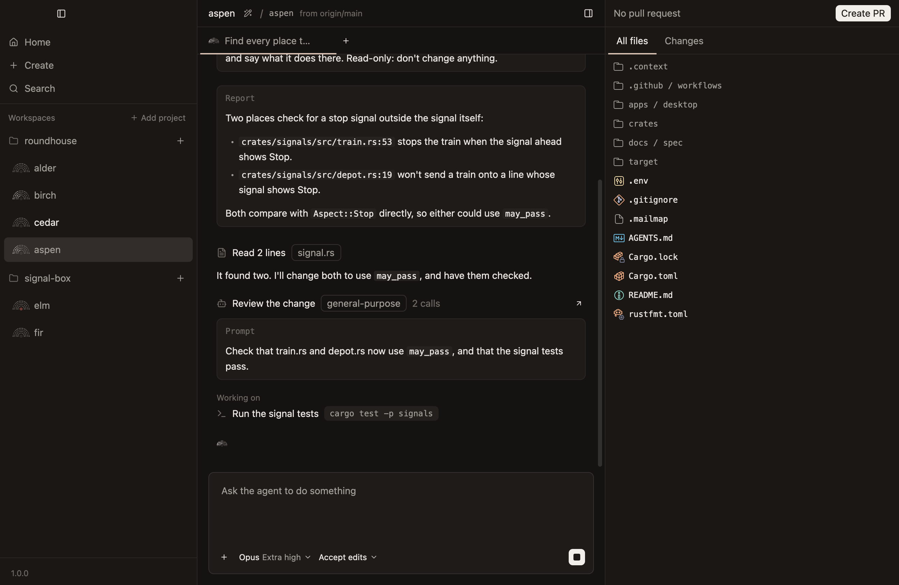

**The subagent tab on the subagent that finished, with its band at the top.** *Unconfirmed.*

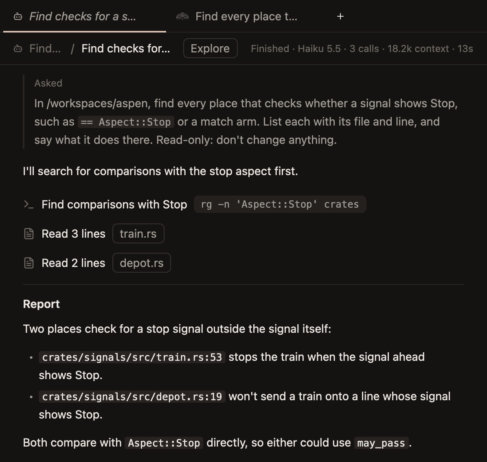

**The subagent tab on the subagent at work.** *Unconfirmed.*

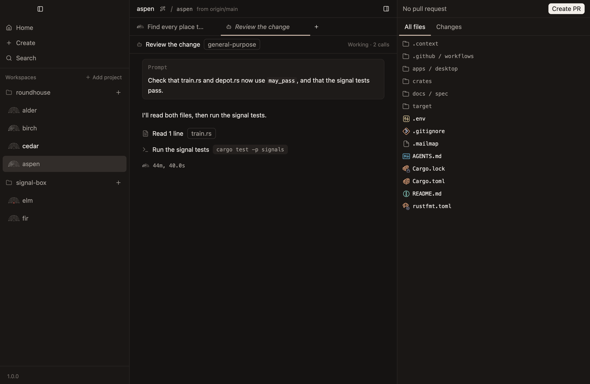

**The web: a search and a fetch opened, and a fetch the site refused.** *Unconfirmed.*

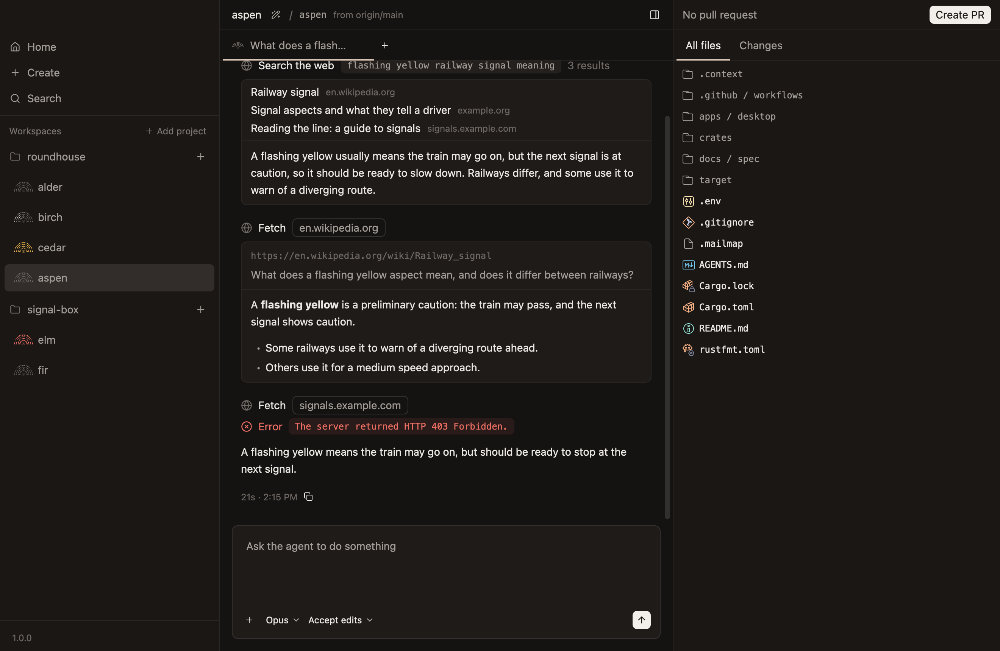

- **Asking the advisor says `Ask the advisor`.** The advisor is a stronger model that reads the whole conversation and advises the agent. Opened, what it said, whose start shows closed too, faint, as a thought's does. A reply can come encrypted, for the model alone, and then the call opens to a line saying only the agent can read it, and nothing claims to say what the advice was. When asking failed, the red line under the call says why, such as `overloaded`, or `refusal` when the advisor refused. *Unconfirmed.*
- **An open call to the advisor always shows something.** With no reply so far, it opens to a line saying the advisor hasn't replied, whether one is on its way or the turn ended first, since a reply can take minutes. A reply with nothing in it opens to a line saying it was empty. *Unconfirmed.*
- **A call to the advisor that the agent went on without says `No reply`.** The log says when the agent's next message began without a call's result. Its line says `No reply`, faint, so closed it reads apart from the call the agent then makes again, and it opens to a line saying the advisor didn't reply and the agent went on without it. It stays in the chat, since the agent did make it. This has been seen for a call made after a call to one of the agent's own tools, in the same message. *Unconfirmed.*

**The advisor: opened to a reply only the agent can read, then a call the agent went on without, the call it made again, closed on a reply that can be read, and a call that failed.** *Unconfirmed.*

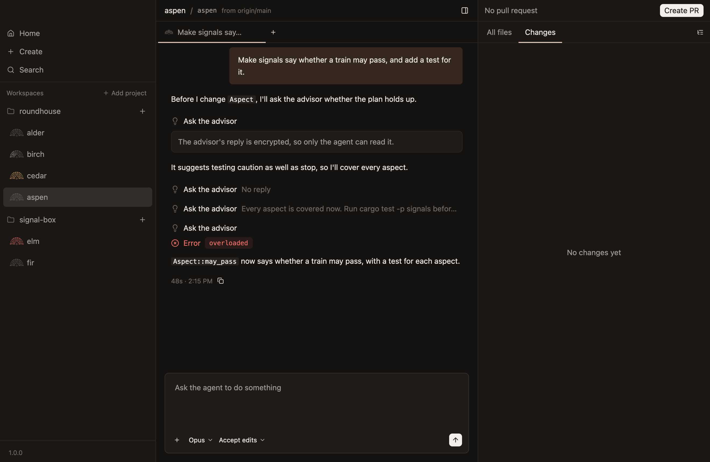

- **What the agent thought is a line like a call's,** saying `Thinking`, with the start of the thought, faint, cut off where the line ends. Opened, the whole thought is at body size in muted text, under its line and on the column's left edge, and the line drops the start, so it isn't shown twice. While it streams, its line says `Thinking…` at the same size. *Unconfirmed.*

**Thinking among calls: a long thought opened, and a short one closed.** *Unconfirmed.*

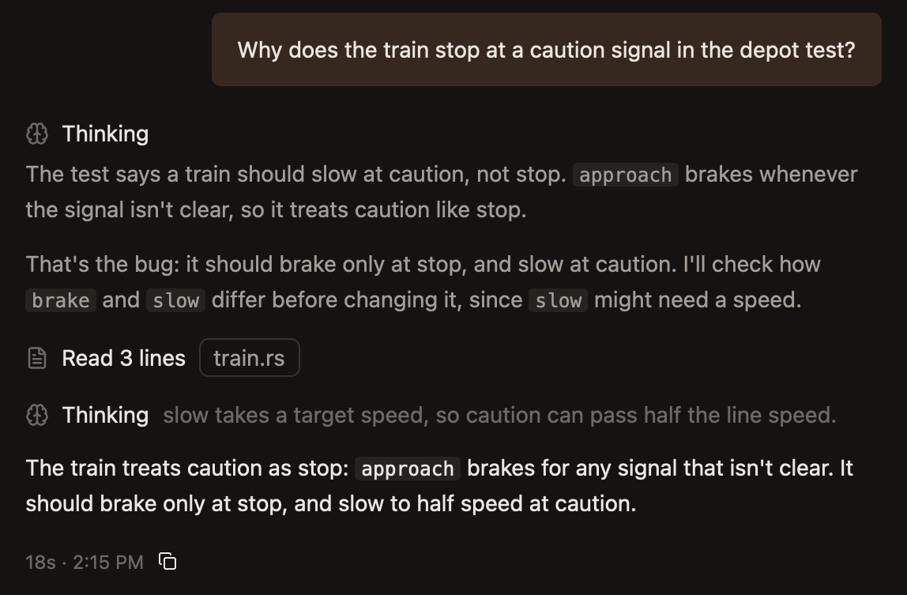

**A thought still being written, above the working line.** *Unconfirmed.*

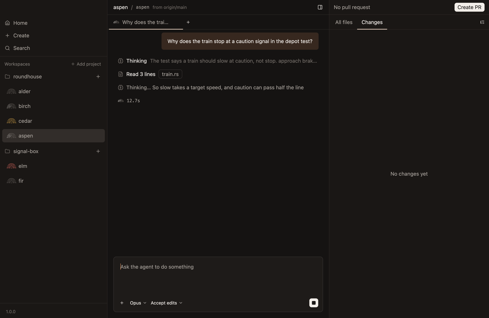

## Sending while the agent works

- **Enter sends what's typed to the agent while it works, and the agent reads it at its next chance,** such as when a running tool finishes. Until then the prompt is faint, so it's clear the agent hasn't seen it. One sent while the agent writes its last reply starts a turn of its own straight after. *Unconfirmed.*
- **Stopping the agent drops a prompt it hasn't read yet, and the prompt says so,** since stopping means stopping. So does a prompt the agent never read because it went away. *Unconfirmed.*
- **A chat's prompts reach the hub in the order they were sent, sent or queued,** even while one is still adding a large file and the next carries none, so the agent never reads them out of order. *Unconfirmed.*
- **Cmd-Enter queues what's typed instead, for after the agent finishes.** Each queued prompt is a turn of its own, sent in order once the agent has nothing left to do, so it can't fold into a turn it wasn't meant for. With the agent idle, Cmd-Enter sends. What's attached goes with it, as it would with Enter, and until the hub has the prompt, it shows faint at the end of the queue, so a prompt whose files take a while to add doesn't seem lost. *Unconfirmed.*
- **The queue sits above the composer, one line to a prompt, with buttons to change one, take it out, or send it now.** A change is made in place, where Enter keeps it and Escape leaves it as it was. It changes only the text, so the files stay as they were queued, and with any, the text can be cleared. Once the agent has a prompt, or it's been taken out, it can't change, and a change that comes too late says so rather than queueing it again. *Unconfirmed.*
- **A queued prompt with files says so after its text, muted, with a file's name or how many there are,** and beside it while it's changed. The text gives way first, so a long line doesn't hide that something's attached. *Unconfirmed.*
- **A queued prompt's buttons show only while the pointer is over it,** which lights its row, so it's clear which prompt they're for.
- **The arrow on a queued prompt steers the agent with it,** as Enter does, rather than leaving it to wait its turn.
- **The queue belongs to the hub, not the app,** so it's still sent with the app closed, and every client shows the same queue. *Unconfirmed.*
- **Stopping the agent holds the queue, and so does the agent going away mid-turn,** since then it's for the person to say whether to go on. The queue says it's waiting, and the arrow on a prompt sends it as a turn of its own, after which the rest follow. Sending any prompt lets the queue go on, once that turn ends. The hold is on the session's record, so it lasts through a hub restart. *Unconfirmed.*

**A prompt sent while a tool runs, waiting for the agent.** *Unconfirmed.*

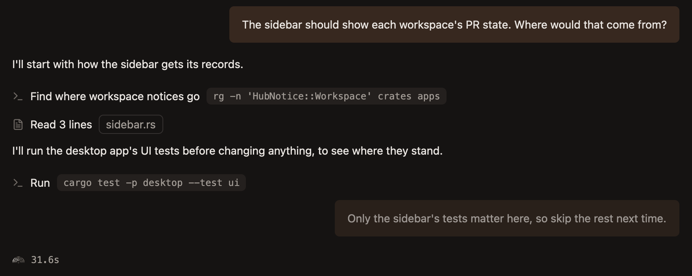

**Three prompts queued while the agent writes, the first with a file, and the pointer over another.** *Unconfirmed.*

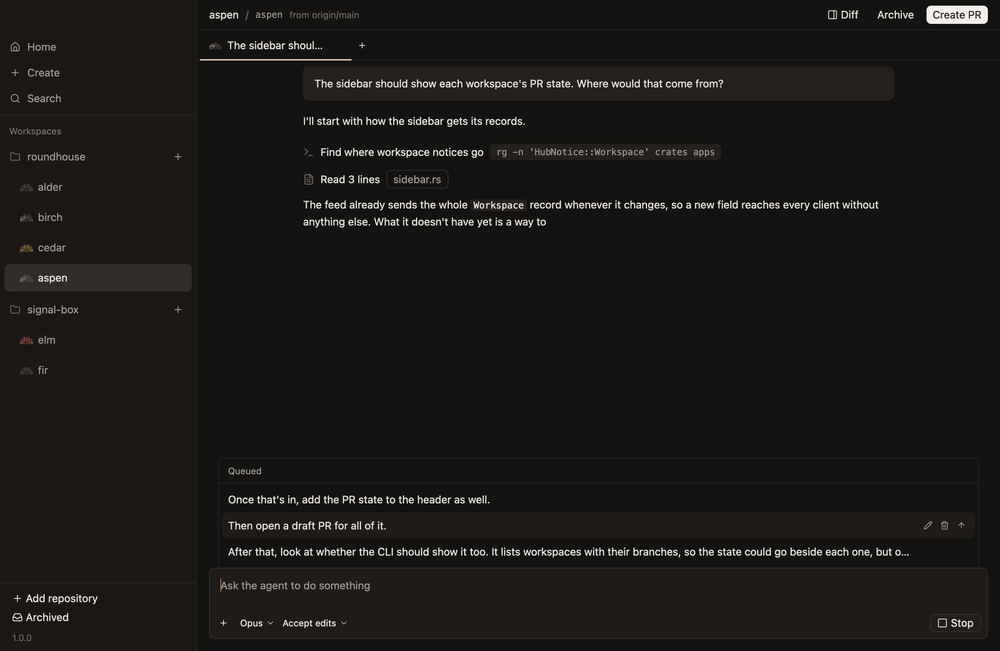

**The queue held after a stop, the last prompt with two files.** *Unconfirmed.*

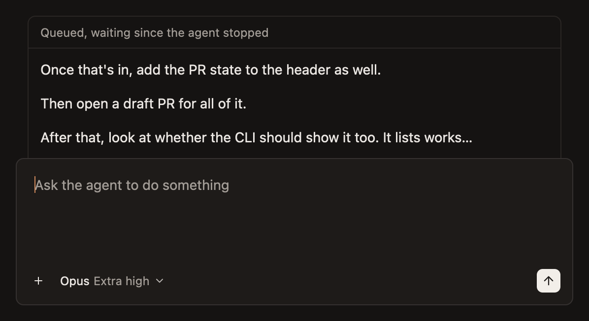

## Questions and approvals

- **A question from the agent takes the composer's place until it's answered,** so it's answered where a reply would be typed, and the transcript keeps what was asked and what was answered. What's typed and attached in the composer waits for it to go, and so does any other question waiting, since they're asked in turn, oldest first. A plain Allow button would throw the question away. *Unconfirmed.*
- **It asks one question at a time:** its header and text, then each option on a numbered row, with what it means under it, and a last row, `0`, to type another answer into. A chosen row is lit, and where several can be chosen, a check marks each, and the typing row's checkbox takes back what's typed there. *Unconfirmed.*
- **On the right under the options is the arrow that sends, and with more than one question, on the left, a dot for each, filled once it has an answer and ringed while it shows,** between arrows to the one before and after. Choosing the one answer a question takes goes on to the next without one. *Unconfirmed.*
- **The arrow sends once any question has an answer, and leaves out a question without one,** so only what matters needs an answer. Enter goes on to the next question without an answer, and sends once there's none. The `×` skips them all, and tells the agent to carry on if it can. *Unconfirmed.*
- **While it has focus, a number chooses that option, `0` goes to the typing row, and the left and right arrows move between questions.** It takes focus from the composer when it comes, and gives it back when it goes. When it's just come, keys do nothing until half a second passes without one, so the end of something being typed in the composer can't answer it. Choosing with the pointer ends that early. Escape leaves the typing row. *Unconfirmed.*
- **It's drawn on the pane's own surface inside the thin edge colour, with the composer's corners, rather than in a card's amber,** since taking the composer's place already says it's your turn. Its header, numbers and what each option means are small details, at 12px, and the question and its options are at body size. A chosen row is lit in a raised surface's hover colour, the nearest step above the pane, and Send is the composer's. *Unconfirmed.*
- **Once it's no longer waiting, a question is a call's line in the transcript, where the agent asked it.** It says `Asked`, or `Asked 2 questions` for several, then each question's header in an outlined chip, then what was answered, faint, cut off where the line ends, with a dot between the answers to several. A typed answer of several lines shows its first there, as a command does. The agent usually says what it's asking just before it asks, so what was answered is what the line has room for. Opened, it's a block with each question under its header, in muted text, and what was answered under it after an arrow, in the foreground colour, so what was decided stands out. The line doesn't say the answers again while it's open.
- **A question nobody answered says `Not answered` in the block,** whether it was skipped, left out when others were answered, or the turn stopped before anyone could. The line leaves out a question nobody answered, and says `Not answered` only when none of them was. *Unconfirmed.*
- **What was answered is on the hub's record,** kept as the answers are passed to the agent, so every client shows the same, after a restart too. One answered before the hub kept answers shows only what was asked. *Unconfirmed.*

**A command waiting to be allowed, in a chat that's planning,** since only an agent in plan mode asks before using a tool. *Unconfirmed.*

**A question from the agent, with choices.** *Unconfirmed.*

**Three questions, with the first answered, two choices and a typed answer on the second, and the third still to answer.** *Unconfirmed.*

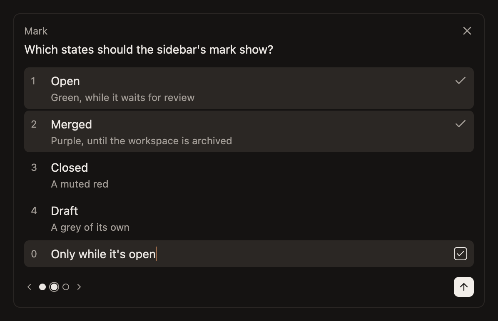

**Questions once answered: one, then two, of which only the first was answered.** *Unconfirmed.*

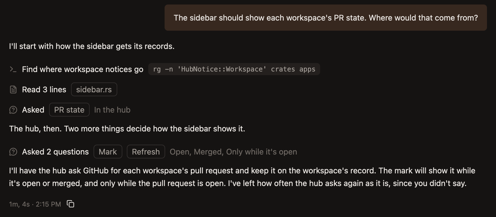

**The two opened to what was answered to each.** *Unconfirmed.*

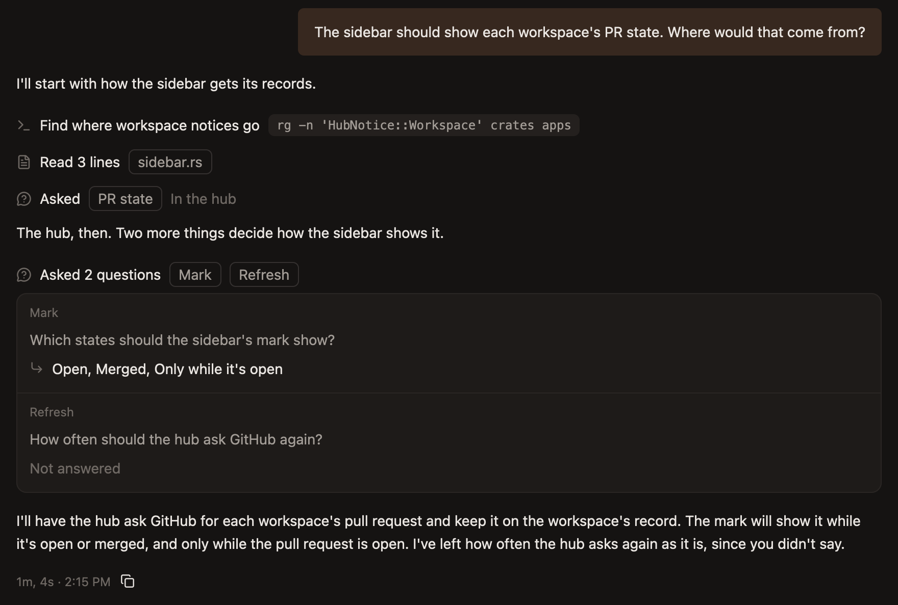

## The model and plan mode

- **Every agent has full access, and never asks before using a tool, except in plan mode.** Agents run side by side, and one that stopped to ask before each step would hold up its work until someone came back to it.
- **`Shift-Tab` in the composer turns plan mode on and off, and so does Plan mode in the menu the composer's `+` opens,** with no menu of modes. In plan mode the agent works out a plan and asks before changing anything, and approving its plan goes back to full access.
- **The `+`'s menu has two items, each with an icon: Attach files…, which opens the file picker, and Plan mode, with `Shift-Tab` beside it, and a check in place of its icon while it's on.** However it closes, focus goes where the prompt is typed. The new-workspace dialog has the same `+` and menu, as `workspaces.md` says. *Unconfirmed.*
- **The composer shows plan mode in copper, with a texture made from the mark:** a muted copper edge, a faint copper wash, and the fan's rows as dotted half circles of fine copper dots around a point just under the composer's bottom edge, each with a dot over the composer's middle, as if the composer lay over a roundhouse far bigger than itself. The texture is strongest at the top and fades toward the buttons, so the colour marks the whole composer and the texture doesn't crowd what's typed or pressed. `look.md` has the colour. *Unconfirmed.*
- **A chat that's planning when its agent stops is still planning when the agent comes back.** Otherwise an agent that restarted would make changes nobody had approved. *Unconfirmed.*
- **A new chat keeps the model and its effort, but not plan mode,** which belongs to the task at hand. *Unconfirmed.*
- **Every chat names its model and its effort, and never leaves either to the agent's CLI,** so the chat decides which model and level the agent runs, rather than the user's own Claude settings or the account. An alias such as `opus` is still the CLI's to resolve to a model. There's no default model to choose.
- **The model picker offers aliases:** `fable`, `opus`, `sonnet` and `haiku`. They follow the CLI's newest of each without a release here. *Unconfirmed.*
- **The model and its effort are one picker,** since how hard the agent thinks is part of choosing what thinks. It shows the model's name, then the effort in muted text, such as `Opus Extra high`, and its menu lists the models, then the levels: Low, Medium, High, Extra high and Max, which are the CLI's own. *Unconfirmed.*
- **A chat nobody has chosen for runs Opus at Extra high,** the owner's usual choice. *Unconfirmed.*
- **A new level reaches an agent that's already working without stopping it,** and shows once the agent has said it's using it, so the picker is never ahead of the agent. *Unconfirmed.*

**The composer in plan mode, with a prompt typed.** *Unconfirmed.*

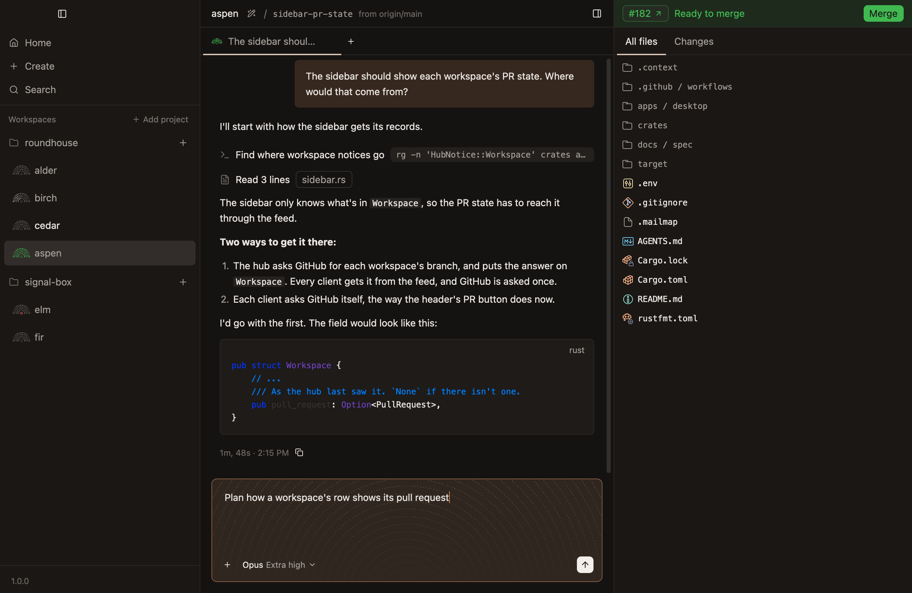

**The `+`'s menu, open, in a chat with full access.** *Unconfirmed.*

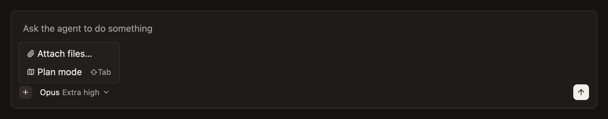

**The same menu in a chat that's planning.** *Unconfirmed.*

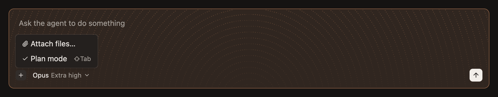

**The model picker's menu, open, in a chat at Extra high.** *Unconfirmed.*

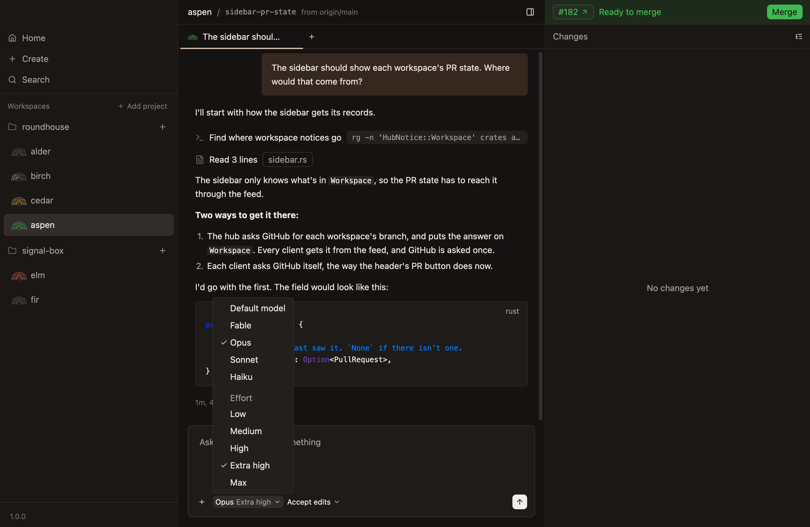

## The context and the account

- **A ring beside Send shows how full the agent's context is,** filled clockwise from the top. It shows once the agent has said, so a new chat has none until its first turn starts. It follows the agent as it works: the agent says when a turn starts, a few times a minute during one, and when it ends. It's in muted text's colour however full it is, since amber and red already mean something, and it doesn't move by itself, since only a working agent moves anything. *Unconfirmed.*
- **Resting the pointer on the ring shows a card above it,** with its right edge on the edge of the ring's place in the bar, so it covers neither the ring nor Send. It goes a third of a second after the pointer leaves, so the pointer can cross to its button. *Unconfirmed.*
- **The card says how much room is left.** First how much is used, as a share such as `63% used` and as a bar. Under the bar, how much more the context can take, such as `153.5k until it compacts`, and what's used of how much, such as `313.5k/500.0k`. An agent that keeps room back for shrinking the conversation has that room split off the bar's end by a gap, so the gap is where it compacts. For one that keeps none back, the bar is whole and the line says how much is left, such as `186.5k left`. *Unconfirmed.*
- **Then what's in the context, in the agent's own words, largest first, in tokens.** Room that's free or kept back isn't listed, since the bar shows it. Neither are the tools an agent loads only when it needs them, since they aren't in the context. A part whose kind the agent didn't say is listed, since it may be in it. *Unconfirmed.*
- **Last, `Compact now` compacts the conversation straight away,** beside `Summarize to make room`, rather than when the room runs out. It asks the hub, as typing `/compact` does, and the chat shows the compaction as one that was asked for. It's off while the agent is on a turn, since the agent would only compact once the turn is done, and while there's no hub. The hub refuses one then, and also while the agent has yet to take a prompt it was sent, or before it has had a turn, when there's nothing to compact, and the chat says why.
- **A bar for each of the account's limits sits left of the ring,** lying flat, one above the next and as wide as the ring, shortest window first. Each empties from the right as the limit is used, as its bar in the card does. They lie flat because two upright bars beside Send would read as a pause button. They're bars so they can't be taken for the ring, and in its colour for the same reason it is. They have a card of their own because a limit is the account's and the context is the chat's. They follow the account's record, which the hub changes as soon as any agent under the account hears of its limits, in whichever workspace, so they move with nothing asked for, while the app is in the background too. An agent says what's left only as it starts, so while one works it's asked again at most every five minutes, and the bars are never more than about five minutes behind what working agents have used. *Unconfirmed.*
- **Their card says how much of each limit is left,** such as `96% left` of the `7d limit`, as a bar that empties, and when the limit starts again, with the plan beside its heading. A limit is the account's and not the chat's, so the hub keeps what any agent under the account last heard, and every chat under that account says the same, in whichever workspace, and still says it after the hub restarts. A chat under another account has that account's own, even with the same model provider. Nothing shows for a limit that has started again since it was heard, for an account with no limits, or until an agent under the account has heard of one. *Unconfirmed.*
- **Under the limits, whose account it is:** the email, then more quietly how it's logged in and the model provider. The hub reads it from the agent's CLI on the workspace's machine each time an agent launches, and the chat names the account its agent's newest launch runs under, so it's there once the agent has gone. A line too long for the card, such as a long email, is cut off with an ellipsis. *Unconfirmed.*
- **With no limits to show there are no bars, so the ring's card says whose account it is,** under what the context holds: the email, then more quietly the plan, how it's logged in and the model provider. Until the chat's agent has launched, when nobody was logged in, and when the hub can't tell whose account it is, nothing says, and the ring's card is only the context. *Unconfirmed.*
- **How full a context is belongs to its chat's record,** so every client shows the same ring, and it's still there once the agent has gone or the hub has restarted, since the conversation the agent resumes is as full. It isn't in the chat's history: only the newest matters, and it answers the app's own question rather than being something the agent said. *Unconfirmed.*

**The ring's card, over a chat whose context is nearly two thirds full.** *Unconfirmed.*

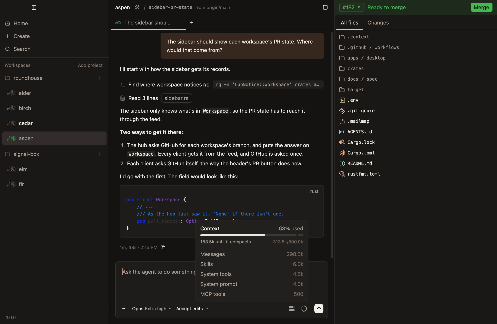

**The limits' card, on an account with two limits.** *Unconfirmed.*

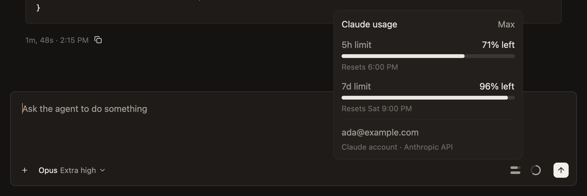

**The ring's card on an account no agent has heard a limit for, so it says whose account it is.** *Unconfirmed.*

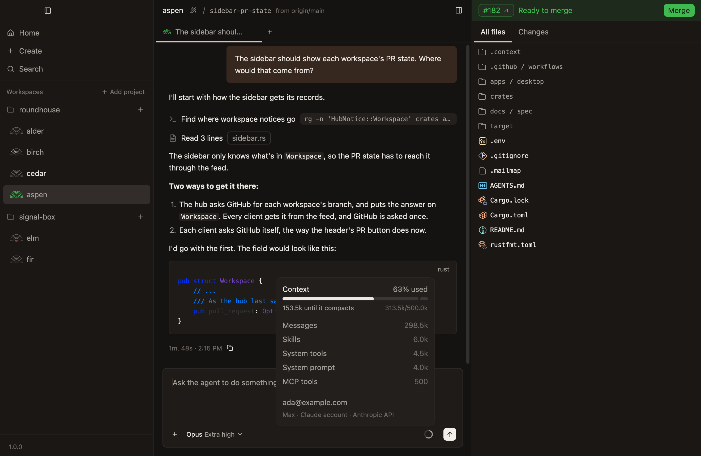

## Compacting

- **A compaction is a rule across the chat,** where the agent swapped what it held for a summary. In its middle, faint: `Compacted`, or `Compacted automatically` when the agent did it by itself as its context filled, then how many tokens the context went from and to, such as `226.9k → 9.0k tokens`, and how long it took.
- **The rule opens to the summary the agent carries on from,** under a heading saying so, in a box about fifteen of its lines tall that scrolls inside past that, since a summary can run to thousands of words. The wheel scrolls the box to its end and then the chat. What the CLI writes around the summary for the model is left out.
- **Typing `/compact` asks the hub to compact, as `Compact now` does, rather than sending a prompt,** with what follows it as what to keep. So a compaction asked for either way is drawn as its rule alone, with no prompt, and so is the end of the turn that was only it, since the rule says how long it took. What it was told to keep is quoted under the rule, as it was typed. Typed while the agent is on a turn, it's refused, and stays typed, with what the hub said.
- **While the agent compacts, the working line says so after the time,** `Compacting the conversation`, and how much of the summary it has written when the agent says, such as `16.5k characters written`, since that's the only sign a compaction is getting on. It says so from when the compaction is asked for, since an agent that has to start first can take most of a minute to say anything. The hub's tail holds it, so every client says the same, and one that opens the chat partway says it too.
- **A compaction that failed is a red line saying why,** such as `Couldn't compact the conversation. Not enough messages to compact.`, or only that it couldn't when the agent didn't say.

**A compaction someone asked for, and the turn after it.**

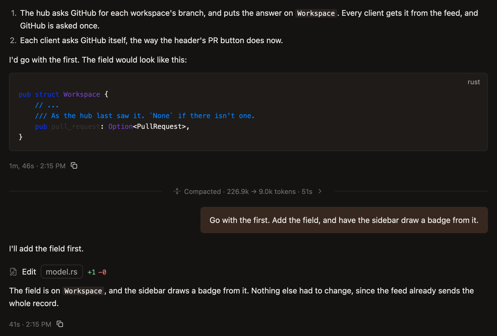

**A compaction asked for with what to keep.**

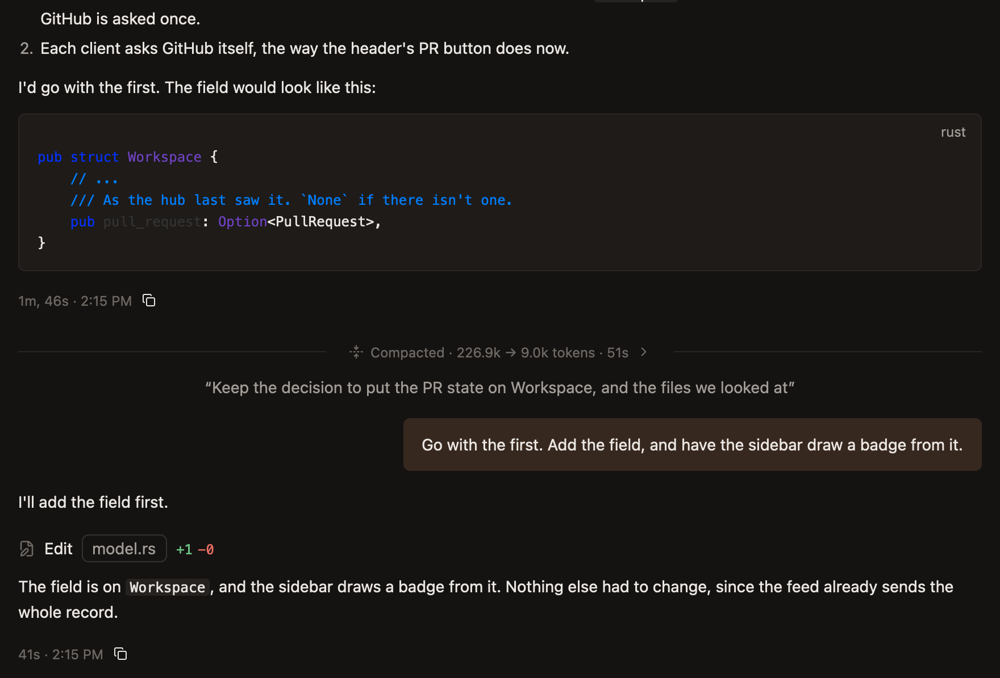

**A compaction opened to its summary, which scrolls past fifteen lines or so.**

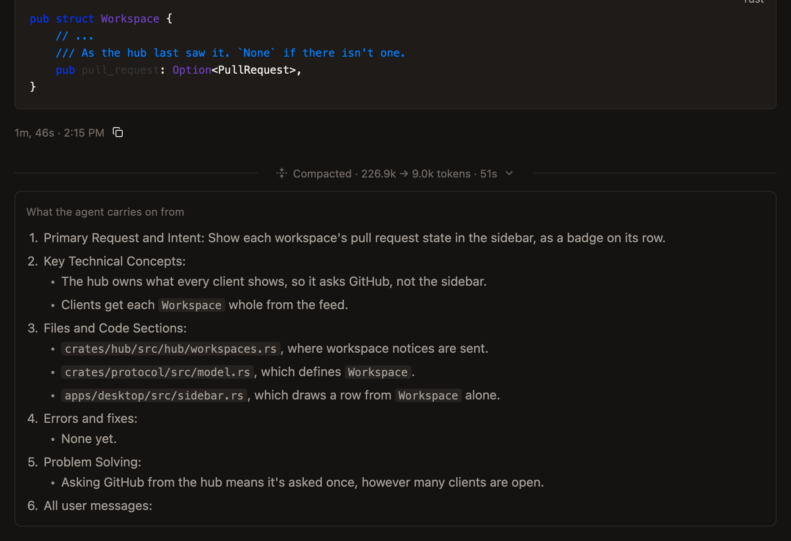

**A compaction the agent did by itself, partway through a turn.**

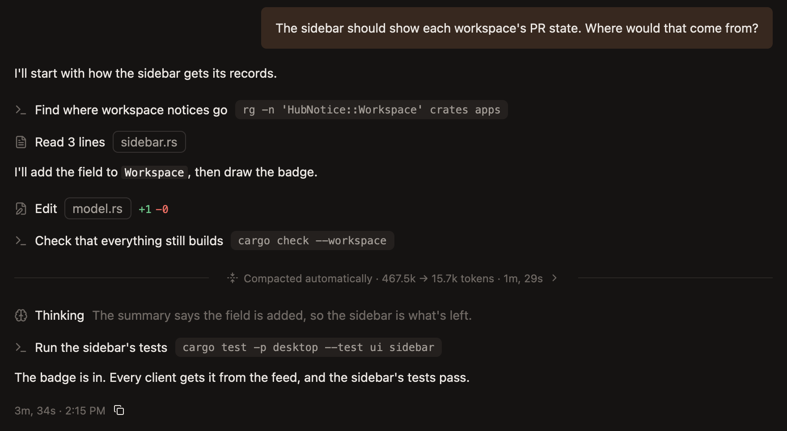

**The agent compacting, three minutes into a turn.**

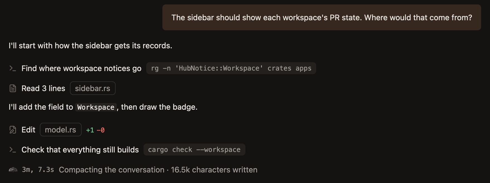

**A compaction asked for with too little to compact.**

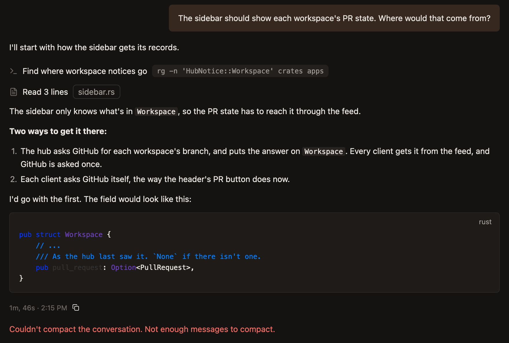

## The prompt cache

The API keeps what an agent's requests read and write for a while, so the next request needn't send it again. A prompt sent once that cache has expired writes the whole conversation to it again, which in a long chat is the most a prompt can cost: writing at 1h costs 2× the input price, and reading costs 0.05× on Opus 5.5, so coming back to a 300k-token chat just after its cache has expired costs about what 40 prompts would while it's warm. So the chat says when that's coming, and when it has happened.

- **A cache expires one TTL after the agent's newest request was sent,** an hour for the agent's own on a Claude account, since each request that reads it or writes it starts its time again. A subagent caches a conversation of its own, so only the agent's own requests count. The hub keeps when that was, and the TTL, on the chat's record, from what the agent's adapter says of each request, so every client says the same, and still says it after the hub restarts. A compaction leaves the chat with nothing cached, since what the cache held is no longer the conversation, and so does choosing another model, whose cache doesn't hold it. *Unconfirmed:* the compaction, and choosing another model.
- **A cache is about to expire with a quarter of its TTL left, or 2 minutes, whichever is longer:** 15 minutes for a 1h cache, and 2 minutes rather than 75 seconds for a 5m one, so there's time to act.
- **A chat under 50k tokens of context says nothing of its cache but in the newest turn's card,** since writing that again costs little: about 15k tokens, which every chat shares, stay cached anyway.
- **Nothing says the cache is about to expire while the agent works,** since each request keeps it warm and there's nothing to do about it mid-turn. A chat waiting on the person for an answer or an approval does say so, on its tab, its workspace's row and Home, and above its composer, since answering is something to do about it. Its transcript doesn't, since the newest turn hasn't ended, and the line and card before it are an earlier turn's. *Unconfirmed:* while it waits.
- **The words are "expires" while that's ahead and "expired" once it's past,** in the transcript too, as a compaction's rule says `Compacted`.
- **The newest turn's card says how long the cache has left,** under its cache read and write: `Cache`, then a small wedge for what's left beside the time, such as `42 min left`, and under it when it expires and how long the cache lasts, such as `Expires at 3:15 PM` and `1h cache`. Once it has expired, the wedge is a clock, the time is `Expired`, and under it is `Expired at 3:15 PM`. The wedge isn't a bar or a ring, so it can't be taken for the context's. It says so whatever the chat's size, and goes while the agent works. An older turn's card says nothing of the cache, since only the newest turn's can still be warm.
- **The line under the newest reply has the same mark after its time, but only once the cache is getting cold:** nothing until it's about to expire, then the wedge, then the clock once it has expired. Pointing at the mark opens the turn's card, as pointing at the time does, since the card says what the mark means. The context's ring and its card say nothing of the cache, since the cache isn't the context.
- **Once it has expired, a line above the composer says so,** with a clock, how long ago in the app's words for that, and what the next prompt writes again, which is what the context holds: `Cache expired 12m ago · this prompt writes 313.5k tokens again`. *Unconfirmed:* the clock, and `12m` for `12 min`, as the app says how long ago elsewhere.
- **While the cache is warm, pointing at another model in the picker says switching writes the chat's tokens to the cache again,** such as `Switching writes this chat's 313.5k tokens to the cache again`, since a cache belongs to one model. Once it has expired, switching costs no more than staying, so the picker says nothing.
- **A prompt that wrote the conversation to the cache again has a rule after it,** drawn as a compaction's is, with a clock, such as `Cache expired · 1h 20m idle · 313.5k tokens written again`. It's after the prompt, before what the agent wrote, since that's where it happened in the chat's history, and each row draws only its own event. The hub records it when the first request for a prompt reads less than half of what the request before it left in the cache, since a warm cache is read at least that far however much the prompt adds, so it's right even when the cache expired sooner than expected. A request to another model writes the conversation again too, which the person chose after the picker said so, so that has no rule. *Unconfirmed:* after the prompt rather than before it, and no rule for another model.
- **Once it's about to expire, a chat says so where it's listed:** a clock on its tab and at the right end of its workspace's row in the sidebar, where pointing at the row shows its archive button instead, which say `Cache expires in 9 min` when pointed at, and those words on the workspace's row on Home, before its repository, for the soonest of its chats. Once it has expired, they say nothing, since every chat's cache expires sooner or later and a clock that stayed would be on almost every row, and the chat itself still says so. *Unconfirmed:* where on Home.
- **What's said moves on by itself,** as each minute goes while the cache is about to expire, and as the line above the composer's time moves on, with nothing drawn between.

**The newest turn's card while its cache is warm.** *Unconfirmed.*

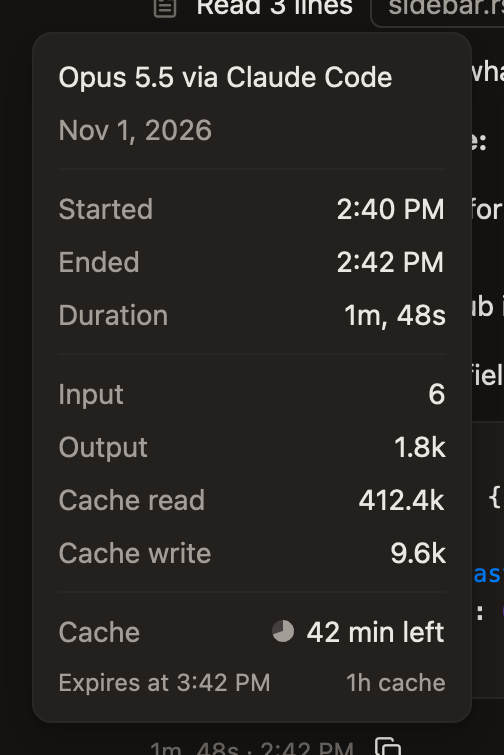

**The newest turn's card once its cache has expired.** *Unconfirmed.*

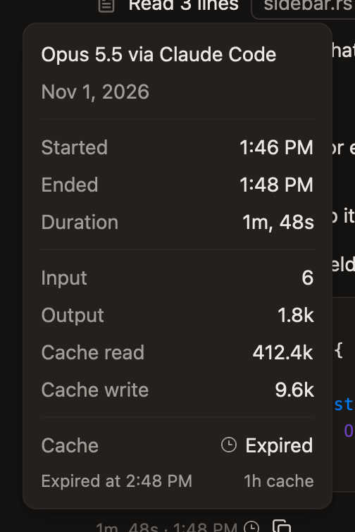

**A chat whose cache is about to expire: a wedge on the newest reply's line, and a clock on its tab and its workspace's row.** *Unconfirmed.*

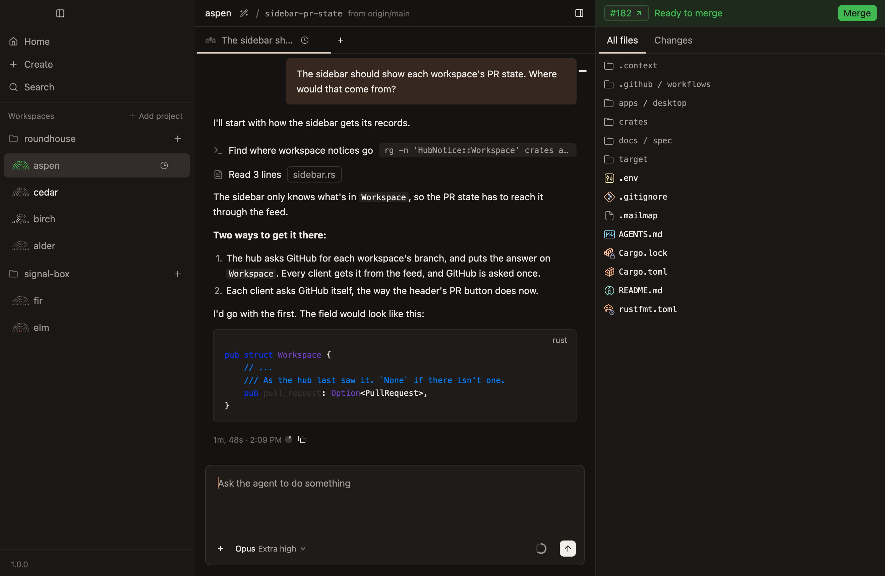

**A chat whose cache has expired: a clock on the newest reply's line, and a line above the composer.** *Unconfirmed.*

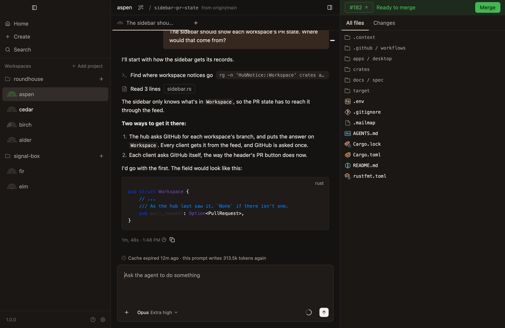

**A prompt sent after the chat had been idle for over an hour, which found the cache expired.** *Unconfirmed.*

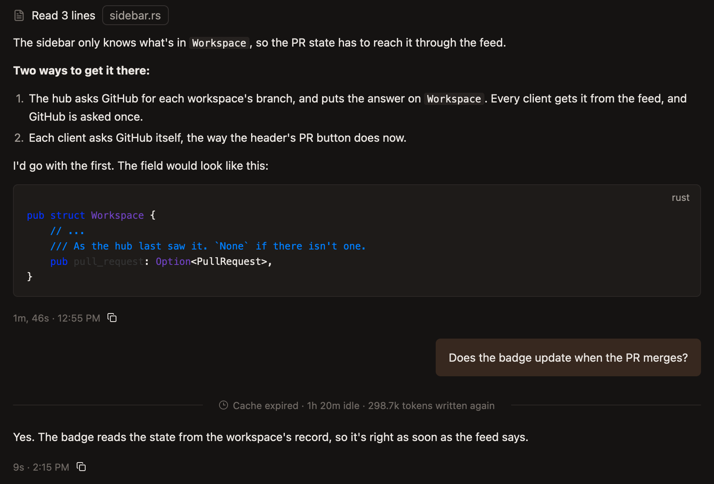

## Tabs

- **The chat showing is underlined, not filled.** A 2px pale copper line runs under its tab, over the bar's bottom edge, and its title looks as it does when it isn't showing, as `look.md` says for lists. A fill would make the tab one more raised thing on the pane.
- **A tab's close button shows only while the pointer is over the tab,** the one showing included, so the row reads as a row of titles. `Cmd-W` closes the chat showing without it.
- **Every tab is 200px wide,** with its mark and as much of its title as fits, so the row doesn't shift when a chat gets its title. *Unconfirmed.*

**Three chats, with the pointer over one that isn't showing.** *Unconfirmed.*

## Closing chats, and keys

- **Closing a chat stops its agent and keeps its history.** Closing the last one starts a new one rather than leaving nothing, and a workspace's first chat is found or made by the hub, so two clients opening a workspace at once share one chat. *Unconfirmed.*
- **Closing a chat nothing has been sent in deletes it,** since it has nothing to go back to, so new chats opened and closed unused don't pile up among the closed ones. A prompt queued counts as sent, and a title typed by hand doesn't. A file added for a prompt that never arrived goes with the chat, since nothing shows it.
- **A closed chat is reopened from the history button at the far end of the tabs,** which shows once a chat is closed and stays put as chats open and close. It's a muted icon with no fill, which brightens while the pointer is over it or its menu is open. The menu lists the closed chats, the most recently closed first, each with its title, how long ago it was closed, such as `9m ago`, and an icon saying a click reopens it. A row has no mark, because a mark says what a chat's agent is doing, and closing a chat stops its agent. *Unconfirmed.*
- **Chat keys are the ones tabs use elsewhere:** `Cmd-T` for a new chat, `Cmd-W` to close one, and `Ctrl-Tab` and `Ctrl-Shift-Tab` to move between them. *Unconfirmed.*

**Two closed chats, in the history button's menu.** *Unconfirmed.*

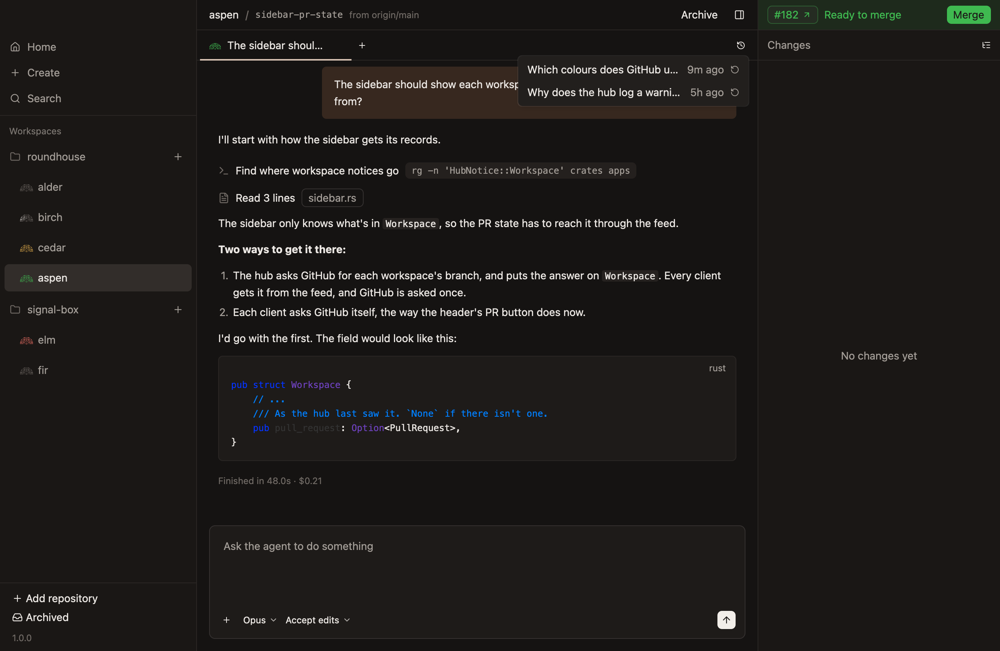
