# Components

The pieces screens are built from, on the foundations in `look.md`: what each is, what it comes in, and how each of its states looks and what it means. Each area's file says where it uses them.

## Buttons

- **Each area has at most one main action,** with a light fill and dark text, such as Create PR, Send, Add project or Send to agent. With one obvious next step per area, nothing competes with it.
- **Every other button is borderless until hovered.** A button with an outline opens something, like the pull request. The button back down to a chat's end has an edge at rest, since it sits over the chat's text, as `chats.md` says.
- **A borderless or outlined button lights with a wash of the text's colour:** `text` at 6% under the pointer, 12% pressed and 9% on. A wash shows on whatever ground the button is on, whether it's the pane, the sidebar or a card. An outlined button is clear at rest, so only its edge shows.

  **The workspace's header, with the pointer on the button that hides the sidebar of changes, which fills under it.** *Unconfirmed.*

  

### Kinds

- **Every button is of a kind, for what it's for,** so two buttons that do the same kind of thing look the same, wherever they are. `look::ButtonKind` holds the kinds. A kind says everything about how a button looks but its size and its state, so a button's look is one of the names below, rather than a colour chosen where it's drawn. A Copy button is the kit's own, as below. *Unconfirmed.*

- **The answer that removes or forgets what can't be had back from where it's asked is filled in the error's colour,** with the main action's dark text, in the main action's place, as the owner decided, from pictures of four, so it can't be taken for an ordinary yes. Disconnecting an account, removing a GitHub app and quitting with something unsent are, and closing or moving a chat, whose history stays, or archiving a workspace, which can be had back, aren't. It's lighter under the pointer, 85%, and pressed, 70%, as a pull request's coloured main action is.

**Every kind of button, by its name.** Each is a kind in `look::ButtonKind`. *Unconfirmed.*

| Name | For |
|---|---|
| `Main` | An area's one main action, with a light fill and dark text, such as Create PR, Send, Add project or Send to agent |
| `Borderless` | An ordinary button, with no edge or fill until the pointer is on it, in the text's colour, such as the one that hides the sidebar, setup's or the update card's |
| `Quiet` | A borderless button whose words and icon are muted, among what it's beside, such as Home's choices of what to show, a row's own buttons or a project's `+` |
| `Faint` | A borderless button whose words and icon are faint, in the heading over a list, such as the sidebar's Add project, or at the window's foot, such as Help and Settings |
| `Outlined` | One that opens something, such as the pull request or a menu of choices, with an edge |
| `Edged` | An answer that isn't the main one, to what stands on its own, such as a dialog's Not now, a plan's choices or a failed request's Retry, with an edge and a dark fill |
| `Removes` | The answer that removes or forgets what can't be had back from where it's asked, such as Disconnect, Remove or Quit with something unsent, filled in the error's colour with dark text, in the main action's place |

**Every kind of button in every state, at the regular size: at rest, under the pointer, pressed, on, as the button that opens a menu is while it's open, off, and waiting, as the app draws each.** The pointer is over each one under it, and presses each pressed one, one at a time, for real. *Unconfirmed.*

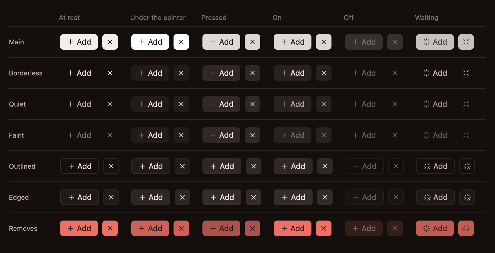

### Copy buttons

- **Every Copy button has the same borderless cutout, icon and feedback,** whether it copies a prompt, code, a command, a final reply or a workspace's path, so the action is recognisable wherever it appears. Its 24px square holds a 14px copy icon at 80% opacity. A pane-coloured surround with 6px corners reaches 1px beyond it without taking layout space. The button fills under the pointer and shows a check after copying. Each area's rules say where it sits and whether it appears only on hover.

**Copy in a code block and beside the finished reply, with the pointer over the code.**

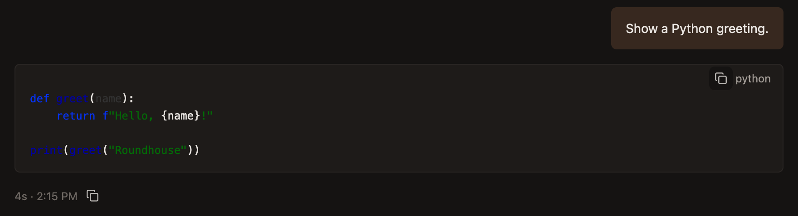

### Sizes

- **Every button is one of a control's sizes, for where it sits,** as `look.md` has them, so the buttons in the same kind of place are the same size, wherever it is. Its words are the kind of text its size says, with an icon beside them of the size of the same name, as the table of an icon's sizes in `look.md` has it: a small icon on a small button, a regular one on a regular button and a large one on a large button. One that's only an icon is a square, as wide as it's tall, whose own icon is regular, or large on a large one. *Unconfirmed.*
- **A borderless button that's in line with text or marks under it or across from it stands out past its own room,** so its words or its icon line up with them, rather than that room in from them: Restart now under the update card's text, setup's last button across from its message, as far in from the strip's end as the message is from its start, the arrows over a question, on the panel's edge inside, and the button that sets out Changes' files, over the marks of the rows under it. Its fill, as the pointer lights it, then reaches past them by that room. *Unconfirmed.*

## Keys

- **A key to press is shown where it's pressed, as the system it's on writes keys,** so the same key reads the same everywhere: Cmd on a Mac and Ctrl elsewhere, Return as `⏎`, and Escape as `Esc` everywhere, as the owner decided, since the Mac's symbol for it reads as undo. A key on its own, beside what it does, is on a small raised key, such as `⌘ F` at the end of Settings' search. A key after a button's words is written as text, in the button's colour, such as Return after Create and after a comment's Comment and Save. `look::KeyKind` holds the kinds. A tooltip's key is `Plain`, in muted text. The keys in the kit's menus are the kit's own, written as text. *Unconfirmed.*

**Every kind of key, by its name.** Each is a kind in `look::KeyKind`. *Unconfirmed.*

| Name | For |
|---|---|
| `Capped` | On a small raised key of its own, 16px tall, with what's held smaller than the key pressed on a Mac, as on its keys, set on its own beside what it does, such as `⌘ F` at the end of Settings' search |
| `Plain` | Written as text, in the colour of what it's in, such as the Return after the words of the button it presses |

**Every kind of key, as the app draws it, with Find, Return and Shift-Tab.** *Unconfirmed.*

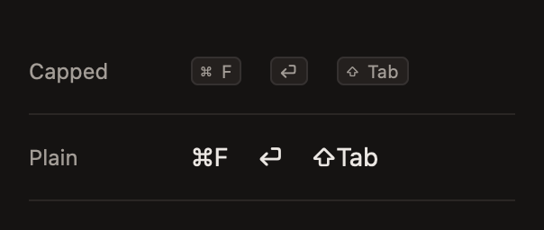

## Toggles

- **A setting that's on or off is a toggle, flipped where it's shown,** such as Settings' Keep computer awake. On is the main action's light fill under a knob in the pane's colour. Off is a dark track under a knob in the muted text's colour, so an off toggle still reads as one, as the owner decided. One that's greyed out can't be flipped, and still shows whether it's on, under the arrow, as `look.md` says. `look::Toggle` is it. *Unconfirmed:* the knob in the pane's colour while it's on.

  **A toggle on, off, and each greyed out.** *Unconfirmed.*

  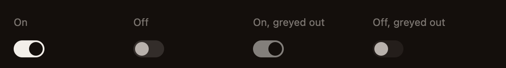

## Switches

- **A choice of one of a few is a switch, its segments in a row, with the one chosen on,** such as the diff's views, the image comparison's and where a GitHub app is made. Each segment is a borderless button, with an icon or words, so it lights under the pointer and is on while it's chosen as any button is. `look::SwitchKind` holds the kinds, as the owner decided: one on a track, as the diff's, and one without, as the image comparison's. Where a GitHub app is made is a switch without a track rather than a pair of radios, as the owner decided, so choosing one of a few looks the same wherever it is. A track there would be the card's own colour, so it wouldn't show.

**Every kind of switch, by its name.** Each is a kind in `look::SwitchKind`. *Unconfirmed.*

| Name | For |
|---|---|
| `Tracked` | Its segments small, on a raised track as tall as a regular button, such as the diff's views at the right end of a file's path |
| `Trackless` | Its segments regular borderless buttons, with nothing around them, such as the image comparison's or where a GitHub app is made |

**Every kind of switch, as a switch of icons and of words, with the first chosen.** *Unconfirmed.*

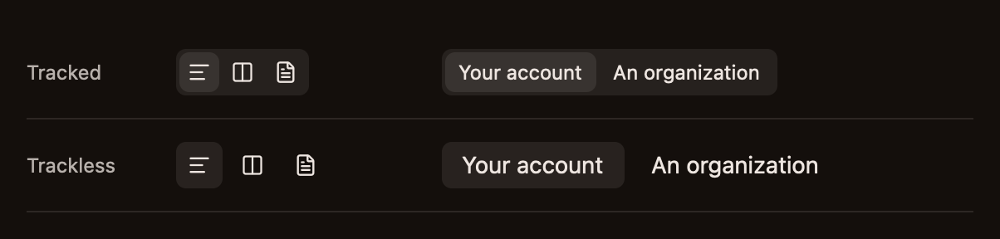

## Fields

- **A field on its own is boxed, and one in what frames it is bare,** as the owner decided. A boxed field has the edge of something to use, a faint fill and a copper ring while it's typed in, such as the rename dialog's, a setting's and Settings' search. A bare field is set in something that frames it already, such as Home's search in its bar and the find bar's, so it has none of them. `look::FieldKind` holds the kinds. *Unconfirmed:* the fill, `control_edge` at 30%, and the edge turning copper with the ring.
- **A field is one of a control's sizes, as tall as the buttons beside it,** as the owner decided: large in a dialog, regular in a setting's panel and Settings' search, and small in the find bar. What's typed is its size's kind of text, it leaves its size's room at each end, and an icon before what's typed, such as a search's, is as big as a square's icon of its size, in the muted text's colour. *Unconfirmed.*
- **What a field says while it's empty is faint, as a hint is,** such as Search settings, as the owner decided. So is what the composer says while it's empty.

**Every kind of field, by its name.** Each is a kind in `look::FieldKind`. *Unconfirmed.*

| Name | For |
|---|---|
| `Boxed` | On its own, with an edge and a faint fill, and a copper ring while it's typed in, such as a dialog's, a setting's or Settings' search |
| `Bare` | Set in something that frames it already, with no edge, fill or ring of its own, such as Home's search in its bar or the find bar's |

**Every kind of field in every state, at the regular size: empty, with something typed, typed in and off, as the app draws each.** Each typed in is pressed for real, one at a time. *Unconfirmed.*

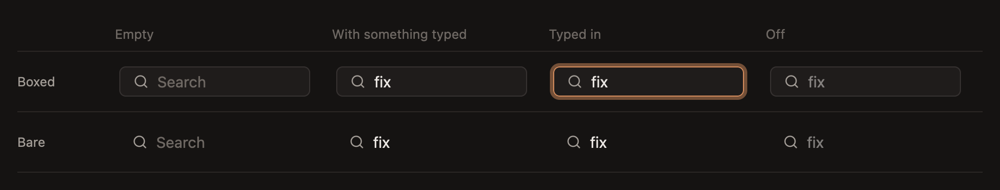

## Menus

- **A menu's rows are as tall as a large control, with room to read and to aim at,** as the owner decided, from pictures of four, since menus are used all over and were among the weakest things to look at. A row's icon is a large icon, in the muted text's colour, then the row's words, in body text, and its key or a note faint at its end. A label over some rows is as tall as a row, in the muted text's colour. A thin line separates groups of rows. *Unconfirmed:* the room at each end of a row, 12px, and between its icon and its words, 8px.
- **A row has an icon where it tells that row from the others in its menu,** such as Rename's pencil beside Archive's box, or what a row names, such as a hub's machine. Where every row does the same, such as closed chats', which each reopen a chat, none has one, since the same icon on each would tell none apart, and what the menu is for is said by what opens it. *Unconfirmed.*
- **A row that's chosen has a check at its very end, after its key or its note, and only that row makes room for it,** as the owner decided, so the rows that can't be chosen, such as the hub switcher's Pair and Connect, start where the rest do, and a note, such as a hub's address, sits at the menu's edge until its row is chosen. The check is a large icon, in the text's colour.
- **A menu is what opens over the rest, with a card's corners, the one thin edge and the one shadow,** and its rows sit 4px in from its edge, with a control's corners, so they follow the menu's. *Unconfirmed.*
- **The row under the pointer, or chosen with the keyboard, is washed as a borderless button is,** `text` at 6%, as the owner decided, so it shows on the menu as a button's does on whatever it's on, where the grey a step above the menu barely did.
- **A note at a row's end says something about what the row names, in a detail's text, and its kind says its colour:** faint for a detail, such as a hub's address or how long ago a chat was closed, the text's colour and stronger for how many need a look, and the error's for what went wrong. A row's words are cut short where they're long, so its note stays. `look::NoteKind` holds the kinds. *Unconfirmed.*
- **Every menu is filled with `look`'s rows,** so none draws a row of its own, such as the hub switcher's and closed chats' once did. *Unconfirmed.*

**Every kind of note at a menu's row's end, by its name.** Each is a kind in `look::NoteKind`. *Unconfirmed.*

| Name | For |
|---|---|
| `Detail` | Something to know about what the row names, faint, such as a hub's address or how long ago a chat was closed |
| `Count` | How many need a look, in the text's colour and stronger, such as the workspaces on another hub |
| `Failure` | What went wrong, in the error's colour, such as a hub that can't be reached |

**Every kind of row: an icon and a key, an icon, one that's off, a label over rows to choose one of, the one chosen checked, and a note; a shorter menu with the pointer on Rename…; and each kind of note.** *Unconfirmed.*

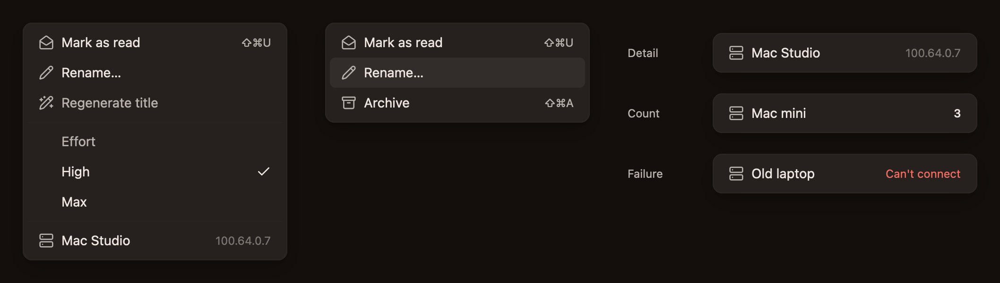

## Dialogs

- **Every dialog is laid out the same,** as the owner decided, from pictures of four: raised, with a card's corners and the one thin edge, 24px in from its edge all round. Its title is a heading, with what it says under it in muted text, then what's in it, such as a field, 16px under, and its answers along its foot, at its end, with the one that confirms last. Anything else at its foot, such as a link to read more, is at the foot's start. It has no close button, since its answers, Escape and a click outside it close it. *Unconfirmed:* 4px between its title and what it says, and 16px between what's in it and its foot.

  **Renaming a workspace: a field, Cancel and Rename.** *Unconfirmed.*

  

  **Asking before restarting now: what it says, Not now and Restart now.** *Unconfirmed.*

  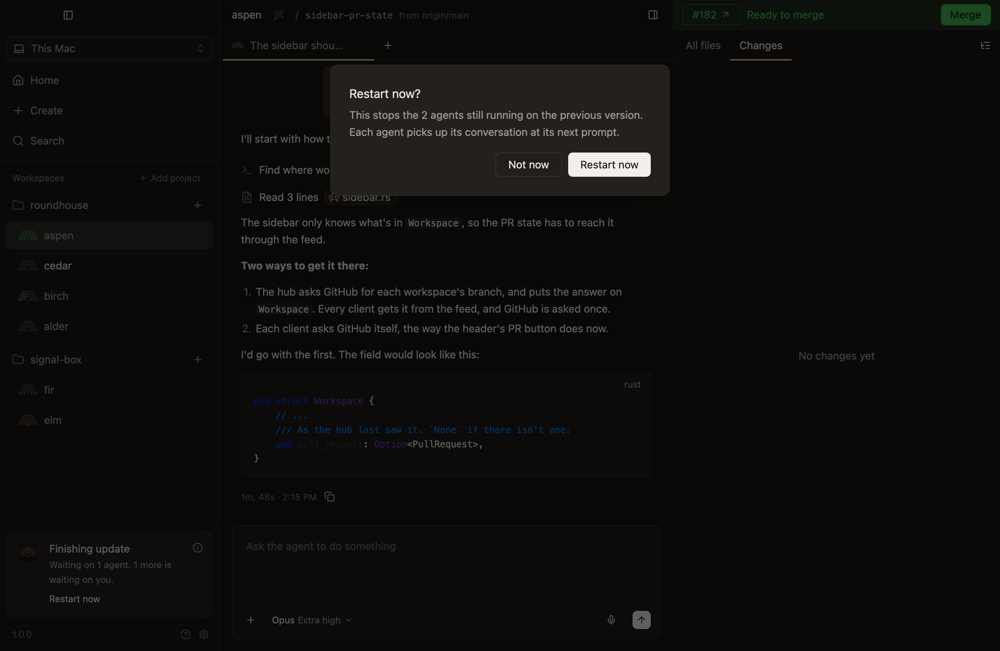

- **The app asks and tells in its own dialogs, never in the system's alert,** as the owner decided, so each looks and answers like the rest of the app: disconnecting an account, removing a GitHub app, quitting, archiving anyway, closing or moving a chat whose agent is working, what went wrong deleting dictation's model or saving settings, and About Roundhouse. The system's own windows for choosing a file stay.
- **Enter confirms a dialog, as its last answer does, and Escape closes it, as Cancel does,** but in a dialog that asks before stopping or losing something, where Enter keeps things as they are, as Escape does, so a key pressed without reading loses nothing. A dialog that can't be confirmed yet, such as a rename with nothing typed, stays open. *Unconfirmed.*
- **A dialog that's only what's in it draws all of itself,** with the one shadow a dialog has: the new workspace's composer, in the composer's fill and corners, and an image opened from a chat, at its own size, in the middle of the window, which a click on closes. *Unconfirmed.*
- **A dialog is as wide as what it holds needs, of three widths,** unless the window is narrower. `look::DialogWidth` holds them. *Unconfirmed.*

**Every width of dialog, by its name.** Each is a width in `look::DialogWidth`. *Unconfirmed.*

| Name | Width | For |
|---|---|---|
| `Small` | 360px | A question and its answers, with nothing in it, such as closing a chat whose agent is working |
| `Regular` | 448px | What most dialogs hold: a field, a line or two and its answers, such as renaming a chat |
| `Wide` | 512px | What a line of its own runs across, or three answers, such as sharing the hub's link |

**Every width of dialog, with a dialog of each: a question, one whose answer removes, and sharing the hub's link.** *Unconfirmed.*

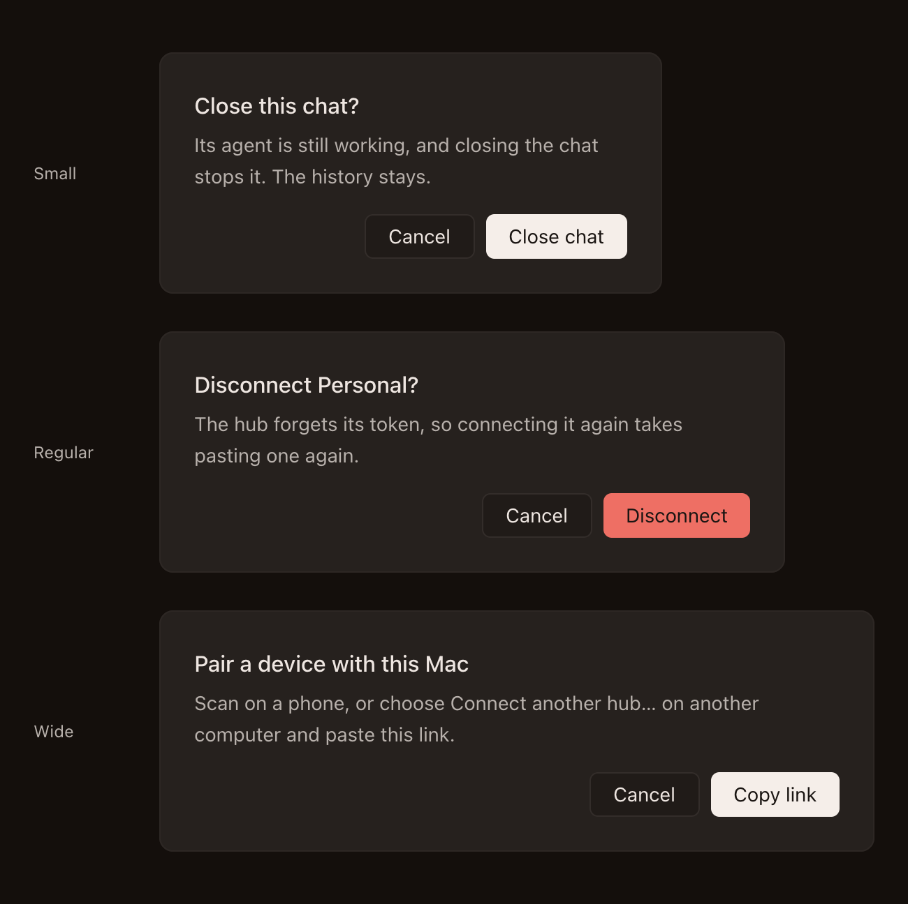

## Tooltips

- **A tooltip says a few words about what the pointer rests on,** as the owner decided, such as what a button does, and the key that does the same, if there's one, at its end. What needs more than a line or two, such as a path, what went wrong or how something works, goes on a hover card, which follows rules of its own, so a tooltip stays something read at a glance.
- **A tooltip is raised, with a control's corners, the one thin edge and the one shadow, in a detail's text,** 8px in from its edge at each end and 4px at the top and bottom, and wraps past 320px, so a sentence that slips in stays readable. Its key is written as text, in muted text, 12px after its words, as the owner decided.
- **Every tooltip is `look`'s,** as the owner decided, so none is drawn in the kit's own look.
- **A hover card that says what a tooltip has no room for is raised, as the app's other cards are, 300px wide,** as the owner decided, with what it's about in body text and stronger, then what it says in muted detail text, or a path in code's type, wrapped, with the button that copies it: the file tab's path, what went wrong updating, what the version says of another hub, and where a checkout's build was made and keeps its data.

**Every tooltip: words, words with their key, Escape, and words that run past its widest and wrap.**

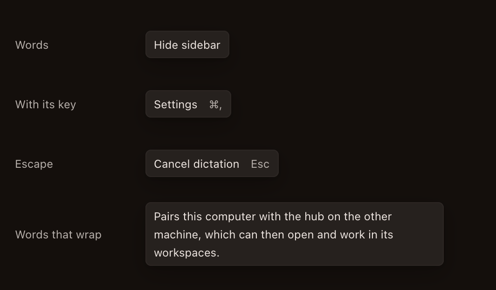

## Small things in a line

- **Five kinds of small thing sit in a line, each for one job,** as the owner decided, so what one is says what it does: a pill is a value as it was written, a chip a thing the app knows, which opens, a badge what's true of the thing beside it, a label a tag someone chose, and a count how many. They're told apart by their shape as well as their words: a pill is filled, a chip filled with an edge, a badge tinted and smaller, a label round, and a count bare.

### Pills

- **A pill is a value as it was written, such as a command, a search's pattern or what a web search asked,** filled, in code's type, with a control's corners, 20px tall, 8px in from each end, and cut short with an ellipsis where it has no room. It opens nothing, and is selected and copied as text. Its kind says its colours. `look::PillKind` holds the kinds. *Unconfirmed:* its height and room.

**Every kind of pill, by its name.** Each is a kind in `look::PillKind`. *Unconfirmed.*

| Name | For |
|---|---|
| `Plain` | A value as it was written, muted on the raised fill, such as a command, a search's pattern or what a web search asked |
| `Failure` | What went wrong, as it was said, in the error's colour on a faint fill of it, such as a call's error under its line |

**Every kind of pill, with a command and an error.** *Unconfirmed.*

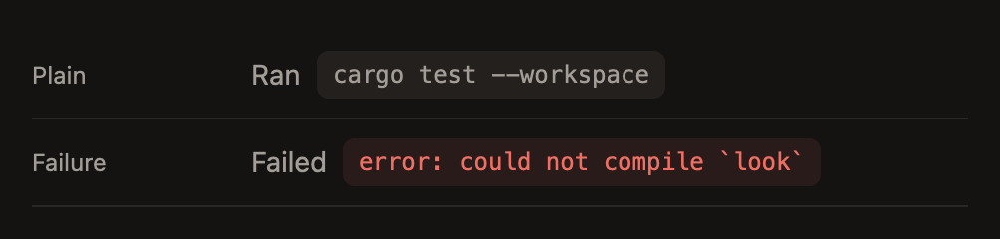

### Chips

- **A chip is a thing the app knows, such as a file or a subagent, in one frame whatever its kind,** as the owner decided, so a line with different chips reads as one system: filled with the one edge for something to use, a control's corners, 20px tall, as a pill is, with its kind's mark, then its name in body text, then what's said of it. Its kind says its mark and what it shows of what it names, such as a path's last part. `look::ChipKind` holds the kinds. *Unconfirmed:* its height and room. *Not built:* a click that opens it, its card on hover and its menu, the chips for an issue, a pull request, a workspace, a branch and a commit, and a file's folder where two files in view share a name.
- **A file's chip always has the icon for its kind, and says what more there is to say of it,** as the owner decided: the lines a call named, after its name, such as `model.rs :12–40`, and the lines a change added and removed, such as `model.rs +12 −3`. A deleted file's name is struck through.

**Every kind of chip, by its name.** Each is a kind in `look::ChipKind`. *Unconfirmed.*

| Name | For |
|---|---|
| `File` | A file, named by its path: the icon for its kind, then its name, such as a call's file |
| `Folder` | A folder, named by its path: the folder's icon, then its name, such as where a search looked |
| `Subagent` | A subagent, by its kind or what it's for: the robot, then its words, such as `Explore` |
| `Server` | An MCP server a tool is from: a plug, then its name, such as `github` |
| `Site` | A site, by its address's host: a globe, then the host, such as what a fetch read |

**Every kind of chip, and a file's chip with the lines it's about, with what changed in it, and deleted.** *Unconfirmed.*

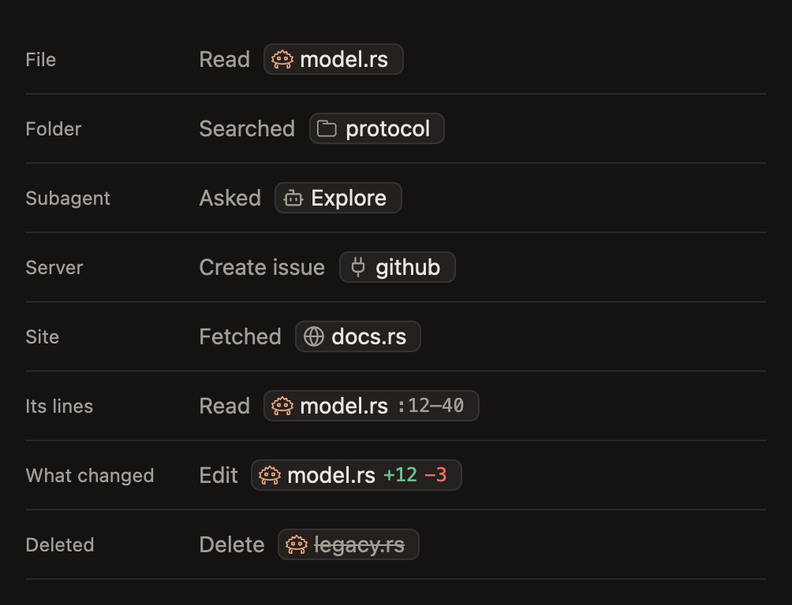

### Badges and labels

- **A badge says what's true of the thing beside it, in a word or two, such as `Default` beside an account,** tinted in its kind's tone, with no edge, in a detail's text and stronger, 18px tall, so it reads as said of the thing rather than a thing of its own. It opens nothing. `look::BadgeKind` holds the kinds. *Unconfirmed:* its height and tints.
- **A label is a tag someone chose, such as a GitHub label, tinted in the colour they gave it,** with an edge and a fill of that hue, faint, and its words in it, as light whatever the colour, so a pale yellow and a dark red read alike. It's round, since its colour is theirs rather than the app's, and as tall as a badge. *Unconfirmed:* its tints, and how light its words are.

**Every kind of badge, by its name.** Each is a kind in `look::BadgeKind`. *Unconfirmed.*

| Name | For |
|---|---|
| `Plain` | Something that's simply so, muted on a faint wash of the text's colour, such as `Default` beside an account |
| `Warning` | Something to watch, in the warning's colour on a faint fill of it, such as a login that ends soon |
| `Failure` | Something that went wrong, in the colour of an agent that stopped short on a faint fill of it, such as how many times in a row a request to the model failed |

**Every kind of badge, beside what it's said of, and labels in four colours.** *Unconfirmed.*

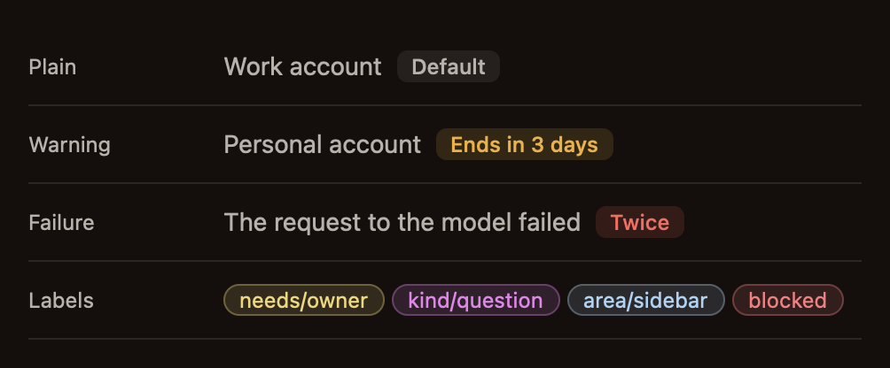

### Counts

- **A count is how many, as a number in the text, never in a box,** in a detail's text, and its kind says its colour and weight. One beside text of another size, such as a tab's name, sits on its baseline. `look::CountKind` holds the kinds. *Unconfirmed.*
- **The lines a file gained and lost are `+12 −3`, in the added and removed colours, in code's type, 4px apart,** with a minus sign rather than a hyphen, and whichever is none left out, wherever they're drawn. *Unconfirmed.*

**Every kind of count, by its name.** Each is a kind in `look::CountKind`. *Unconfirmed.*

| Name | For |
|---|---|
| `NeedsALook` | How many need a look, in the text's colour and stronger, such as a collapsed project's workspaces |
| `HowMany` | Only how many there are, muted, such as the files Changes lists |

**Every kind of count beside what it counts, and the lines a file gained and lost.** *Unconfirmed.*

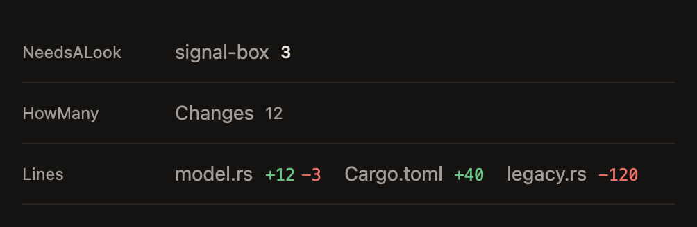

## The status mark

Every workspace and chat has a mark: a half circle of fine dots around a turntable, like a roundhouse seen from above. It has four rows of 9, 13, 17 and 21 dots, the same distance apart along every row. Each row has four more dots than the one inside it, so the fan keeps the same pattern with any number of rows, the rows sit a little further apart than the dots in them, and every row has a dot on the middle line, so the rows line up down it. The inner row has the fewest dots that keep it at least 2/5 of the way out to the outer row, which leaves room for the turntable. Fine dots give it a texture of its own. It's 26px wide in the sidebar, where it fills the room before a workspace's name and its dots are big enough to tell apart at a glance, and 16px in chat tabs, the working line and Home. A much bigger fan, such as the brand in an empty state, has more rows rather than bigger dots, so the texture stays fine, and its turntable stays the same share of its width.

The mark has three layers, and each is about one thing, so several facts can show at once without competing:

| Layer | It's about | What it shows |
|---|---|---|
| The fan's colour | The work | Where the workspace's pull request stands: grey for none, then green, yellow in the merge queue, purple, muted red or a lighter grey, as `look.md` says |
| A white light over the fan | The agent | A light sweeps the fan while the agent works, keeps to the inner row once its turn has ended with something still running, and the fan fills in while the workspace is set up |
| The turntable in red | You | Red when the agent stopped short: it went away mid-turn, or its turn failed, as on a usage limit. It goes back to the fan's colour once that's dealt with, as a turn starts again |

- **Only an agent with something running moves the mark.** Motion says something is going on there, so nothing else moves. While the agent waits on you, the fan holds still. A moving mark is redrawn on every frame of the display, as smoothly as it can show, and the system's Reduce Motion setting holds it still. Pictures of the app hold every mark still at one moment, so they come out the same every time.
- **Only the pull request changes the colour of a workspace's fan,** so the colour always means one thing, and matches the bar. What's about you is on the turntable and the name, which leave the fan as it is.
- **A chat's fan is grey,** in its tab and on its working line, since a pull request belongs to the workspace, not to one of its chats. So a chat's mark says only what its agent is doing, and the workspace's mark shows the pull request.
- **The turntable shows one thing at a time:** red, then the white of something still running. *Unconfirmed.*
- **The light sweeps the whole fan only for the agent's own work:** a turn, or a subagent it left going when its turn ended. *Unconfirmed.*
- **Once a turn has ended with anything else still running, the light keeps to the inner row, beside the turntable, which is lit, and goes slower.** A command left running might end by itself, as a test run does, or be held open, as an app is, and the agent doesn't say which. So the mark claims only what's known: something is running there, and it isn't the agent. *Unconfirmed.*
- **A workspace's mark speaks for its open chat with the most going on.** `sidebar.md` has the rule.
- **A reply you haven't read isn't on the mark, and neither is a chat waiting on you.** Both mean the same to you, that it needs a look, so the name beside the mark says that one thing, as `sidebar.md` says, and the chat says which. It shows along with whatever the mark says, such as the light of something the agent left running. That reply might be the agent handing over, such as an app it opened for you to look at, so nothing on the mark hides it.
- **Plan mode's texture is drawn from the mark without keeping to its rule.** Its rows are half circles of fine dots around one centre, with a dot on the middle line of each, but they're further apart than four more dots a row would put them, so each reads as a dotted line, and the dots are only about the same distance apart along every row. At the composer's size, the rule's own rows blur into an even field of dots. `chats.md` has the texture. *Unconfirmed.*
- **A background task has a ring, not a mark:** ten dots around a hub, which is the fan's turntable on its own, 16px wide so what follows it lines up with the working line's. The fan is for an agent, and a task isn't one. `chats.md` says when its light goes round. *Unconfirmed.*
- **A subagent at work in the background has the robot its call's line has instead, with a white light sweeping across it,** so its line reads as the call it came from and plainly says it's at work. The light is the agent's, as it is on the fan, since a subagent is the agent's own work. It crosses the whole robot from left to right, fading at its edges, so its outline lights up as it passes, where the eyes alone are too small to show a change at a glance. It goes at the pace a ring's light goes round, so it doesn't vie with the working line. In pictures and with Reduce Motion, it holds still across the robot's face. It's as wide as the ring, so what follows it lines up too. *Unconfirmed:* how fast it goes, how wide the light is, and where it holds still.

**Every state of the mark, against each colour a pull request gives its fan, at the sidebar's size and Home's, the ring of a background task, and a subagent's robot.** A tab's mark is the `None` column at Home's size. *Unconfirmed.*

## Empty states

- **An empty pane shows the mark in copper, what's missing and why, and the one thing to do about it,** as a main button. The mark is 72px wide there, with five rows.

  **The pane with projects and no workspace yet, which says to start one.** *Unconfirmed.*

  

## The app icon

The brand on a tile, caught working: the fan in copper with the agent's white light partway across it, as a working mark draws it, on a warm dark tile that fades from `#211d1b` at the top to the pane's `#151312`, with the thin edge colour around it.

- **The light sits just right of the middle** of the inner row, with the outer row trailing as far behind as a four-row mark's, at every size. It's held still, so it doesn't say an agent is running. It's the fan as it looks at work, and says what the app is for: many jobs, one being worked on.
- **The fan at rest is a second style,** [without the light](../../apps/desktop/icons/idle.iconset/icon_512x512@2x.png), drawn and checked the same way.

- **Each size has a drawing of its own,** rather than one drawing scaled, because macOS shows each size's own drawing, and a big fan scaled down blurs into a smudge.
- **Smaller drawings have fewer rows,** so the dots stay big enough to see: four at 256 pixels, which the Dock shrinks to under half its size, three at 128 and 64, and two below that. Only the largest drawings, where there are pixels for it, have nine rows of fine dots.
- **Every size follows the status mark's rule,** so there's one geometry in the app and its icon: four more dots a row, the same distance apart along every row, with a dot on the middle line of each. The 16-pixel drawing is the one exception, with one dot fewer in every row and a gap on the middle line instead, since its one-pixel dots can't sit on the line between two pixels.
- **Below 128 pixels it's drawn on whole pixels,** where the fan's own shape would blur: the rule's dots moved onto whole pixels as squares, far enough apart that each keeps a pixel clear around it, mirrored across the line between the tile's two middle pixels so the fan sits in the middle, and a turntable that's only its hub where a ring would be too small to see. *Unconfirmed.*
- **macOS mostly uses the smallest drawing with at least the pixels it needs,** and shrinks it to fit, so on a Retina display each drawing covers the sizes up to half its pixels in points. The Dock is the exception: at about 55 points it uses the 256-pixel drawing.

| Pixels | Used on a Retina display | Dots in each row, inside out | Drawn |
|---|---|---|---|
| 1024 and 512 | 129 to 512 points, such as Finder's largest icons | 23, 27, 31 … 55, in nine rows | The fan's shape, 62% of the canvas wide |
| 256 | 65 to 128 points, and the Dock | 9, 13, 17, 21 | The fan's shape, 66% wide |
| 128 | 33 to 64 points | 7, 11, 15 | The fan's shape, 66% wide |
| 64 | 17 to 32 points | 7, 11, 15 | On whole pixels, with dots two pixels square and a ring |
| 32 | 16 points and under, such as a list | 5, 9 | On whole pixels, with dots two pixels square |
| 16 | Only on a display that isn't Retina, at 16 points | 4, 8 | On whole pixels, with dots one pixel square. *Unconfirmed* |

- **It's an `.icns`,** because it keeps a drawing for each size. `look::app_icon` draws each style at every size, and the gallery checks each against its file in the style's iconset in `apps/desktop/icons/`. `tools/package/package.sh` packs the app's, `working.iconset`, into the `.icns` with `iconutil`.
- **On Windows it's an `.ico`, which the program carries as well as the installer,** so the app's windows and their taskbar button show it too. It holds the drawings for 16, 32, 64, 128 and 256 pixels, since an `.ico` holds none larger. `tools/package/ico.py` makes it from `working.iconset` as `apps/desktop/icons/AppIcon.ico`, which is checked in, so building needs no Python, and a test fails once it no longer matches the drawings. *Unconfirmed.*
