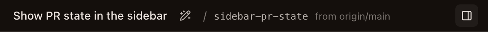
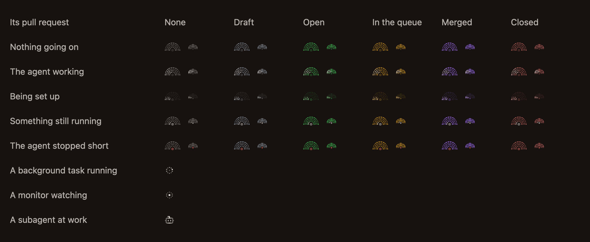
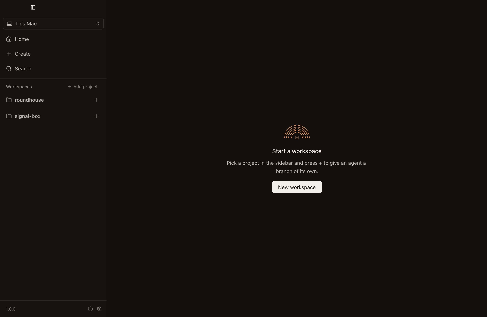

# Components

The pieces screens are built from, on the foundations in `look.md`: what each is, what it comes in, and how each of its states looks and what it means. Each area's file says where it uses them.

## Buttons

Every size a button comes in, and where each goes, is in `look.md`.

- **Each area has at most one main action,** with a light fill and dark text, such as Create PR, Send, Add project or Send to agent. With one obvious next step per area, nothing competes with it.
- **Every other button is borderless until hovered.** A button with an outline opens something, like the pull request. The button back down to a chat's end has an edge at rest, since it sits over the chat's text, as `chats.md` says.

  **The workspace's header, with the pointer on the button that hides the sidebar of changes, which fills under it.** *Unconfirmed.*

  

## The status mark

Every workspace and chat has a mark: a half circle of fine dots around a turntable, like a roundhouse seen from above. It has four rows of 9, 13, 17 and 21 dots, the same distance apart along every row. Each row has four more dots than the one inside it, so the fan keeps the same pattern with any number of rows, the rows sit a little further apart than the dots in them, and every row has a dot on the middle line, so the rows line up down it. The inner row has the fewest dots that keep it at least 2/5 of the way out to the outer row, which leaves room for the turntable. Fine dots give it a texture of its own. It's 26px wide in the sidebar, where it fills the room before a workspace's name and its dots are big enough to tell apart at a glance, and 16px in chat tabs, the working line and Home. A much bigger fan, such as the brand in an empty state, has more rows rather than bigger dots, so the texture stays fine, and its turntable stays the same share of its width.

The mark has three layers, and each is about one thing, so several facts can show at once without competing:

| Layer | It's about | What it shows |
|---|---|---|
| The fan's colour | The work | Where the workspace's pull request stands: grey for none, then green, yellow in the merge queue, purple, muted red or a lighter grey, as `look.md` says |
| A white light over the fan | The agent | A light sweeps the fan while the agent works, keeps to the inner row once its turn has ended with something still running, and the fan fills in while the workspace is set up |
| The turntable in red | You | Red when the agent stopped short: it went away mid-turn, or its turn failed, as on a usage limit. It goes back to the fan's colour once that's dealt with, as a turn starts again |

- **Only an agent with something running moves the mark.** Motion says something is going on there, so nothing else moves. While the agent waits on you, the fan holds still. A moving mark is redrawn on every frame of the display, as smoothly as it can show, and the system's Reduce Motion setting holds it still. Pictures of the app hold every mark still at one moment, so they come out the same every time.
- **Only the pull request changes the colour of a workspace's fan,** so the colour always means one thing, and matches the bar. What's about you is on the turntable and the name, which leave the fan as it is.
- **A chat's fan is grey,** in its tab and on its working line, since a pull request belongs to the workspace, not to one of its chats. So a chat's mark says only what its agent is doing, and the workspace's mark shows the pull request.
- **The turntable shows one thing at a time:** red, then the white of something still running. *Unconfirmed.*
- **The light sweeps the whole fan only for the agent's own work:** a turn, or a subagent it left going when its turn ended. *Unconfirmed.*
- **Once a turn has ended with anything else still running, the light keeps to the inner row, beside the turntable, which is lit, and goes slower.** A command left running might end by itself, as a test run does, or be held open, as an app is, and the agent doesn't say which. So the mark claims only what's known: something is running there, and it isn't the agent. *Unconfirmed.*
- **A workspace's mark speaks for its open chat with the most going on.** `sidebar.md` has the rule.
- **A reply you haven't read isn't on the mark, and neither is a chat waiting on you.** Both mean the same to you, that it needs a look, so the name beside the mark says that one thing, as `sidebar.md` says, and the chat says which. It shows along with whatever the mark says, such as the light of something the agent left running. That reply might be the agent handing over, such as an app it opened for you to look at, so nothing on the mark hides it.
- **Plan mode's texture is drawn from the mark without keeping to its rule.** Its rows are half circles of fine dots around one centre, with a dot on the middle line of each, but they're further apart than four more dots a row would put them, so each reads as a dotted line, and the dots are only about the same distance apart along every row. At the composer's size, the rule's own rows blur into an even field of dots. `chats.md` has the texture. *Unconfirmed.*
- **A background task has a ring, not a mark:** ten dots around a hub, which is the fan's turntable on its own, 16px wide so what follows it lines up with the working line's. The fan is for an agent, and a task isn't one. `chats.md` says when its light goes round. *Unconfirmed.*
- **A subagent at work in the background has the robot its call's line has instead, with a white light sweeping across it,** so its line reads as the call it came from and plainly says it's at work. The light is the agent's, as it is on the fan, since a subagent is the agent's own work. It crosses the whole robot from left to right, fading at its edges, so its outline lights up as it passes, where the eyes alone are too small to show a change at a glance. It goes at the pace a ring's light goes round, so it doesn't vie with the working line. In pictures and with Reduce Motion, it holds still across the robot's face. It's as wide as the ring, so what follows it lines up too. *Unconfirmed:* how fast it goes, how wide the light is, and where it holds still.

**Every state of the mark, against each colour a pull request gives its fan, at the sidebar's size and Home's, the ring of a background task, and a subagent's robot.** A tab's mark is the `None` column at Home's size. *Unconfirmed.*

## Empty states

- **An empty pane shows the mark in copper, what's missing and why, and the one thing to do about it,** as a main button. The mark is 72px wide there, with five rows.

  **The pane with projects and no workspace yet, which says to start one.** *Unconfirmed.*

  
