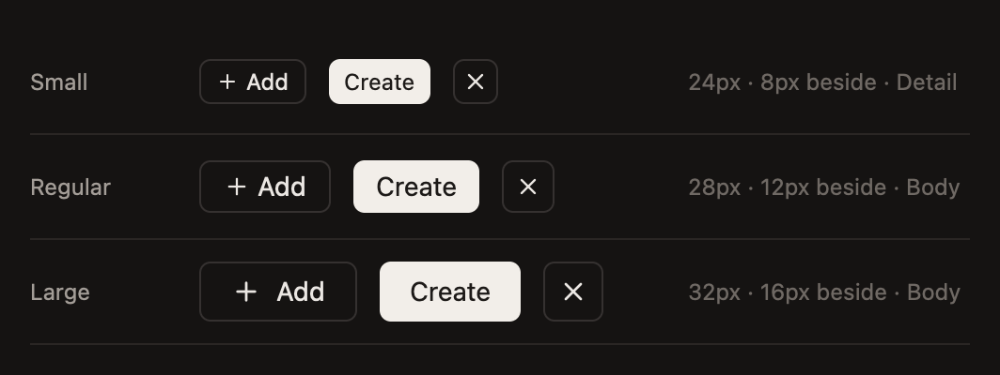
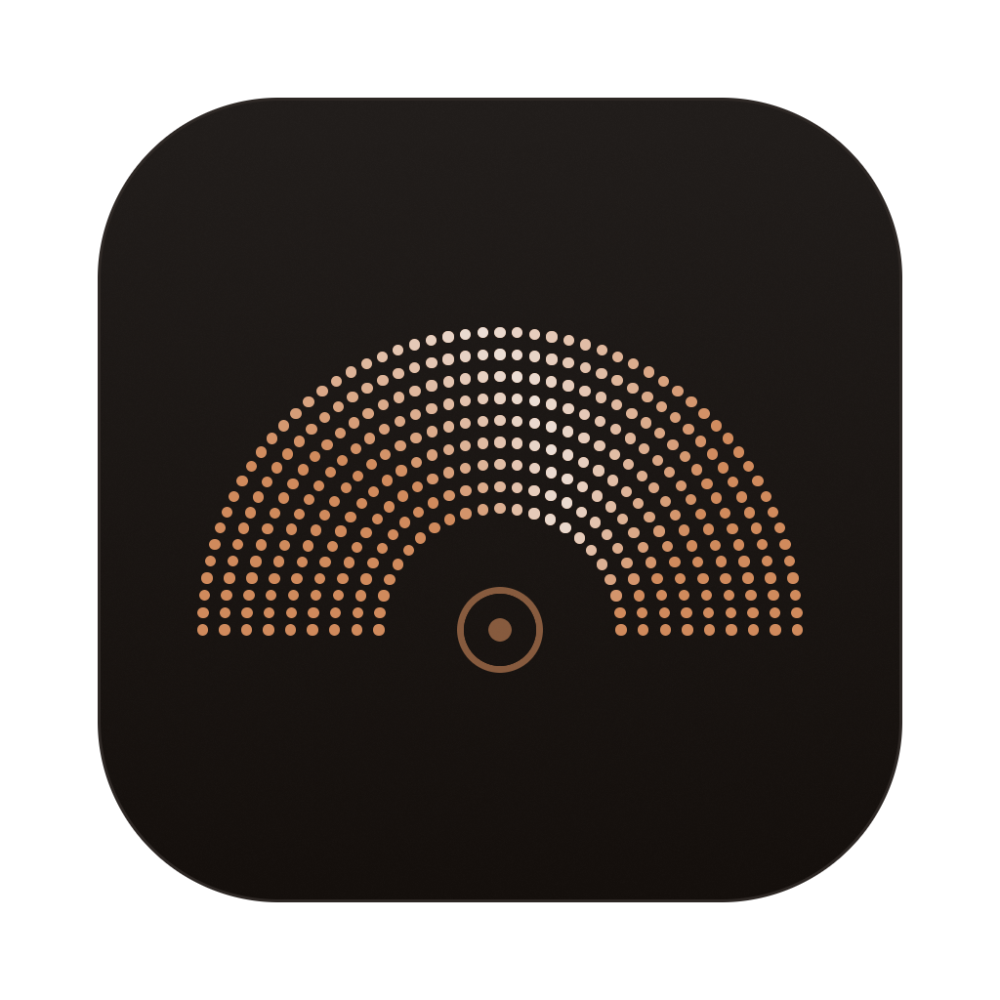

# Components

The pieces screens are built from, on the foundations in `look.md`: what each is, what it comes in, and how each of its states looks and what it means. Each area's file says where it uses them.

## Buttons

- **Each area has at most one main action,** with a light fill and dark text, such as Create PR, Send, Add project or Send to agent. With one obvious next step per area, nothing competes with it.
- **Every other button is borderless until hovered.** A button with an outline opens something, like the pull request. The button back down to a chat's end has an edge at rest, since it sits over the chat's text, as `chats.md` says.
- **A borderless or outlined button lights with a wash of the text's colour:** `text` at 6% under the pointer, 12% pressed and 9% on. A wash shows on whatever ground the button is on, whether it's the pane, the sidebar or a card. An outlined button is clear at rest, so only its edge shows.

  **The workspace's header, with the pointer on the button that hides the sidebar of changes, which fills under it.** *Unconfirmed.*

  

### Kinds

- **Every button is of a kind, for what it's for,** so two buttons that do the same kind of thing look the same, wherever they are. `look::ButtonKind` holds the kinds. A kind says everything about how a button looks but its size and its state, so a button's look is one of the names below, rather than a colour chosen where it's drawn. A Copy button is the kit's own, as below. *Unconfirmed.*

**Every kind of button, by its name.** Each is a kind in `look::ButtonKind`. *Unconfirmed.*

| Name | For |
|---|---|
| `Main` | An area's one main action, with a light fill and dark text, such as Create PR, Send, Add project or Send to agent |
| `Borderless` | An ordinary button, with no edge or fill until the pointer is on it, in the text's colour, such as the one that hides the sidebar, setup's or the update card's |
| `Quiet` | A borderless button whose words and icon are muted, among what it's beside, such as Home's choices of what to show, a row's own buttons or a project's `+` |
| `Faint` | A borderless button whose words and icon are faint, in the heading over a list, such as the sidebar's Add project, or at the window's foot, such as Help and Settings |
| `Outlined` | One that opens something, such as the pull request or a menu of choices, with an edge |
| `Edged` | An answer that isn't the main one, to what stands on its own, such as a dialog's Not now, a plan's choices or a failed request's Retry, with an edge and a dark fill |

**Every kind of button in every state, at the regular size: at rest, under the pointer, pressed, on, as the button that opens a menu is while it's open, off, and waiting, as the app draws each.** The pointer is over each one under it, and presses each pressed one, one at a time, for real. *Unconfirmed.*

### Copy buttons

- **Every Copy button has the same borderless cutout, icon and feedback,** whether it copies a prompt, code, a command, a final reply or a workspace's path, so the action is recognisable wherever it appears. Its 24px square holds a 14px copy icon at 80% opacity. A pane-coloured surround with 6px corners reaches 1px beyond it without taking layout space. The button fills under the pointer and shows a check after copying. Each area's rules say where it sits and whether it appears only on hover.

**Copy in a code block and beside the finished reply, with the pointer over the code.**

### Sizes

- **Every button has a size for where it sits,** so the buttons in the same kind of place are the same size, wherever it is, and each leaves a little room around its words and its icon. A small button is set in a line of text or a row one line tall, a regular one is a bar's or a card's own, set apart from its text, and a large one is on its own. One that's only an icon is a square, as wide as it's tall. `look::ControlSize` holds the sizes. *Unconfirmed.*
- **A borderless button that's in line with text or marks under it or across from it stands out past its own room,** so its words or its icon line up with them, rather than that room in from them: Restart now under the update card's text, setup's last button across from its message, as far in from the strip's end as the message is from its start, the arrows over a question, on the panel's edge inside, and the button that sets out Changes' files, over the marks of the rows under it. Its fill, as the pointer lights it, then reaches past them by that room. *Unconfirmed.*

**Every size of a button, by its name.** Each is a size in `look::ControlSize`, from the smallest. A button's words are the kind of text its row says, with an icon beside them of the size of the same name, as the table of an icon's sizes in `look.md` has it: a small icon on a small button, a regular one on a regular button and a large one on a large button. A square's own icon is regular, or large on a large one. *Unconfirmed.*

| Name | Tall | Room beside its words | Words | For |
|---|---|---|---|---|
| `Small` | 24px | 8px | Detail | Set in a line of text or a row one line tall: a row of a list, a tab, the heading over a list, a call's line in the chat, a line of a card's text, the composer's bar, the find bar, setup's strip and a fold, and the window's own buttons in its corner, beside the Mac's. A switch's segments are small, so the switch, with the room around them, is as tall as a regular button |
| `Regular` | 28px | 12px | Body | A bar's own, along a pane's edge, such as a header's, a tab bar's, the pull request's bar's or Home's bar's, or a card's or a page's own action, set apart from its text, such as the update card's, a comment's on a diff, a setting's or a list's of accounts, and the button over the chat back to its end |
| `Large` | 32px | 16px | Body | On its own: a dialog's buttons, the one thing an empty pane says to do, and what answers a card in the chat, such as approving a plan or retrying a request |

**Every size of a button, as the app draws it.** *Unconfirmed.*

## The status mark

Every workspace and chat has a mark: a half circle of fine dots around a turntable, like a roundhouse seen from above. It has four rows of 9, 13, 17 and 21 dots, the same distance apart along every row. Each row has four more dots than the one inside it, so the fan keeps the same pattern with any number of rows, the rows sit a little further apart than the dots in them, and every row has a dot on the middle line, so the rows line up down it. The inner row has the fewest dots that keep it at least 2/5 of the way out to the outer row, which leaves room for the turntable. Fine dots give it a texture of its own. It's 26px wide in the sidebar, where it fills the room before a workspace's name and its dots are big enough to tell apart at a glance, and 16px in chat tabs, the working line and Home. A much bigger fan, such as the brand in an empty state, has more rows rather than bigger dots, so the texture stays fine, and its turntable stays the same share of its width.

The mark has three layers, and each is about one thing, so several facts can show at once without competing:

| Layer | It's about | What it shows |
|---|---|---|
| The fan's colour | The work | Where the workspace's pull request stands: grey for none, then green, yellow in the merge queue, purple, muted red or a lighter grey, as `look.md` says |
| A white light over the fan | The agent | A light sweeps the fan while the agent works, keeps to the inner row once its turn has ended with something still running, and the fan fills in while the workspace is set up |
| The turntable in red | You | Red when the agent stopped short: it went away mid-turn, or its turn failed, as on a usage limit. It goes back to the fan's colour once that's dealt with, as a turn starts again |

- **Only an agent with something running moves the mark.** Motion says something is going on there, so nothing else moves. While the agent waits on you, the fan holds still. A moving mark is redrawn on every frame of the display, as smoothly as it can show, and the system's Reduce Motion setting holds it still. Pictures of the app hold every mark still at one moment, so they come out the same every time.
- **Only the pull request changes the colour of a workspace's fan,** so the colour always means one thing, and matches the bar. What's about you is on the turntable and the name, which leave the fan as it is.
- **A chat's fan is grey,** in its tab and on its working line, since a pull request belongs to the workspace, not to one of its chats. So a chat's mark says only what its agent is doing, and the workspace's mark shows the pull request.
- **The turntable shows one thing at a time:** red, then the white of something still running. *Unconfirmed.*
- **The light sweeps the whole fan only for the agent's own work:** a turn, or a subagent it left going when its turn ended. *Unconfirmed.*
- **Once a turn has ended with anything else still running, the light keeps to the inner row, beside the turntable, which is lit, and goes slower.** A command left running might end by itself, as a test run does, or be held open, as an app is, and the agent doesn't say which. So the mark claims only what's known: something is running there, and it isn't the agent. *Unconfirmed.*
- **A workspace's mark speaks for its open chat with the most going on.** `sidebar.md` has the rule.
- **A reply you haven't read isn't on the mark, and neither is a chat waiting on you.** Both mean the same to you, that it needs a look, so the name beside the mark says that one thing, as `sidebar.md` says, and the chat says which. It shows along with whatever the mark says, such as the light of something the agent left running. That reply might be the agent handing over, such as an app it opened for you to look at, so nothing on the mark hides it.
- **Plan mode's texture is drawn from the mark without keeping to its rule.** Its rows are half circles of fine dots around one centre, with a dot on the middle line of each, but they're further apart than four more dots a row would put them, so each reads as a dotted line, and the dots are only about the same distance apart along every row. At the composer's size, the rule's own rows blur into an even field of dots. `chats.md` has the texture. *Unconfirmed.*
- **A background task has a ring, not a mark:** ten dots around a hub, which is the fan's turntable on its own, 16px wide so what follows it lines up with the working line's. The fan is for an agent, and a task isn't one. `chats.md` says when its light goes round. *Unconfirmed.*
- **A subagent at work in the background has the robot its call's line has instead, with a white light sweeping across it,** so its line reads as the call it came from and plainly says it's at work. The light is the agent's, as it is on the fan, since a subagent is the agent's own work. It crosses the whole robot from left to right, fading at its edges, so its outline lights up as it passes, where the eyes alone are too small to show a change at a glance. It goes at the pace a ring's light goes round, so it doesn't vie with the working line. In pictures and with Reduce Motion, it holds still across the robot's face. It's as wide as the ring, so what follows it lines up too. *Unconfirmed:* how fast it goes, how wide the light is, and where it holds still.

**Every state of the mark, against each colour a pull request gives its fan, at the sidebar's size and Home's, the ring of a background task, and a subagent's robot.** A tab's mark is the `None` column at Home's size. *Unconfirmed.*

## Empty states

- **An empty pane shows the mark in copper, what's missing and why, and the one thing to do about it,** as a main button. The mark is 72px wide there, with five rows.

  **The pane with projects and no workspace yet, which says to start one.** *Unconfirmed.*

  

## The app icon

The brand on a tile, caught working: the fan in copper with the agent's white light partway across it, as a working mark draws it, on a warm dark tile that fades from `#211d1b` at the top to the pane's `#151312`, with the thin edge colour around it.

- **The light sits just right of the middle** of the inner row, with the outer row trailing as far behind as a four-row mark's, at every size. It's held still, so it doesn't say an agent is running. It's the fan as it looks at work, and says what the app is for: many jobs, one being worked on.
- **The fan at rest is a second style,** [without the light](../../apps/desktop/icons/idle.iconset/icon_512x512@2x.png), drawn and checked the same way.

- **Each size has a drawing of its own,** rather than one drawing scaled, because macOS shows each size's own drawing, and a big fan scaled down blurs into a smudge.
- **Smaller drawings have fewer rows,** so the dots stay big enough to see: four at 256 pixels, which the Dock shrinks to under half its size, three at 128 and 64, and two below that. Only the largest drawings, where there are pixels for it, have nine rows of fine dots.
- **Every size follows the status mark's rule,** so there's one geometry in the app and its icon: four more dots a row, the same distance apart along every row, with a dot on the middle line of each. The 16-pixel drawing is the one exception, with one dot fewer in every row and a gap on the middle line instead, since its one-pixel dots can't sit on the line between two pixels.
- **Below 128 pixels it's drawn on whole pixels,** where the fan's own shape would blur: the rule's dots moved onto whole pixels as squares, far enough apart that each keeps a pixel clear around it, mirrored across the line between the tile's two middle pixels so the fan sits in the middle, and a turntable that's only its hub where a ring would be too small to see. *Unconfirmed.*
- **macOS mostly uses the smallest drawing with at least the pixels it needs,** and shrinks it to fit, so on a Retina display each drawing covers the sizes up to half its pixels in points. The Dock is the exception: at about 55 points it uses the 256-pixel drawing.

| Pixels | Used on a Retina display | Dots in each row, inside out | Drawn |
|---|---|---|---|
| 1024 and 512 | 129 to 512 points, such as Finder's largest icons | 23, 27, 31 … 55, in nine rows | The fan's shape, 62% of the canvas wide |
| 256 | 65 to 128 points, and the Dock | 9, 13, 17, 21 | The fan's shape, 66% wide |
| 128 | 33 to 64 points | 7, 11, 15 | The fan's shape, 66% wide |
| 64 | 17 to 32 points | 7, 11, 15 | On whole pixels, with dots two pixels square and a ring |
| 32 | 16 points and under, such as a list | 5, 9 | On whole pixels, with dots two pixels square |
| 16 | Only on a display that isn't Retina, at 16 points | 4, 8 | On whole pixels, with dots one pixel square. *Unconfirmed* |

- **It's an `.icns`,** because it keeps a drawing for each size. `look::app_icon` draws each style at every size, and the gallery checks each against its file in the style's iconset in `apps/desktop/icons/`. `tools/package/package.sh` packs the app's, `working.iconset`, into the `.icns` with `iconutil`.
- **On Windows it's an `.ico`, which the program carries as well as the installer,** so the app's windows and their taskbar button show it too. It holds the drawings for 16, 32, 64, 128 and 256 pixels, since an `.ico` holds none larger. `tools/package/ico.py` makes it from `working.iconset` as `apps/desktop/icons/AppIcon.ico`, which is checked in, so building needs no Python, and a test fails once it no longer matches the drawings. *Unconfirmed.*
