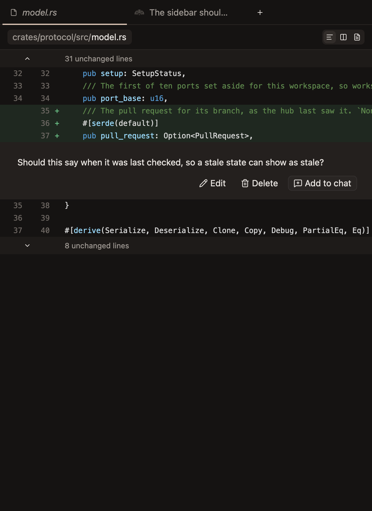
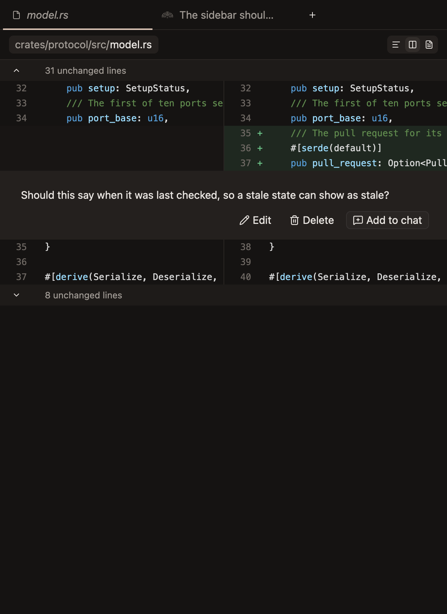
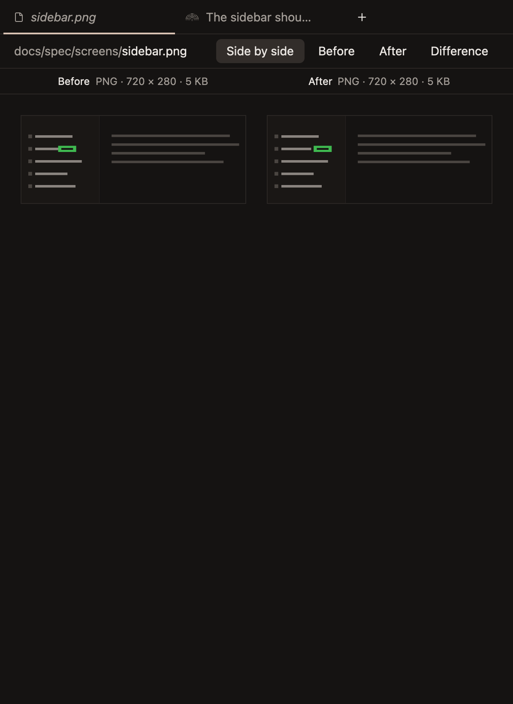
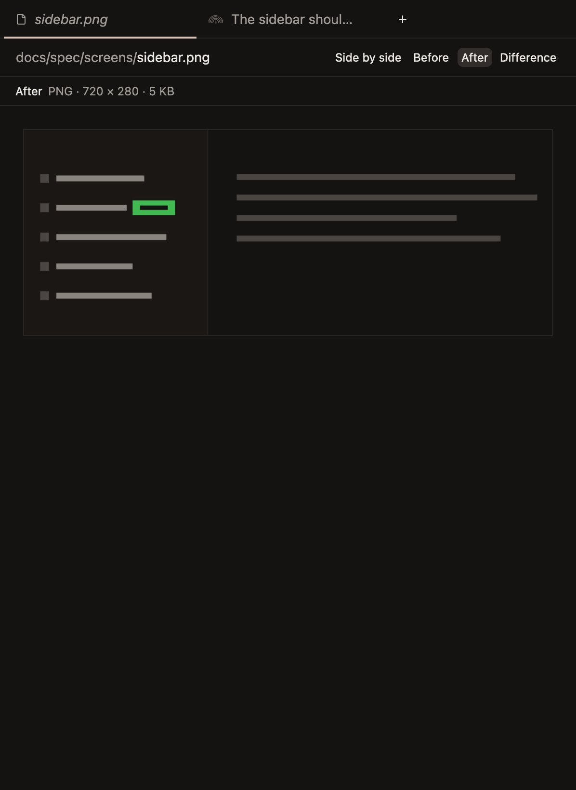
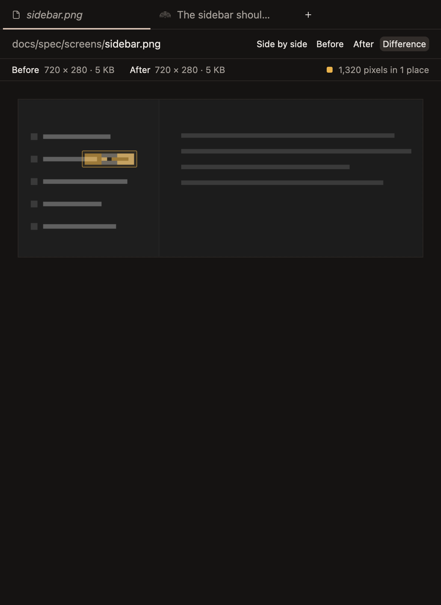

# Diff

A workspace's changes against its base, listed in a sidebar on the right, each file's diff in the workspace's one file tab, and comments on changed lines for the agent. The sidebar's other tab, All files, and a file opened from it, are in `files.md`.

## The sidebar of changes

- **The sidebar on the right lists every file the workspace changes,** with how many lines each adds and removes, and an icon for how it changed: added, modified, removed or renamed. It sits below the pull request's bar, which `workspaces.md` describes.
- **It's open from the start, so a workspace's changes, or its files, and its pull request are always in view.** The button at the right end of the header and `Cmd-Shift-D` hide and show it, in every workspace at once, and the choice holds until the app quits, as the choice of list or folders does. It slides open and shut, and its left edge drags to change how wide it is, as `sidebar.md` says. *Unconfirmed.*
- **Two tabs under the pull request's bar, All files first and then Changes, switch what the sidebar lists,** level with the chat tabs and drawn as they are. Changes counts the files the workspace changes, so how many there are shows from either tab, and its lines added and removed and the button for list or folders sit at the row's right end while it shows. Switching reads again what it lists. *Unconfirmed:* all but the order of the tabs.
- **A workspace that changes nothing shows All files, and one that changes something shows Changes,** since an empty list of changes shows nothing, and the files are what there is to read before anything has changed. When a workspace goes from changing nothing to changing something, the sidebar switches to Changes, since that's when there's something to review. That's when its changes are next read, which is mostly at the end of the agent's turn. *Unconfirmed:* each workspace keeps its own tab until the app quits, rather than every workspace sharing one as they share the sidebar's other choices, since which tab suits depends on what the workspace changes. A tab that's clicked stays through later changes, and when its own click is what finds the first change, so only a first change moves it. A workspace whose tab wasn't clicked goes back to All files when its changes go, as they do once they're merged. Neither tab is marked for the moment before a workspace's changes are first read. Changes stands in for All files where All files would say nothing: when the changes can't be read, and on a hub too old to list files.
- **The files show as a list of paths, or in folders.** The button at the sidebar's top right switches between them. A folder that holds only another folder shares its row, as `apps / desktop`, so a deep tree stays short, and a folder closes to hide what's in it. The choice holds in every workspace until the app quits. *Unconfirmed:* where the button is, and the choice holding.
- **A folder's name is in the mono font, muted, as a path, and a file's in the body font,** since each changed file is what's read and reviewed, with its lines added and removed beside it. All files, a tree to browse, has every name in mono, as `files.md` says.
- **A modified file's icon is yellow, and the other icons are muted,** with lines added and removed in green and red, as `look.md` says the diff's colours are.
- **Comments waiting to be sent are counted at the top of the sidebar, beside Send to agent,** so they can be sent whichever file is showing, or none. Sending them shows the chat they went to, so you see the agent take them up. *Unconfirmed.*

**The sidebar of changes, as a list, with a comment waiting.** *Unconfirmed.*

**The sidebar hidden, with the pull request's number and its action in the header.** *Unconfirmed.*

**The same changes in folders.** *Unconfirmed.*

## The file tab

- **Clicking a file shows its diff in the workspace's file tab, which is always the leftmost tab,** so it's in the same place however many chats are open. A workspace has at most one: clicking another file shows that one in the same tab, so reviewing a branch doesn't leave a tab for every file.
- **The file tab's name is in italics,** as a tab that's replaced rather than added to usually is. *Unconfirmed.*
- **A bar along the top of the file tab names the file, with its path on a raised pill,** its folders muted before its name, as the sidebar shows them, and a renamed file says what it was renamed from. A file opened from All files has the same bar. *Unconfirmed.*
- **A file's changes show with git's three lines either side, and the lines between fold into a row that says how many there are,** rather than git's `@@` lines. The row is on the code blocks' surface, `#1e1b19`, so it stands out from the lines either side without looking raised. Arrows in the row's line numbers show 20 more at a time, up from the change below or down from the change above, or all of them at once when there are no more than 20 between two changes, so the code around a change can be read without leaving the diff. Each arrow says what it shows when it's hovered. *Unconfirmed.*
- **The lines git leaves out are read from the file as it was in the commit the diff was taken from,** since they're the same on both sides, so only the file that shows is read. While it shows, it's read again only when the diff is taken from another commit, or when it couldn't be read before. One too big to be sent whole, over 4 MB, is read a page of lines at a time instead, as they're to show, so its folds open as any other file's do, and the whole file shows only what's been read of it, with the rest folded. A line over 16 KB read that way shows only its start, ending in an ellipsis. A file that can't be read there at all, as from a hub too old to read one in part, folds without arrows. *Unconfirmed.*
- **What's opened of a file stays open when the diff is read again, and when another file has shown in between,** so the end of a turn doesn't fold away what was being read, and the row at the top of the diff stays where it is. *Unconfirmed.*
- **A line with a comment always shows, rather than folding away,** and a comment whose line isn't in the file now shows at the end. *Unconfirmed.*
- **A switch at the right end of the bar shows the diff in one column, side by side, or as the whole file,** with its changes where they are. Long lines scroll sideways under the line numbers, which stay where they are, as the comments do, so both sides are in sight side by side. The choice holds in every workspace until the app quits, as the sidebar's do. Leaving the whole file shows the folds as they were, and switching between one column and side by side keeps what's open. *Unconfirmed.*
- **Lines added and removed are tinted green and red, and what changed within a line that took another's place more strongly, word by word,** so a small edit to a long line stands out. *Unconfirmed.*
- **The file tab covers the chat and its composer until a chat's tab is clicked,** and stays open behind the chats until it's closed. `Cmd-W` closes it while it shows, rather than the chat behind it, and `Ctrl-Tab` comes to it after the last chat. A reply that comes in the chat it covers is read once that chat shows. *Unconfirmed.*
- **To comment, hover a line and click its add button.** The line stays marked, with its add button showing, while its comment is written below it, on a raised band that fills the diff from edge to edge. The box is wide, with a thin copper edge the whole time rather than a focus ring. Enter saves it. A comment on a line both sides have is on the file as it is now, since that's what the agent reads. *Unconfirmed:* the copper, and where a comment on a line both sides have goes.
- **A comment being written on one file is kept while another file shows,** and comes back with its file. *Unconfirmed.*
- **A saved comment shows where it was written, its text where it was typed,** on the same band, with Edit, Delete and Add to chat on its right. Edit opens it in the box again, and saving keeps it in its place. *Unconfirmed:* how Edit works.
- **Add to chat puts a comment in the chat's composer, after what's typed there,** so you can say more with it. The comment stays on the diff until it's deleted, as every comment does, and Send to agent sends every comment at once.
- **A changed file that isn't text shows what it was and what it is, rather than git's line saying they differ.** An image shows as it was in the commit the diff was taken from, as Before, and as it is in the worktree, as After. A file the branch adds shows only After, and one it removes only Before. Any other file says it isn't text, as All files does. It has no lines, so it takes no comments. It's read again with the diff, and an image that hasn't changed stays as it's drawn. *Unconfirmed.*
- **A changed image is compared side by side, one side at a time in one place, or as what changed, all from one bar above it.** The bar has its path, and Side by side, Before, After and Difference at its right end, and nothing else, so neither is ever squeezed. The choice holds in every workspace until the app quits, as the choice of list or folders does, but a file opened while Before is chosen starts at After. Both sides are drawn at one scale from their top left, never bigger than they are, so a pixel is in the same place in each and an image that grew looks bigger. *Unconfirmed.*
- **A strip under the bar names each side shown and says what kind of image it is, how many pixels it has and how big a file it is, as an image opened from All files says,** in smaller text than the bar's, as `Before PNG · 720 × 280 · 5 KB`. Side by side, each side's is over its column, so the columns need no captions of their own. A file the branch adds or removes is named Added or Removed. In Difference, both are in one line, without what kind they are when they're the same, as `Before 2200 × 1500 · 395 KB` and `After 2640 × 1720 · 442 KB`, rather than an arrow between what each says. When the bar hasn't room, the path's folders go first, cut from their start to `…/`, then the end of the file's name, and the choices are always whole. What the strip says of each side is cut short at its end. *Unconfirmed.*
- **Before and After show one side at a time, and flipping between them makes what changed jump out,** as the eye catches anything that moves. Clicking the image or pressing Space flips it, so it can be flipped quickly without aiming at the bar. *Unconfirmed.*
- **What changed shows After faded to grey, with each pixel that differs from Before tinted yellow, the colour of a modified file,** over what's there, so it can still be read, and a thin outline, with a faint wash of the same yellow, around each place that changed, since a change of a pixel or two is lost once a big screenshot is drawn small. A pixel differs when any of its red, green, blue or transparency does at all, as the gallery decides a screen no longer matches its image. Only what both images cover is compared: what only one covers, when it changed size, is striped and isn't counted, since every pixel of it would count and say nothing about what changed. Changes up to 16 pixels apart, by the boxes around them, are one place, so a word is one outline rather than one for each letter. Places whose outlines would meet or nearly, at the size the image is drawn, are drawn as one, so none is drawn inside, across or against another, while the strip counts them as they are at full size, so the count doesn't change with the window. The strip says how many pixels changed and in how many places at its right end, after a swatch of the yellow, as `3,775 pixels in 7 places`, and how big each side is says whether it changed size. The two are compared only once this is chosen, off the main thread, and again only when either changes. *Unconfirmed.*

**A file's diff in the file tab, with a comment on a changed line, and the lines far from the change folded.** *Unconfirmed.*

**The same diff side by side.** *Unconfirmed.*

**Writing a comment on a changed line, with one already left below it.** *Unconfirmed.*

**A changed image, side by side.** *Unconfirmed.*

**The same image, After on its own.** *Unconfirmed.*

**What changed in it, with the badge that moved outlined.** *Unconfirmed.*

