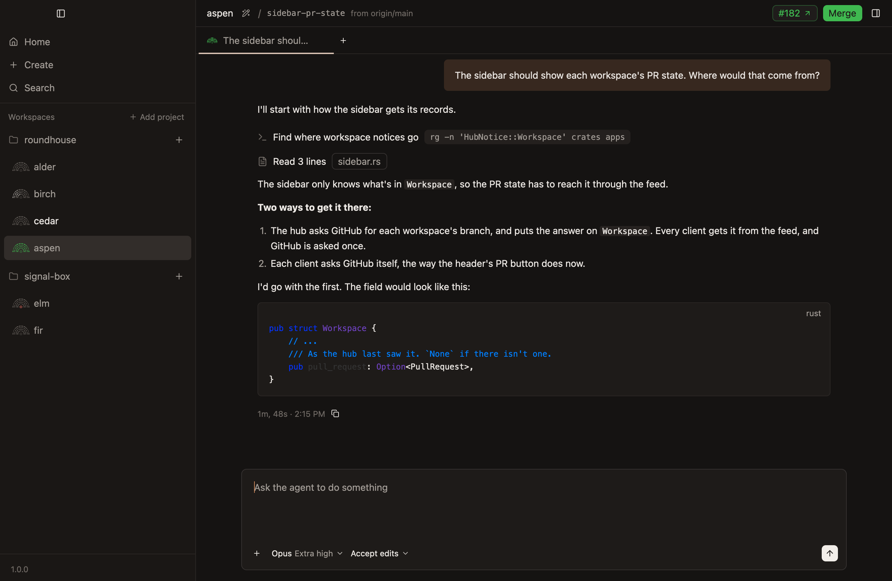

# Diff

A workspace's changes against its base, listed in a sidebar on the right, each file's diff in the workspace's one file tab, and comments on changed lines for the agent. The sidebar's other tab, All files, and a file opened from it, are in `files.md`.

## The sidebar of changes

- **The sidebar on the right lists every file the workspace changes,** with how many lines each adds and removes, and an icon for how it changed: added, modified, removed or renamed. It sits below the pull request's bar, which `workspaces.md` describes.
- **It's open from the start, so a workspace's changes, or its files, and its pull request are always in view.** The button at the right end of the header and `Cmd-Shift-D` hide and show it, in every workspace at once, and the choice holds until the app quits, as the choice of list or folders does. It slides open and shut, and its left edge drags to change how wide it is, as `sidebar.md` says. *Unconfirmed.*
- **Two tabs under the pull request's bar, All files first and then Changes, switch what the sidebar lists,** level with the chat tabs and drawn as they are. Changes counts the files the workspace changes, so how many there are shows from either tab, and its lines added and removed and the button for list or folders sit at the row's right end while it shows. Switching reads again what it lists. *Unconfirmed:* all but the order of the tabs.
- **A workspace that changes nothing shows All files, and one that changes something shows Changes,** since an empty list of changes shows nothing, and the files are what there is to read before anything has changed. When a workspace goes from changing nothing to changing something, the sidebar switches to Changes, since that's when there's something to review. That's when its changes are next read, which is mostly at the end of the agent's turn. *Unconfirmed:* each workspace keeps its own tab until the app quits, rather than every workspace sharing one as they share the sidebar's other choices, since which tab suits depends on what the workspace changes. A tab that's clicked stays through later changes, and when its own click is what finds the first change, so only a first change moves it. A workspace whose tab wasn't clicked goes back to All files when its changes go, as they do once they're merged. Neither tab is marked for the moment before a workspace's changes are first read. Changes stands in for All files where All files would say nothing: when the changes can't be read, and on a hub too old to list files.
- **The files show as a list of paths, or in folders.** The button at the sidebar's top right switches between them. A folder that holds only another folder shares its row, as `apps / desktop`, so a deep tree stays short, and a folder closes to hide what's in it. The choice holds in every workspace until the app quits. *Unconfirmed:* where the button is, and the choice holding.
- **A folder's name is in the mono font, muted, as a path, and a file's in the body font,** since each changed file is what's read and reviewed, with its lines added and removed beside it. All files, a tree to browse, has every name in mono, as `files.md` says.
- **A modified file's icon is yellow, and the other icons are muted,** with lines added and removed in green and red, as `look.md` says the diff's colours are.
- **Comments waiting to be sent are counted at the top of the sidebar, beside Send to agent,** so they can be sent whichever file is showing, or none. Sending them shows the chat they went to, so you see the agent take them up. *Unconfirmed.*

**The sidebar of changes, as a list, with a comment waiting.** *Unconfirmed.*

**The sidebar hidden, with the pull request's number and its action in the header.** *Unconfirmed.*

**The same changes in folders.** *Unconfirmed.*

## The file tab

- **Clicking a file shows its diff in the workspace's file tab, which is always the leftmost tab,** so it's in the same place however many chats are open. A workspace has at most one: clicking another file shows that one in the same tab, so reviewing a branch doesn't leave a tab for every file.
- **The file tab's name is in italics,** as a tab that's replaced rather than added to usually is. *Unconfirmed.*
- **The file tab covers the chat and its composer until a chat's tab is clicked,** and stays open behind the chats until it's closed. `Cmd-W` closes it while it shows, rather than the chat behind it, and `Ctrl-Tab` comes to it after the last chat. A reply that comes in the chat it covers is read once that chat shows. *Unconfirmed.*
- **To comment, hover a changed line and click its add button.** The line stays marked, with its add button showing, while its comment is written below it, on a raised band that fills the diff from edge to edge. The box is wide, with a thin copper edge the whole time rather than a focus ring. Enter saves it. *Unconfirmed:* the copper.
- **A comment being written on one file is kept while another file shows,** and comes back with its file. *Unconfirmed.*
- **A saved comment shows where it was written, its text where it was typed,** on the same band, with Edit, Delete and Add to chat on its right. Edit opens it in the box again, and saving keeps it in its place. *Unconfirmed:* how Edit works.
- **Add to chat puts a comment in the chat's composer, after what's typed there,** so you can say more with it. The comment stays on the diff until it's deleted, as every comment does, and Send to agent sends every comment at once.

**A file's diff in the file tab, with a comment on a changed line.** *Unconfirmed.*

**Writing a comment on a changed line, with one already left below it.** *Unconfirmed.*

