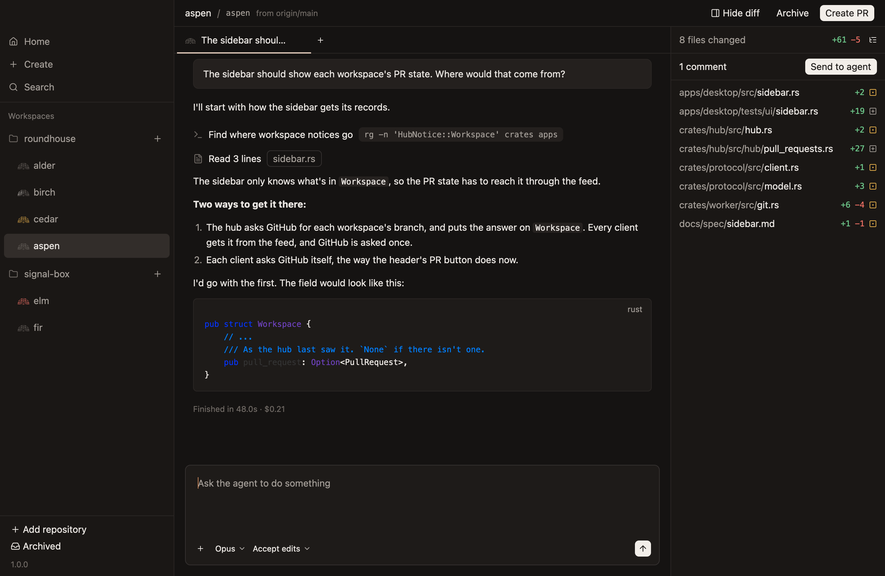
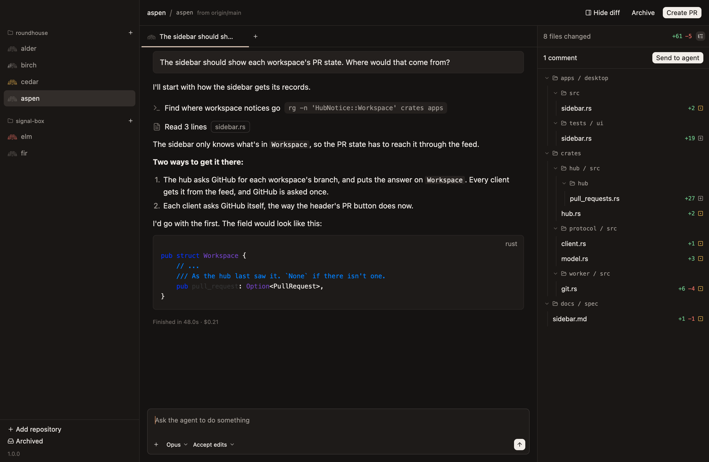
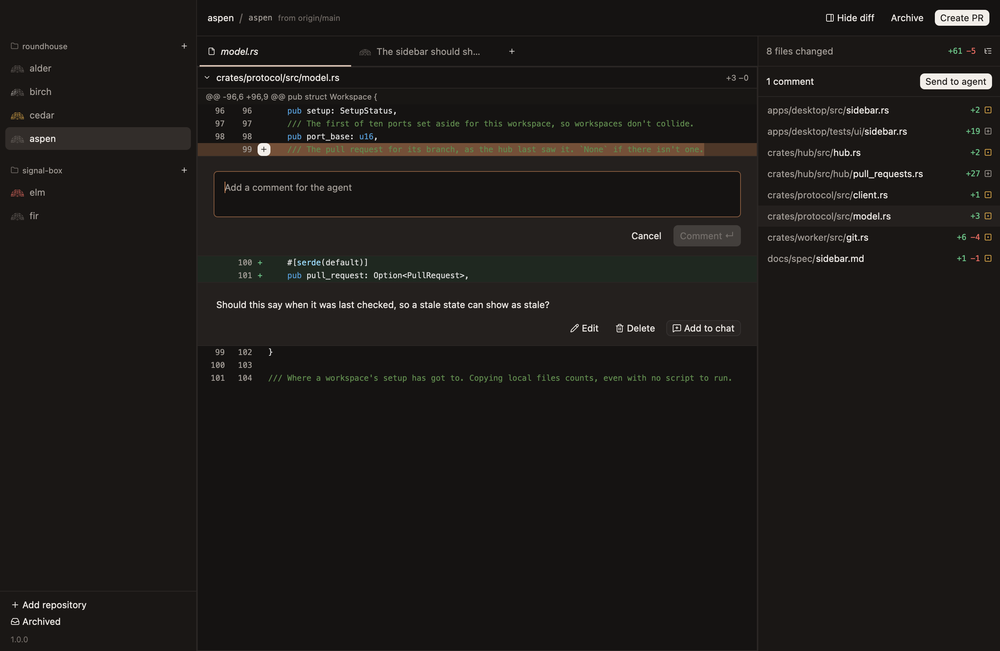

# Diff

A workspace's changes against its base, listed in a sidebar on the right, each file's diff in the workspace's one diff tab, and comments on changed lines for the agent.

## The sidebar of changes

- **The diff opens as a sidebar on the right, listing every file the workspace changes,** with how many lines each adds and removes, and an icon for how it changed: added, modified, removed or renamed. `Diff` in the header and `Cmd-Shift-D` show and hide it.
- **The files show as a list of paths, or in folders.** The button at the sidebar's top right switches between them. A folder that holds only another folder shares its row, as `apps / desktop`, so a deep tree stays short, and a folder closes to hide what's in it. The choice holds in every workspace until the app quits. *Unconfirmed:* where the button is, and the choice holding.
- **A modified file's icon is yellow, and the other icons are muted,** with lines added and removed in green and red, as `look.md` says the diff's colours are.
- **Comments waiting to be sent are counted at the top of the sidebar, beside Send to agent,** so they can be sent whichever file is showing, or none. Sending them shows the chat they went to, so you see the agent take them up. *Unconfirmed.*

**The sidebar of changes, as a list, with a comment waiting.** *Unconfirmed.*

**The same changes in folders.** *Unconfirmed.*

## The diff tab

- **Clicking a file shows its diff in the workspace's diff tab, which is always the leftmost tab,** so it's in the same place however many chats are open. A workspace has at most one: clicking another file shows that one in the same tab, so reviewing a branch doesn't leave a tab for every file.
- **The diff tab's name is in italics,** as a tab that's replaced rather than added to usually is. *Unconfirmed.*
- **The diff tab covers the chat and its composer until a chat's tab is clicked,** and stays open behind the chats until it's closed. `Cmd-W` closes it while it shows, rather than the chat behind it, and `Ctrl-Tab` comes to it after the last chat. A reply that comes in the chat it covers is read once that chat shows. *Unconfirmed.*
- **To comment, hover a changed line and click its add button.** The line stays marked, with its add button showing, while its comment is written below it, on a raised band that fills the diff from edge to edge. The box is wide, with a thin copper edge the whole time rather than a focus ring. Enter saves it. *Unconfirmed:* the copper.
- **A comment being written on one file is kept while another file shows,** and comes back with its file. *Unconfirmed.*
- **A saved comment shows where it was written, its text where it was typed,** on the same band, with Edit, Delete and Add to chat on its right. Edit opens it in the box again, and saving keeps it in its place. *Unconfirmed:* how Edit works.
- **Add to chat puts a comment in the chat's composer, after what's typed there,** so you can say more with it. The comment stays on the diff until it's deleted, as every comment does, and Send to agent sends every comment at once.

**A file's diff in the diff tab, with a comment on a changed line.** *Unconfirmed.*

**Writing a comment on a changed line, with one already left below it.** *Unconfirmed.*

