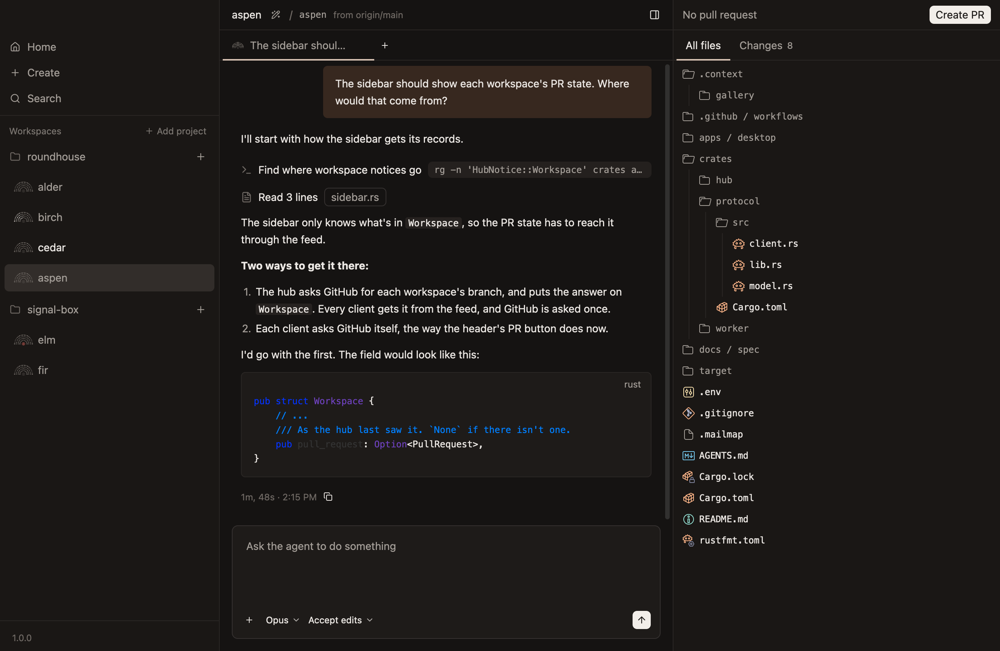
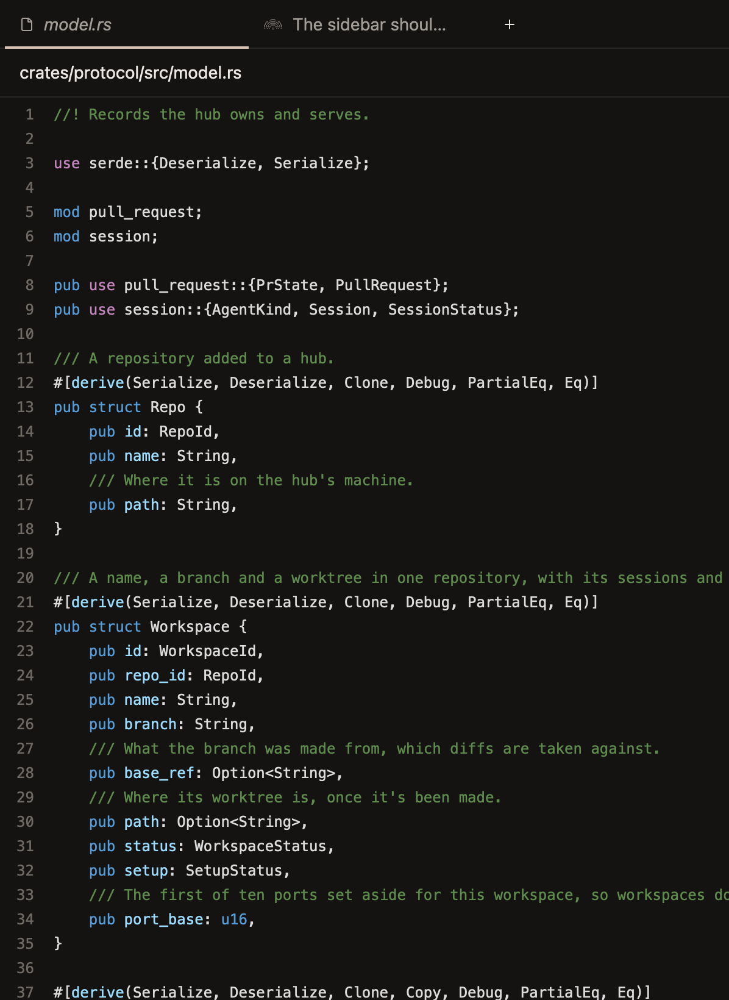
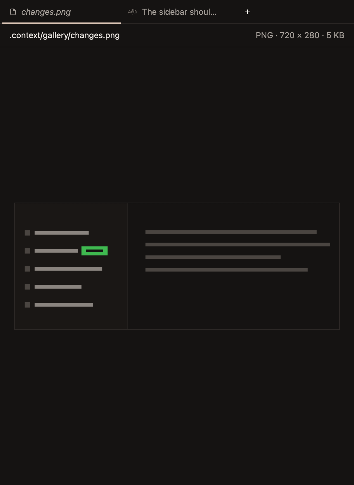

# Files

All files, the sidebar on the right's list of every file in a workspace's worktree, and a file opened from it in the workspace's file tab. The tabs that switch the sidebar between the changes and All files are in `diff.md`.

## All files

- **All files lists every file in the worktree, ignored ones too:** tracked, new or ignored, so the code around a change can be read as well as the change, and so can what's built or kept beside it, such as `.context`.
- **A folder git ignores whole, such as `target` or `node_modules`, is read only when it's opened,** one level at a time, and again each time it opens, since one can hold hundreds of thousands of files. It keeps a row of its own rather than sharing one with a folder inside it, so opening it doesn't look like renaming it. *Unconfirmed.*
- **Each file has a coloured icon for its kind, as editors show them,** such as Rust's for a `.rs` file or a crate for `Cargo.toml`, so a file can be found by its look before its name is read, and every folder has the plain folder, open or closed, whatever it holds. They're the MIT-licensed Catppuccin icons, and each name gets the icon Catppuccin's own list gives it, so they look as they do in an editor that uses them. They're only in All files, since Changes is about how each file changed, and the file tab has the plain file icon whichever it shows. *Unconfirmed:* how a name is matched to the list, by its name, then by its longest extension, then by the few patterns editors know a kind of file by, such as `Dockerfile.api` and `app.log.1`, in any case.
- **The files show in folders, which start closed,** since a whole repository open at once is too much to look through. Folders come first, then files, each by name, and a folder that holds only another folder shares its row, as `.github / workflows`, as they do in the changes. *Unconfirmed.*
- **Every name in All files is in the mono font, a file's as a folder's,** at the size of a folder's in Changes, since the list is a tree of paths to browse, as an editor's or a terminal's is. A folder's is muted and a file's in the text colour, so the files, which open, stand out.
- **A folder's row is its icon and its name, with no chevron, as in an editor's tree of files,** the icon opening as the folder does, and what it holds starts under its name, so each level sits a step in from the one it's in. Changes keeps its chevrons. *Unconfirmed:* a line down what an open folder holds, under its icon, as in Changes.
- **The list is read again when All files shows, when the workspace shows, and when a turn ends while it's on screen,** with each open folder in view that's read when it opens, so what the agent makes shows up without asking, and the folders open stay open, even when a new file splits a row of folders in two. A workspace whose turn ends while it isn't on screen reads its list once it is, rather than every workspace's being read at every turn. *Unconfirmed.*
- **A hub older than the app says it can't list files,** in the list's place. *Unconfirmed.*

**All files, with the folders of one file open, and `.context`, which git ignores whole, open too.** *Unconfirmed.*

## A file opened from All files

- **Clicking a file shows it as it is in the worktree, in the workspace's file tab,** in place of whatever the tab showed, and clicking a file in Changes shows its diff there in place of the file, so one tab holds either, and browsing leaves no trail of tabs, as reviewing doesn't. Its row is marked while it shows, and its path is above its lines. *Unconfirmed:* the row marked, and the path above.
- **Its lines are numbered and highlighted for its language, as a diff's are,** and scroll both ways, so a long line can be read to its end. A big file shows plain at once and in colour once it's highlighted, and one over 1 MB stays plain, since highlighting it would take seconds. *Unconfirmed.*
- **A file shown is read again when a turn ends,** keeping where it's scrolled to, and its colours until the new ones are ready, so it shows what the agent changed. *Unconfirmed.*
- **An image shows as itself, as big as it is or smaller to fit the tab, never bigger,** with what kind it is, how many pixels it has and how big a file it is at the other end of its path, so a screenshot an agent saved can be looked at without leaving the app. What it is goes by what the file starts with, not its name, as an attachment's does. It's sent whole up to 64 MB, since half an image is no use, where text stops at 4 MB. It sits on a checkerboard, so what's clear in it shows as clear, inside a thin edge, so one the colour of the pane still shows where it ends. A GIF holds still on its first frame, so an idle window draws nothing. *Unconfirmed.*
- **A file that can't be shown says why, in its place:** it isn't text or an image, it's too big to send at once, it's empty, it's an image that can't be read, or it's gone since it was listed. *Unconfirmed.*

**A file opened from All files.** *Unconfirmed.*

**An image opened from All files.** *Unconfirmed.*

