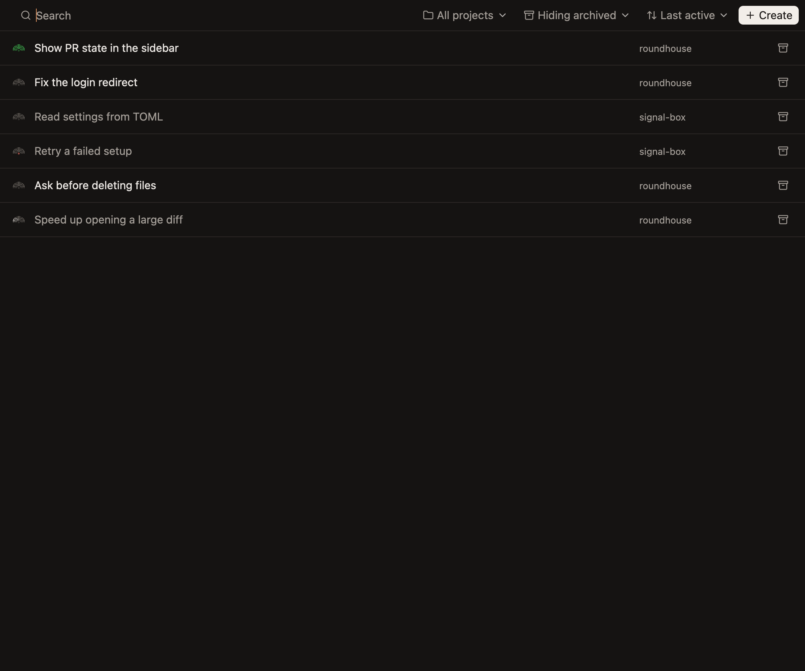
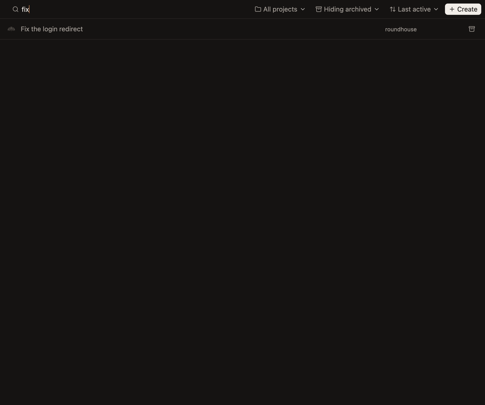

# Home

Every workspace in one list, to find one, and to see where they all stand without opening each.

- **Home at the top of the sidebar shows it in place of the workspace, and picking a workspace puts it away.** The workspace stays selected under it. While Home hides it, a reply there isn't read and its keys do nothing, since nobody can see what they'd do. *Unconfirmed.*
- **A row is a workspace:** its mark, its name, its project, and a button to archive it, or to bring back an archived one, which leaves Home showing. While it's being archived or brought back, the row says Archiving… or Restoring… in place of the button, in every window, wherever that was asked for. Clicking the rest of the row shows the workspace, as its row in the sidebar does, or brings an archived one back. A workspace still being made isn't listed until it's ready, since there's nothing to open yet, and the sidebar says it's on its way. Rows are 44px, with a line between them. *Unconfirmed.*

  **Every workspace, the one last worked in first.** *Unconfirmed.*

  

  **A workspace being archived, which says Archiving… in place of its button.** *Unconfirmed.*

  

- **Names read as they do in the sidebar.** A workspace with a reply you haven't read has its name at full brightness in medium weight, and every other name is muted. *Unconfirmed.*

  **A workspace with a reply nobody has read, and one waiting on an approval, at full brightness among muted names.** *Unconfirmed.*

  

- **The bar along the top finds and narrows,** in place of the workspace header. The search matches the name a workspace shows or its branch, in any case, as it's typed, and has the keys while Home shows. Beside it, the list can show one project or all, hide archived workspaces, show them too or show only them, and sort by when a chat was last worked in, as the sidebar's Last active does, by when the workspace was made, newest first, or by name. It's the only place archived workspaces are listed. Home shows what it did the last time it was open, until the app quits. *Unconfirmed.*

  **A search, narrowing the list as it's typed.** *Unconfirmed.*

  

  **Showing all, with the archived workspace listed too, and its button to bring it back.** *Unconfirmed.*

  

- **The list's order holds still while someone is using it, and its rows slide as it changes, as the sidebar's do.** While the pointer moves over the list, and for a second and a half after it stops, a row doesn't move out from under a click, and a workspace that comes meanwhile goes after the others. Then each row that moves slides to its place in a fifth of a second, which Reduce Motion skips. `sidebar.md` says the rest under Order. The rows a search keeps are in their places at once as it's typed, rather than sliding at every key. *Unconfirmed:* searching, or choosing another project, filter or order, lists the workspaces again at once, even while the order holds, and Home shown again has each row in its place at once, rather than sliding from where it was the last time Home showed.
- **Create is the bar's main action.** It opens the new-workspace dialog for the project the list shows, or else for the selected workspace's, and the workspace it makes is shown, which puts Home away. The sidebar's Create and `Cmd-N` do the same while Home shows. *Unconfirmed.*
- **A row says when one of its workspace's chats' caches is about to expire,** such as `Cache expires in 9 min`, for the soonest, before its project, as `chats.md` says. *Unconfirmed:* where.

  **Every workspace, with a chat in the first whose cache is about to expire.** *Unconfirmed.*

  

- **A row shows how many lines its workspace has added and removed,** in green and red, before its project. *Not built:* the hub doesn't send them.
