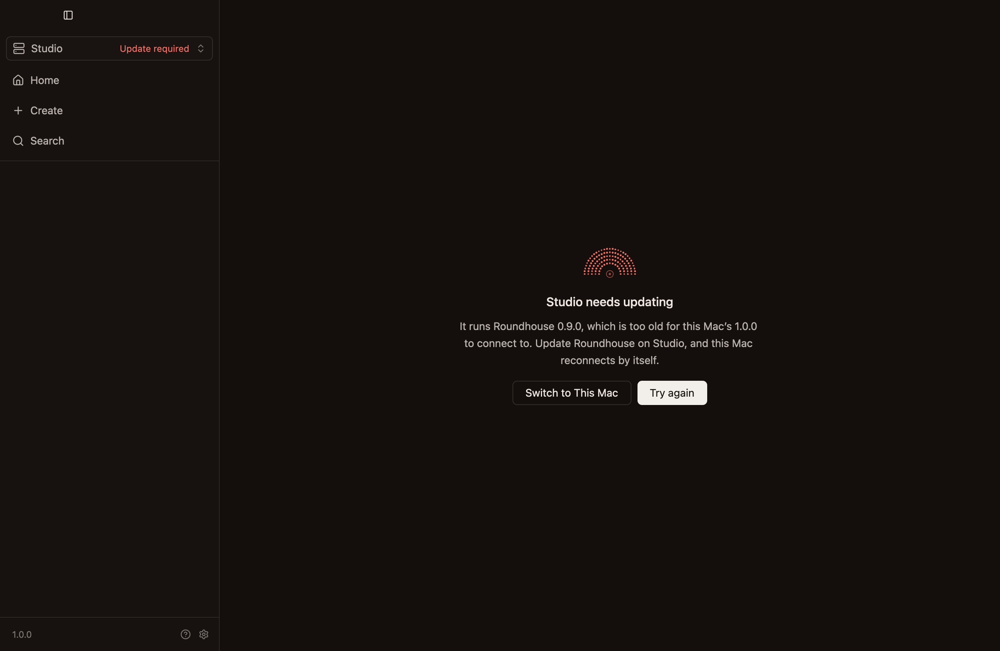
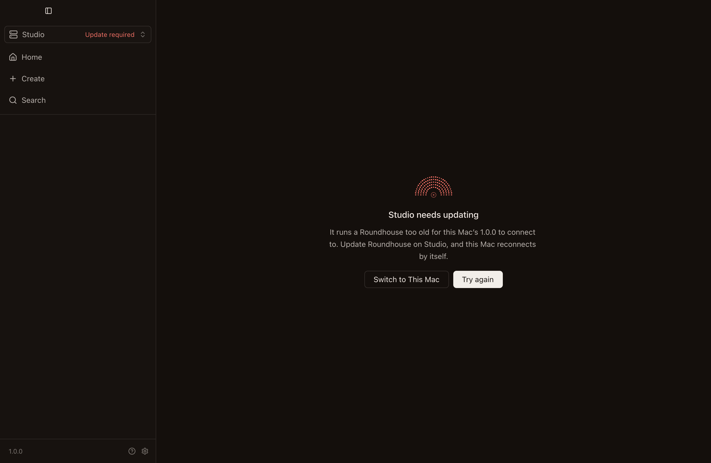
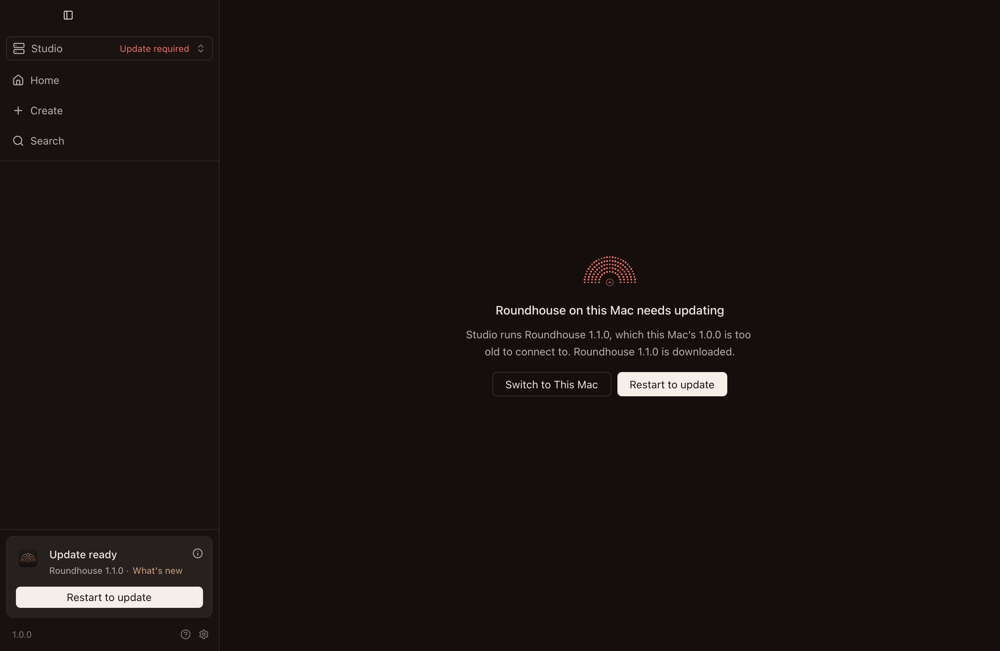
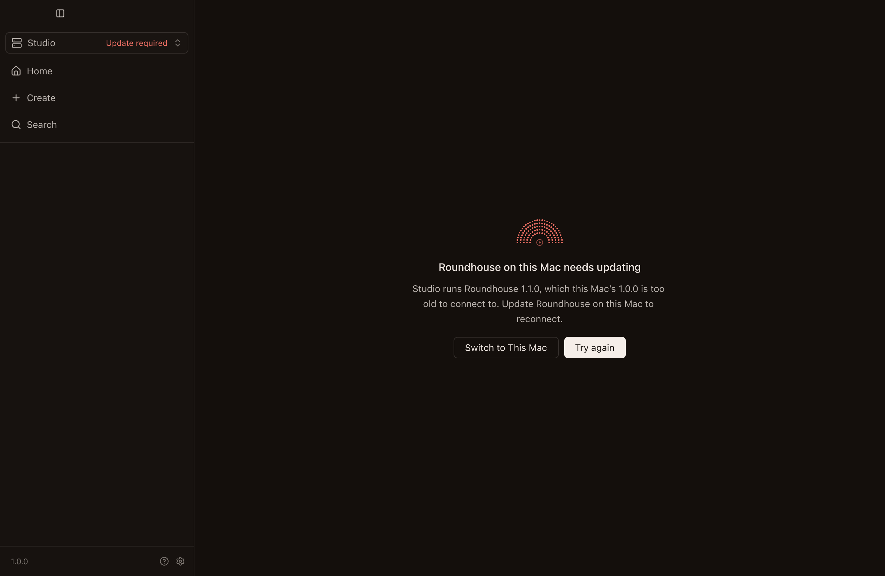

# Paired hubs

- **A network client pairs with a hub using a single-use link.** On the hub's machine, `roundhouse phone pair` prints a link and QR code. The link expires after ten minutes and pins the hub's public key before sending the code. A successful pairing gives that device its own token. The hub stores only its hash. *Unconfirmed.*
- **The hub's machine controls access.** `roundhouse phone list` lists devices and `roundhouse phone revoke NAME-OR-ID` revokes one and closes its connections. *Unconfirmed.*
- **A paired device can do what you can in the app, but for pairing and revoking devices and stopping or restarting the hub.** It can update a hub installed as a service, which restarts it, as `updates.md` says. It can change the hub's settings and its accounts. It can open a workspace's terminals, which are a shell on the hub's machine, so pairing a device trusts it with that machine.
- **The machines must be directly reachable.** The network listener starts for pairing, or at startup when a device is paired. `ROUNDHOUSE_LISTEN` chooses its address, or only its port; release builds use port 7867 and development builds use 7868. There is no relay. Workspace state stays on its hub. *Unconfirmed.*
- **A peer that stops responding cannot hold connection setup or a write forever.** Pairing, or authentication and hello together, have ten seconds after TLS connects. Each outgoing frame also has ten seconds; expiry closes the connection and releases pending requests. An idle connected client can keep waiting for events. *Unconfirmed.*
- **A client whose connection goes connects again by itself, unless only a person can fix what stops it.** The desktop app and the iPhone app follow one rule, for this machine's hub and a paired one alike. A connection that goes is made again at once. A failed try is tried again after a second, then after twice as long as the last wait, up to 30 seconds. Meanwhile the iPhone app says it's trying, and the desktop app shows why the last try failed. A new connection that hasn't caught up on the hub's records within 10 seconds is dropped and tried again, and one that closes before it has is tried again at once. A hub that refuses the device's token, answers with another key than the one paired with, or is ahead of the app across a protocol break isn't tried again until someone asks, and nor is this machine's hub when the desktop app can't start it or is across a break from it: the desktop app says why, with what to do about it, such as Try again or Pair again, and the iPhone app tries again when it comes back to the front. A paired hub that's behind the app across a break is tried again by itself, so the app connects once that hub is updated. *Unconfirmed:* that failing to follow the hub's records is tried again unless it's one of those, that a connection dropped for not catching up waits a second before the next try, and that asking to connect drops any connection there is and starts the waits over.
- **While a new connection catches up on the hub's records, the app sends the hub nothing it's asked, as with no connection,** so nothing is done to what the hub's first list is about to replace. *Unconfirmed.*
- **Without a connection that has caught up, what sends something typed waits, and a click says it couldn't.** Send, Save on a comment on the diff and the arrow that sends a typed answer are off, and what's typed stays where it is, so nothing typed is taken and handed back. A rename, and an edit of a queued prompt, stay open with what's typed. Stop, deleting a comment and closing a terminal's tab say they couldn't, and can be pressed again, since nothing is lost. *Not built:* the iPhone's Send, a comment's Save and a typed answer's arrow take what's typed and hand it back, saying it couldn't be sent.
- **Across a protocol break, the app says whether the paired hub or the app itself needs updating.** It never shows the hub's own refusal. It never says how the hub is updated, since it can't tell whether that hub is a service, or the app's on its machine, or started by hand. When the hub is older, the app names the machine, says both releases, and says to update Roundhouse there.

  **A paired hub older than the app.** *Unconfirmed.*

  

  A hub that doesn't say its release is always the older one, since it's from before hubs did, so the app says so without the hub's release.

  **A paired hub older than the app, which doesn't say its release.** *Unconfirmed.*

  

- **When the app is the older one, its main button is its own update.** It says both releases. `Restart to update` installs an update that's downloaded, `Check for updates` looks for one, and it says so if nothing newer was found. A build that doesn't update itself says to update Roundhouse, with Try again. The iPhone app says only to update Roundhouse on the iPhone.

  **The app's update is downloaded.** *Unconfirmed.*

  

  **It's checking for an update.** *Unconfirmed.*

  

  **It found nothing newer.** *Unconfirmed.*

  

  **A build that doesn't update itself.** *Unconfirmed.*

  
