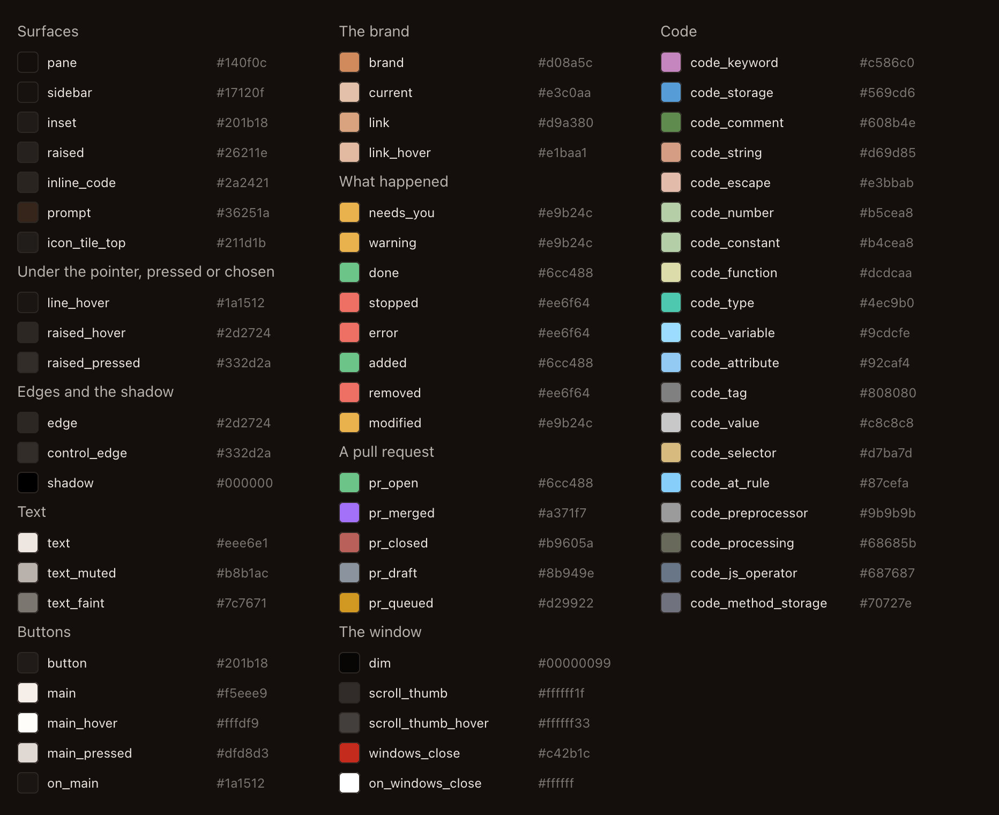
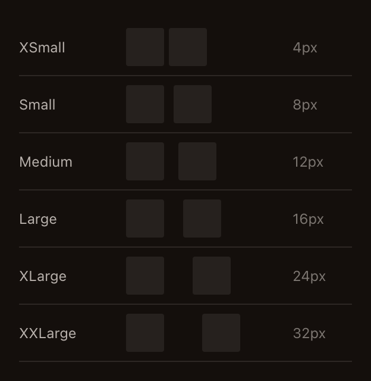
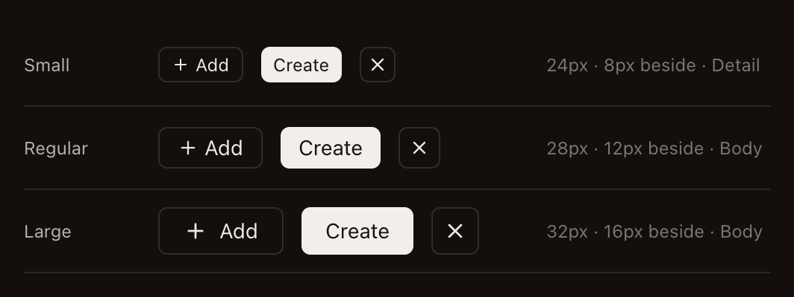
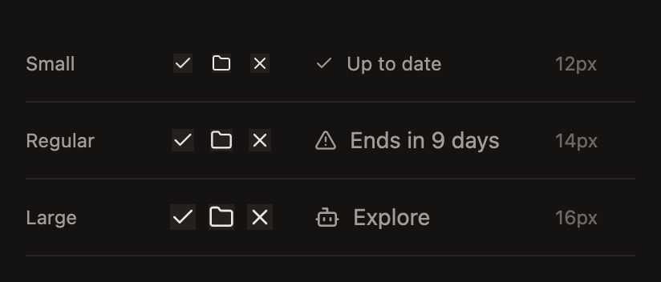

# Look

The foundations of the app's design system, the rules every screen follows: colour, type, space and shape, layout and the pointer. The components built on them, such as buttons, the status mark and the app icon, are in `components.md`, and a rule about one place is in that place's file, even when it's about how it looks. Each area's file shows its own screens. `crates/look` holds them in code: every colour, kind of text and corner by what it's for, every step of space, and every size a control, a bar, a row and an icon come in, the theme made from them, the mark, the icon, plan mode's texture, the pointing hand and the baseline text of different sizes shares.

It's meant to feel familiar to the people Roundhouse is for, and it sets itself apart with a motif of its own, the status mark.

## Colour

Each colour means one thing.

- **Three warm near-black surfaces,** so the app reads as one calm field with a few raised things on it. The pane is `#151312`, the sidebar `#1a1715`, and anything raised, such as a card or a popover, is `#24201e`. The composer and code blocks are `#1e1b19`. A prompt is a wash of the brand's copper, `#37281f`, so what was asked is easy to find when scrolling.
- **Two edge colours.** The thin edge that separates, around a card, along a header or between rows, is `#2a2624`. Something to use, such as the composer, a chip, a key, a field or a button that opens something, has a lighter edge, `#353130`, so it reads as something to use rather than as a line between two things. So does the button back down to a chat's end, which sits over the chat's text, as `chats.md` says.
- **One shadow, under what opens over the rest,** such as a card, the outline, the find bar or what a hover shows, so it reads as on top of what it covers. It's soft, so it lifts what's over the rest without drawing the eye: black at 22.5%, 8px below and blurred by 12px, and black at 15%, 2px below and blurred by 3px, as GPUI measures a blur, which is half what CSS calls it. What's raised in place, such as a pill or the update card, has none. A menu, a tooltip and a dialog cast it too. *Not built:* the kit draws them, each with a fainter shadow of its own.
- **A dialog dims everything behind it to 40% of its brightness,** under 60% black, so it's plainly the one thing to deal with, and what's behind it reads as out of reach. *Unconfirmed.*
- **Three text colours:** foreground `#ebe7e3`, muted `#a39d97`, and faint `#6f6964` for meta, line numbers and hints.
- **Copper, `#d08a5c`, is the brand.** It's for empty states, the app icon, keyboard focus, the edge of a comment being written, the wash behind a prompt and, quieter, a composer that's planning, and never a status.
- **Pale copper, `#d8c2b3`, marks the chat showing,** as the line under its tab. It's the brand's hue, paled toward the text, so it says where you are without reading as a status.
- **A composer that's planning is in a quieter copper.** Its surface takes a tenth of copper, its edge is copper at a little over half strength over that, and its texture's dots are copper. It's the brand's own colour, so plan mode reads as a way of working you chose rather than a status, and its edge stays quieter than keyboard focus, which the composer also shows while files are dragged over it. `chats.md` has the texture. *Unconfirmed.*
- **Amber is for the card that needs you, and red means the agent stopped short.** A plan waiting to be approved gets a thin amber edge and a faint amber background, and a failed request's card the same in red, as `chats.md` says. A question isn't a card, and neither is a request to use a tool, since each takes the composer's place, and has the thin edge colour on the pane's own surface, as `chats.md` says. Amber isn't on the mark, where the merge queue's yellow would be taken for it.
- **The diff uses the colours review tools do,** because they're about a file rather than about you or the agent: lines added and removed are green and red, and a modified file's icon is yellow.
- **A file's icon is in its kind's colours,** as Catppuccin's Mocha flavour draws them, in thin lines, which editors have made familiar, and a folder's is the plain folder in the muted text colour, whatever it holds, as is the plain file's, for a file with no icon of its own. They say what a file is, never how anything stands, so they sit beside a name and nowhere a status would.
- **A pull request's state is shown in GitHub's colours,** which the people Roundhouse is for already know: green when it's open, purple when it's merged, a muted red when it's closed, and a grey of its own when it's a draft.
- **The pull request's bar says more with the same colours.** It's green only once nothing is in the way of merging, and on the theme's raised surface, in the text colour, while there's something to do first. A place in the merge queue is GitHub's yellow, which GitHub uses for what's waiting on it, and the bar always says in words what it's waiting for, so it isn't taken for amber's turn of yours. The fan is yellow there too, and green for every other open pull request, since it's too small to say what's in the way of merging. Amber is never on the mark, so the queue's yellow isn't taken for it. `look::Work` chooses them from `look::Colors`, so a workspace's fan and the bar can't disagree. *Unconfirmed.*
- **Every colour the app draws with has a name for what it's for,** so a colour means the same wherever it's drawn, and two that look alike and mean different things, such as an approval's amber and a warning's, can change apart. What's drawn takes one of them by its name, or one of them at a strength chosen where it's drawn, such as a removed line's wash, which is `removed` at 12%, rather than a colour by its value. The app is dark only, and a light theme would be a second set of values for the same names. `look::Colors` holds them, and the kit's theme is made from them, so the kit's own parts, such as its buttons and menus, draw with the same ones. The few that only the kit's own parts draw with, such as the text on its danger button, are given where the theme is made. Code's colours, a file's icon and an image's pixels are their own, as above. *Unconfirmed.*

**Every colour, by its name.** Each is the field of that name in `look::Colors`. *Unconfirmed.*

| Name | Colour | For |
|---|---|---|
| **Surfaces** | | |
| `pane` | `#151312` | The workspace's pane, Home's and Settings' pages, and the window's ground |
| `sidebar` | `#1a1715` | The sidebars |
| `inset` | `#1e1b19` | What's set into a surface: the composer, a prompt waiting in the queue, a call's output, a code block |
| `raised` | `#24201e` | Anything raised, whether it opens over the rest, such as a card, a menu, a tooltip or what a hover shows, or sits in place, such as a pill, a file's header, the update card or an open pull request's bar with something to do |
| `prompt` | `#37281f` | A prompt's bubble |
| `icon_tile_top` | `#211d1b` | The top of the app icon's tile |
| **Under the pointer, pressed or chosen** | | |
| `row_hover` | `#211e1c` | A row in a list under the pointer, such as Home's or a file's |
| `line_hover` | `#1e1b19` | A call's line under the pointer, and the compaction's |
| `menu_hover` | `#282321` | A menu's row under the pointer, a step above the menu, a page in Settings' sidebar, under the pointer or open, and behind code within a line of text, which the kit draws in the grey of its menus' rows |
| `raised_hover` | `#2b2724` | Something raised, under the pointer |
| `raised_pressed` | `#322d2a` | Something raised, pressed, and the sidebar's selected row |
| **Edges and the shadow** | | |
| `edge` | `#2a2624` | The thin edge that separates: around a card, along a header, between rows |
| `control_edge` | `#353130` | Something to use: the composer, a chip, a key, a field, a button that opens something, the button back down to a chat's end |
| `shadow` | `#000000` | Under what opens over the rest, faint |
| **Text** | | |
| `text` | `#ebe7e3` | What to read |
| `text_muted` | `#a39d97` | What's secondary, and a name that needs nothing from you |
| `text_faint` | `#6f6964` | Line numbers, meta, hints, and a mark with no pull request |
| **Buttons** | | |
| `button` | `#211e1c` | A button with an edge, such as a dialog's Cancel |
| `main` | `#f2eee9` | An area's one main action, such as Send |
| `main_hover` | `#ffffff` | The main action under the pointer |
| `main_pressed` | `#ddd8d2` | The main action pressed |
| `on_main` | `#1d1a18` | What's on the main action, and on any other light fill |
| **The brand** | | |
| `brand` | `#d08a5c` | Copper: empty states, the icon, keyboard focus, the caret, a comment being written, a composer that's planning |
| `current` | `#d8c2b3` | Pale copper: the chat showing, and, faint, what's found |
| `link` | `#dba27c` | A link |
| `link_hover` | `#e8b896` | A link under the pointer |
| **What happened** | | |
| `needs_you` | `#e9b24c` | The card that needs you, such as an approval |
| `warning` | `#e9b24c` | A warning, such as setup that failed |
| `done` | `#6cc488` | Something ready, or done, such as dictation's model once it's prepared |
| `stopped` | `#ee6f64` | The agent stopped short: its mark's turntable, and a turn that failed |
| `error` | `#ee6f64` | Something else that went wrong, such as a call that failed |
| `added` | `#6cc488` | Lines and counts added to a file |
| `removed` | `#ee6f64` | Lines and counts removed from a file |
| `modified` | `#e9b24c` | A file that's changed, and what changed in an image |
| **A pull request** | | |
| `pr_open` | `#3fb950` | Open |
| `pr_merged` | `#a371f7` | Merged |
| `pr_closed` | `#b9605a` | Closed |
| `pr_draft` | `#8b949e` | A draft |
| `pr_queued` | `#d29922` | Waiting on GitHub, such as in the merge queue |
| **The window** | | |
| `dim` | `#00000099` | Over everything behind a dialog |
| `scroll_thumb` | `#ffffff1f` | A scrollbar's thumb |
| `scroll_thumb_hover` | `#ffffff33` | A scrollbar's thumb under the pointer |
| `windows_close` | `#c42b1c` | Windows' close button under the pointer |
| `on_windows_close` | `#ffffff` | Its glyph |

Three strengths have names of their own, since several places draw with them: what's selected in text is `brand` at 30%, the most the kit lets a selection show, every match of what's found is `current` at 22%, and the match being shown is `brand` at 55%. *Unconfirmed.*

**Every colour by its name, as the app draws it.** *Unconfirmed.*

## Type

- **The system font, at 14px for body text.** Secondary text is muted, at the same size or at 12px for details. Sizes in rems are measured from 16px, as the web's and the kit's are, so the kit's spacing comes out as the web's does. It's dense enough to watch many agents, and still easy to read. A tool call's line is at body size, since what it did is the main thing it says. *Unconfirmed.*
- **Emphasis is medium weight, never bold,** for what should stand out from what's around it, such as the title that names what a card or section is about. Bold shouts in a dense layout. Medium is drawn as regular, since the text system gives a request for medium the system font's regular face. *Not built.*
- **In a list of one kind of thing, such as the workspaces in the sidebar or the chat tabs, a name's colour and weight change only for state that needs you,** such as a reply you haven't read. Which one is selected or open shows in its background or underline instead, and its name looks as it does when it isn't. Names are read side by side, so any change to one reads as news, and macOS's font smoothing thickens brighter text, so a name that brightened would look heavier too.
- **Code is Menlo at 12px,** set once, as `look::Type` has it, and given to the kit's theme from there.
- **Every kind of text the app sets has a name for what it's for,** so a size means the same wherever it's set, and two kinds that are the same size today, such as details and code, can change apart. What's set takes one of them by its name, rather than a font or a size by its value, and text that stands out from what's around it takes emphasis rather than a weight. `look::Type` holds them, and the kit's theme is given the rem, and code's font and size, from there, so the kit's own parts agree.
- **Text in different sizes or fonts along one line sits on one baseline,** as the words of a sentence do, such as the workspace header's title beside its branch, in the code font, and where that started, both smaller. Centred one by one, smaller text would ride higher than what's beside it. An icon stays centred, and so does text on a shape, such as a pill, a chip or a button, since it's the shape that's lined up. `look::LineText` sets them. *Unconfirmed.*

**Every kind of text, by its name.** Each is a kind in `look::Type`, at the app's scale, where a rem is 16px. One with no weight of its own takes what's around it, which is regular unless it's given emphasis.

| Name | Font | Size | Weight | For |
|---|---|---|---|---|
| `PageTitle` | System | 24px | Medium | A page's name, such as each of Settings' pages: the largest kind, since it says where you are |
| `Heading` | System | 16px | Medium | What an empty pane says is missing, above why |
| `Body` | System | 14px | As around it | What to read: what the agent wrote, a prompt, a call's line, a row's name, and most of the rest |
| `Detail` | System | 12px | As around it | Details beside or under what to read, such as a time, a count, a hint or a heading over a list |
| `Code` | Menlo | 12px | As around it | Code: a command, a path, a file, or what a call put out |
| `Key` | System | 10px | As around it | What a key says, such as the `F` of Settings' `⌘ F` |
| `KeyHeld` | System | 7.5px | As around it | What's held with a key, such as Settings' `⌘`, smaller than the key that's pressed, as on the keys themselves |

**Every kind of text, as the app sets it.**

## Space and shape

### Space

- **Every space is one of six steps on a 4px grid: 4, 8, 12, 16, 24 or 32px.** A space is the room left between and around things, as a gap, a padding or a margin, to set them apart or hold them together. What belongs together is closer than what's apart, as a project's row and its workspaces are in the sidebar, closer to each other than to the next project. `look::Space` holds the steps, and what's drawn takes one by its name, rather than a length by its value. *Unconfirmed.* A length set for something else isn't a space, even where it's a gap, a padding or a margin, so it isn't a step, but is set by what it's for: one that lines a thing up, such as an icon level with the middle of the line of text beside it, by what it lines up with; one that keeps clear of what the app doesn't lay out, such as the scrollbar's thumb or macOS's window buttons, by what it keeps clear of; a drawing's own, such as the gap between the two parts of the context card's bar, by the drawing; the 2px around and between the buttons of the diff's switch of views, by a regular button's height, which the switch is as tall as; and a pill's and a chip's pixel or two above and below their words, by the line of text they sit in. *Unconfirmed.* Settings' search has sizes of its own, so it looks familiar: it's 28px tall, spaced to the point rather than the grid, with a key 16px tall and 4px corners. *Unconfirmed.* The button back down to a chat's end is a 28px square, as `chats.md` says.

**Every step of space, by its name.** Each is a step in `look::Space`, from the smallest, in pixels, so a space stays as it is whatever size text is set at. *Unconfirmed.*

| Name | Room | For |
|---|---|---|
| `XSmall` | 4px | Between a name and what's said under it, such as an account's; between the lines of one list, such as a project's row and its workspaces or Settings' pages; between the buttons on a row, such as a prompt's waiting in the queue; and around the rows in All files, in Changes and in the outline's list |
| `Small` | 8px | Between an icon or a mark and its words, such as a sidebar row's or a file's in a tree; at a sidebar row's ends and around the sidebar's list; above and below the chat's rows; between a comment's Cancel and Save; and above and below a prompt waiting in the queue or a question's option |
| `Medium` | 12px | Around what's in a card, such as the update card, the workspace's card or a turn's card, and between the parts of the update card or a question; at both ends of Changes' bar, the pull request's bar and a file's path, and where a tab starts; at the sides of a call's block; and between an icon and its words in Settings' pages and Home's rows |
| `Large` | 16px | At the sides of the chat's column and under the composer; where the workspace's header and Home's bar start, and at both ends of an image's comparison's bar, a subagent's bar and Home's rows; around Agents' panel; and between the settings on a page and the parts of an account's row |
| `XLarge` | 24px | Around what's in Agents' panel, and around a picture in the file viewer or an image's comparison; under a setting; between the two sides in the bar under an image's comparison's; and the least room between the two ends of a line laid out to its ends, such as a setting's name and its switch |
| `XXLarge` | 32px | At the sides of a Settings page, and between its lists, such as Agents' |

**Every step of space, as the app leaves it.** *Unconfirmed.*

### Corners

- **Corners are 6px on controls, and 10px on cards and the composer.**
- **Every corner the app rounds has a name for what it's on,** so a corner means the same wherever it's drawn, and two that are the same size today can change apart. What's drawn takes one by its name, rather than a radius by its value. What's set across a chat's column, such as a card in the chat, a call's block or the queue, has a card's corners, as the composer it sits above does, and what's set small in it, such as a prompt's bubble, a pill or a chip, has a control's. A row to choose in a list inside a card, such as the outline's, has a control's, so its corner sits inside the card's. What's round all the way, such as a bar's track or a dot, is round all the way. Every edge is 1px, and a quote's rule, such as the one at the left of what a subagent was asked, and the line under the tab that's showing are 2px. `look::Corner` holds the corners, and `look::EDGE`, `look::QUOTE_RULE` and `look::TAB_LINE` the widths. The kit's theme is given a control's and a card's corners from there, so the kit's own parts agree, and its menus and tooltips have a control's. *Unconfirmed.*

**Every corner, by its name.** Each is a corner in `look::Corner`, in pixels, so a corner stays as round whatever size text is set at. *Unconfirmed.*

| Name | Corners | On |
|---|---|---|
| `Control` | 6px | Something to use, such as a button, a field, a switch, a row to choose in a list, as Settings' pages and the outline's are, or the kit's menus and tooltips, and what's set small beside them, in a chat's column or inside a card, such as a pill, a chip, a prompt's bubble, a prompt waiting in the queue, an attachment, a question's option or what a question's tool was given |
| `Card` | 10px | A card, and what the app draws over the rest, such as the outline, the find bar or what a hover shows, a dialog, a composer, and the question panel in its place, and what's set across a chat's column, such as a card in the chat, a call's block, the compaction's summary or the queue |
| `InlineControl` | 4px | A control about as tall as a line of text, such as Settings' key or a question's checkbox |
| `Glyph` | 2px | What's drawn a few pixels across, or as a fine line around something, such as the square in Stop, the image diff's swatch, or its outline around what changed between two images |

**Every corner, as the app rounds it.** *Unconfirmed.*

### Controls

- **Every control has a size for where it sits,** whether it's a button or a field, so the controls in the same kind of place are the same size, wherever it is, and a field is as tall as the buttons beside it. Each leaves a little room at its ends, around what it says. A small one is set in a line of text or a row one line tall, a regular one is a bar's or a card's own, set apart from its text, and a large one is on its own. `look::ControlSize` holds the sizes, and `components.md` says how each control takes them. *Unconfirmed.*

**Every size of a control, by its name.** Each is a size in `look::ControlSize`, from the smallest. What a control says, such as a button's words or what's typed in a field, is the kind of text its row says. *Unconfirmed.*

| Name | Tall | Room at its ends | Text | For |
|---|---|---|---|---|
| `Small` | 24px | 8px | Detail | Set in a line of text or a row one line tall: a row of a list, a tab, the heading over a list, a call's line in the chat, a line of a card's text, the composer's bar, the find bar, setup's strip and a fold, and the window's own buttons in its corner, beside the Mac's. A switch's segments are small, so the switch, with the room around them, is as tall as a regular button |
| `Regular` | 28px | 12px | Body | A bar's own, along a pane's edge, such as a header's, a tab bar's, the pull request's bar's or Home's bar's, or a card's or a page's own action, set apart from its text, such as the update card's, a comment's on a diff, a setting's or a list's of accounts, and the button over the chat back to its end |
| `Large` | 32px | 16px | Body | On its own: a dialog's buttons, the one thing an empty pane says to do, and what answers a card in the chat, such as approving a plan or retrying a request |

**Every size of a control, as the app draws it.** *Unconfirmed.*

### Bars and rows

- **Every bar has a size for where it sits.** A bar reaches from one edge of a pane or a card to the other, with an edge under it. A regular bar is along the top of a pane or a card, and every one is as tall, so the bars side by side across the window line up, whichever pane each is in: the workspace's header, the pull request's bar and Home's bar, in the strip along the window's top, which is as tall as they are, both rows of tabs under them, the bar over Changes' files that sends the comments waiting, a file's path, a subagent's tab's bar, and the bar along the top of the new workspace's card. A small bar is under a bar, and says more of what that one shows, in a detail's text, such as what each side of an image's comparison is. A bar holds buttons of its own size, with room above and below them. What else is called a bar, such as the find bar over the chat or the bar along the composer's bottom, isn't one of these. `look::BarSize` holds the sizes. *Unconfirmed.*

**Every size of a bar, by its name.** Each is a size in `look::BarSize`, from the smallest, with the edge under it. *Unconfirmed.*

| Name | Tall | For |
|---|---|---|
| `Small` | 32px | Under a bar, saying more of what that one shows, in a detail's text, such as what each side of an image's comparison is |
| `Regular` | 40px | Along the top of a pane or a card: the workspace's header, the pull request's bar, Home's bar, both rows of tabs, the bar over Changes' files that sends the comments waiting, a file's path, a subagent's tab's bar, and the new workspace's card's |

- **Every row of a list that's one line tall has a size for what the list is,** so the rows of the same kind of list are as tall, wherever it is. A regular row is for most lists, such as the places to go in a sidebar, and a large one is a row of a table. A small row is used sparingly, for a long list to look down, where more room would show less of it at once, such as a file tree or a chat's calls, and whatever the list, for the heading over it, and for a line on its own, set apart from a list, such as a fold among a diff's lines or the build line under the sidebar. Each holds a small button, with room above and below it. A row taller than a line, such as a prompt in the outline or in the queue, is as tall as what it says, with room above and below it. `look::RowSize` holds the sizes. *Unconfirmed.*

**Every size of a row, by its name.** Each is a size in `look::RowSize`, from the smallest. *Unconfirmed.*

| Name | Tall | For |
|---|---|---|
| `Small` | 28px | Used sparingly: a long list to look down, where more room would show less of it at once, such as a file in a tree, a call's line in the chat, a page a search found or a closed chat in its menu, and whatever the list, the heading over it, and a line on its own, set apart from a list, such as a fold among a diff's lines or the build line under the sidebar |
| `Regular` | 36px | Most lists, such as the places to go in a sidebar: the sidebar's own places, its projects and their workspaces, and Settings' pages |
| `Large` | 44px | A row of a table, with a line between it and the next: Home's workspaces, and the accounts in Settings' Agents and Git |

**Every size of a bar and of a row, as the app draws them.** *Unconfirmed.*

### Icons

- **Every icon has a size for where it's drawn,** so the icons in the same kind of place are the same size, wherever it is. One set among text, as one of its words, is about as big as the text: small among a detail's or code's, and regular among body text. One that stands for what a row, a tab, a bar, a card or a call's line is, at its start, is large, as big as a mark beside text, since that's the place a workspace or a chat has its mark, so a file tab's icon is as big as a chat tab's mark, and a call's as the working line's. A button's icon is sized by the button, as its table in `components.md` says, and one inside a control about as tall as a line of text, such as the check in a checkbox, is small, so it has room inside it. Each is in pixels, so an icon stays as it is whatever size text is set at. `look::IconSize` holds the sizes. *Unconfirmed.* What's drawn rather than an icon, such as the mark, a task's ring or a cache's mark, keeps a size of its own. *Unconfirmed.* *Not built:* the kit's own parts size their icons themselves, so a menu's row has a 12px icon among body text.

**Every size of an icon, by its name.** Each is a size in `look::IconSize`, from the smallest. *Unconfirmed.*

| Name | Size | For |
|---|---|---|
| `Small` | 12px | Among a detail's or code's text: a rule's across the chat, such as a compaction's, and the compaction's in the outline; the build line's answer; a changed file's state at its row's end, and a folder's chevron, in Changes; the check in a checkbox; and the `+` that adds a comment to a diff's line, on a button as tall as the line. Beside a small button's words |
| `Regular` | 14px | Among body text: a warning before the body text it warns of, such as an account's standing; a project's chevron after its name; the arrow before an answer to a question, and the check on an option chosen; a file sent with a prompt waiting in the queue; a draft's pencil at a workspace's row's end; the arrow that reopens a closed chat, in its menu; the glass in a search field; the arrow after a pull request's number; and the update card's details. Beside a regular button's words, and a small or regular button's own, as a square, such as Send, a tab's close or closed chats |
| `Large` | 16px | Standing for what a row, a tab, a bar, a card or a call's line is, at its start: a file's or a folder's, in All files or Changes; a place's or a project's in the sidebar; a page's in Settings; an account's; a file tab's, and a subagent's, on its tab and its bar; a file's card, sent with a prompt; a failed request's; and a call's kind, or the chevron that takes its place, and the robot of a subagent at work. Beside a large button's words, and a large button's own |

**Every size of an icon, as the app draws it.** *Unconfirmed.*

## Layout

- **A sidebar lists things to choose from, and what they open to is read in the workspace's pane,** as a file from Changes or All files opens in the file tab. A sidebar is too narrow for anything to read at length, such as a plan, a table or options compared side by side, and widening it far enough takes the room from the chat it would sit beside. So such things open in a tab in the pane, and never in a sidebar, even to keep them in sight of the chat.

## The pointer

- **The pointer is a hand over anything that can be pressed:** a button, a tab, a switch, a link, and a row that opens something, such as a workspace's or a file's. What can be pressed is then plain before it's pressed, even where a borderless button looks like a label until it's hovered. It's a hand whether or not a press would change anything just then, as over the tab that's already showing or Send with nothing typed, so the hand says what a thing is and doesn't flicker as its state changes. The kit's own controls, such as the button that removes an attached file and a dialog's close button, keep its arrow. *Unconfirmed.*
- **It stays an arrow over what's greyed out,** such as a button that can't be pressed yet, and over one that's waiting, so the pointer agrees with how the button looks. A switch that's greyed out has the kit's barred circle instead. *Unconfirmed.*
- **It stays an arrow over what only shows something while the pointer rests on it,** such as the context's ring, since a hand there would ask for a click that does nothing. *Unconfirmed.*
- **It's an open hand over what can be dragged to another place, such as a project's row in the sidebar, and a closed one while it's dragged,** even where a press does something too, since a hand that points would say nothing of the drag. *Unconfirmed.*
- **A menu's rows keep the arrow, as the system's menus do,** since an open menu is nothing but things to click, and the row under the pointer is lit. *Unconfirmed.*
- **It's an I-beam over text that can be typed in or selected,** such as the composer and what the agent wrote, as it is everywhere else on a Mac, so it's plain that dragging there selects. *Unconfirmed.*
