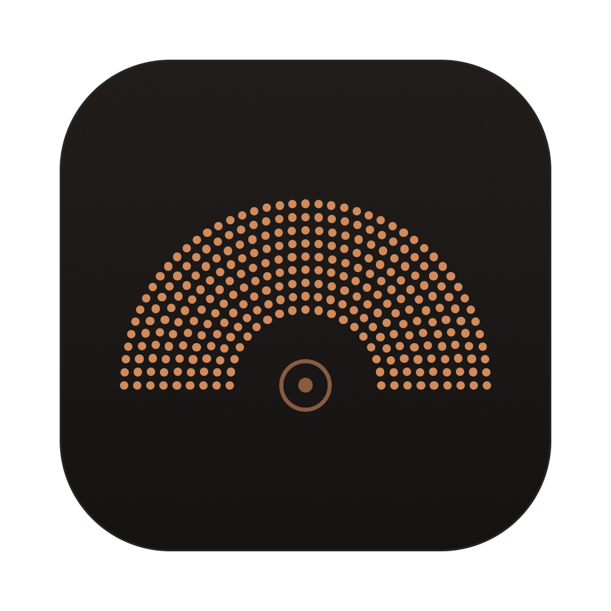

# Look

The rules every screen follows: surfaces, type, space, buttons, colour, and the status mark, with the app icon that's made from the mark. Each area's file shows its own screens. `crates/look` holds the theme, the colours the kit has no name for, the mark and the icon.

It's meant to feel familiar to the people Roundhouse is for, and it sets itself apart with a motif of its own, the status mark.

## Surfaces and type

- **Three warm near-black surfaces,** so the app reads as one calm field with a few raised things on it. The pane is `#151312`, the sidebar `#1a1715`, and anything raised, such as a message, a card, a popover or the selected tab, is `#24201e`. The composer and code blocks are `#1e1b19`.
- **One thin edge colour, `#2a2624`, and no shadows.** Edges separate, and nothing floats.
- **The system font, at 14px for body text.** Secondary text and tool calls use the kit's small size, 12.25px, and small details its extra-small size, 10.5px, both scaled from the body text. It's dense enough to watch many agents, and still easy to read.
- **Emphasis is medium weight, never bold.** Bold shouts in a dense layout.
- **Three text colours:** foreground `#ebe7e3`, muted `#a39d97`, and faint `#6f6964` for meta, line numbers and hints.
- **Code is Menlo at 12px,** set once in the theme.

## Space and shape

- **A 4px grid.** Controls are 28px tall, sidebar rows 30px, the workspace header 48px, and the chat tabs 40px.
- **Corners are 6px on controls, and 10px on cards and the composer.**
- **The transcript is a centred column, at most 780px wide,** so lines stay short enough to read in a wide window.
- **A tool call is one compact line,** with an icon for its kind and the input that matters, and its result folds underneath it, even when the agent runs several calls at once.

## Buttons

- **Each area has at most one main action,** with a light fill and dark text, such as Create PR, Send, Add repository or Send to agent. With one obvious next step per area, nothing competes with it.
- **Every other button is borderless until hovered.** A button with an outline opens something, like the pull request.

## Colour

Each colour means one thing.

- **Copper, `#d08a5c`, is the brand.** It's for empty states, the app icon and keyboard focus, and never a status.
- **Amber means it's your turn, and red means the agent stopped short.** A card that needs you, such as a question or an approval, gets a thin amber edge and a faint amber background.
- **A pull request's state is shown in GitHub's colours,** which the people Roundhouse is for already know: green when it's open, purple when it's merged, a muted red when it's closed, and a grey of its own when it's a draft.

## The status mark

Every workspace and chat has a mark: a half circle of fine dots around a turntable, like a roundhouse seen from above. It has four rows of dots, spaced evenly along each row, so outer rows have more of them and the edge stays as dense as the middle. Fine dots give it a texture of its own. It's 18px wide in the sidebar and 16px in chat tabs, cards and the working line. A bigger fan, such as the brand in an empty state, has more rows rather than bigger dots, so the texture stays fine, and its turntable stays the size it is in a four-row fan.

The mark has three layers, and each is about one thing, so several facts can show at once without competing:

| Layer | It's about | What it shows |
|---|---|---|
| The fan's colour | The work | Where its pull request stands: grey for none, then green, purple, muted red or a lighter grey, as above |
| A white light over the fan | The agent | A light sweeps the fan while the agent works, and the fan fills in while the workspace is set up |
| The whole fan in amber or red | You | Amber when it's your turn to answer or approve, red when the agent stopped short. The pull request's colour comes back once that's dealt with |

- **Only a running agent moves the mark.** Motion says the agent is working, so nothing else moves. When it's your turn, the fan turns amber and holds still. A moving mark is redrawn on every frame of the display, as smoothly as it can show, and the system's Reduce Motion setting holds it still. Pictures of the app hold every mark still at one moment, so they come out the same every time.
- **A workspace's mark speaks for its open chat that most needs attention.** `sidebar.md` has the rule.
- **The sidebar shows every workspace's pull request.** *Not built:* only a workspace that's open knows its pull request, until the hub sends it with each workspace. The others show no pull request.

## Empty states

- **An empty pane shows the mark in copper, what's missing and why, and the one thing to do about it,** as a main button. The mark is 72px wide there, with five rows.

## The app icon

The brand on a tile: the fan in copper, on a warm dark tile that fades from `#211d1b` at the top to the pane's `#151312`, with the thin edge colour around it.

- **Each size has a drawing of its own,** rather than one drawing scaled, because macOS shows each size's own drawing, and a big fan scaled down blurs into a smudge. Bigger drawings have more rows, so the dots stay as fine as the motif's.
- **Below 128 pixels it's drawn on whole pixels,** where the fan's own shape would blur: square dots with a pixel clear around each, mirrored across the line between the tile's two middle pixels so the fan sits in the middle, and a turntable that's only its hub where a ring would be too small to see. *Unconfirmed.*
- **macOS uses the smallest drawing with at least the pixels it needs,** and shrinks it to fit, so on a Retina display each drawing covers the sizes up to half its pixels in points.

| Pixels | Used on a Retina display | Rows | Drawn |
|---|---|---|---|
| 1024 and 512 | 129 to 512 points | 9 | The fan's shape, 62% of the canvas wide |
| 256 | 65 to 128 points | 7 | The fan's shape, 62% wide |
| 128 | 33 to 64 points, such as the Dock | 5 | The fan's shape, 64% wide |
| 64 | 17 to 32 points | 4 | On whole pixels, with dots two pixels square and a ring |
| 32 | 16 points and under, such as a list | 3 | On whole pixels, with dots two pixels square |
| 16 | Only on a display that isn't Retina, at 16 points | 2 | On whole pixels, with dots one pixel square. *Unconfirmed* |

- **It's an `.icns`,** because it keeps a drawing for each size. `look::icon` draws every size, and the gallery checks each against its file in `apps/desktop/AppIcon.iconset/`, which `iconutil` packs into the `.icns`. *Not built:* the app isn't packaged yet, so nothing shows the icon.
