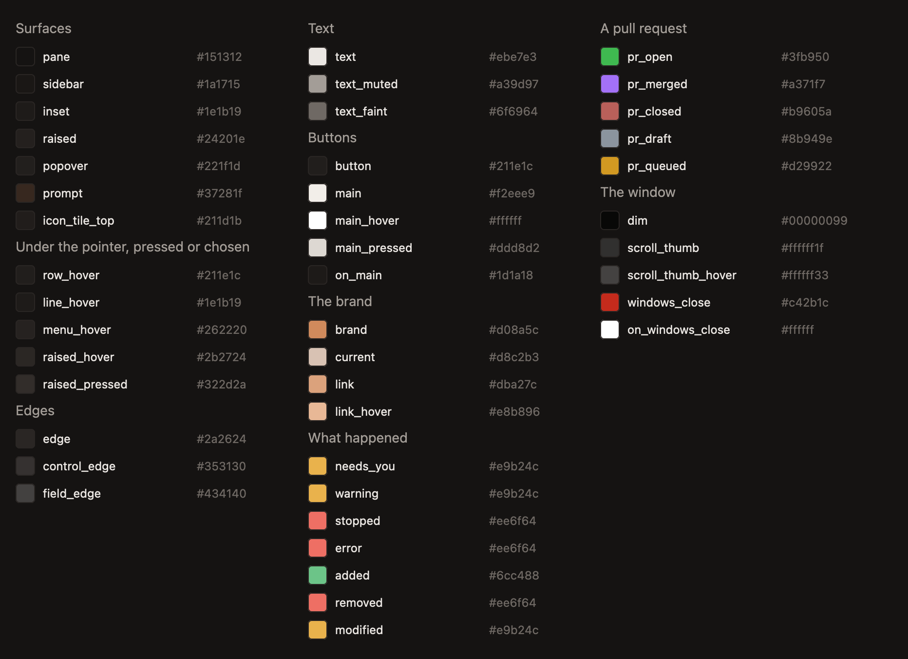
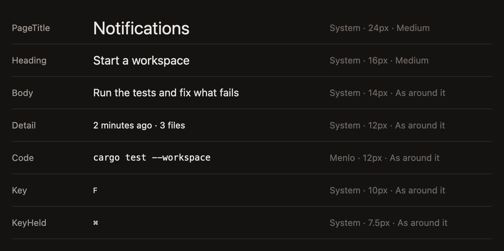
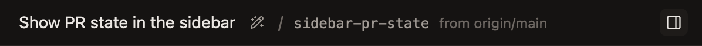
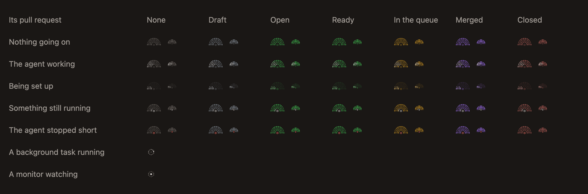
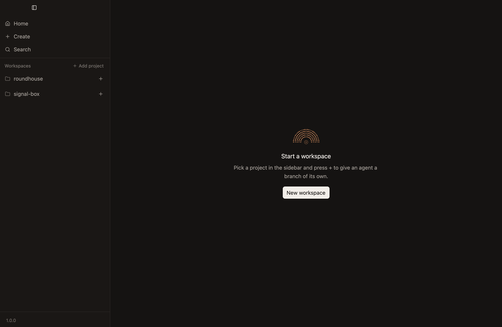
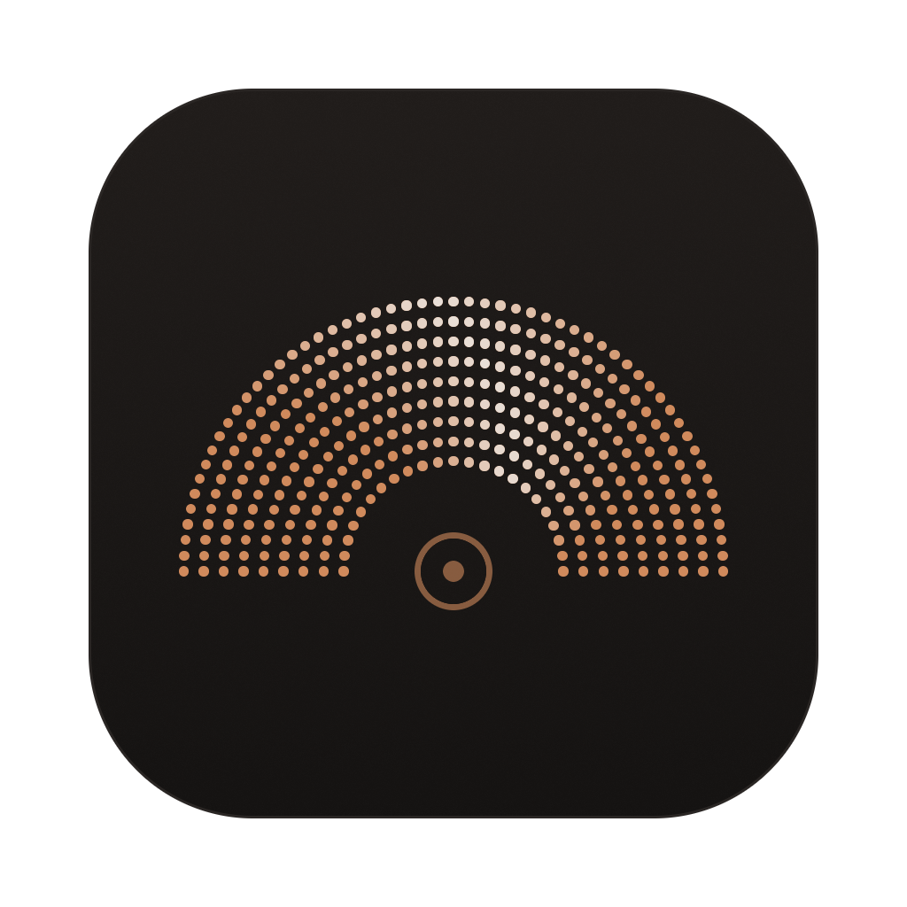

# Look

The foundations of the app's design system, the rules every screen follows: colour, type, space and shape, buttons, the pointer, and the status mark, with the app icon that's made from the mark. Each area's file shows its own screens. `crates/look` holds them in code: every colour by what it's for, the theme made from them, the mark, the icon, plan mode's texture, the pointing hand and the baseline text of different sizes shares.

It's meant to feel familiar to the people Roundhouse is for, and it sets itself apart with a motif of its own, the status mark.

## Colour

Each colour means one thing.

- **Three warm near-black surfaces,** so the app reads as one calm field with a few raised things on it. The pane is `#151312`, the sidebar `#1a1715`, and anything raised, such as a card or a popover, is `#24201e`. The composer and code blocks are `#1e1b19`. A prompt is a wash of the brand's copper, `#37281f`, so what was asked is easy to find when scrolling.
- **Two edge colours.** The thin edge that separates, around a card, along a header or between rows, is `#2a2624`. Something to use, such as the composer, a chip, a key, a field or a button that opens something, has a lighter edge, `#353130`, so it reads as something to use rather than as a line between two things. So does the button back down to a chat's end, which sits over the chat's text, as `chats.md` says.
- **One shadow, under what opens over the rest,** such as a card, the outline, the find bar or what a hover shows, so it reads as on top of what it covers. It's soft, so it lifts what's over the rest without drawing the eye: black at 22.5%, 8px below and blurred by 12px, and black at 15%, 2px below and blurred by 3px, as GPUI measures a blur, which is half what CSS calls it. What's raised in place, such as a pill or the update card, has none. A menu, a tooltip and a dialog cast it too. *Not built:* the kit draws them, each with a fainter shadow of its own.
- **A dialog dims everything behind it to 40% of its brightness,** under 60% black, so it's plainly the one thing to deal with, and what's behind it reads as out of reach. *Unconfirmed.*
- **Three text colours:** foreground `#ebe7e3`, muted `#a39d97`, and faint `#6f6964` for meta, line numbers and hints.
- **Copper, `#d08a5c`, is the brand.** It's for empty states, the app icon, keyboard focus, the edge of a comment being written, the wash behind a prompt and, quieter, a composer that's planning, and never a status.
- **Pale copper, `#d8c2b3`, marks the chat showing,** as the line under its tab. It's the brand's hue, paled toward the text, so it says where you are without reading as a status.
- **A composer that's planning is in a quieter copper.** Its surface takes a tenth of copper, its edge is copper at a little over half strength over that, and its texture's dots are copper. It's the brand's own colour, so plan mode reads as a way of working you chose rather than a status, and its edge stays quieter than keyboard focus, which the composer also shows while files are dragged over it. `chats.md` has the texture. *Unconfirmed.*
- **Amber is for the card that needs you, and red means the agent stopped short.** A plan waiting to be approved gets a thin amber edge and a faint amber background, and a failed request's card the same in red, as `chats.md` says. A question isn't a card, and neither is a request to use a tool, since each takes the composer's place, and has the thin edge colour on the pane's own surface, as `chats.md` says. Amber isn't on the mark, where the merge queue's yellow would be taken for it.
- **The diff uses the colours review tools do,** because they're about a file rather than about you or the agent: lines added and removed are green and red, and a modified file's icon is yellow.
- **A file's icon is in its kind's colours,** as Catppuccin's Mocha flavour draws them, in thin lines, which editors have made familiar, and a folder's is the plain folder in the muted text colour, whatever it holds, as is the plain file's, for a file with no icon of its own. They say what a file is, never how anything stands, so they sit beside a name and nowhere a status would.
- **A pull request's state is shown in GitHub's colours,** which the people Roundhouse is for already know: green when it's open, purple when it's merged, a muted red when it's closed, and a grey of its own when it's a draft.
- **The pull request's bar says more with the same colours.** It's green only once nothing is in the way of merging, and on the theme's raised surface, in the text colour, while there's something to do first. A place in the merge queue is GitHub's yellow, which GitHub uses for what's waiting on it, and the bar always says in words what it's waiting for, so it isn't taken for amber's turn of yours. The fan is yellow there too, and green for every other open pull request, since it's too small to say what's in the way of merging. Amber is never on the mark, so the queue's yellow isn't taken for it. `look::Work` chooses them from `look::Colors`, so a workspace's fan and the bar can't disagree. *Unconfirmed.*
- **Every colour the app draws with has a name for what it's for,** so a colour means the same wherever it's drawn, and two that look alike and mean different things, such as an approval's amber and a warning's, can change apart. What's drawn takes one of them by its name, or one of them at a strength chosen where it's drawn, such as a removed line's wash, which is `removed` at 12%, rather than a colour by its value. The app is dark only, and a light theme would be a second set of values for the same names. `look::Colors` holds them, and the kit's theme is made from them, so the kit's own parts, such as its buttons and menus, draw with the same ones. The few that only the kit's own parts draw with, such as the text on its danger button, are given where the theme is made. Code's colours, a file's icon and an image's pixels are their own, as above. *Unconfirmed.*

**Every colour, by its name.** Each is the field of that name in `look::Colors`. *Unconfirmed.*

| Name | Colour | For |
|---|---|---|
| **Surfaces** | | |
| `pane` | `#151312` | The workspace's pane, Home's and Settings' pages, and the window's ground |
| `sidebar` | `#1a1715` | The sidebars |
| `inset` | `#1e1b19` | What's set into a surface: the composer, a prompt waiting in the queue, a call's output, a code block |
| `raised` | `#24201e` | Anything raised, whether it opens over the rest, such as a card, a menu, a tooltip or what a hover shows, or sits in place, such as a pill, a file's header, the update card or an open pull request's bar with something to do |
| `prompt` | `#37281f` | A prompt's bubble |
| `icon_tile_top` | `#211d1b` | The top of the app icon's tile |
| **Under the pointer, pressed or chosen** | | |
| `row_hover` | `#211e1c` | A row in a list under the pointer, such as Home's or a file's |
| `line_hover` | `#1e1b19` | A call's line under the pointer, and the compaction's |
| `menu_hover` | `#282321` | A menu's row under the pointer, a step above the menu, a page in Settings' sidebar, under the pointer or open, and behind code within a line of text, which the kit draws in the grey of its menus' rows |
| `raised_hover` | `#2b2724` | Something raised, under the pointer |
| `raised_pressed` | `#322d2a` | Something raised, pressed, and the sidebar's selected row |
| **Edges and the shadow** | | |
| `edge` | `#2a2624` | The thin edge that separates: around a card, along a header, between rows |
| `control_edge` | `#353130` | Something to use: the composer, a chip, a key, a field, a button that opens something, the button back down to a chat's end |
| `shadow` | `#000000` | Under what opens over the rest, faint |
| **Text** | | |
| `text` | `#ebe7e3` | What to read |
| `text_muted` | `#a39d97` | What's secondary, and a name that needs nothing from you |
| `text_faint` | `#6f6964` | Line numbers, meta, hints, and a mark with no pull request |
| **Buttons** | | |
| `button` | `#211e1c` | A button with an edge, such as a dialog's Cancel |
| `main` | `#f2eee9` | An area's one main action, such as Send |
| `main_hover` | `#ffffff` | The main action under the pointer |
| `main_pressed` | `#ddd8d2` | The main action pressed |
| `on_main` | `#1d1a18` | What's on the main action, and on any other light fill |
| **The brand** | | |
| `brand` | `#d08a5c` | Copper: empty states, the icon, keyboard focus, the caret, a comment being written, a composer that's planning |
| `current` | `#d8c2b3` | Pale copper: the chat showing, and, faint, what's found |
| `link` | `#dba27c` | A link |
| `link_hover` | `#e8b896` | A link under the pointer |
| **What happened** | | |
| `needs_you` | `#e9b24c` | The card that needs you, such as an approval |
| `warning` | `#e9b24c` | A warning, such as setup that failed |
| `stopped` | `#ee6f64` | The agent stopped short: its mark's turntable, and a turn that failed |
| `error` | `#ee6f64` | Something else that went wrong, such as a call that failed |
| `added` | `#6cc488` | Lines and counts added to a file |
| `removed` | `#ee6f64` | Lines and counts removed from a file |
| `modified` | `#e9b24c` | A file that's changed, and what changed in an image |
| **A pull request** | | |
| `pr_open` | `#3fb950` | Open |
| `pr_merged` | `#a371f7` | Merged |
| `pr_closed` | `#b9605a` | Closed |
| `pr_draft` | `#8b949e` | A draft |
| `pr_queued` | `#d29922` | Waiting on GitHub, such as in the merge queue |
| **The window** | | |
| `dim` | `#00000099` | Over everything behind a dialog |
| `scroll_thumb` | `#ffffff1f` | A scrollbar's thumb |
| `scroll_thumb_hover` | `#ffffff33` | A scrollbar's thumb under the pointer |
| `windows_close` | `#c42b1c` | Windows' close button under the pointer |
| `on_windows_close` | `#ffffff` | Its glyph |

Three strengths have names of their own, since several places draw with them: what's selected in text is `brand` at 30%, the most the kit lets a selection show, every match of what's found is `current` at 22%, and the match being shown is `brand` at 55%. *Unconfirmed.*

**Every colour by its name, as the app draws it.** *Unconfirmed.*

## Type

- **The system font, at 14px for body text.** Secondary text is muted, at the same size or at 12px for details. Sizes in rems are measured from 16px, as the web's and the kit's are, so the kit's spacing comes out as the web's does. It's dense enough to watch many agents, and still easy to read. A tool call's line is at body size, since what it did is the main thing it says. *Unconfirmed.*
- **Emphasis is medium weight, never bold,** for what should stand out from what's around it, such as the title that names what a card or section is about. Bold shouts in a dense layout. Medium is drawn as regular, since the text system gives a request for medium the system font's regular face. *Not built.*
- **In a list of one kind of thing, such as the workspaces in the sidebar or the chat tabs, a name's colour and weight change only for state that needs you,** such as a reply you haven't read. Which one is selected or open shows in its background or underline instead, and its name looks as it does when it isn't. Names are read side by side, so any change to one reads as news, and macOS's font smoothing thickens brighter text, so a name that brightened would look heavier too.
- **Code is Menlo at 12px,** set once, as `look::Type` has it, and given to the kit's theme from there.
- **Every kind of text the app sets has a name for what it's for,** so a size means the same wherever it's set, and two kinds that are the same size today, such as details and code, can change apart. What's set takes one of them by its name, rather than a font or a size by its value, and text that stands out from what's around it takes emphasis rather than a weight. `look::Type` holds them, and the kit's theme is given the rem, and code's font and size, from there, so the kit's own parts agree.
- **Text in different sizes or fonts along one line sits on one baseline,** as the words of a sentence do, such as the workspace header's title beside its branch, in the code font, and where that started, both smaller. Centred one by one, smaller text would ride higher than what's beside it. An icon stays centred, and so does text on a shape, such as a pill, a chip or a button, since it's the shape that's lined up. `look::LineText` sets them. *Unconfirmed.*

**Every kind of text, by its name.** Each is a kind in `look::Type`, at the app's scale, where a rem is 16px. One with no weight of its own takes what's around it, which is regular unless it's given emphasis.

| Name | Font | Size | Weight | For |
|---|---|---|---|---|
| `PageTitle` | System | 24px | Medium | A page's name, such as each of Settings' pages: the largest kind, since it says where you are |
| `Heading` | System | 16px | Medium | What an empty pane says is missing, above why |
| `Body` | System | 14px | As around it | What to read: what the agent wrote, a prompt, a call's line, a row's name, and most of the rest |
| `Detail` | System | 12px | As around it | Details beside or under what to read, such as a time, a count, a hint or a heading over a list |
| `Code` | Menlo | 12px | As around it | Code: a command, a path, a file, or what a call put out |
| `Key` | System | 10px | As around it | What a key says, such as the `F` of Settings' `⌘ F` |
| `KeyHeld` | System | 7.5px | As around it | What's held with a key, such as Settings' `⌘`, smaller than the key that's pressed, as on the keys themselves |

**Every kind of text, as the app sets it.**

## Space and shape

- **A 4px grid.** Controls are 32px tall, or 24px for small ones, sidebar rows 36px, the workspace header 40px, and the chat tabs 40px. *Unconfirmed.* Settings' sidebar has sizes of its own, so it looks familiar: its search is 28px tall, spaced to the point rather than the grid, with a key 16px tall and 4px corners, and its pages' rows are 32px. *Unconfirmed.* The button back down to a chat's end is a 28px square, as `chats.md` says.
- **The window has no title bar of its own.** The sidebar and the workspace header run up to its top edge, so the app reads as one field, and on a Mac the window's buttons sit in the sidebar's top corner, level with the header and as far from the top as from the side, or over the start of the header while the sidebar is hidden, as `sidebar.md` says. The strip along the top, as tall as the header, stands in for a title bar: dragging it moves the window and double-clicking it does what double-clicking a title bar does, which on a Mac is what its setting says and on Windows is maximizing or restoring the window, except where a button or a sidebar's edge takes the press, and pressing it leaves focus where it was.
- **On Windows, the window's buttons are Windows' own three, minimize, maximize or restore, and close, at the right end of the strip and as tall as it,** since Windows puts them there and has no title bar here to hold them. Each is 46px wide and drawn as Windows draws its own, with the glyph from Windows' icon font, Segoe Fluent Icons, or Segoe MDL2 Assets on Windows 10, or the kit's icon where neither is installed, in the text colour, dimmed while another window is active, a faint shade under the pointer, and Windows' red with a white glyph under it for close. They work as Windows' own do, minimizing, maximizing or restoring, or closing the window as the press is let go, and a screen reader can press each. They're over everything, a dialog included, so they work while one is open. What reaches the strip's right end ends before them: the pull request's bar while the sidebar of changes shows, which leaves out its number once the number doesn't fit beside its action, and otherwise the workspace's header, Home's bar or an error. An action longer than all the room the bar has left, at the sidebar's narrowest, still runs under them, and for the moment the sidebar of changes slides in, the bar passes under them, since it slides at its whole width. The top left corner then has the app's own two, the button that opens the menus and then the one that hides the sidebar, each a small button, 4px apart and 12px from the window's edge, as it does on Linux, where the strip has no window buttons. *Unconfirmed.*
- **The window opens where it was left,** at the size it was, on the display it was on, and in full screen if it was, so a window kept filling the screen still fills it after the app restarts to update. On Windows, one snapped to an edge or a corner, or stretched to the display's height, opens there as an ordinary window, since Windows can't be told to snap a window, and one closed while minimized opens as it was before, filling the screen if it did. One whose display has gone, or that would open out of reach, opens at its usual size in the middle of the main display. *Unconfirmed.*
- **Corners are 6px on controls, and 10px on cards and the composer.**
- **The transcript is a centred column, at most 848px wide,** so lines stay short enough to read in a wide window. *Unconfirmed.*
- **Everything in the transcript but a prompt starts on the column's left edge:** what the agent wrote, a call's icon, and what a call or a thought opens to, so the eye always goes back to the same place. Something with an edge, such as a code block or the rule down a subagent's work, puts its edge there, and what's inside it sits in from it.
- **A prompt sits at the right of the column, on a bubble only as wide as what it says,** so what was asked stands apart from the agent's work, which starts at the left. The bubble has no edge, a control's 6px corners, 16px of room beside its text and 12px above and below. It's at most 80% of the column wide, so it never reaches across the column the way the agent's work does. *Unconfirmed.*
- **The composer is centred under the transcript, 24px wider than its column on each side, and at most 896px wide,** so the transcript's text sits inside the composer's edges. It has room for four lines before it grows, so a longer prompt doesn't start out cramped, and empty it's about 150px tall. *Unconfirmed.*
- **The bar along the composer's bottom has two ends.** The left one sets up the prompt: the `+`, whose menu attaches files and turns plan mode on and off, then the model picker. The right one is the agent's: what it says of itself, such as how full its context is, and last the one main action, Send or Stop. Each thing beside the main action sits in the middle of a 24px square, the main action's own size, so things of different sizes line up with it and are as easy to point at as each other. The squares are 8px apart, and the main action is 16px from them, so it stands apart. Something 16px wide there, as the context's ring is, is so 20px from the main action and 16px from another like it. *Unconfirmed.*
- **A tool call is one line:** an icon for its kind, what it did in a few words, and the detail that matters, such as the command on a raised pill or an MCP server in an outlined chip. Hovering the line turns its icon into a chevron, and clicking it opens what the call did in a block underneath, which scrolls once it's taller than a dozen lines or so. The wheel over a block that scrolls moves the block until it reaches the end the wheel is turning toward, and then the transcript, so a long block reads straight on into the rest of the chat. Over a block that fits, the wheel moves the transcript. A scroll stays with what it started on, as it does in a browser, so one that starts on the transcript carries on over the blocks it meets, and a trackpad's fling of a block stops at the block's end rather than speeding the transcript on. A scroll lasts from touching the trackpad to the end of the fling, or for a mouse wheel until it pauses. Calls in a row sit 36px apart, as one list. `chats.md` has how each kind of call reads. *Unconfirmed.*
- **What a click opens, a second click closes without the pointer moving,** so the line that was clicked stays exactly where it is in the window while what it opened to comes and goes under it. At a chat's end, where the chat otherwise keeps its end at the window's bottom, opening something leaves the chat where it is, with its end out of sight as if it had been scrolled away from. Closing something there that would leave the chat ending above the window's bottom, with more of it above the window's top, brings the chat down until its end is at the bottom, since that room would show nothing, and the chat keeps to its end from there. That's the one place the line moves out from under the pointer. *Unconfirmed:* what the chat's end does.

## Buttons

- **Each area has at most one main action,** with a light fill and dark text, such as Create PR, Send, Add project or Send to agent. With one obvious next step per area, nothing competes with it.
- **Every other button is borderless until hovered.** A button with an outline opens something, like the pull request. The button back down to a chat's end has an edge at rest, since it sits over the chat's text, as `chats.md` says.

  **The workspace's header, with the pointer on the button that hides the sidebar of changes, which fills under it.** *Unconfirmed.*

  

- **The pull request's bar fills its main action with the pull request's colour,** still with dark text, so the action reads as part of the bar it's on. One with no colour of its own, such as Create PR, is the light main button. *Unconfirmed.*

## The pointer

- **The pointer is a hand over anything that can be pressed:** a button, a tab, a switch, a link, and a row that opens something, such as a workspace's or a file's. What can be pressed is then plain before it's pressed, even where a borderless button looks like a label until it's hovered. It's a hand whether or not a press would change anything just then, as over the tab that's already showing or Send with nothing typed, so the hand says what a thing is and doesn't flicker as its state changes. The kit's own controls, such as the button that removes an attached file and a dialog's close button, keep its arrow. *Unconfirmed.*
- **It stays an arrow over what's greyed out,** such as a button that can't be pressed yet, and over one that's waiting, so the pointer agrees with how the button looks. A switch that's greyed out has the kit's barred circle instead. *Unconfirmed.*
- **It stays an arrow over what only shows something while the pointer rests on it,** such as the context's ring, since a hand there would ask for a click that does nothing. *Unconfirmed.*
- **It's an open hand over what can be dragged to another place, such as a project's row in the sidebar, and a closed one while it's dragged,** even where a press does something too, since a hand that points would say nothing of the drag. *Unconfirmed.*
- **A menu's rows keep the arrow, as the system's menus do,** since an open menu is nothing but things to click, and the row under the pointer is lit. *Unconfirmed.*
- **It's an I-beam over text that can be typed in or selected,** such as the composer and what the agent wrote, as it is everywhere else on a Mac, so it's plain that dragging there selects. *Unconfirmed.*

## The status mark

Every workspace and chat has a mark: a half circle of fine dots around a turntable, like a roundhouse seen from above. It has four rows of 9, 13, 17 and 21 dots, the same distance apart along every row. Each row has four more dots than the one inside it, so the fan keeps the same pattern with any number of rows, the rows sit a little further apart than the dots in them, and every row has a dot on the middle line, so the rows line up down it. The inner row has the fewest dots that keep it at least 2/5 of the way out to the outer row, which leaves room for the turntable. Fine dots give it a texture of its own. It's 26px wide in the sidebar, where it fills the room before a workspace's name and its dots are big enough to tell apart at a glance, and 16px in chat tabs, the working line and Home. A much bigger fan, such as the brand in an empty state, has more rows rather than bigger dots, so the texture stays fine, and its turntable stays the same share of its width.

The mark has three layers, and each is about one thing, so several facts can show at once without competing:

| Layer | It's about | What it shows |
|---|---|---|
| The fan's colour | The work | Where the workspace's pull request stands: grey for none, then green, yellow in the merge queue, purple, muted red or a lighter grey, as above |
| A white light over the fan | The agent | A light sweeps the fan while the agent works, keeps to the inner row once its turn has ended with something still running, and the fan fills in while the workspace is set up |
| The turntable in red | You | Red when the agent stopped short: it went away mid-turn, or its turn failed, as on a usage limit. It goes back to the fan's colour once that's dealt with, as a turn starts again |

- **Only an agent with something running moves the mark.** Motion says something is going on there, so nothing else moves. While the agent waits on you, the fan holds still. A moving mark is redrawn on every frame of the display, as smoothly as it can show, and the system's Reduce Motion setting holds it still. Pictures of the app hold every mark still at one moment, so they come out the same every time.
- **Only the pull request changes the colour of a workspace's fan,** so the colour always means one thing, and matches the bar. What's about you is on the turntable and the name, which leave the fan as it is.
- **A chat's fan is grey,** in its tab and on its working line, since a pull request belongs to the workspace, not to one of its chats. So a chat's mark says only what its agent is doing, and the workspace's mark shows the pull request.
- **The turntable shows one thing at a time:** red, then the white of something still running. *Unconfirmed.*
- **The light sweeps the whole fan only for the agent's own work:** a turn, or a subagent it left going when its turn ended. *Unconfirmed.*
- **Once a turn has ended with anything else still running, the light keeps to the inner row, beside the turntable, which is lit, and goes slower.** A command left running might end by itself, as a test run does, or be held open, as an app is, and the agent doesn't say which. So the mark claims only what's known: something is running there, and it isn't the agent. *Unconfirmed.*
- **A workspace's mark speaks for its open chat with the most going on.** `sidebar.md` has the rule.
- **A reply you haven't read isn't on the mark, and neither is a chat waiting on you.** Both mean the same to you, that it needs a look, so the name beside the mark says that one thing, as `sidebar.md` says, and the chat says which. It shows along with whatever the mark says, such as the light of something the agent left running. That reply might be the agent handing over, such as an app it opened for you to look at, so nothing on the mark hides it.
- **Plan mode's texture is drawn from the mark without keeping to its rule.** Its rows are half circles of fine dots around one centre, with a dot on the middle line of each, but they're further apart than four more dots a row would put them, so each reads as a dotted line, and the dots are only about the same distance apart along every row. At the composer's size, the rule's own rows blur into an even field of dots. `chats.md` has the texture. *Unconfirmed.*
- **The sidebar shows every workspace's pull request.**
- **A background task has a ring, not a mark:** ten dots around a hub, which is the fan's turntable on its own, 16px wide so what follows it lines up with the working line's. The fan is for an agent, and a task isn't one. `chats.md` says when its light goes round. *Unconfirmed.*
- **A subagent at work in the background has the robot its call's line has instead, with a white light sweeping across it,** so its line reads as the call it came from and plainly says it's at work. The light is the agent's, as it is on the fan, since a subagent is the agent's own work. It crosses the whole robot from left to right, fading at its edges, so its outline lights up as it passes, where the eyes alone are too small to show a change at a glance. It goes at the pace a ring's light goes round, so it doesn't vie with the working line. In pictures and with Reduce Motion, it holds still across the robot's face. It's as wide as the ring, so what follows it lines up too. *Unconfirmed:* how fast it goes, how wide the light is, and where it holds still.

**Every state of the mark, against each colour a pull request gives its fan, at the sidebar's size and Home's, the ring of a background task, and a subagent's robot.** A tab's mark is the `None` column at Home's size. *Unconfirmed.*

## Empty states

- **An empty pane shows the mark in copper, what's missing and why, and the one thing to do about it,** as a main button. The mark is 72px wide there, with five rows.

  **The pane with projects and no workspace yet, which says to start one.** *Unconfirmed.*

  

## The app icon

The brand on a tile, caught working: the fan in copper with the agent's white light partway across it, as a working mark draws it, on a warm dark tile that fades from `#211d1b` at the top to the pane's `#151312`, with the thin edge colour around it.

- **The light sits just right of the middle** of the inner row, with the outer row trailing as far behind as a four-row mark's, at every size. It's held still, so it doesn't say an agent is running. It's the fan as it looks at work, and says what the app is for: many jobs, one being worked on.
- **The fan at rest is a second style,** [without the light](../../apps/desktop/icons/idle.iconset/icon_512x512@2x.png), drawn and checked the same way.

- **Each size has a drawing of its own,** rather than one drawing scaled, because macOS shows each size's own drawing, and a big fan scaled down blurs into a smudge.
- **Smaller drawings have fewer rows,** so the dots stay big enough to see: four at 256 pixels, which the Dock shrinks to under half its size, three at 128 and 64, and two below that. Only the largest drawings, where there are pixels for it, have nine rows of fine dots.
- **Every size follows the status mark's rule,** so there's one geometry in the app and its icon: four more dots a row, the same distance apart along every row, with a dot on the middle line of each. The 16-pixel drawing is the one exception, with one dot fewer in every row and a gap on the middle line instead, since its one-pixel dots can't sit on the line between two pixels.
- **Below 128 pixels it's drawn on whole pixels,** where the fan's own shape would blur: the rule's dots moved onto whole pixels as squares, far enough apart that each keeps a pixel clear around it, mirrored across the line between the tile's two middle pixels so the fan sits in the middle, and a turntable that's only its hub where a ring would be too small to see. *Unconfirmed.*
- **macOS mostly uses the smallest drawing with at least the pixels it needs,** and shrinks it to fit, so on a Retina display each drawing covers the sizes up to half its pixels in points. The Dock is the exception: at about 55 points it uses the 256-pixel drawing.

| Pixels | Used on a Retina display | Dots in each row, inside out | Drawn |
|---|---|---|---|
| 1024 and 512 | 129 to 512 points, such as Finder's largest icons | 23, 27, 31 … 55, in nine rows | The fan's shape, 62% of the canvas wide |
| 256 | 65 to 128 points, and the Dock | 9, 13, 17, 21 | The fan's shape, 66% wide |
| 128 | 33 to 64 points | 7, 11, 15 | The fan's shape, 66% wide |
| 64 | 17 to 32 points | 7, 11, 15 | On whole pixels, with dots two pixels square and a ring |
| 32 | 16 points and under, such as a list | 5, 9 | On whole pixels, with dots two pixels square |
| 16 | Only on a display that isn't Retina, at 16 points | 4, 8 | On whole pixels, with dots one pixel square. *Unconfirmed* |

- **It's an `.icns`,** because it keeps a drawing for each size. `look::icon` draws each style at every size, and the gallery checks each against its file in the style's iconset in `apps/desktop/icons/`. `tools/package/package.sh` packs the app's, `working.iconset`, into the `.icns` with `iconutil`.
- **On Windows it's an `.ico`, which the program carries as well as the installer,** so the app's windows and their taskbar button show it too. It holds the drawings for 16, 32, 64, 128 and 256 pixels, since an `.ico` holds none larger. `tools/package/ico.py` makes it from `working.iconset` as `apps/desktop/icons/AppIcon.ico`, which is checked in, so building needs no Python, and a test fails once it no longer matches the drawings. *Unconfirmed.*
