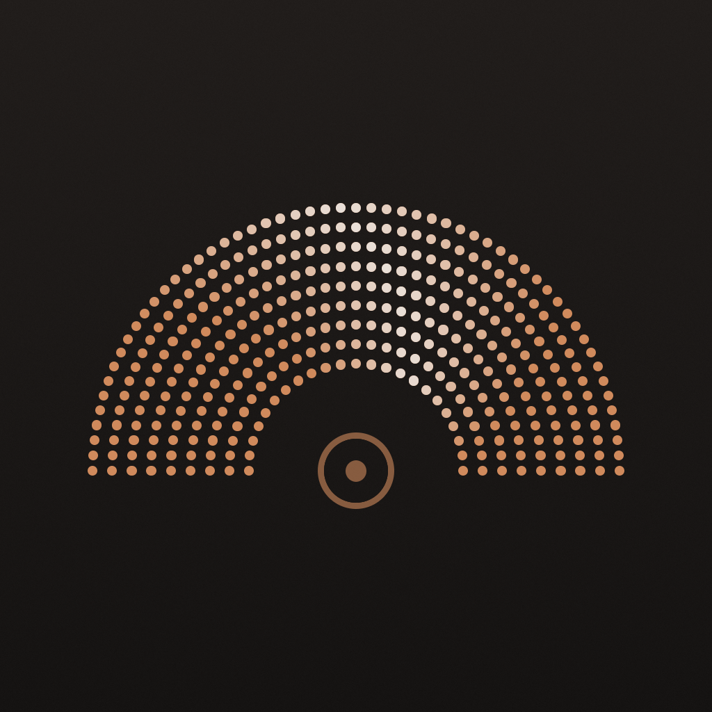

# The iPhone app

One hub's workspaces and chats, on a phone, for keeping work moving away from the desk. It does less than the desktop app on purpose: it shows what the agents are doing, answers them, and starts new work, and leaves reviewing and merging to the desktop.

## Reaching the hub

- **A phone pairs with one hub, by scanning a QR code with the Camera app.** `roundhouse phone pair`, on the hub's computer, shows the code and waits. The code opens the app with a link, and the app pairs without anything to type. The link can be pasted too, for a phone that can't scan. Pairing with another hub replaces the first. *Unconfirmed.*
- **The phone reaches the hub directly,** over the same network or a VPN to it, such as Tailscale, and only while the hub's computer is awake. The hub's QR code holds every address the phone might reach it at, and the phone tries them in order. *Not built:* a relay, for a hub that a phone can't reach directly. *Unconfirmed.*
- **What the phone keeps is enough to connect again, and no more.** The token the hub gave it is in the Keychain, for this phone only, so no backup carries it to another, and the hub's name, addresses and key are in the app's own files. Removing the phone on the hub, with `roundhouse phone revoke`, closes its connections and stops the token working. *Unconfirmed.*
- **A lost connection comes back without asking.** The app tries again after a second, then waits twice as long after each failure, up to 30 seconds, and says it's trying. Coming back to the app after 20 seconds away connects again at once, since a phone that slept may hold a connection that's gone without a word. What's typed and what's shown stay as they were. *Unconfirmed.*
- **The hub screen says how the connection stands and where the phone looks for the hub,** with a reminder that the phone needs the hub's network or a VPN to it, and a button to forget the hub and pair again. *Unconfirmed.*

## Workspaces

- **The first screen lists the hub's workspaces, grouped by repository,** newest first, each with the status mark the desktop's sidebar shows, its name, and its branch where that isn't the name again. Archived workspaces aren't listed. *Unconfirmed.*
- **Tapping a workspace opens its chat:** the one most recently active, or a new one if it has none open. *Unconfirmed.*
- **`+` starts a workspace in a repository the hub already has,** with the hub's choice of name and branch, as the desktop app does, and opens its chat. Adding a repository needs the hub's computer. *Unconfirmed.*

## A chat

- **A chat shows the same transcript as the desktop,** live as the agent works, with the workspace and branch above it. *Unconfirmed.*
- **Return makes a new line, and the arrow sends.** The on-screen keyboard's Return only ever types a new line, so sending is a button. The composer grows to six lines. *Unconfirmed.*
- **The agent's approvals and questions are answered in the chat,** with the transcript's own buttons, as on the desktop. *Unconfirmed.*
- *Not built:* stopping a turn, other chats in the workspace, the model and mode pickers, and the diff.

## How it looks

- **It's the desktop's look,** with the same theme, colours and status marks, and type a size up for a phone held at arm's length: 16 points for text and 13 for code. Everything tappable is at least 44 points tall, as iOS asks. *Unconfirmed.*
- **It's always dark, and portrait only,** like the desktop app, which has no light theme. *Unconfirmed.*
- **The app icon is the desktop's, drawn for iOS:** the working icon's tile filling the canvas, since iOS rounds it, with the fan as big against the tile as on the Mac. `look::phone_icon` draws it, and the gallery checks it against the asset catalog's in `apps/mobile-ios/ios/`. *Unconfirmed.*

*Not built:* the gallery doesn't draw the phone's screens yet, so none are shown here.
