# The iPhone app

One hub's workspaces and chats, on a phone, for keeping work moving away from the desk. It does less than the desktop app on purpose: it shows what the agents are doing, answers them, and starts new work, and leaves reviewing and merging to the desktop.

## Reaching the hub

- **A phone pairs with one hub, by scanning a QR code with the Camera app.** `roundhouse phone pair`, on the hub's computer, shows the code and waits. The code opens the app with a link, and the app pairs without anything to type. The link can be pasted too, for a phone that can't scan. Pairing with another hub replaces the first, so a link opened while paired asks first, since any app can open one. *Unconfirmed.*

  **A phone that has never paired.** *Unconfirmed.*

  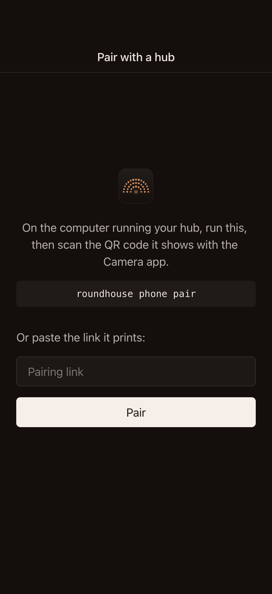

  **A link that isn't a pairing link.** *Unconfirmed.*

  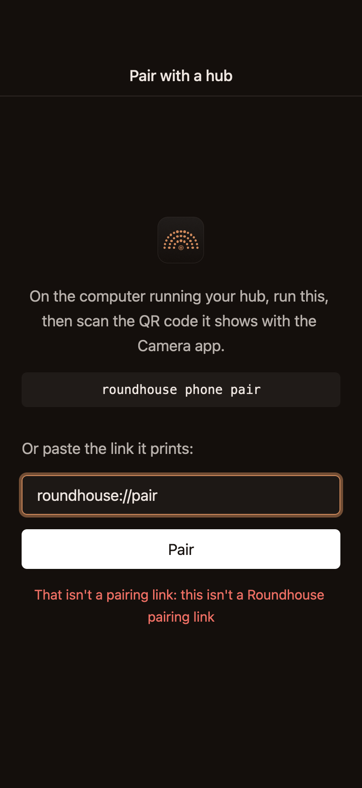

  **A link to another hub, which asks before it replaces the first.** *Unconfirmed.*

  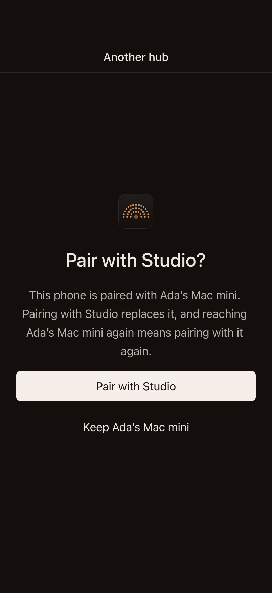

- **The phone reaches the hub directly,** over the same network or a VPN to it, such as Tailscale, and only while the hub's computer is awake. The hub's QR code holds every address the phone might reach it at, and the phone tries them all, each a moment after the last, and uses whichever answers first, so an address it can't reach doesn't hold it up. *Not built:* a relay, for a hub that a phone can't reach directly. *Unconfirmed.*

  **A hub the phone can't reach.** *Unconfirmed.*

  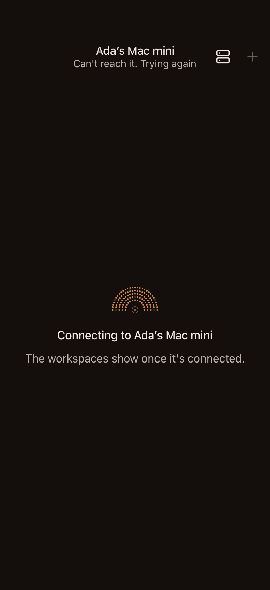

- **What the phone keeps is enough to connect again, and no more.** The token the hub gave it is in the Keychain, for this phone only, so no backup carries it to another, and the hub's name, addresses and key are in the app's own files. Removing the phone on the hub, with `roundhouse phone revoke`, closes its connections and stops the token working. *Unconfirmed.*
- **A lost connection comes back without asking, unless only a person can bring it back,** by the rule every client follows, in `hubs.md`, and the app says it's trying. A hub that refuses the phone's token, answers with another key, or is across a protocol break from this app isn't tried again until the app comes back to the front, and the hub screen says why. Coming back to the app after 20 seconds away connects again at once, since a phone that slept may hold a connection that's gone without a word. What's typed and what's shown stay as they were. *Unconfirmed.*

  **Connecting, before the hub has answered.** *Unconfirmed.*

  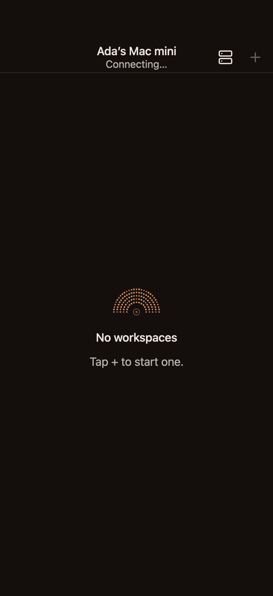

  **A hub lost while its workspaces showed.** *Unconfirmed.*

  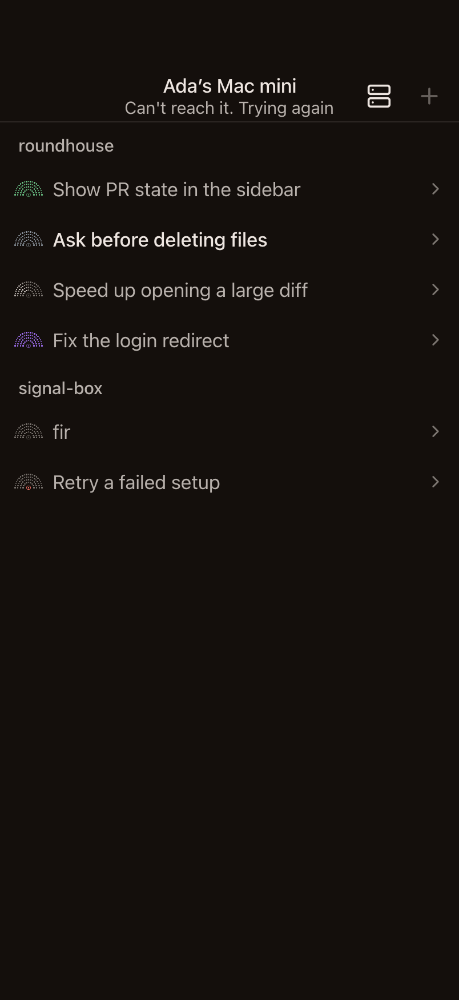

- **The hub screen says how the connection stands and where the phone looks for the hub,** with a reminder that the phone needs the hub's network or a VPN to it, and a button to forget the hub and pair again. A hub the phone couldn't forget, such as when the Keychain refuses, stays, with why, since the app would follow it again the next time it starts. Forgetting leaves the token working on the hub until it's revoked there. *Unconfirmed.*

  **The hub screen.** *Unconfirmed.*

  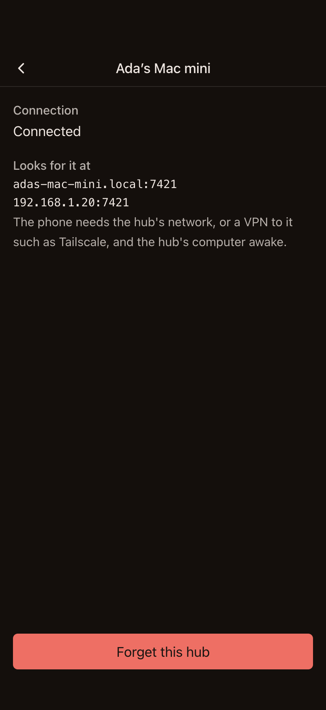

## Workspaces

- **The first screen lists the hub's workspaces, grouped by repository,** newest first, each with the status mark the desktop's sidebar shows, in its pull request's colour as the hub sends it, what the sidebar calls it, which is its title or its name until it has one, and its branch where that isn't the same again. Only workspaces that are ready are listed, since one still being made or archived has nothing to open. *Unconfirmed.*
- **A workspace's name is muted until it needs a look, then at full brightness in medium weight,** as in the desktop's sidebar, as `sidebar.md` says: one of its open chats has a reply nobody has read, or waits on an answer or an approval. *Unconfirmed.*

  **A hub's workspaces, with one waiting on an answer.** *Unconfirmed.*

  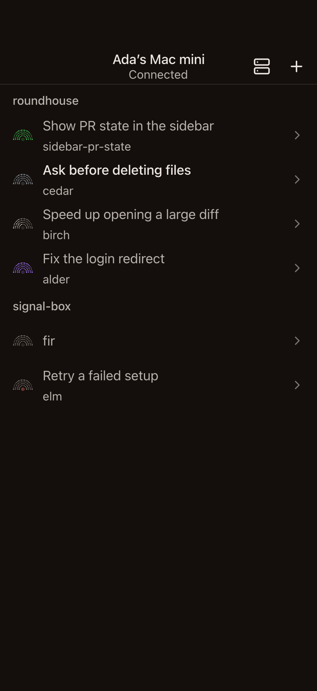

  **A hub with no workspace yet.** *Unconfirmed.*

  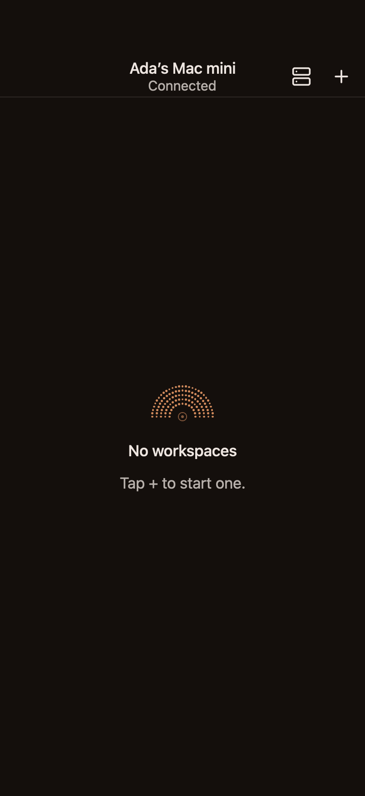

- **Tapping a workspace opens its chat:** the one last worked in, as the desktop opens it on, or with none open, the one the hub finds or starts, on the agent the hub would start a chat on. *Unconfirmed.*
- **A long press on a workspace's row opens its menu, as a right-click on its row in the desktop's sidebar does:** Mark as read, or Mark as unread, as the desktop's would mark it, then Rename… and Regenerate title, and Archive last, in red, after a line. The row lifts over the dimmed list with its menu under it, as `components.md` says. *Unconfirmed.*

  **A workspace's menu, from a long press on its row.** *Unconfirmed.*

  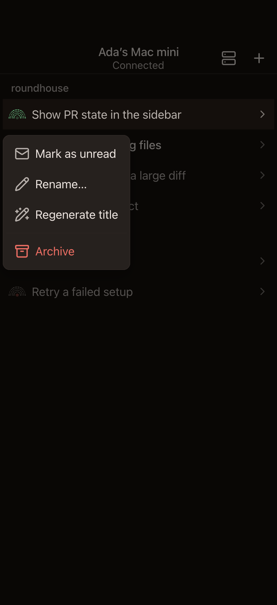

- **Archive asks first, in an action sheet, since the phone can't bring a workspace back,** as the owner decided. Where the hub says there's work archiving would lose, it asks again, saying what, before archiving anyway, as the desktop does. With no connection, the sheet stays, and the screen says it couldn't archive, so it can be tried again once the hub's back. *Unconfirmed:* asking again, and the sheet staying.

  **Archiving, asked first.** *Unconfirmed.*

  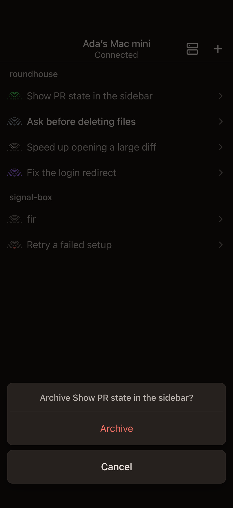

- **Renaming is in a sheet, with the name in a field, selected, so typing replaces it,** and Rename, which an empty name leaves the sheet open for, as no connection does, with what's typed, saying it couldn't rename. The hub tidies what's typed, as it does the desktop's. *Unconfirmed.*

  **Renaming a workspace.** *Unconfirmed.*

  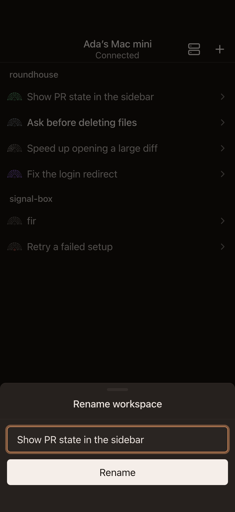
- **`+` starts a workspace in a repository the hub already has,** with the hub's choice of name and branch, as the desktop app does, and opens its chat. Adding a repository needs the hub's computer. *Unconfirmed.*

  **Choosing which repository to start a workspace in.** *Unconfirmed.*

  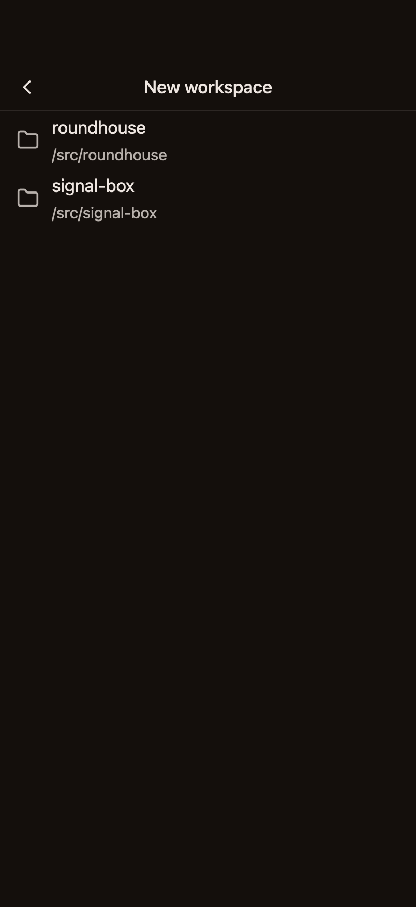

## A chat

- **A chat shows the same transcript as the desktop,** live as the agent works, with what the workspace is called and its branch above it, which change as the hub's record of it does. What the transcript draws from the chat's records, as the desktop's does, follows them too: whether the agent is working, what it left running, its subagents' calls, its proposals, and which workspace a pull request it links to is in, and going to that workspace from the chip's menu opens its chat. *Unconfirmed.*

  **A chat whose turn is over.** *Unconfirmed.*

  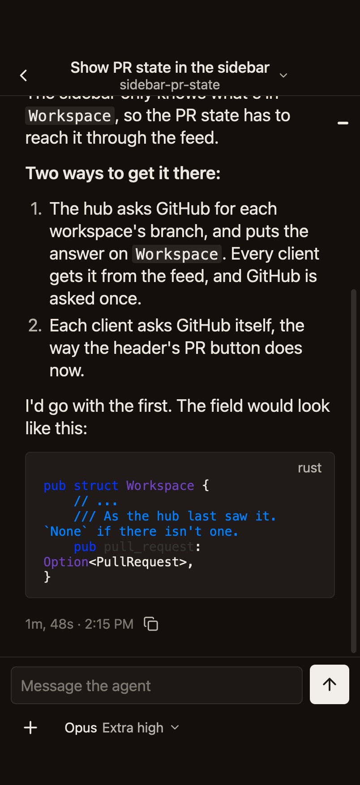

  **A chat whose agent is at work, with Stop in the arrow's place.** *Unconfirmed.*

  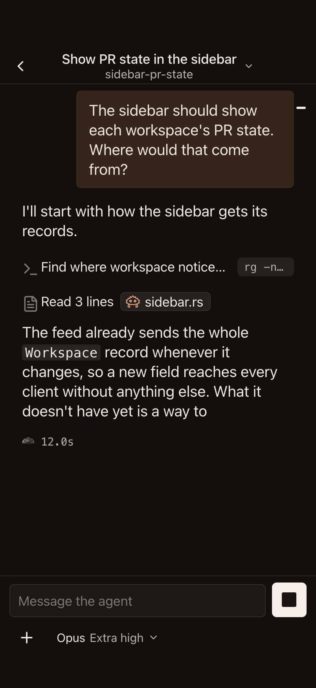

- **Return makes a new line, and the arrow sends.** The on-screen keyboard's Return only ever types a new line, so sending is a button. The composer grows to six lines. *Unconfirmed.*
- **While the agent works, Stop takes the arrow's place for the whole turn,** and ends the turn, as the desktop's Stop does. Once something's typed the arrow shows before it, and sends it to steer the agent, as the desktop's Enter does, since Return can't. So no button turns into another under a finger: once the arrow has sent, what's typed takes its room, and a second tap lands there rather than on Stop, as the owner decided. *Unconfirmed:* the arrow and Stop's order.

  **Something typed, with the arrow ready to send it.** *Unconfirmed.*

  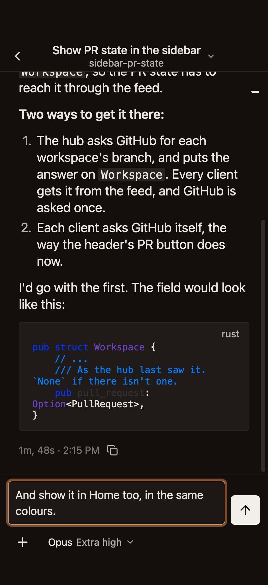

  **Something typed while the agent works, with the arrow to steer it before Stop.** *Unconfirmed.*

  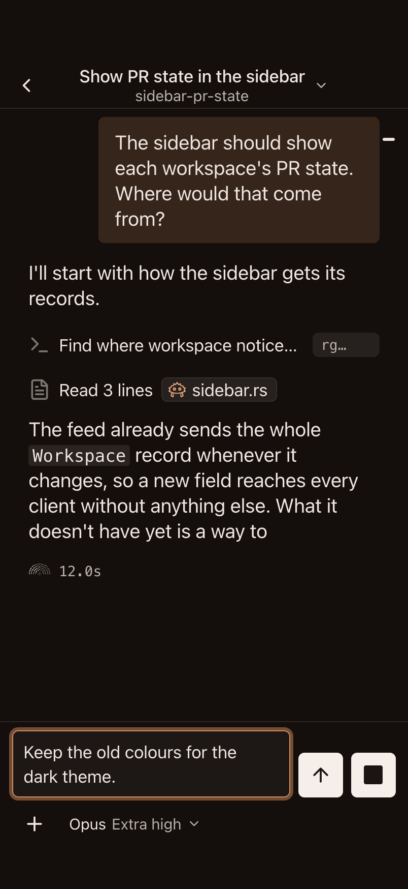

- **What the agent asks, a question or leave to use a tool, takes the composer's place,** in the panel the desktop asks it in, with the answers to tap and a line to type one's own, and the arrow sends it. The composer comes back once it's answered. A plan is approved on its card in the transcript. *Unconfirmed.*

  **A question, in the composer's place.** *Unconfirmed.*

  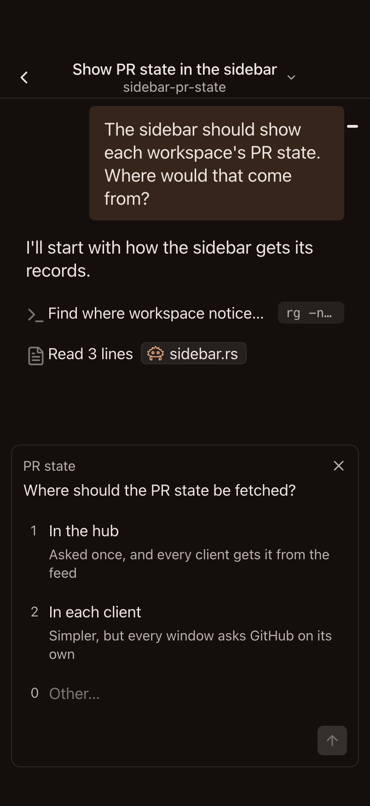

  **Leave to run a command.** *Unconfirmed.*

  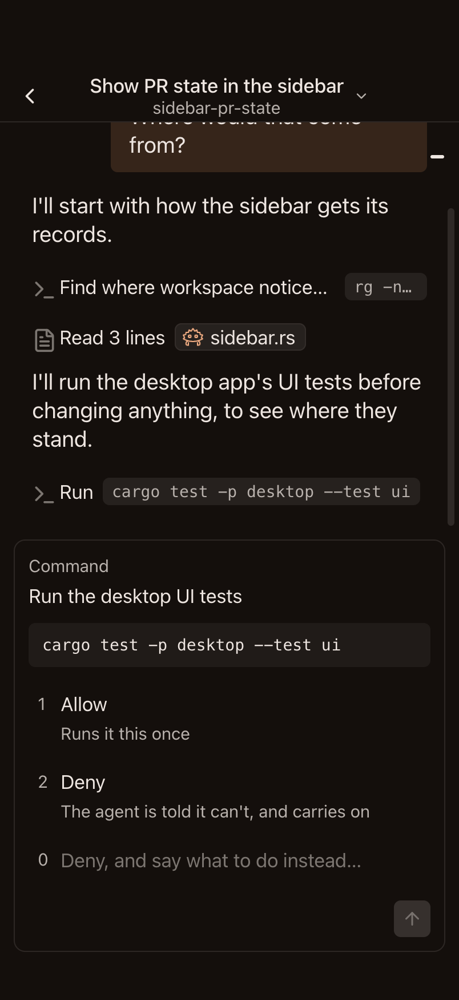

- **Open, on a subagent's line or a proposal's, shows it over the chat,** as a screen of its own with a way back, where the desktop opens it in a tab beside the chat. A subagent's bar names what it's for, then its kind unless it's the default, and where it stands, over its work, which has no composer. A proposal's is its page without the outline, which a phone has no room for beside it, and it's answered there as on the desktop. Opening another shows it in place of the one open, and going back keeps it, so an answer chosen and not sent is still there when it's opened again. A proposal the phone hasn't shown doesn't open by itself, as the desktop's tab does, since that would take the person from what they're reading. *Unconfirmed.*

  **A subagent's work, from its line in the chat.** *Unconfirmed.*

  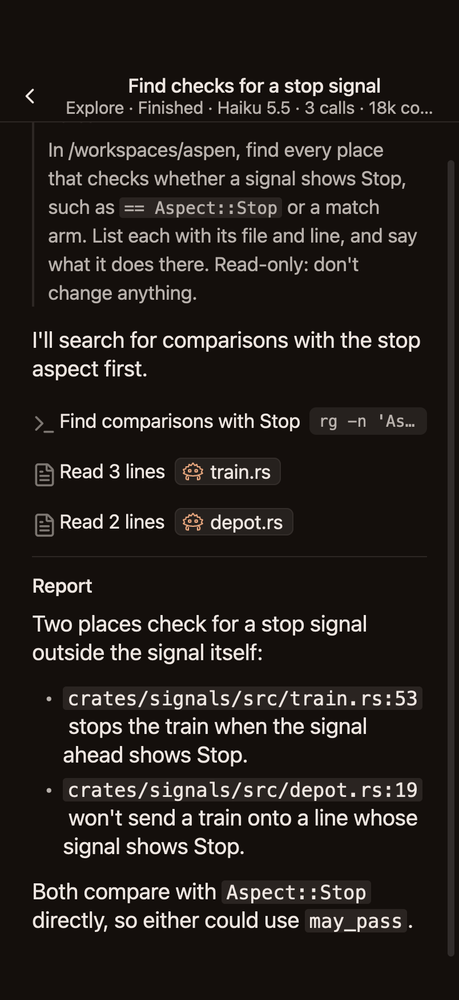

  **A proposal, to answer.** *Unconfirmed.*

  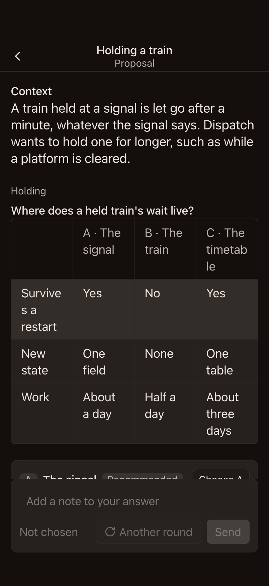

- **A long press on a prompt, a code block or a call opens a menu with Copy first,** as `look.md` says, since nothing rests on them to show the buttons that copy them on the desktop, and one on a chip opens its menu with Copy link first. What's pressed lifts over the dimmed chat, as `components.md` says, as the owner decided. *Not built:* selecting a reply's text by touch.

  **Copy, from a long press on a code block.** *Unconfirmed.*

  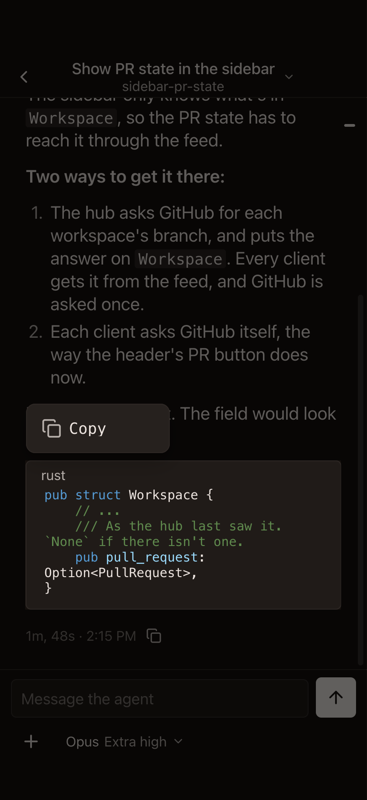

- *Not built:* the transcript at a handheld's sizes, as `look.md` says, which #2208 has. Until it is, the app sets the space between a reply's lines; a question's panel, code blocks and calls' lines are a desk's size; a code block wraps rather than scrolling sideways; a table's columns share its width evenly and break a long word, as a proposal's do; the outline's mark and the scrollbar show as they do under a pointer; and a question's options are numbered, though each number is the option's key, which only a pointer shows.
- **The chat's title opens a menu of the workspace's chats,** where the desktop has a tab for each, as `components.md` says of tabs in a compact layout: each open one, oldest first as the tabs are, with a check on the one shown, then New chat, then those closed, under `Closed chats`, most recently closed first with how long ago. Choosing an open chat shows it in this one's place, New chat starts one on the shown chat's agent, model and effort, as the desktop's does, and choosing a closed one reopens it. The menu is 320 points wide, or the screen's width less a margin each side, and a long title is cut short. *Not built:* closing a chat, a chat's mark in the menu, and a workspace's terminals, which #2356 has. *Unconfirmed.*

  **The menu of the workspace's chats.** *Unconfirmed.*

  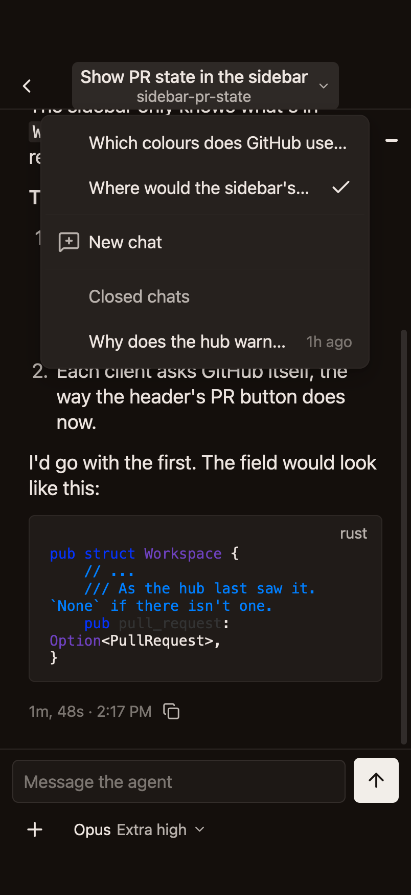

- **What's typed and not sent is kept by the hub for each chat,** as the desktop's is, so it's there after switching chats, leaving the chat or restarting the app, and in every client, and one typed in another client since shows in its place, unless what's typed here is still on its way. What's typed with no connection goes once the phone reconnects, and the hub keeps it only if it was typed after the hub's, as `chats.md` says. Until then it's only in the app's memory, so it's lost if iOS closes the app first, as the owner decided, rather than the phone keeping a copy of its own. Files the desktop attached to a draft stay in it, though the phone doesn't show them, and a prompt sent from the phone goes without them. *Unconfirmed.*
- **A reply is read once its chat is showing in front,** as on the desktop, as `sidebar.md` says: while the app is in front, and no subagent's or proposal's screen is over the chat. One that comes while another app is in front, or the phone is locked, waits until the app's in front again, and one that comes while the hub can't be reached waits until it can. In the chats menu, another chat that needs a look says why at its row's end, `Unread` or `Waiting`, where the desktop's tab stands out. *Unconfirmed.*
- **What the chat runs with is under what's typed, as on the desktop:** the `+` menu, which holds plan mode for an agent that can plan, then the model and its effort, as one button that opens one menu with both, offering what the chat's agent is offered where it runs, as the desktop's picker does, or `Loading models…`, or what went wrong with Retry, while an agent that finds its models is asked. While plan mode is on, `Plan mode` says so in its copper. Each changes once the hub has agreed, and what shows is what the chat's record says. *Not built:* plan mode's texture over the composer, attaching files from the `+` menu, and what switching model costs the chat's cache, which the desktop says while the pointer rests on a model. *Unconfirmed.*

  **The model and its effort, from the button under what's typed.** *Unconfirmed.*

  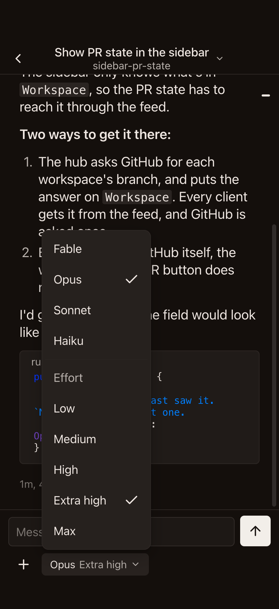

- *Not built:* the diff.

## How it looks

- **It's the desktop's look, at a handheld's sizes,** with the same theme, colours and status marks, and the design system's handheld sizes for text, controls, rows and bars, as the tables in `look.md` give them: body text is 17 points and code 14, in Menlo as on the Mac, and what's tapped is a large control, 44 points tall, as iOS asks. *Not built:* a tap area bigger than what's drawn, so a small control could still be easy to hit. *Unconfirmed.*
- **Every screen has the design system's bar across its top,** as the owner decided, with its name in the middle, what goes back at its start and what's done there at its end, and a row that opens another screen has a chevron at its end, as `components.md` says of both. *Unconfirmed:* the chevron.
- **Choices open as an iPhone's own do:** a menu beside the button that opened it, a context menu on a long press, and a sheet for a task, as `components.md` says, as the owner decided.
- **What a desk shows while the pointer rests on something shows on a tap,** such as a turn's time and what it took, as `components.md` says, as the owner decided, and a tap anywhere else puts it away. *Not built:* in a sheet. *Unconfirmed:* a tap anywhere else putting it away.

  **A turn's card, from a tap on its time.** *Unconfirmed.*

  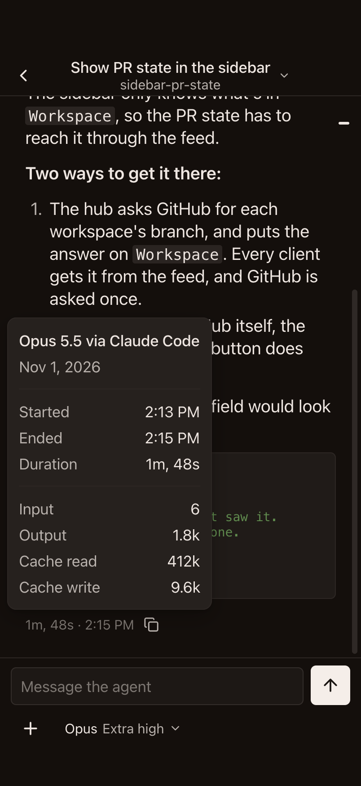

- **It's always dark, and portrait only,** like the desktop app, which has no light theme. *Unconfirmed.*
- **The app icon is the desktop's, drawn for iOS:** the working icon's tile filling the canvas, since iOS rounds it, with the fan as big against the tile as on the Mac. `look::phone_icon` draws it, and the gallery checks it against the asset catalog's in `apps/mobile-ios/ios/`. *Unconfirmed.*

