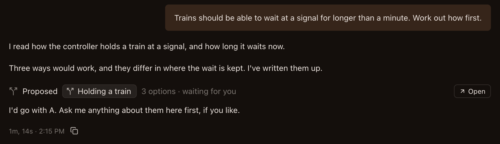
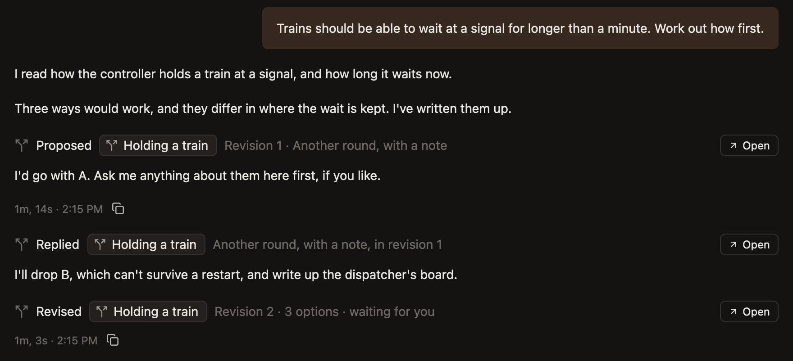
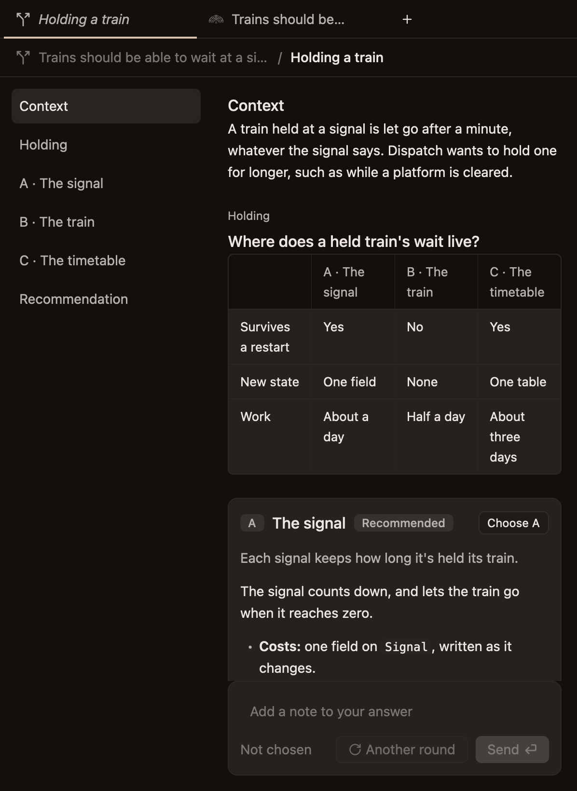
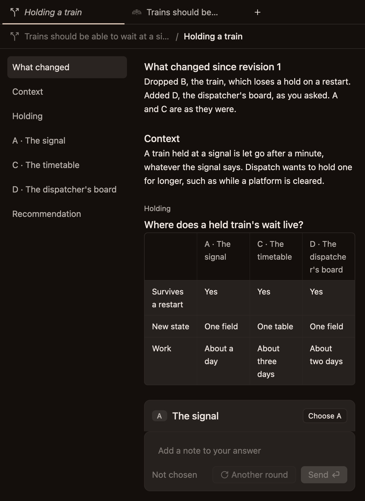
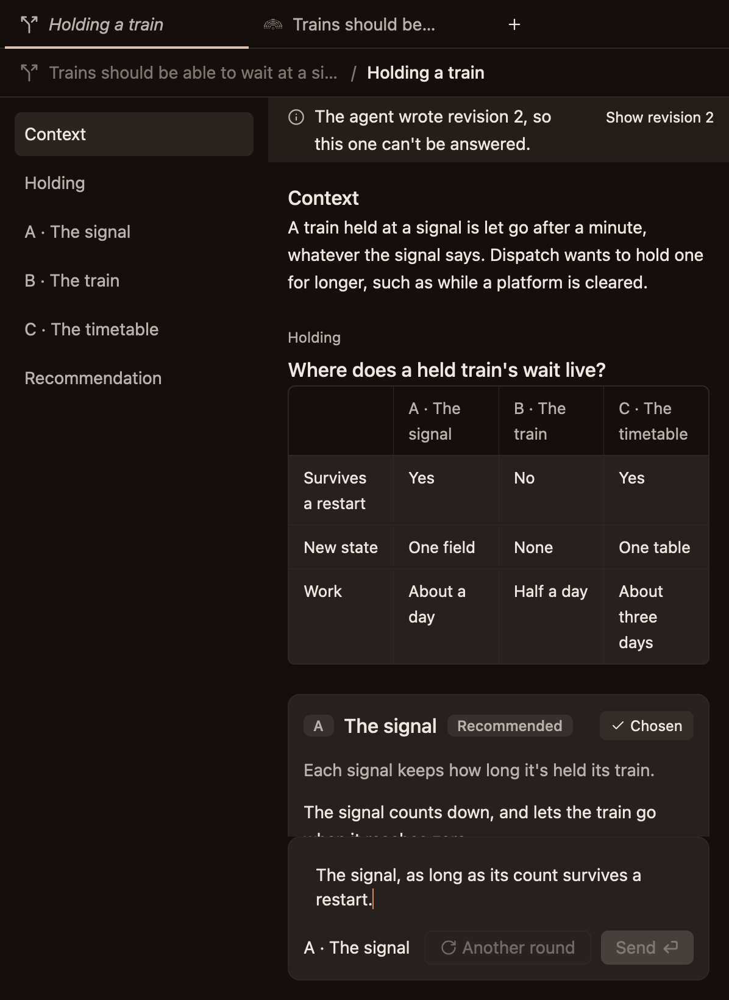
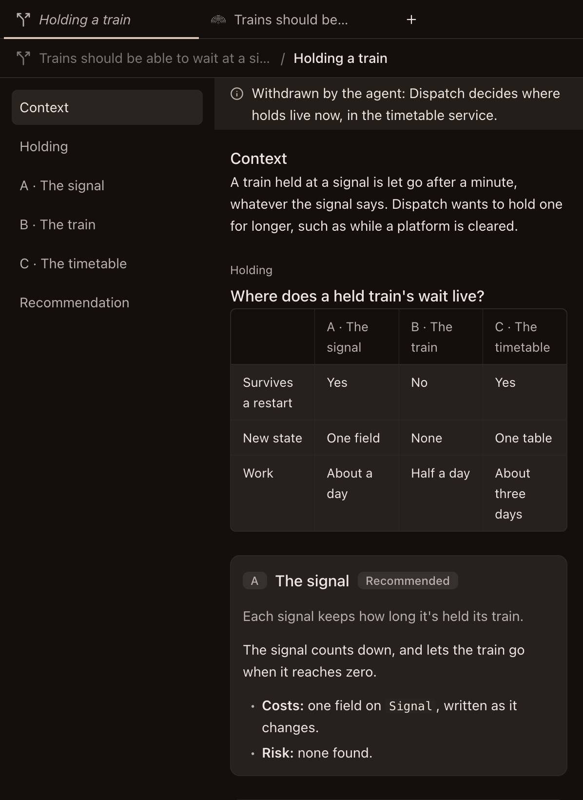

# Proposals

An agent asks the person to decide something with a question, which shows in the composer's place: a header, a sentence or two, and a few short options. That fits a small, bounded choice. It doesn't fit a decision such as which of two or three architectures to build a large feature on, where what's to be read is the context, a comparison, each option in full with what it costs, and the agent's recommendation. A proposal is a second way to ask, for those: a page the agent writes, with two to four options for each question, which the person reads in a tab of its own. #1454 has the design, its mocks and its plan.

## What the agent writes

- **An agent proposes rather than asks when an option needs more than a sentence to describe, or the person needs a comparison, code or a picture to judge the options,** such as choosing between architectures. Its tool's description says so, and so does what every agent is told when Roundhouse serves it tools. *Unconfirmed.*
- **A proposal is written as a structure, not as one document:** a title, which names it, and its context, then one to four questions, each with a header of a few words, the question, what compares its options, such as a table, and two to four options, each with a label, a one-line description and a body, and the option the agent recommends, and why, when it has a view. The context, the comparison, each body and why are Markdown. So the app knows where each option starts and ends, to draw it as a card, to list it in the outline and to choose it, which it would get wrong finding the options among a document's headings whenever the agent wrote one a little differently. Its questions and options are named as a question's are, as `Question` and `QuestionOption` name them, with what only a proposal's have besides: the comparison, each option's body and the recommendation. *Unconfirmed:* the counts and the fields.
- **The agent revises a proposal rather than proposing it again,** whether or not the person has answered the newest, such as when they asked for something the options don't have: it writes the whole proposal again, and what changed since the revision before, which it has to say, and the new revision takes the old one's place. It gives each option it keeps the letter it had, where that makes sense, so the person names it as they did: dropping B leaves C as C. A new option takes the first letter no other option has. Its tools, and what every agent is told when Roundhouse serves it tools, tell it to change a proposal of its own by revising it rather than proposing again, whether or not the person has answered it, such as when they want to decide again, so a decision stays one proposal, whose revisions the person reads in order. *Unconfirmed:* the tool's words, and the letters.
- **The person can ask for another round instead of choosing,** such as when none of the options will do, with a note that says what to change, which it has to have, since it's all the agent has to go on. The prompt the hub writes says so, as `I'd like another round of your proposal "Holding a train" (its ID), without choosing yet. My note says what to change, which get_proposal reads. Then revise it with revise_proposal.`, and names the revision once there are several, as an answer's does. The hub keeps it on that revision as the person's response, as it keeps an answer, so nothing can be chosen in that revision after, and the agent's next revision waits for the person. `get_proposal` says another round was asked for, and the note. *Unconfirmed:* the prompt's words.
- **The agent withdraws a proposal it won't use,** once it's obsolete, such as when the person decided another way in the chat, or the work it was for moved on, so it no longer waits for them, and says why, in a sentence the person reads. Its tools, and what every agent is told when Roundhouse serves it tools, tell it to withdraw each of its proposals that won't be answered, rather than leave it waiting, as the owner asked. A withdrawn proposal takes no answer and no revision, so the agent proposes again instead, and one the person has chosen in can't be withdrawn, since it's settled. *Unconfirmed:* the tool's words, refusing once chosen, and that withdrawing can't be undone.
- **The agent's turn can end while the person reads it.** The tool says it's made at once, so the agent carries on with other work or stops there, and the chat's composer stays free, so the person can ask the agent about it first.
- **The person's answer comes to the agent as a prompt the hub writes, which says only what was chosen,** such as `I chose A, The signal, in your proposal "Holding a train" (its ID).`, which says the revision once there are several, as `in revision 2 of your proposal`, since the agent may have revised it since, and that a note went with it, if one did, which `get_proposal` reads given that revision. An answer to the first revision names none, so `get_proposal` reading the newest, and `revise_proposal`'s reply, say what the person said to the latest revision before it that they responded to, and that `get_proposal` reads it given that revision, so an answer that reaches the agent after it revised is still read as what it was. The agent reads the note, with the rest of the proposal, with `get_proposal`, which says what was chosen and the note once it's answered, and that it waits for the person until then. The hub keeps the answer on the proposal, so every client shows it, and puts the prompt in the chat's queue in the same commit, so no answer is kept without the prompt that tells the agent of it. Taking that prompt out of the queue, before the agent has it, takes the answer back with it, in the same commit, so the proposal waits for the person again, with what they chose still chosen in its tab, to send again or change. *Unconfirmed.* It's sent at once, as the arrow on a queued prompt sends it: while the agent works, into its turn, which it reads at its next chance, such as when a running tool finishes, so it can act on the answer sooner, and otherwise as a turn of its own. Only while the queue is held does it wait there, until the person lets the queue go on or sends it. If the agent is stopped before it reads it, it never gets it, and the answer's line says so, and that the proposal keeps the answer, which the agent reads with `get_proposal` once the person asks it to. *Unconfirmed.* The prompt says it's the hub's, for the answer to that proposal, so no client takes it for something the person said, and a chat's title is never made from it. The same answer sent again, as after a lost reply, tells the agent nothing more. *Unconfirmed:* the prompt's words.

## In the chat

- **The call that proposed is a line of its own:** `Proposed`, the proposal's title in a chip, how many options it has, or how many questions when there are several, and `waiting for you`, or once it's answered, what was chosen, such as `Chose A, The signal`, and `with a note` if one went with it, and an outlined Open button at the far end, which opens it in the proposal tab, as a subagent's opens the subagent tab. The line doesn't open, since the proposal is read in its tab. It's drawn from the proposal's record, which names the call that made it, so a call whose proposal the hub refused, or that hasn't come yet, is drawn as any other tool's. *Unconfirmed.*
- **The prompt that told the agent what was chosen is drawn as a line like it, not as something the person said,** since they answered in the tab: `Answered`, the title in a chip, what was chosen, and Open, where the agent took it. Find doesn't find what it said. The prompt says the hub wrote it for the answer to that proposal, so every client knows it for what it is, and until the proposal's record has come, the line says `Answered a proposal`. The outline has it as the proposal's too, as `chats.md` says. *Unconfirmed.*

  **The line for a proposal with three options, between what the agent said before and after it.** *Unconfirmed.*

  

  **Once A was chosen with a note: the proposal's line says so, and so does the line drawn for the prompt that told the agent, before its reply.** *Unconfirmed.*

  

- **The call that withdrew a proposal is a line of its own:** `Withdrew`, the title in a chip, why, and Open, and the newest revision's line says `withdrawn` where it said `waiting for you`. *Unconfirmed.*

  **After the agent withdrew the proposal, since the person had decided another way in the chat.** *Unconfirmed.*

  

- **The prompt that asked for another round is drawn as a line like an answer's, but `Replied`,** the title in a chip, `Another round, with a note`, and Open, and the line of the revision it replied to says `Another round, with a note` where an answered one says what was chosen. *Unconfirmed.*

- **Each revision the agent writes has a line of its own, at the call that wrote it:** `Revised`, as the first's says `Proposed`, the title in a chip, and Open. Once there are several, each line says which revision its call wrote, as `Revision 2`, and what became of it: the newest's what it asks and that it waits, or what was chosen, and an earlier one's what was chosen, or `Another round, with a note`, or `replaced by revision 2` when the agent revised before the person answered. The line for an answer says which revision it answered, as `Chose D, The dispatcher's board, in revision 2`, so an answer to one the agent has since revised reads as that. *Unconfirmed.*

  **After the person asked for another round, since the proposal didn't have what they wanted: the first revision's line and the line for their request say so, and the call that revised it has a line of its own, waiting.** *Unconfirmed.*

  

## The proposal tab

- **A proposal opens in a tab of its own,** beside the chats, not in the chat or the sidebar of changes, since both are too narrow for a comparison, and a card in the chat would share the pane with the composer.
- **The proposal tab works as the subagent tab does.** A workspace has at most one, and opening another proposal shows that one in the same tab. It covers the chat and its composer until a chat's tab is clicked, and `Cmd-W` closes it while it shows, when the File menu's Close Chat says Close Proposal Tab. It sits with the tabs that are replaced rather than added to, just after the subagent tab when that's open too, and `Ctrl-Tab` comes to it there. It closes when the chat whose proposal it shows does. The tab has the proposal's icon and its title, in italics. Find isn't there while it shows. *Unconfirmed.*
- **It opens by itself for a proposal the workspace hasn't shown yet,** without coming to the front, so a proposal waiting for the person is a tab away without taking them from what they're doing, unless the tab is in front already, showing another, or holds an answer chosen or written and not sent, which showing another would lose. Each proposal opens it by itself once while the app runs, so one the person closed stays closed. *Unconfirmed.* *Not built:* only one that's still waiting for an answer, and the tab's dot.
- **The tab is a page about one proposal.** A band at its top says which chat it's from, faint, before a slash, which shows that chat when clicked, and the proposal's title, as the subagent tab's band does. Below it, an outline of its parts on the left, and the page beside it, in a column as wide as the chat's at most: the context, then each question, its header and its words, what compares its options, each option as a card, and the agent's recommendation, by the option's letter and label, and why. Pressing a part in the outline scrolls the page to it, and the part at the top of the page is marked. With several questions, each question's options and recommendation are set in under it in the outline. *Unconfirmed.*
- **Each option is a card,** with an edge all round and no header across its top, so the options read as separate at a glance: its letter as a badge, its label, Recommended as a badge when it's the one the agent recommends, its description, muted, and its body.
- **What the agent wrote is drawn and selected as the chat's text is,** its Markdown with tables and code, so a selection across the page copies it as it was written, and Markdown the parser can't read doesn't stop the app. *Unconfirmed.*
- **The page scrolls with the keys a chat does, and `Option-Up` and `Option-Down` step it to the part before and the one after in its outline,** as pressing that part does, and as they step a chat between its prompts. Up and down scroll it a line, Page Up and Page Down a screen, and Home and End go to its top and bottom. With Shift, `Option-Up` and `Option-Down` move the end of what's selected to that part's start. *Unconfirmed.*
- **An image the proposal points to in the workspace shows on its page, as one a reply points to does,** such as a diagram the agent drew as an SVG, ``, or a screenshot. It's the file as it was when the agent proposed, which the hub keeps with that revision, so the page shows what the agent meant to show however the file changes after, and every client shows the same. The agent's tool says it can point to one. *Unconfirmed.*
- **A diagram the proposal writes in Mermaid shows on its page as a picture,** as one in a reply does. The agent's tool says to draw a diagram this way. *Unconfirmed.*

  **A proposal in its tab, with the band, the outline, the context, the comparison and the first option.** *Unconfirmed.*

  

- **The tab shows the newest revision, and one the agent revised starts with what changed,** under `What changed since revision 1`, first in the outline too, before its context. Its options keep the letters the agent gave them, so the outline and the cards can skip one, as A, C, D. A revision the agent writes while the person is reading the one before it waits to be shown, as "Answering" says. *Unconfirmed.* *Not built:* the timeline of revisions, in the right sidebar, which shows an earlier one.

  **The second revision, which dropped B and added D: what changed first, and the options A, C and D.** *Unconfirmed.*

  

## Answering

- **Each option's card has Choose at its end,** `Choose A`, edged, as a plan's choices are, which picks it for its question, in place of what was picked before, and turns to `Chosen`, on, with a tick, which picks nothing again when clicked. *Unconfirmed.*
- **The tab's foot is a bar like the composer, under the page:** a note, which says `Add a note to your answer` while it's empty and grows to six lines, then what's chosen for each question, as `A · The signal`, or `Not chosen`, faint, by the question's header when there are several, Another round, edged, with a round arrow, which asks for another round once the note says something, whatever's chosen, and whose tooltip says the note is what to change, and Send, at the far end, which sends once one option is chosen for each question, and shows Return, `⏎`, after its words where there's a pointer, as Create does. Enter sends too, from the note, and Shift-Enter starts a new line. What's chosen and written isn't kept until it's sent, so it's lost when the person opens another proposal in the tab, or the tab closes, or the app quits, though a proposal the agent makes meanwhile doesn't take its place. *Unconfirmed.*
- **Once it's answered, the bar says what was chosen, and the note, muted, and the cards' Choose go, but for Chosen on what was chosen.** An answer can't be changed, so another the person wants is said to the agent in the chat. An answer the hub couldn't take says why in the bar, beside Send, which sends the same answer again, so one the hub kept after all is kept once. *Unconfirmed.*

  **Choosing A, before sending, with the bar at the tab's foot.** *Unconfirmed.*

  

- **A revision the agent writes while the person is reading the proposal, or has chosen or written something in it that they haven't sent, waits to be shown.** The tab stays on the revision it shows, with what's chosen and written, and a banner across the top of the page says `The agent wrote revision 2, so this one can't be answered.`, with `Show revision 2`. Another round and Send are off meanwhile, since the hub refuses a response to a revision the agent has replaced. `Show revision 2` shows it from its top, and so does Open on one of the proposal's lines in the chat. The note goes on to it as it is, and so does what's chosen for each question it still asks, where the option chosen is still there under its letter. The person is reading it while its tab is in front, in the workspace that's showing. A tab behind another, with nothing chosen or written, shows the newest at once, since nobody is reading it. The owner chose this over the newest taking the page and clearing what was chosen and written. *Unconfirmed:* the banner's words, what counts as reading, and that a question keeps its choice only at the same place, under the same header.

  **The agent revised while the person was answering: the banner, the first revision still on the page, and Another round and Send off.** *Unconfirmed.*

  

- **The note can be dictated into, as a question's written answer is,** with the same keys and no microphone, as `chats.md` says, while the tab is in front and the proposal waits for an answer that isn't being sent. The fine line runs along the bar's bottom, as along the composer's, and the recording's controls take the place of what's chosen, `Another round` and Send until the last words are in. Enter while dictating finishes the last words and sends them with the answer, once one option is chosen for each question. The tab going out of sight, such as for the chat, ends the recording, keeping what went in and sending nothing. Its hint words are the proposal's names, such as its options' labels, then the workspace's and its chat's. *Unconfirmed.*

  **Dictating a note, after choosing A.** *Unconfirmed.*

  

- **Once another round is asked for, a banner across the top of the page says `You asked for another round. Revision 2 shows here once the agent writes it.`,** which says nothing of whether the agent has started, since the request may still wait in the queue, the bar says `Another round`, with its round arrow, and the note, muted, and the cards' Choose go. The agent's next revision takes its place in the tab, waiting for the person. One the hub couldn't take says why in the bar, as an answer does. *Unconfirmed.*

  **After asking for another round: the banner, and the note in the bar.** *Unconfirmed.*

  

- **A withdrawn proposal's tab says so in a banner across the top of the page, `Withdrawn by the agent:` and why,** and has no bar at its foot, and its cards no Choose, since nothing more can be said to it. An answer chosen or written and not sent when it's withdrawn can't be sent, and doesn't keep another proposal out of the tab. *Unconfirmed.*

  **A withdrawn proposal in its tab.** *Unconfirmed.*

  

*Not built:* comments on words, the timeline of revisions, the options side by side, and the guide to writing a good proposal, as #1454's plan has them, and keeping what's chosen and written before it's sent, as a question's answer is kept.
