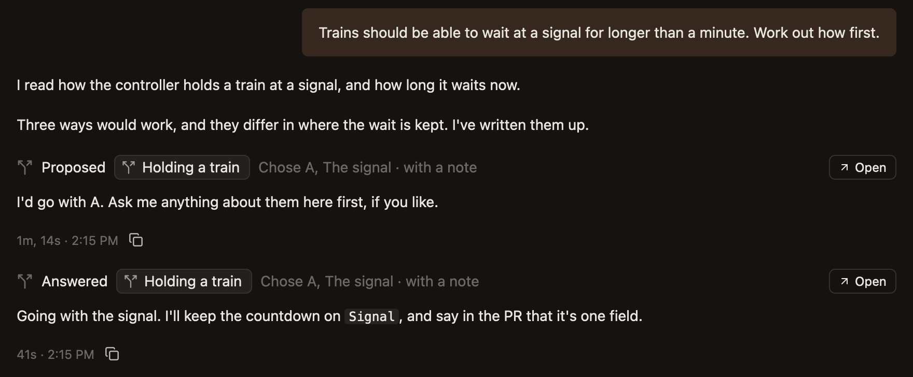
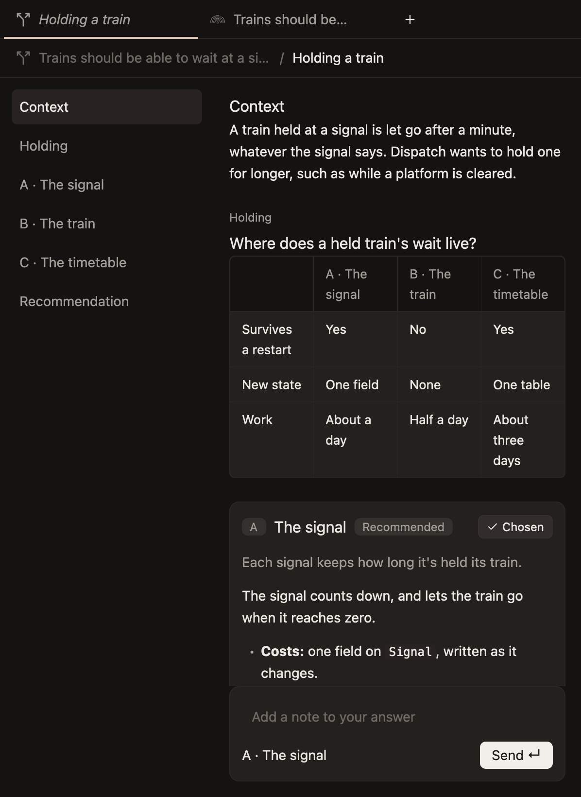

# Proposals

An agent asks the person to decide something with a question, which shows in the composer's place: a header, a sentence or two, and a few short options. That fits a small, bounded choice. It doesn't fit a decision such as which of two or three architectures to build a large feature on, where what's to be read is the context, a comparison, each option in full with what it costs, and the agent's recommendation. A proposal is a second way to ask, for those: a page the agent writes, with two to four options for each question, which the person reads in a tab of its own. #1454 has the design, its mocks and its plan.

## What the agent writes

- **An agent proposes rather than asks when an option needs more than a sentence to describe, or the person needs a comparison, code or a picture to judge the options,** such as choosing between architectures. Its tool's description says so, and so does what every agent is told when Roundhouse serves it tools. *Unconfirmed.*
- **A proposal is written as a structure, not as one document:** a title, which names it, and its context, then one to four questions, each with a header of a few words, the question, what compares its options, such as a table, and two to four options, each with a label, a one-line description and a body, and the option the agent recommends, and why, when it has a view. The context, the comparison, each body and why are Markdown. So the app knows where each option starts and ends, to draw it as a card, to list it in the outline and to choose it, which it would get wrong finding the options among a document's headings whenever the agent wrote one a little differently. Its questions and options are named as a question's are, as `Question` and `QuestionOption` name them, with what only a proposal's have besides: the comparison, each option's body and the recommendation. *Unconfirmed:* the counts and the fields.
- **The agent's turn can end while the person reads it.** The tool says it's made at once, so the agent carries on with other work or stops there, and the chat's composer stays free, so the person can ask the agent about it first.
- **The person's answer comes to the agent as a prompt the hub writes, which says only what was chosen,** such as `I chose A, The signal, in your proposal "Holding a train" (its ID).`, and that a note went with it, if one did. The agent reads the note, with the rest of the proposal, with `get_proposal`, which says what was chosen and the note once it's answered, and that it waits for the person until then. The hub keeps the answer on the proposal, so every client shows it, and puts the prompt in the chat's queue in the same commit, so no answer is kept without the prompt that tells the agent of it. Taking that prompt out of the queue, before the agent has it, takes the answer back with it, in the same commit, so the proposal waits for the person again, with what they chose still chosen in its tab, to send again or change. *Unconfirmed.* The queue sends it as it sends any: once the agent has nothing left to do, and after the hub restarts, and not while the queue is held. The prompt says it's the hub's, for the answer to that proposal, so no client takes it for something the person said, and a chat's title is never made from it. The same answer sent again, as after a lost reply, tells the agent nothing more. *Unconfirmed:* the prompt's words.

## In the chat

- **The call that proposed is a line of its own:** `Proposed`, the proposal's title in a chip, how many options it has, or how many questions when there are several, and `waiting for you`, or once it's answered, what was chosen, such as `Chose A, The signal`, and `with a note` if one went with it, and an outlined Open button at the far end, which opens it in the proposal tab, as a subagent's opens the subagent tab. The line doesn't open, since the proposal is read in its tab. It's drawn from the proposal's record, which names the call that made it, so a call whose proposal the hub refused, or that hasn't come yet, is drawn as any other tool's. *Unconfirmed.*
- **The prompt that told the agent what was chosen is drawn as a line like it, not as something the person said,** since they answered in the tab: `Answered`, the title in a chip, what was chosen, and Open, where the agent took it. Find doesn't find what it said. The prompt says the hub wrote it for the answer to that proposal, so every client knows it for what it is, and until the proposal's record has come, the line says `Answered a proposal`. The outline has it as the proposal's too, as `chats.md` says. *Unconfirmed.*

  **The line for a proposal with three options, between what the agent said before and after it.** *Unconfirmed.*

  

  **Once A was chosen with a note: the proposal's line says so, and so does the line drawn for the prompt that told the agent, before its reply.** *Unconfirmed.*

  

## The proposal tab

- **A proposal opens in a tab of its own,** beside the chats, not in the chat or the sidebar of changes, since both are too narrow for a comparison, and a card in the chat would share the pane with the composer.
- **The proposal tab works as the subagent tab does.** A workspace has at most one, and opening another proposal shows that one in the same tab. It covers the chat and its composer until a chat's tab is clicked, and `Cmd-W` closes it while it shows, when the File menu's Close Chat says Close Proposal Tab. It sits with the tabs that are replaced rather than added to, just after the subagent tab when that's open too, and `Ctrl-Tab` comes to it there. It closes when the chat whose proposal it shows does. The tab has the proposal's icon and its title, in italics. Find isn't there while it shows. *Unconfirmed.*
- **It opens by itself for a proposal the workspace hasn't shown yet,** without coming to the front, so a proposal waiting for the person is a tab away without taking them from what they're doing, unless the tab is in front already, showing another, or holds an answer chosen or written and not sent, which showing another would lose. Each proposal opens it by itself once while the app runs, so one the person closed stays closed. *Unconfirmed.* *Not built:* only one that's still waiting for an answer, and the tab's dot.
- **The tab is a page about one proposal.** A band at its top says which chat it's from, faint, before a slash, which shows that chat when clicked, and the proposal's title, as the subagent tab's band does. Below it, an outline of its parts on the left, and the page beside it, in a column as wide as the chat's at most: the context, then each question, its header and its words, what compares its options, each option as a card, and the agent's recommendation, by the option's letter and label, and why. Pressing a part in the outline scrolls the page to it, and the part at the top of the page is marked. With several questions, each question's options and recommendation are set in under it in the outline. *Unconfirmed.*
- **Each option is a card,** with an edge all round and no header across its top, so the options read as separate at a glance: its letter as a badge, its label, Recommended as a badge when it's the one the agent recommends, its description, muted, and its body.
- **What the agent wrote is drawn and selected as the chat's text is,** its Markdown with tables and code, so a selection across the page copies it as it was written, and Markdown the parser can't read doesn't stop the app. *Unconfirmed.* *Not built:* pictures and diagrams, in SVG or Mermaid.

  **A proposal in its tab, with the band, the outline, the context, the comparison and the first option.** *Unconfirmed.*

  

## Answering

- **Each option's card has Choose at its end,** `Choose A`, edged, as a plan's choices are, which picks it for its question, in place of what was picked before, and turns to `Chosen`, on, with a tick, which picks nothing again when clicked. *Unconfirmed.*
- **The tab's foot is a bar like the composer, under the page:** a note, which says `Add a note to your answer` while it's empty and grows to six lines, then what's chosen for each question, as `A · The signal`, or `Not chosen`, faint, by the question's header when there are several, and Send, at the far end, which sends once one option is chosen for each question. Enter sends too, from the note, and Shift-Enter starts a new line. What's chosen and written isn't kept until it's sent, so it's lost when the person opens another proposal in the tab, or the tab closes, or the app quits, though a proposal the agent makes meanwhile doesn't take its place. *Unconfirmed.*
- **Once it's answered, the bar says what was chosen, and the note, muted, and the cards' Choose go, but for Chosen on what was chosen.** An answer can't be changed, so another the person wants is said to the agent in the chat. An answer the hub couldn't take says why in the bar, beside Send, which sends the same answer again, so one the hub kept after all is kept once. *Unconfirmed.*

  **Choosing A, before sending, with the bar at the tab's foot.** *Unconfirmed.*

  

*Not built:* comments on words, replying without choosing, such as that none of the options will do, and another round, which the agent will write as a revision of the same proposal, kept with the ones before it and the person's response to each, the options side by side, and the guide to writing a good proposal, as #1454's plan has them, and keeping what's chosen and written before it's sent, as a question's answer is kept.
