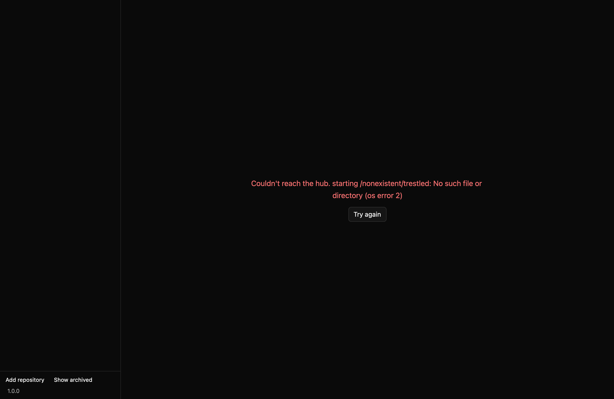
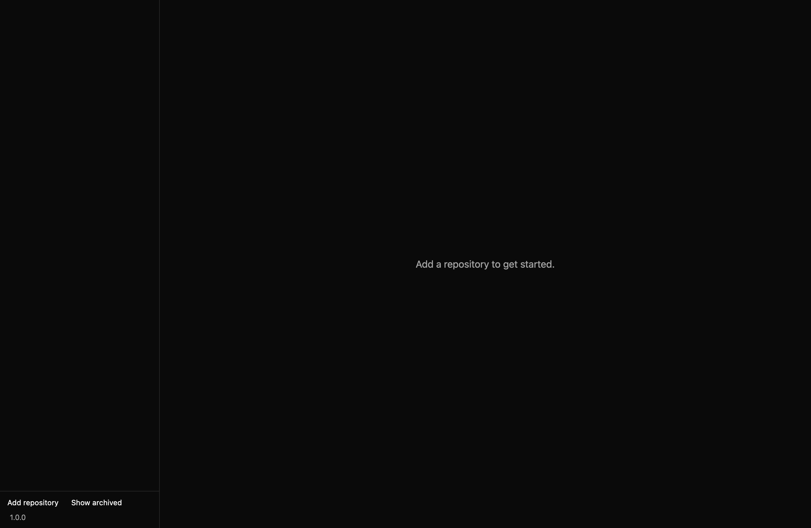
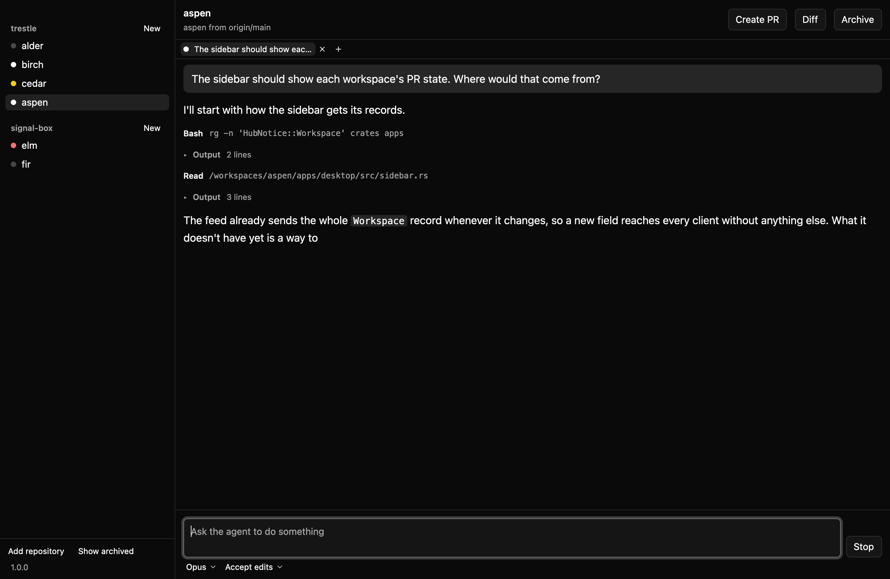
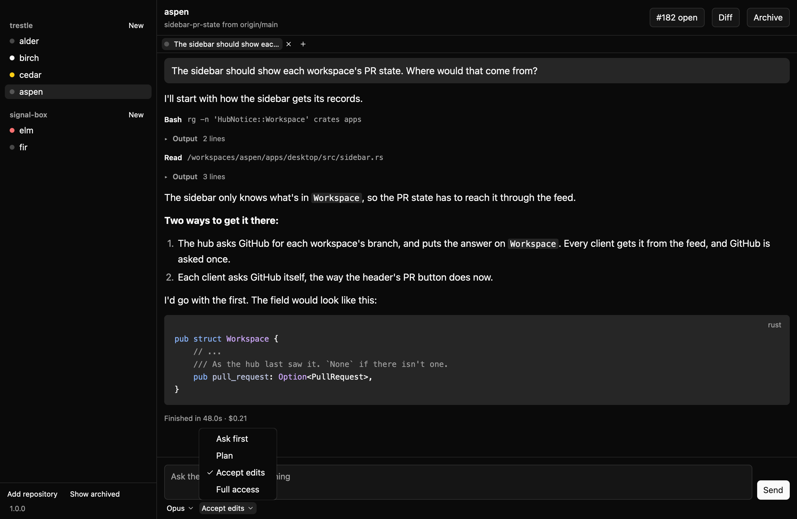
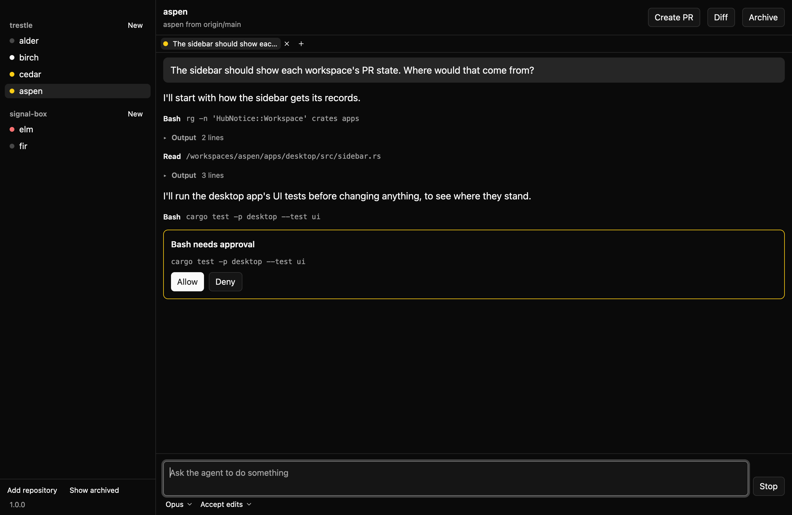
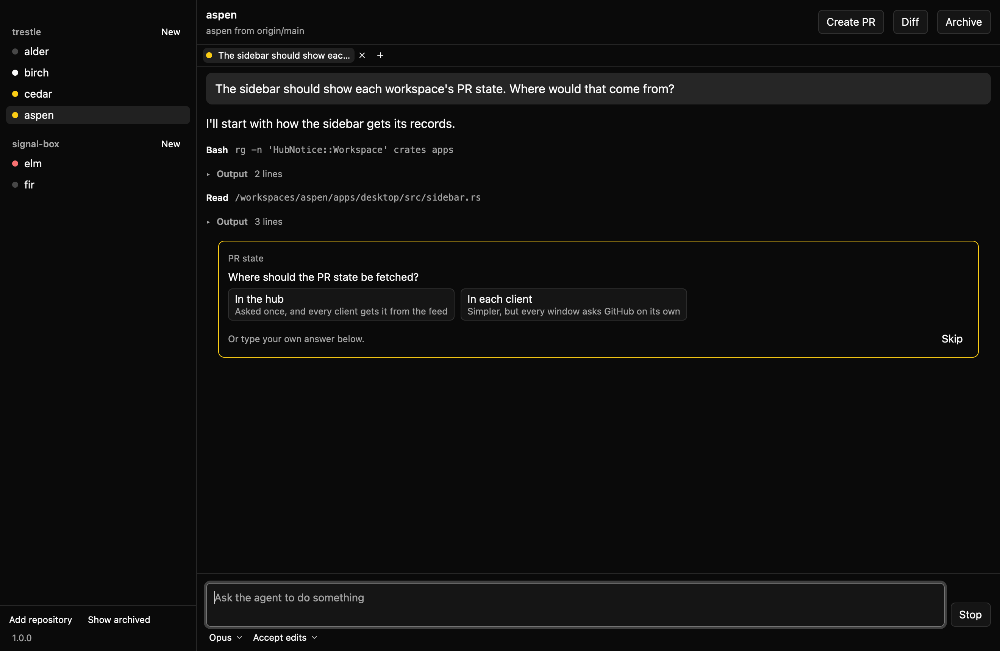
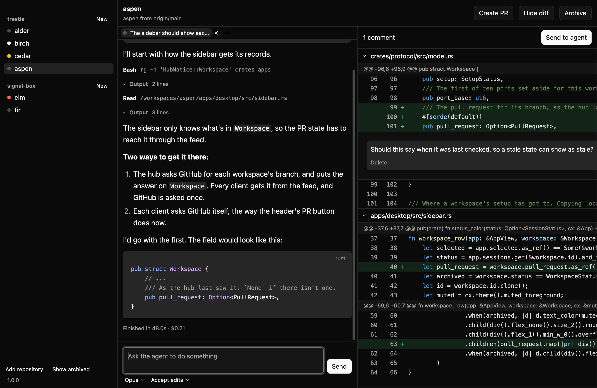
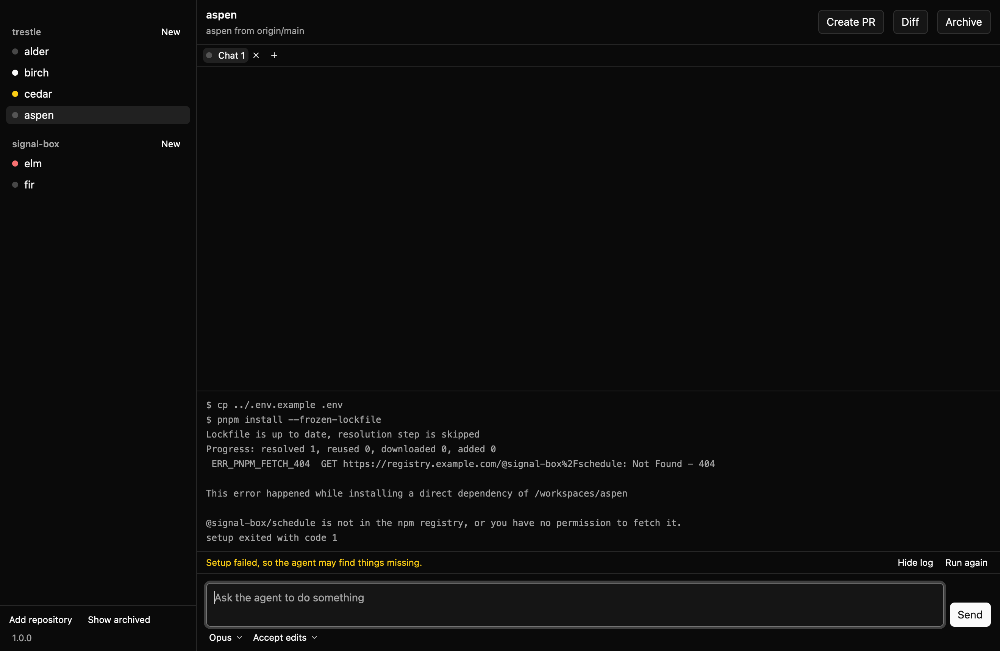

# Screens

How each screen of the desktop app looks. `README.md` says how the images are made, checked and confirmed. Each is a 1320 by 860 window, drawn at twice that size, as on a Retina display.

The data is made up, and every screen with a sidebar has the same one: two repositories, with a workspace in each state a row can show, and `aspen` as the workspace the screen is about.

## No hub

The app couldn't reach a hub, or start one. *Unconfirmed.*

## First run

No repositories. *Unconfirmed.*

## Conversation

A finished turn, with tools, a list and code, and a pull request open for the branch. *Unconfirmed.*

## Streaming

The agent partway through writing a reply. *Unconfirmed.*

## Mode picker

The approval mode's menu, open. *Unconfirmed.*

## Approval

A command waiting to be allowed. *Unconfirmed.*

## Question

A question from the agent, with choices. *Unconfirmed.*

## Diff

The diff beside the chat, with a comment on a changed line. *Unconfirmed.*

## Setup failed

A new workspace whose setup script failed, with its log open. *Unconfirmed.*

